# PolyGlue — Project specification

> **Current development version:** `0.0.1` (unreleased, local/CI testing only).
>
> **Status:** planned, not implemented. This document is the source of truth for implementation and review. Examples specify intended behavior. They are not evidence of an existing implementation.

Always write the product name as PolyGlue, with an uppercase P and G, in documentation, headings, branding, illustrations and user-facing text. Keep lowercase polyglue for technical identifiers such as the Python package, CLI command and repository path. Preserve language-specific identifier conventions.

## Contents

Start with chapters 1 through 5 if this is your first time using a cross-language generator. Chapters 6 through 11 explain generation and customization. Chapters 12 through 16 explain what happens at runtime. Chapters 17 through 22 explain the examples, tests and distribution. Section 22 is the single detailed implementation checklist. AGENTS.md holds the permanent engineering rules and matching reference tables without diagrams.

- [1. Product and scope](#1-product-and-scope)
- [2. Supported languages and platforms](#2-supported-languages-and-platforms)
- [3. Developer workflow and distribution](#3-developer-workflow-and-distribution)
- [4. IDL language](#4-idl-language)
  - [Static operations and factories](#46-static-operations-and-factories)
  - [Inheritance, properties, overloads and generic specialization](#47-inheritance-properties-overloads-and-generic-specialization)
  - [Concrete generic ownership and resolver limits](#471-concrete-generic-ownership-and-resolver-limits)
  - [Declaration syntax and semantic validation baseline](#48-declaration-syntax-and-semantic-validation-baseline)
- [5. Type system](#5-type-system)
  - [Complete type mapping contract](#54-complete-type-mapping-contract)
  - [Canonical equality, numeric conversion and legal value positions](#541-canonical-equality-numeric-conversion-and-legal-value-positions)
  - [One Dart API across native and web](#542-one-dart-api-across-native-and-web)
  - [Concrete lowering rules for every type family](#543-concrete-lowering-rules-for-every-type-family)
  - [Compound values, equality and non-void host generics](#544-compound-values-equality-and-non-void-host-generics)
  - [Initialization, destruction and execution-domain properties of types](#545-initialization-destruction-and-execution-domain-properties-of-types)
  - [Concrete value model and conversion policy](#546-concrete-value-model-and-conversion-policy)
  - [Built-in date and time types](#56-built-in-date-and-time-types)
  - [Custom and external type extension system](#57-custom-and-external-type-extension-system)
  - [Optional values, nulls and defaults](#58-optional-values-nulls-and-defaults)
  - [How each value crosses languages](#59-how-each-value-crosses-languages)
    - [Records and generic records](#records-and-generic-records)
    - [Enums](#enums)
    - [Flags](#flags)
    - [Variants](#variants)
    - [Lists and arrays](#lists-and-arrays)
    - [Sets and maps](#sets-and-maps)
- [6. Modules and dependencies](#6-modules-and-dependencies)
  - [Conventional implementation layout](#611-conventional-implementation-layout)
  - [Module versions and dependency identity](#621-module-versions-and-dependency-identity)
- [7. Module-first configuration](#7-module-first-configuration)
  - [Operational defaults and diagnostics](#763-operational-defaults-and-diagnostics)
  - [Library and build configuration](#77-library-and-build-configuration)
  - [Per-platform native build configuration](#773-per-platform-native-build-configuration)
  - [Library version and build number](#78-library-version-and-build-number)
  - [Single configuration and runtime options inventory](#710-single-configuration-and-runtime-options-inventory)
- [8. Naming and file formatting](#8-naming-and-file-formatting)
  - [Complete public naming defaults](#85-complete-public-naming-defaults)
  - [Formatting and customization profiles](#86-formatting-and-customization-profiles)
  - [Idiomatic public signatures and Swift import defaults](#87-idiomatic-public-signatures-and-swift-import-defaults)
  - [Public signature resolution and identity](#88-public-signature-resolution-and-identity)
  - [Swift signature grammar and Apple exposure](#89-swift-signature-grammar-and-apple-exposure)
  - [Idiomatic callable surfaces for every target](#810-idiomatic-callable-surfaces-for-every-target)
  - [Public API without generator artifacts](#811-public-api-without-generator-artifacts)
- [9. Annotations and platform attributes](#9-annotations-and-platform-attributes)
- [10. Output layout and import resolution](#10-output-layout-and-import-resolution)
  - [Unified library public entry points](#105-unified-library-public-entry-points)
  - [Shared target artifact ownership](#106-shared-target-artifact-ownership)
  - [One public Apple module without language suffixes](#1061-one-public-apple-module-without-language-suffixes)
  - [Composition of libraries](#107-composition-of-libraries)
- [11. Compiler and templates](#11-compiler-and-templates)
  - [Compiler pipeline](#111-pipeline)
  - [Template override system](#115-template-override-system-mandatory)
  - [Compiler input bounds, trust and transactional output](#117-compiler-input-bounds-trust-and-transactional-output)
- [12. Native runtime and ABI](#12-native-runtime-and-abi)
  - [Call and return across the ABI](#123-call-and-return-across-the-abi)
  - [Contexts, attachments and admission](#124-contexts-attachments-and-admission)
  - [Public lifecycle control and errors](#125-public-lifecycle-control-and-errors)
  - [Handle identity, contract fingerprints and start/completion invariants](#126-handle-identity-contract-fingerprints-and-startcompletion-invariants)
  - [Physical ABI baseline and compatibility gates](#127-physical-abi-baseline-and-compatibility-gates)
  - [Canonical recursive contract fingerprints](#128-canonical-recursive-contract-fingerprints)
  - [Explicit initialization, construction and teardown](#129-explicit-initialization-construction-and-teardown)
  - [Operational ABI contract and ownership inventory](#1210-operational-abi-contract-and-ownership-inventory)
  - [Shared core acquisition across independently built libraries](#1211-shared-core-acquisition-across-independently-built-libraries)
  - [Handle ownership tickets, status and delivery protocol](#1212-handle-ownership-tickets-status-and-delivery-protocol)
- [13. Memory and buffers](#13-memory-and-buffers)
  - [Reference and value ownership matrix](#1321-reference-and-value-ownership-matrix)
  - [Host-specific memory and execution rules](#1322-host-specific-memory-and-execution-rules)
  - [Proxy identity, root pressure and cycles](#1323-proxy-identity-root-pressure-and-cycles)
  - [Borrow scopes and aliasing](#135-borrow-scopes-and-aliasing)
  - [DataRef storage ownership and zero-copy](#136-dataref-storage-ownership-and-zero-copy)
  - [Owner retirement and executable-code lifetime](#1361-owner-retirement-and-executable-code-lifetime)
  - [Memory domains and platform boundaries](#137-memory-domains-and-platform-boundaries)
  - [JavaScript buffer integration through the shared WASM core](#1371-javascript-buffer-integration-through-the-shared-wasm-core)
  - [Configurable resource limits and diagnostics](#138-configurable-resource-limits-and-diagnostics)
  - [Aggregate budgets and reservations](#1381-aggregate-budgets-and-reservations)
  - [Race invariants and runtime observability](#1382-race-invariants-and-runtime-observability)
  - [Allocation and lifetime accounting boundaries](#1383-allocation-and-lifetime-accounting-boundaries)
  - [Prior-art and official platform review](#139-prior-art-and-official-platform-review)
  - [Buffer and ownership flows](#134-buffer-and-ownership-flows)
- [14. Asynchronous operations callbacks and streams](#14-asynchronous-operations-callbacks-and-streams)
  - [Async, callbacks, cancellation and streams in motion](#145-async-callbacks-cancellation-and-streams-in-motion)
  - [Listeners and subscription patterns](#146-listeners-and-subscription-patterns)
  - [Default delivery and callback scope](#1431-default-delivery-and-callback-scope)
  - [Stream acquisition, subscription and terminal state](#1432-stream-acquisition-subscription-and-terminal-state)
  - [Demand and item conversion](#1433-demand-and-item-conversion)
  - [Capture, acceptance and publication](#1441-capture-acceptance-and-publication)
  - [Cancellation authority and observer lifetime](#1442-cancellation-authority-and-observer-lifetime)
  - [Scheduler rejection and shutdown accounting](#1443-scheduler-rejection-and-shutdown-accounting)
  - [Stream and callback adapter lifecycle](#1444-stream-and-callback-adapter-lifecycle)
  - [Prepared operations, result materialization and terminal commitment](#1445-prepared-operations-result-materialization-and-terminal-commitment)
  - [Threads, executors, event loops and asynchronous I/O](#147-threads-executors-event-loops-and-asynchronous-io)
  - [Language and platform execution profiles](#1474-language-and-platform-execution-profiles)
  - [Application-created threads and direct native entry](#1475-application-created-threads-and-direct-native-entry)
  - [Bidirectional thread interoperability by language](#1476-bidirectional-thread-interoperability-by-language)
  - [Blocking native HTTP from a host-owned worker: concrete usage](#1477-blocking-native-http-from-a-host-owned-worker-concrete-usage)
  - [Cross-thread handles, cancellation, close and conformance evidence](#1478-cross-thread-handles-cancellation-close-and-conformance-evidence)
  - [Explicit capability transfer and scheduler guarantees](#1479-explicit-capability-transfer-and-scheduler-guarantees)
  - [Runtime lifecycle, suspension and host-specific availability](#14710-runtime-lifecycle-suspension-and-host-specific-availability)
- [15. Interfaces and service discovery](#15-interfaces-and-service-discovery)
  - [Direct references and service registry flows](#155-direct-references-and-service-registry-flows)
  - [Registry identity, contexts and public API](#156-registry-identity-contexts-and-public-api)
  - [Registration policies and deterministic restoration](#157-registration-policies-and-deterministic-restoration)
  - [Three-layer application example](#158-three-layer-application-example)
  - [Registration ownership, detach and shutdown](#159-registration-ownership-detach-and-shutdown)
- [16. Language-specific integration](#16-language-specific-integration)
  - [Host attachment and disposal integration](#1620-host-attachment-and-disposal-integration)
- [17. Example applications](#17-example-applications)
  - [HTTP execution, ownership and cancellation across all targets](#1721-http-execution-ownership-and-cancellation-across-all-targets)
- [18. Test specification](#18-test-specification)
  - [Coverage and test design policy](#180-coverage-and-test-design-policy)
  - [Mandatory 100% Python generator coverage](#1801-mandatory-100-python-generator-coverage)
  - [Registry and listener lifecycle conformance](#187-registry-and-listener-lifecycle-conformance)
  - [Deterministic lifecycle race fixtures](#188-deterministic-lifecycle-race-fixtures)
  - [Default profiles and installed public API conformance](#189-default-profiles-and-installed-public-api-conformance)
  - [Cross-contract and ownership regression fixtures](#1810-cross-contract-and-ownership-regression-fixtures)
  - [Cross-boundary consistency checks](#1811-cross-boundary-consistency-checks)
  - [Type and ownership audit acceptance](#1812-type-and-ownership-audit-acceptance)
  - [Consolidated semantic, ABI and lifecycle acceptance](#1813-consolidated-semantic-abi-and-lifecycle-acceptance)
  - [Execution-domain, initialization and HTTP conformance](#1814-execution-domain-initialization-and-http-conformance)
  - [Application-owned thread and reverse-callback conformance](#1815-application-owned-thread-and-reverse-callback-conformance)
  - [Independent coverage, regression and performance gates](#1816-independent-coverage-regression-and-performance-gates)
  - [Final contract closure and negative evidence](#1817-final-contract-closure-and-negative-evidence)
  - [Public signature and importer conformance](#1818-public-signature-and-importer-conformance)
  - [No-leakage public API conformance](#1819-no-leakage-public-api-conformance)
- [19. GitHub Actions](#19-github-actions)
  - [Isolated CI execution](#1911-isolated-ci-execution)
  - [Fast CI and cache policy](#196-fast-ci-and-cache-policy)
  - [CI trust boundaries](#1961-ci-trust-boundaries)
- [20. Repository documentation and branding](#20-repository-documentation-and-branding)
  - [README and logo](#202-readme-and-logo)
  - [Native build system and CMake organization](#204-native-build-system-and-cmake-organization)
  - [Conventional module CMake integration](#2044-conventional-module-cmake-integration)
  - [Project-owned CMake entrypoint and generated integration](#2045-project-owned-cmake-entrypoint-and-generated-integration)
  - [Python build orchestration and artifact pipeline](#205-python-build-orchestration-and-artifact-pipeline)
  - [Trusted project-local Python actions](#2052-trusted-project-local-python-actions)
  - [Binary and package outputs by target](#206-binary-and-package-outputs-by-target)
  - [Per-platform build recipes and consumer integration](#2065-per-platform-build-recipes-and-consumer-integration)
  - [Generated build and test projects](#2066-generated-build-and-test-projects)
  - [Library deployment to S3-compatible object storage](#2010-library-deployment-to-s3-compatible-object-storage)
- [21. Implementation phases and reviews](#21-implementation-phases-and-reviews)
- [22. Implementation and acceptance checklist](#22-implementation-and-acceptance-checklist)
  - [Repository and tooling](#221-repository-tooling-and-engineering-rules)
  - [Compiler and IDL](#222-compiler-idl-and-diagnostics)
  - [Modules and configuration](#223-module-system-configuration-and-output-planning)
  - [Templates and annotations](#224-templates-and-annotations)
  - [Built-in and external types](#225-built-in-types-and-extension-mechanism)
  - [Runtime and ownership](#226-native-abi-ownership-and-runtime)
  - [Language backends](#227-language-specific-backends-and-platform-support)
  - [Build and artifacts](#228-cmake-python-build-tool-and-binary-artifacts)
  - [Applications and conformance](#229-real-applications-and-conformance)
  - [CI and delivery](#2210-ci-performance-documentation-and-final-delivery)

## 1. Product and scope

**One definition. Multiple languages. Native interoperability.**

Imagine a Flutter app that needs an Android feature written in Kotlin and an iOS feature written in Swift. Without a shared contract, developers often write the same data models and connecting code separately, and must keep the signatures, error handling and memory rules in sync.

PolyGlue is designed to solve this problem. Write a contract once in an Interface Definition Language (IDL). The Python generator creates native-looking types and bindings for each selected language. A binding is the connecting code that lets one language call another. The application still supplies the real implementation of each method. The runtime is a small support library used at execution time. It is not a server and it does not require JSON or Python in non-Python applications.

Start with the platform scope in section 2, follow the developer workflow in section 3, and learn the IDL and type mappings in sections 4 and 5. Sections 6 through 11 explain how files are generated. Sections 12 through 16 explain what happens when the program runs. Sections 17 through 22 explain how to prove the behavior, build, distribute and complete the project.

### 1.0 The idea in one picture

The same contract generates both sides of a connection. At run time either language can be the caller or the implementation, when their runtimes can safely coexist.

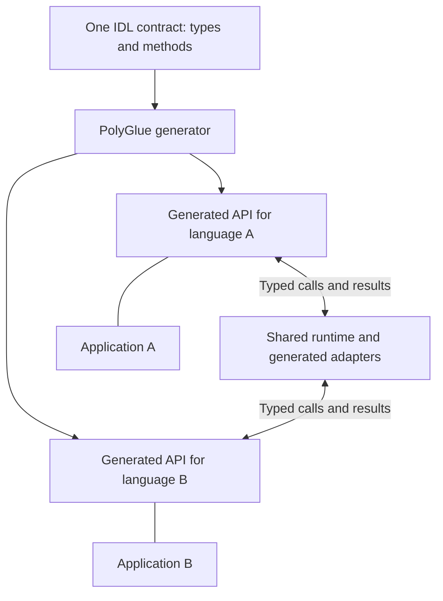

Terms used throughout this document:

| Term | Meaning |
| --- | --- |
| IDL | A language-neutral description of types and operations |
| Record | A named group of values, such as a user |
| Interface | A contract describing what methods an object offers |
| Consumer | Code that calls a method |
| Provider | Code that implements the method |
| Proxy | A generated object that forwards a call to another implementation |
| Adapter | Generated code that converts values and invokes the correct runtime |
| ABI | The binary rules both sides follow when calling each other |
| Service registry | An optional place to register and find implementations |
| Project | A collection of IDL modules, library definitions and shared configuration |
| IDL module | Logical compilation and dependency unit, independent of a language import namespace |
| Target | A selected programming language or integration profile |
| Library | The reusable public API and implementation delivered to a consumer |
| Public module / namespace / package | The language-native name through which a consumer imports the library |
| Package | An ecosystem-specific installable distribution of a library |
| Artifact | An actual generated or built file, archive or package |
| Runtime | Native support code that connects compatible language attachments |
| SDK | A broader development kit or a third-party platform toolchain, such as Android SDK or Apple SDK |

A record carries data, an enum names allowed choices, and an interface describes actions. A service is an interface implementation registered for discovery. PolyGlue generates the connection between languages, not the application's business logic.

For a first project, start with a record and one interface method. Generate bindings for two languages, implement the method in one language and call it from the other. Once that works, add a second module, optional values, asynchronous methods and callbacks. Use shared buffers when the application needs to avoid copying large data. Use the registry when the application needs to find or replace an implementation at runtime. Build and package the library after the calls work. Deployment is optional. The later chapters explain each step in depth.

**Product priority.** PolyGlue is first a source generator. P0: correct, deterministic, intelligent Python generation for all declared targets, 100% Python statement and branch coverage, and real compile/run conformance of generated bindings with the shared runtime. P1: conventional per-platform build and package convenience, including handwritten implementations, AAR and XCFramework assembly. P2: optional distribution/deploy convenience, including S3/R2. Real native builds and execution for P0 conformance do not depend on completion of the P1/P2 CLI. All remain required planned deliverables before full project release; P1/P2 must not delay the generator. No native SDK, cloud access or local Python/CMake execution is required to generate source.

### 1.1 Required outcomes

**Convention over configuration.** Public API naming, actual module/package/namespace, output and build integration, public presentation and template overrides have deterministic documented defaults and granular overrides where meaningful. Internal symbol names, temporary variables, private storage, marshalling strategies and core algorithms are generator responsibilities, not configuration categories. A minimal module works without copying a large template. Do not expose a choice unless its user-visible benefit or distinct integration requirement is documented.

**Language-native public APIs.** Generate independently planned public APIs for every selected language, not literal transliterations of C ABI names or another language's syntax. Swift must not expose generated Objective-C prefixes by default (explicit overrides are supported), Kotlin must not inherit JNI names, and Dart must not expose C handles as ordinary application types. Public calls use native types, error and async conventions whenever they preserve the canonical contract. The application selects the implementation language independently of the public language. No compromise to ownership, type precision, ABI compatibility or executor safety is permitted to make a signature appear idiomatic.

**One library, one public entry point by default.** An explicitly selected library may aggregate several IDL modules into a single native public import surface without erasing their logical identities. Independent modules remain usable without a library definition. A library is not a new IDL namespace, service registry or network boundary. See sections 7.7 and 10.5.

- One IDL can describe data models, repositories, services, callbacks, factories and asynchronous operations.
- A module can import data models and interfaces defined or generated in another module.
- A developer can implement a contract in Kotlin and consume it from Flutter, C++ or another available runtime. The same contract can also be implemented in Dart or Swift.
- Native calls can share memory without copying when supported, and make copying explicit when necessary.
- Every module can choose independent output directories, packages, namespaces, prefixes, naming conventions, annotations and build integration.
- The generator and native support libraries live in one repository and are released and tested together.
- An optional registry allows runtime service discovery and replacement. Ordinary interface references work without it.

### 1.2 Non-goals and decisions

| Topic | Decision |
| --- | --- |
| Existing IDL compatibility | None. Design an independent language |
| Protocol Buffers | Out of scope |
| Network RPC | Out of scope. No mandatory transport or serialization |
| Provider as built-in IDL type | Omit. Interfaces and callbacks implement factories |
| Future syntax | Use `async` in IDL. Futures are runtime/target representations |
| Result / Outcome | Use `Result<T, E>` for typed business errors |
| Global service locator | Optional, never required to invoke an interface |
| Python in production | Only when Python is a selected application runtime |
| External formatters | Optional. Generated source is readable by default |
| Universal cross-runtime sync dispatch | Do not promise where thread or isolate constraints make it unsafe |

Use original implementations. Preserve required third-party notices when dependencies are used. Do not copy existing generator or runtime source. Prefer fewer dependencies and a small, well-tested runtime. No unverified feature claims.

### 1.3 Engineering boundaries

The final implementation must be small, direct and maintainable. Use the simplest architecture that satisfies the explicit requirements. Do not add features, dependencies, extension frameworks, generators, wrappers or tests just to demonstrate activity. Every component must serve a real consumer, a documented contract or a credible failure mode.

Implement only the new final contract. Remove replaced implementations, obsolete configuration, compatibility aliases, version-detection branches, dead code and unused dependencies together with their callers. Do not preserve old PolyGlue APIs, IDL, configuration, manifest or ABI formats. Version and ABI checks remain necessary to reject incompatible current artifacts safely, not to route old versions to legacy code. Never hide failure with default values, silent retries, alternate implementation selection, ignored errors or compatibility workarounds. Explicit template inheritance, a deliberately selected provider override and safe resource finalization are defined behavior, not error-recovery fallbacks. Unsupported operations must fail with useful diagnostics.

Follow the owner rules in AGENTS.md. Review actual impact, fix substantiated problems and do not perform unrelated speculative refactors. Preserve user data, unrelated work, security and release authorization.

**Architecture budget.** Organize the implementation around five responsibilities: IDL/configuration; one canonical compiler and semantic IR; language-native backend planning/rendering; one shared interoperability core and host-family adapters; and a thin build/package/deploy orchestrator. A responsibility does not mandate a class, package or framework. Prefer plain typed data, small functions and composition over abstract factories, dynamic plugins or extra registries. Before adding a mechanism, identify its distinct semantics and why an existing one cannot implement it. Reuse safe machinery without merging different public contracts. Measure before introducing caches, pooling, reflection or specialized fast paths; no speculative alternate implementation. Do not introduce an application framework, network RPC, event bus, scheduler framework, package manager or separate runtime per language.

## 2. Supported languages and platforms

### 2.1 Language targets

Every language must be able to act as a consumer and as an implementation provider where its runtime permits the operation.

| Target | Boundary | Async surface |
| --- | --- | --- |
| C | Versioned C ABI | Completion function and opaque operation handle |
| C++ | C++20 interface / C ABI adapter | Awaitable / future |
| Java | JNI | CompletableFuture |
| Kotlin | JNI / JVM | suspend function |
| Objective-C | Objective-C++ | Completion block |
| Swift | Native Apple adapter | async throws |
| Python | CPython adapter | awaitable / async def |
| Dart | Dart FFI or web adapter | Future |
| Flutter | Dart bindings plus native plugin | Future |
| C# | .NET interop | Task |
| JavaScript | WebAssembly / JS adapter | Promise |
| TypeScript | JS implementation plus type declarations | Promise |

Flutter is an integration target, not a separate language. JavaScript and TypeScript share implementation artifacts by default in a jointly declared package, as defined in section 10.6. Java and Kotlin share JVM models by default when jointly declared in a paired JVM library as defined in section 10.6; independent ownership remains configurable. Swift and Objective-C can share imported types or use distinct namespaced wrappers. Never generate conflicting definitions.

| Host family | Shared implementation boundary |
| --- | --- |
| C/C++ | One native core, one typed C ABI, C++ RAII facade |
| Java/Kotlin | One JNI support layer, handle/root management and shared model conversion; native public async shapes differ |
| Objective-C/Swift | One Apple host integration, native C ABI and shared ARC/ownership support where legal; independent public callable surfaces |
| Python | One CPython integration |
| Dart/Flutter | One Dart API and native FFI adapter; Flutter supplies integration only |
| C# | One .NET interop integration |
| JS/TS and Dart Web | One JS host bridge to the same C/C++ core compiled to WASM; TS declarations and Dart facade reuse it |

An adapter is not a second runtime. Backend-specific code is limited to representation, actual host lifecycle, scheduling, typed invocation and ecosystem packaging. All declared targets remain required; sharing must be proven by tests, not inferred from similar syntax.

### 2.2 Platform matrix

| Platform | Required primary targets | Evidence |
| --- | --- | --- |
| Linux | C, C++, Java, Kotlin, Python, Dart, Flutter, C# | Native execution |
| Windows | C, C++, Java, Kotlin, Python, Dart, Flutter, C# | Native execution |
| macOS | C, C++, Objective-C, Swift, Java, Kotlin, Python, Dart, Flutter, C# | Native execution |
| Android | C, C++, Java, Kotlin, Dart, Flutter | Emulator and device smoke where required |
| Android XR | C, C++, Java, Kotlin | SDK build and compatible emulator/device |
| iOS / iPadOS | C, C++, Objective-C, Swift, Dart, Flutter | Simulator and device smoke where required |
| tvOS | C, C++, Objective-C, Swift | SDK build and simulator |
| watchOS | C, C++, Objective-C, Swift | SDK build and simulator |
| visionOS | C, C++, Objective-C, Swift | SDK build and visionOS simulator/device |
| Mac Catalyst | C, C++, Objective-C, Swift | SDK build and execution |
| Web (browser) | C/C++ via WASM, JS, TS, Dart/Flutter Web | Browser execution |
| Node.js | C/C++ via WASM, JS, TS | Node execution |

The table is a required coverage plan, not verified support. SDK floors in examples are illustrative until the current toolchain matrix is validated. Each combination requires a capability entry and actual evidence. Native visionOS support is independent of Flutter. Native Flutter visionOS is conditional on upstream SDK/engine support. Flutter Web uses JS/WASM adapters rather than dart:ffi. Additional runtime combinations require explicit tests.

Build-only, emulator/simulator and physical-device evidence must be reported separately. An unavailable runner is a blocker, not a pass.

## 3. Developer workflow and distribution

### 3.1 Project usage

The CLI is named `polyglue`. The main config is `polyglue.yaml`. Modules use `module.yaml`. IDL files use `.idl`.

```bash
polyglue generate
polyglue generate --module domain
polyglue generate --module repository --target swift
polyglue generate --config modules/domain/module.yaml
polyglue validate
polyglue config defaults --target objc
polyglue config resolved --module repository --target objc
polyglue generate --library apple
polyglue list targets
polyglue --version
```

Without a target filter, generate all public targets explicitly selected by the requested standalone modules or the selected library. With a target filter, generate only that target and its required source dependency closure, including internal bridge artifacts. A project invocation without a module/library selector generates its explicitly selected standalone module outputs and configured library source plans, deduplicating identical plans; it does not build or package libraries. A library target filter must select a declared library target. Reject ambiguous module plus library selection. Resolve source and prebuilt dependencies automatically. A module.yaml used directly inherits built-in and module defaults only. Library selection explicitly applies library defaults and the public API plan; a standalone module generation does not infer a library from the project. To apply project defaults, select the module through its polyglue.yaml. Do not search parent directories for an implicit project. Validation must happen before writes. The config inspection command prints the effective merged settings, resolved paths and their origins.

### 3.2 Official and local generator

After release:

```bash
uvx polyglue generate
pip install polyglue
polyglue generate
```

From source:

```bash
git clone https://github.com/polyglue/polyglue.git
cd polyglue
uv sync --locked
uv run --locked polyglue generate --config examples/polyglue.yaml
uv tool install --editable .
```

A consumer may pin an official version or run a modified local checkout without changing the IDL. The package must work offline after installation. Wheel and sdist include the grammar, built-in templates and runtime source resources.

Python API:

```python
from polyglue.compiler import Compiler

compiler = Compiler.from_file("polyglue.yaml")
compiler.validate()
compiler.generate()
```

Use an installed CLI as the baseline. A bundled executable without a separately installed Python is optional only if a real deployment need justifies it after the wheel works. Do not publish packages before all required release gates and owner authorization.

### 3.3 Tooling

Latest stable CPython (verify actual release and dependency compatibility before locking), uv, pyproject.toml, uv.lock, Lark, Jinja2, safe YAML loading, typed dataclasses, argparse, pytest, pytest-cov/coverage.py with branch measurement, Hypothesis and Ruff. Native support: C++20, C ABI, CMake and standard toolchains. Avoid duplicate configuration or CLI frameworks, mandatory formatters, generators requiring Scala/JVM and unnecessary build systems.

### 3.4 Build, test and packaging commands

One installed Python CLI is the entry point for generation and optional native build orchestration. The build/package/deploy conveniences actually produce the requested library formats from the standard layout, but are secondary to source generation. A repository-local invocation uses the same code as the installed CLI. Do not maintain a second independent task runner.

| Command | Responsibility |
| --- | --- |
| polyglue doctor | Discover host, installed SDKs, compilers and tool versions. Show missing requirements for the selected target |
| polyglue generate | Generate source files and configured integration metadata. No native SDK required |
| polyglue build | Resolve the selected build plan, generate inputs if needed, configure and build the requested artifact |
| polyglue test | Run target-specific tests, conformance or installed-package tests against selected artifact bytes, optionally with sanitizer configuration |
| polyglue package | Build and assemble the distributable, inspect its structure and write an artifact manifest |
| polyglue deploy | Upload an explicitly selected, already packaged library to an S3-compatible bucket using its validated version and build number |
| polyglue run | Run the selected example where the current host or device allows execution |
| polyglue clean | Remove only PolyGlue-owned build outputs for the selected scope |
| polyglue config defaults | Inspect the complete applicable built-in defaults and derivation rules |
| polyglue config schema | Emit the machine-readable configuration schema |
| polyglue config resolved | Inspect effective settings, paths, names, export closure and origins |
| polyglue templates list | Show template IDs, target, source and render-model version |
| polyglue templates export | Export selected built-in templates for local customization |
| polyglue templates check | Validate a template override set against its declared target and context contract |

Illustrative CLI (commands to implement and test, not available yet):

```bash
uv run --locked polyglue doctor --target kotlin --platform android
uv run --locked polyglue generate --module repository --target kotlin
uv run --locked polyglue build --library mobile --platform android --configuration release
uv run --locked polyglue package --library mobile --format aar
uv run --locked polyglue test --library mobile --format aar
uv run --locked polyglue package --library apple --format xcframework
uv run --locked polyglue package --library apple --format swiftpm
uv run --locked polyglue package --library desktop --platform linux --format cmake
uv run --locked polyglue test --target cpp --sanitizer address
uv run --locked polyglue test --target cpp --sanitizer thread
uv run --locked polyglue run --target flutter --platform android
```

Use explicit module/target selection for standalone generation and explicit library selection for library source assembly and binary artifacts. Deploy consumes a previously validated artifact manifest and never implicitly builds, bumps a version, publishes to a package registry or uploads as a side effect of generate/build/package/test. Resolve missing or ambiguous library/format/SDK combinations before modifying outputs. Build/test/package may require native SDKs. Generate/validate must remain offline Python-only. Use verified incremental reuse by default with input fingerprint validation, support an explicit clean build, a dry-run build plan, bounded parallelism, nonzero exit on failure/signal, and a machine-readable result option. Never report success just because an external command returned zero: verify expected artifacts and test results.

All CLI entry points use the same project/config resolver and immutable generation/build plan. generate and validate remain SDK-free. build calls generation when required; package ensures generation and a matching staged build, building missing/stale prerequisites through the same planner; test without a format runs the selected source/native tests, while test with a format requires the exact existing package and never rebuilds or mutates it; deploy consumes the verified existing package. No parallel implementations of dependency discovery, toolchain selection, version propagation, artifact hashing or command execution. The commands are thin entry points, not separate orchestration engines. Reuse native ecosystem tooling and explicit user source/build integration rather than reimplementing it.

Module discovery, conventional handwritten implementation folders, generated sources and optional local CMake entrypoints use the same resolved project plan (sections 6.1.1, 7.7, 20.4.4). A local Python action file may replace an explicitly requested build/package/deploy action through run(params: dict) (section 20.5.2). Missing file means built-in behavior. Existing projects can build generated sources using their own tools. Never import local Python or execute CMake during generate, validate or configuration inspection.

### 3.5 Development version and release authorization

The current project version is **0.0.1**, an unreleased development version. Use a single canonical package version in pyproject.toml once the Python package is bootstrapped. Derive the CLI version, runtime distribution version, generated metadata and artifact manifests from the same source. Keep the ABI version and user module versions independent. A 1.0.0 value in an application-module or library example is illustrative, not the PolyGlue version. Do not claim 1.0.0 support. Library versions and build numbers are independently configured by their owners under section 7.8. They must not change the tool version or ABI identity.

- Continue development and local/CI testing at 0.0.1 until the owner explicitly requests another version.
- Advance to 0.0.2, 0.0.3 and subsequent versions only when explicitly authorized. Never increment the version automatically for commits, builds or successful CI.
- An authorization to change the development version does not authorize a Git tag, GitHub Release, TestPyPI upload, PyPI upload or any other external publication.
- Local builds and GitHub Actions test artifacts may use the current development version without creating a public release. Identify individual builds by commit SHA and artifact checksum.
- Do not create tags, releases, registry uploads, library cloud deployments or publication automation capable of running automatically during normal development. An explicit consumer invocation of deploy authorizes only that selected library artifact and destination. For this repository, actual external deployment requires the owner's explicit authorization. No cloud upload or credential setup is authorized by implementing or documenting the feature.
- Production PyPI publication is prohibited until every mandatory acceptance gate passes on the exact candidate revision, the project is complete to the owner's satisfaction and the owner explicitly approves that specific version for PyPI. Never publish placeholder packages to reserve the name.

### 3.6 PyPI Trusted Publishing (future, disabled)

The intended pending publisher is:

| Setting | Value |
| --- | --- |
| PyPI project name | polyglue |
| GitHub owner | polyglue |
| GitHub repository | polyglue |
| Workflow filename | publish.yml |
| GitHub environment | pypi |

The owner may register this pending publisher at https://pypi.org/manage/account/publishing/. A pending publisher does not create a project or reserve the distribution name. Confirm the name remains available when the first authorized release is ready.

Future workflow: .github/workflows/publish.yml. Do not install an upload-capable workflow until the owner explicitly authorizes production publishing. Until then, ordinary CI only builds, checks and stores test artifacts. No automatic publishing on push, merge, tag, release, schedule or pull request. No TestPyPI upload without separate permission.

When enabled by a separate owner-approved task, use manual workflow_dispatch for a specific version and candidate revision, restrict it to an approved protected ref, and require the pypi environment and owner approval where GitHub settings support required reviewers. Keep an independent explicit owner authorization requirement even if an environment protection feature is unavailable. Validate the version and exact commit, required CI evidence and all artifact checks. Keep build/test jobs read-only, with checkout credentials disabled and no OIDC permission. Build wheel and sdist with uv, inspect package metadata and contents, run Twine check and install both in isolated consumer environments. Transfer the exact validated distributions within the workflow. The dedicated hosted Linux publish job alone receives id-token: write and uses the official PyPA publishing action pinned to a reviewed immutable SHA. Preserve default attestations, do not rebuild in the privileged job, and do not store PyPI API tokens or passwords. Never use skip-existing to conceal version conflicts. Check the resulting registry metadata and hashes after an authorized upload. Yanking, deletion and retry after a partial release require review and explicit authorization.

Official guidance: https://docs.pypi.org/trusted-publishers/creating-a-project-through-oidc/ and https://docs.pypi.org/trusted-publishers/using-a-publisher/.

### 3.7 Current stable tools and dependencies

Latest stable versions are a mandatory engineering policy. At implementation time and when maintaining build, CI or package configuration, verify every direct runtime, development, testing and build dependency, GitHub Action, reusable workflow, compiler, SDK and package manager against its official upstream stable release. Select the newest stable release, not an arbitrary older major or a prerelease. Verify compatible dependency sets for coupled toolchains. A necessary older direct version requires an explicit documented incompatibility and owner approval. Do not silently downgrade. Transitive versions respect upstream constraints and must be reviewed for security and compatibility.

Use the newest stable CPython and uv for development and CI. Verify the actual available releases and all dependency compatibility before declaring the supported Python runtime range. Keep pyproject.toml, src layout, uv.lock, dependency groups, modern supported Python syntax/typing and standard-library APIs. Use uv for project setup, virtual environments, dependency management, execution, testing and packaging. Do not maintain parallel requirements.txt or other Python environment-management workflows. Consumers may install an authorized distribution with pip. That does not replace uv for development.

```bash
uv sync --locked
uv run --locked ruff check .
uv run --locked ruff format --check .
uv run --locked pytest
uv build --no-sources
```

Use uv add for declared dependencies and uv lock --upgrade during deliberate reviewed upgrades. Commit the updated lockfile. The latest stable dependency policy and reproducible builds are complementary: select current stable releases, lock their actual versions and test them. Ordinary CI installs the committed resolution and must not silently upgrade it or rewrite files. Pin Actions to the immutable commit of the latest verified stable release and annotate the release tag. Pin CMake/native dependencies by reviewed source revision or archive checksum. Record exact resolved toolchains and dependencies in build evidence. No unreviewed floating dependency or automatic release, version increment, dependency-update PR or scheduled repository mutation.

## 4. IDL language

### 4.1 Domain and repository example

`modules/domain/idl/user.idl`:

```text
module domain;

enum UserStatus {
    Active = 1,
    Inactive = 2,
    Blocked = 3
}

/// Represents a registered user.
record User {
    id: int64;
    name: string;
    email: optional<string>;
    loggedIn: bool = false;
    status: UserStatus = UserStatus.Active;
}
```

`modules/repository/idl/user-repository.idl`:

```text
module repository;

import domain.User;
import domain.UserStatus;

interface UserRepository {
    async findById(id: int64): optional<User>;
    async findAll(): list<User>;
    async findByStatus(status: UserStatus): list<User>;
    async save(user: User): User;
    async saveAll(users: list<User>): list<User>;
    async count(): int64;
    async exists(id: int64): bool;
    async delete(id: int64): bool;
    async deleteAll(): void;
}
```

This is a core acceptance fixture. The user status belongs to the User record, so findByStatus filters the same data that save and findById return. loggedIn is a separate boolean, not a second account status. Each target must implement and consume these contracts across module and language boundaries. The repository sample uses the User definition from section 4.1. The separate date example in section 5.6 is an alternative fixture, not a second User declaration in the same module. No JSON conversion or manually written bridge in the example.

### 4.2 Language constructs

| Construct | Semantics |
| --- | --- |
| module | Logical namespace, shared by multiple IDL files |
| import | Compile-time symbol reference, independent of physical output |
| record | Independent value semantics; one contract, idiomatic host representation |
| enum / flags | Stable integer representation, named values and bit masks |
| variant | Tagged union with explicit alternatives |
| interface | Object identity, methods and cross-language references |
| callback | Typed callable with a synchronous or asynchronous completion contract and explicit lifetime |
| async | Asynchronous method or callback, independent of return type |
| const | Typed constant |
| static | Explicitly bound operation without an instance receiver; a factory returns an owning interface reference |
| public / private | Export visibility |
| generic parameters | Concrete instantiation and ABI specialization |
| documentation | Structured comments copied to target documentation |
| annotations | Typed semantic or backend-specific metadata |

Support single-base interface inheritance with cycle detection (4.7). Reject recursive value layouts without an indirection. Validate constant ranges, defaults, method signatures, overload collisions and reserved IDL identifiers. A typed enum constant or default may reference a declared member such as UserStatus.Active. Resolve it during generation. Define grammar and diagnostic source spans before publishing the syntax.

### 4.3 Imports and aliases

```text
import domain.User;
import domain.{User, UserStatus};
import domain as model;
import domain.User as DomainUser;
```

These are alternative forms, not intended to be combined redundantly. Imports are explicit: qualified symbol, grouped symbols, module alias or symbol alias. Wildcard imports are not supported; reject them with a suggestion to use explicit imports. No dependence on C++ headers or Swift module names in IDL. Fully qualified logical identifiers can disambiguate types.

### 4.4 User-defined generics

```text
module common;

record Page<T> {
    items: list<T>;
    page: int32;
    pageSize: int32;
    total: int64;
    hasNext: bool;
}
```

```text
module repository;

import common.Page;
import domain.User;

interface PagedUserRepository {
    async findPage(page: int32, pageSize: int32): Page<User>;
}
```

Generic source types are instantiated automatically from the reachable concrete signatures. C uses concrete generated types such as PageUser; generic-capable targets may expose native generics where equivalent. No specialize declaration is required by this example. Only when a named concrete public alias or a real independent-distribution owner is desired may the eligible source module add the optional declaration shown below. The canonical identity is the fully qualified generic definition plus canonical type arguments, not the rendered name or consuming module. Section 4.7.1 defines deterministic ownership and when a separately distributed dependency actually requires explicit ownership.

Optional named public alias/owner, not needed for the ordinary example:

```text
specialize common.Page<domain.User> as UserPage;
```

A manifest records the actual owner even without an explicit declaration; the consumer imports the ordinary logical type or its deliberately declared alias.

### 4.5 Constants, inheritance and factory flow

Constants and defaults become generated values, not runtime lookup calls. Interface inheritance and concrete generic specialization are resolved before generation. Static operations and factories bind to an explicitly selected implementation rather than a hidden global service.

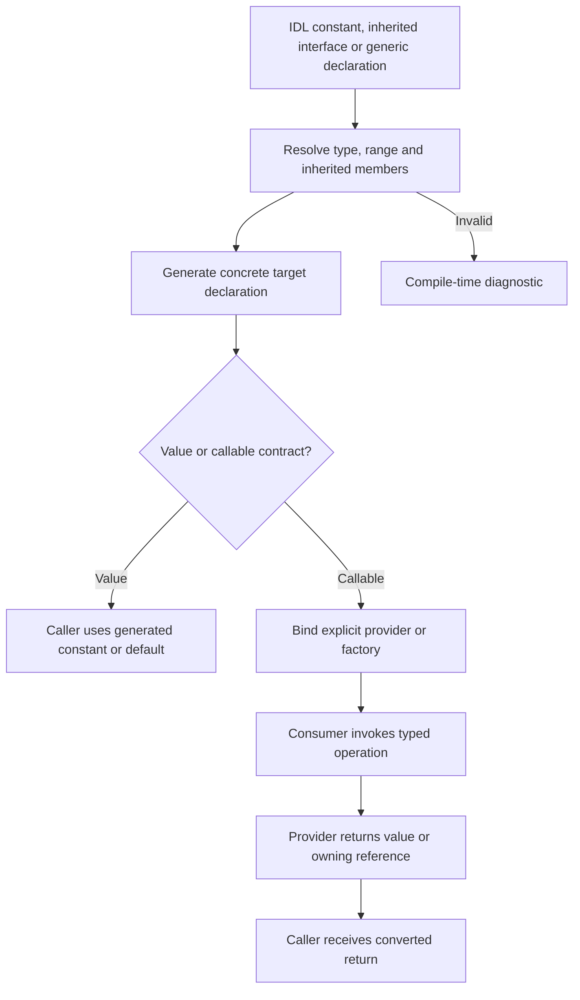

### 4.6 Static operations and factories

A static operation is an explicitly bound typed operation without an instance receiver. It is not a service lookup and does not belong to an instance's virtual method table. Use static before async when both modifiers are present. A factory is an ordinary operation returning an owning interface reference, not a separate keyword or wire type. The name create is only a convention.

```text
module repository;

import domain.ProductChapter;

interface ProductChapterHelper {
    @swift.name("index(of:in:)")
    static getIndexByChapterIdAndList(chapterId: int64, chapters: list<ProductChapter>): int32;
}

interface ProductChapterRepository {
    static async create(catalogId: int64): ProductChapterRepository;
    async findAll(): list<ProductChapter>;
}
```

This is an alternative fixture assuming the imported domain type exists. Generate a separate typed static contract and descriptor, identified by the declaring logical interface plus a static-contract discriminator. An all-static interface needs no empty instance proxy and has no instance value type (4.7). An interface's static and instance providers may be implemented in different hosts. A factory does not imply a singleton, automatic registration or construction in the caller's language.

The embedding application explicitly supplies a fixed static implementation to a generated context-bound facade or binds it as the default static implementation for that contract in the selected context. Validate canonical contract, context, owner and executor before publishing a binding. Use the same reference, operation and execution machinery as ordinary interfaces. Default binding has one slot per declaring contract per context, not a service stack. Duplicate binding fails without mutation. No dynamic replacement, priority, restoration or Service Registry lookup. Removing the binding ends class-level discovery; independently retained fixed facades remain valid while their actual provider is Open. Rebinding after explicit removal has a new unique control identity. Detach revokes bindings whose binding owner or actual provider belongs to the closing attachment. Closing the context revokes all bindings. Applications needing dynamic replacement use ordinary registered interfaces.

Generate convenient class/type-level syntax where the language permits it and the embedding application has explicitly selected a default context and bound implementation. An absent or ambiguous context or binding reports a typed error. Never choose the last initialized context, a thread ID or an arbitrary language. Multiple contexts can always use explicitly bound facade objects. The declared public type owns both static and instance methods in all languages with type-level calls. A mixed interface never requires a separate public static helper. A pure static interface owns its public name without a fake instance. C exposes typed prefixed functions and bound handles because it has no class methods. Static dispatch and provider adaptation are generated internally (section 8.11); class-level convenience is enabled by default, and explicit fixed context-bound calls remain available. The static binding's lifetime is controlled by a unique owning binding token with idempotent explicit removal and last-control-reference cleanup. It never removes another binding generation. Reuse registry control bookkeeping where appropriate without exposing static bindings as registry entries. No package import initializes a runtime.

Illustrative Swift calls after explicit initialization:

```swift
import Ubook

let index = try ProductChapterHelper.index(of: chapterId, in: chapters)
let repository = try await ProductChapterRepository.create(catalogId: catalogId)
let chapters = try await repository.findAll()
```

Static operations obey the same synchronous executor checks, async completion, error and ownership contracts as instance operations. A synchronous static method does not guarantee cross-isolate execution. Use static async when scheduling is required. Prove direct facade injection, duplicate and missing binding, async factory, context isolation, removal with surviving fixed facades, provider detach and separate instance/static identity using actual host compilers. Freeze exact API spelling in implementation.

### 4.7 Inheritance, properties, overloads and generic specialization

**Inheritance.** Use interface Child : Parent for a single base. Support exactly one direct base interface. Reject multiple bases; model multiple independent roles using composition or explicit interface references. No mixin, diamond or implicit multiple-interface cast system. Reject cycles, conflicting inherited declarations and unrepresentable target mappings. Inherited identical operations retain the declaring operation identity. A derived provider implements all inherited instance operations. Mixed static/instance facade generation must preserve base views even when the host cannot express that relation as native inheritance. In particular, a Swift final owning facade is not subclassable; expose a validated typed base-view conversion and a provider contract that inherits the base's provider requirements or ordinary instance protocol. Do not claim implicit assignment to an unrelated final facade. C#/Java/Kotlin/Dart use native inheritance only where the actual type surface supports the canonical view; otherwise provide a typed explicit conversion with the same ownership semantics. This is a real host type-system constraint, not a second provider or service key. An upcast retains the same underlying implementation through a validated base-contract view; no duplicate provider or registration. Explicit downcast succeeds only for an advertised compatible interface view. No cross-language RTTI guesses. Static bindings are not inherited through instance tables or implicitly rebound for a derived type. An inherited static member, where exposed by native syntax, must resolve to the declaring type's static binding; a separately declared static member has its own canonical identity. A pure static interface cannot be a base or derived instance contract and cannot be used as a value, registry key, weak target or factory result. A derived interface with inherited instance requirements is not pure static even if its own declarations are all static. Reject empty interfaces unless they inherit actual instance requirements; no synthetic marker-object handles. Registry registration is exact-interface only; registering Child does not implicitly register Parent.

**Properties.** Record fields expose ordinary native fields/properties/accessors with independent value semantics. Interface operations always remain methods, including get/set names; do not infer or configure method-to-property mapping. Accessors are generated only for real fields. No IDL property keyword, cached remote property, implicit change event, or target-specific property annotation. This avoids hiding cross-runtime dispatch, errors or blocking work.

**Overloads.** Distinguish operations by the declaring interface, logical method name, ordered canonical argument types and instance/static discriminator. Different method names with identical arguments are different operations. Parameter names, return type alone, async modifier alone or display name cannot distinguish overloads. Reject target collisions after lowering, including JVM erasure, Obj-C selectors, Swift argument labels and C symbols. C uses stable signature-derived symbol identifiers for overloads. A language lacking faithful overload support requires explicit distinct target names or a proven typed surface, not silently numbered methods or value-based guessing. Adapters dispatch by resolved operation identity.

**Generics.** Resolve reachable concrete instantiations automatically from the canonical graph. An optional specialize Definition<Arguments> as Name declaration selects a meaningful public alias and, when necessary, explicit artifact ownership. It does not create a second canonical record. Reject conflicting explicit owners, infinite expansions, unbound parameters and incompatible aliases. Ownership is independent of target filtering and graph traversal. Preserve legal indirect layouts with bounded conversion. Reject recursive by-value layouts. Freeze the exact grammar with positive and negative tests in phase 1.

All the forms above use the existing typed IR, ABI and runtime machinery. The parser distinguishes logical aliases, target annotations and runtime binding. Any grammar adjustment requires updating the examples and conformance inventory together.

#### 4.7.1 Concrete generic ownership and resolver limits

Resolve all module declarations and imports before assigning physical artifacts. Collect each reachable concrete generic identity once from the complete declared graph before target filtering. Reuse an existing validated prebuilt/source explicit owner if it reaches the definition and all argument types. Otherwise, for a standalone source module, materialize the concrete use in that module's generated artifact if no existing dependency owns it; for an assembled source library, plan exactly one shared generated specialization artifact in its actual public library scope, with a stable concrete name derived from definition and arguments when native generic syntax cannot express it. For a source dependency graph outside a unified library, prefer an existing reachable source owner that can legally reach the definition and every argument type and is reachable from every public use; choose the unique nearest shared owner by dependency reachability, not traversal order. If no unique eligible shared owner exists for independently published artifacts, require an explicit owning source module and dependency edge or a unified source library; explain the competing usages. Do not generate duplicates or mutate a prebuilt dependency. An explicit specialize declaration in the eligible owner resolves that genuine distribution choice and can supply a public name; it is not required for ordinary use. A private nonescaping instantiation may use a private physical name, with canonical identity unchanged. Record the chosen physical owner in the manifest and reuse it on independent builds; reject incompatible composition before generation. All applicable profiles use the same canonical descriptor and concrete ABI identity.

Allow mutual references between declarations within one module using symbol predeclaration; a source module dependency cycle is not permitted. Resolve imports by exact case-sensitive IDs, reject ambiguous explicit name bindings and wildcard imports and distinguish alias from definition. Validate by-value layout cycles after expansion, not only syntactic recursion; finite indirection through collection or capability representations is different from an infinitely sized by-value structure. Reject open or infinitely expanding generic arguments. Bound expansion and parsing using section 11.7. Record canonical arguments, owner, visibility and physical representations in manifest. Test independent generation order, a shared specialization supplied prebuilt, conflicting independent owners and private instantiation leakage.

### 4.8 Declaration syntax and semantic validation baseline

Use one case-sensitive grammar and one semantic resolver. The parser records exact source spans and never decides target names or native layouts. Each IDL file starts with its module declaration, followed by imports and declarations. Whitespace and comments are insignificant outside literals; documentation comments attach to the next eligible declaration. Use ASCII identifiers matching [A-Za-z_][A-Za-z0-9_]*, with reserved language words rejected, and UTF-8 Unicode string literals. Dotted paths refer to logical modules and qualified declarations. Strings use double quotes and a documented finite escape set (quote, backslash, newline, carriage return, tab and Unicode scalar escapes); reject malformed escapes, unpaired surrogates and invalid input encoding. Do not evaluate host-language expressions.

The following is the required syntax baseline, not a second parser implementation:

```text
module example;

import domain.User;
import common.Page;

const MaxUsers: int32 = 100;

enum State {
    Idle = 0,
    Running = 1
}

flags Permission {
    Read = 1,
    Write = 2,
    ReadWrite = 3
}

variant Response {
    Success: User;
    Failure: string;
    NotFound;
}

record Filter {
    name: optional<string> = null;
    limit: int32 = MaxUsers;
}

async callback Changed(value: User): void;

interface Store {
    async find(id: int64): optional<User>;
    async find(filter: Filter): list<User>;
    async observe(@ownership("retained") listener: Changed): void;
}

interface ExtendedStore : Store {
    static async create(): ExtendedStore;
    async page(): Page<User>;
}

specialize common.Page<domain.User> as UserPage;
```

These forms require real declarations for the imported types. The overload in this fixture needs distinct explicit names in targets lacking a faithful overload surface; it is not an automatically valid all-target fixture. The observe operation intentionally retains a callback and its provider must define removal/cleanup; it does not introduce an implicit subscription. All declarations are public unless explicitly private. A private top-level declaration is module-local, not accessible by another module's import; an exported signature may not expose a private type. Methods of a public interface form its public contract; do not allow private abstract operations to make foreign implementations incomplete. Public/private affects source visibility and export planning, not native memory isolation. Reject duplicate names, ambiguous imports and unresolved references with related source locations.

Constants and field defaults are typed literals, declared constant references, or enum/flags member references with compatible canonical type. Support null only in optional positions, numeric range checks and explicit collection literals where the declared type permits them. Do not introduce arbitrary compile-time execution or implicit conversions between unrelated types. Variant cases may carry a typed payload (Name: Type;) or no payload (Name;). A no-payload case has only its tag, no void-valued field; it reuses the active-tag mechanism of Result<void,E>. Variant cases have distinct names and deterministic canonical tags derived from their declaration order (zero-based; no explicit tag syntax in the current grammar); reordering them is a contract change. Enums and flags use explicit integer assignments. The final grammar must document literal syntax, type nesting, annotation placement, modifier order (visibility, static, async where applicable), generic declarations, inheritance and import forms, with positive/negative parser fixtures. Freeze before generating public APIs. No legacy spellings or silent syntax recovery that changes a contract.

## 5. Type system

Start with ordinary values such as integers and strings. Records group values together. Collections hold several values. Optionals say whether a value exists. Interfaces and callbacks allow calls rather than just carrying data. Buffers and references add lifetime rules. Section 5.4 is the complete type reference, and section 5.9 shows how the values actually travel and return.

### 5.1 Types to implement and test

| Group | IDL types |
| --- | --- |
| Scalar | bool, int8, int16, int32, int64, uint8, uint16, uint32, uint64, float32, float64 |
| Text / binary | string, bytes |
| Collections | `list<T>`, `set<T>`, `map<K,V>`, `array<T>` |
| Optional / variant | `optional<T>`, variant |
| Named | record, enum, flags, interface |
| Special memory | DataView, MutableDataView, DataRef |
| Errors | `Result<T,E>` |
| Time and identity | date, timestamp, duration, uuid |
| Behavior | callback, async method or callback, `Stream<T>` |
| Lifetime / control | `WeakRef<T>`, CancellationToken |
| External | Explicitly declared type with per-target adapter |

`void` is a return-only type, including Result success with no payload. Reject `optional<void>`, `list<void>` and other value positions containing void, except `Result<void,E>` as a legal success case. Null is a literal, not an independent transport type. Service discovery, constants, factories, inheritance and generic declarations are language features rather than extra wire types. `array<T>` is a variable-length sequence with an optimized contiguous representation for fixed-width numeric primitives. `list<T>` is the general sequence representation. Restrict array<T> to bool and fixed-width integer/floating scalar elements. Reject record, reference, collection, optional, enum/flags and external/generic-expanded nonprimitive elements; use list<T> instead. A generic T resolved to an allowed primitive is legal. Both sequence forms use one element conversion/validation and ownership engine; array selects an actual typed contiguous public representation when supported, not a separate collection runtime. Optimize list<T> internally where compatible; use DataView/DataRef for explicit byte-memory sharing. Bool arrays must use explicitly defined byte storage when exposed as contiguous memory, not C++ `vector<bool>` bit proxies. Neither list nor array implies zero-copy. Use the explicit buffer contracts in section 13 for shared memory.

### 5.2 Return mapping examples

These are semantic API mappings. An async declaration wraps the corresponding type in the target's async mechanism.

| IDL | C++ | Kotlin | Swift | Dart |
| --- | --- | --- | --- | --- |
| User | User | User | User | User |
| `optional<User>` | `std::optional<User>` | User? | User? | User? |
| `list<User>` | `std::vector<User>` | `List<User>` | [User] | `List<User>` |
| int64 | int64_t | Long | Int64 | BigInt |
| bool | bool | Boolean | Bool | bool |
| void | void | Unit | Void | void |

For JavaScript and TypeScript, use bigint for exact 64-bit integer values. Use the portable Dart profile by default on every platform; native-only signed int64 as int is explicit opt-in under 5.4.2. Dart Web needs an explicitly validated exact-integer representation, not unchecked JS Number conversion. Java unsigned types require a documented exact mapping. C and Objective-C require explicit boxing/tagged representations for optionals, variants and generic collections.

### 5.3 Value and error rules

- Unicode strings use a specified UTF-8 boundary. Define invalid Unicode handling and test non-ASCII, supplementary characters, embedded nulls and empty strings.
- Integer values must not silently truncate. Define floating-point NaN, infinity and signed zero semantics.
- Specify collection equality, hashing, supported map keys, duplicate entries, ordering and nesting limits.
- Distinguish null, absent, empty and zero. Enums use explicit unique signed 32-bit values. Flags use unsigned 32-bit masks with explicit named bits and optional named combinations. Reject unknown enum values and unknown flag bits at the boundary. Zero is a valid empty flags value. These are closed current contracts, not forward-compatibility mechanisms.
- Define date, timestamp and duration units and UUID byte order. Test exact round trips as specified in section 5.6.
- `Result<T,E>` represents business success or failure. `Result<void,E>` has a success tag without a value payload. E must be a legal non-void owning value type. Runtime/ABI failures use a separate status, including conversion failure, missing service and invalid handle. Cancellation is a separate terminal status. No cross-ABI exception unwinding. A failed invocation or conversion must never look like a successful optional absence or a business error.
- External types require declared import paths, ABI representation, marshaller, ownership and tests for each target. No unsupported target fallback.

Example:

```text
enum LoginError {
    InvalidCredentials = 1
}

interface Auth {
    async login(username: string, password: string): Result<User, LoginError>;
}
```

Use one C++20-compatible Result representation. Swift uses Result when E conforms to Swift Error and a generated tagged result otherwise. A generated business-error enum may conform to Error without turning Result into an implicit throw. Other targets use a native or generated tagged result. Business errors do not become unexpected exceptions.

### 5.4 Complete type mapping contract

These tables are the proposed default public APIs, not native struct layouts. C and WASM describe the boundary representation. Generated wrappers are small and typed. Their final names follow module naming rules. Dart/Flutter uses BigInt for int64 and uint64 by default on all platforms (section 5.4.2); native-only signed int is explicit opt-in. Java and Kotlin share one model by default when jointly declared in a paired JVM library; explicit independent packages and ownership are supported. Swift may import Objective-C models. Shared model ownership does not change the canonical type.

All numeric conversions check range and type. All collection mappings obey the key and optional rules below. A minimal wrapper is required only when a native representation cannot preserve the full value or lifetime contract; share lowering by canonical type family, not one implementation for each concrete spelling. No silent conversion or fallback. A pointer, offset or handle is valid only inside its owning runtime or WASM instance. Stream acquisition returns an owning stream handle, distinct from the subscription handle created when a consumer subscribes (section 14.3.2). `async` is a declaration modifier rather than a value type. Async callbacks use the same completion contract as async methods. `void` is return-only, including the success case of Result. The WASM column describes a conceptual canonical lowering, not a finalized ABI signature.

#### Type meaning and native boundary

| IDL | Meaning | C | WebAssembly |
| --- | --- | --- | --- |
| `bool` | True or false | uint8_t (0/1) | i32 (0/1) |
| `int8` | Signed 8-bit integer | int8_t | i32, checked |
| `int16` | Signed 16-bit integer | int16_t | i32, checked |
| `int32` | Signed 32-bit integer | int32_t | i32 |
| `int64` | Signed 64-bit integer | int64_t | i64 |
| `uint8` | Unsigned 8-bit integer | uint8_t | i32, checked |
| `uint16` | Unsigned 16-bit integer | uint16_t | i32, checked |
| `uint32` | Unsigned 32-bit integer | uint32_t | i32 bit pattern |
| `uint64` | Unsigned 64-bit integer | uint64_t | i64 bit pattern |
| `float32` | 32-bit floating-point value | float | f32 |
| `float64` | 64-bit floating-point value | double | f64 |
| `string` | Unicode text | UTF-8 descriptor | UTF-8 in linear memory |
| `bytes` | Independent binary value | Owned byte descriptor | Owned byte buffer |
| `void` | Successful return with no payload | Status, no payload | Status, no payload |
| `record` | Named group of values | Generated value/handle | Canonical fields |
| `enum` | One declared integer value | int32_t + constants | i32, checked |
| `flags` | Combined named bits | uint32_t + constants | i32 bit mask |
| `variant` | One of several tagged alternatives | Tagged value + destroy | Tag + active payload if declared |
| `list<T>` | Ordered sequence | Typed descriptor/handle | Length + elements |
| `set<T>` | Unique values | Typed descriptor/handle | Canonical unique elements |
| `map<K,V>` | Keys mapped to values | Typed descriptor/handle | Canonical key/value pairs |
| `array<T>` | Numeric/bool scalar sequence with typed contiguous representation | Same sequence lowering, typed scalar storage | Length + typed scalar buffer |
| `optional<T>` | Absent or present value | Presence tag + payload | Presence tag + payload |
| `Result<T,E>` | Business success or business error | Tagged result + destroy | Tag + active payload |
| `interface` | Reference to an implementation | Typed opaque handle | Context-local typed handle |
| `callback` | Callable passed to another implementation | Function table + context | Typed callback handle |
| `async method / callback` | Operation with asynchronous completion | Completion + operation handle | Operation handle + completion |
| `Stream<T>` | Owning stream; separate subscription | Stream handle + subscription handle | Stream handle + subscription handle |
| `WeakRef<T>` | Reference that does not retain the object | Weak handle | Context-local weak handle |
| `CancellationToken` | Owning cancellation observation; no source authority | Token handle | Token handle |
| `date` | Calendar date, without a time | int64_t epoch days | i64 epoch days |
| `timestamp` | UTC instant, exact microseconds | int64_t UTC microseconds | i64 UTC microseconds |
| `duration` | Signed elapsed nanoseconds | int64_t nanoseconds | i64 nanoseconds |
| `uuid` | 128-bit identifier | 16-byte value | 16 canonical bytes |
| `DataView` | Scoped read-only borrowed memory | Validated borrow token + const pointer/length view | Validated borrow token + scoped offset/length |
| `MutableDataView` | Scoped exclusive writable memory | Validated exclusive borrow token + pointer/length view | Validated exclusive borrow token + scoped offset/length |
| `DataRef` | Shared owning buffer reference | Owning handle | Context-local owner handle |
| `external` | User-defined host type with canonical mapping | Declared type / adapter | Declared canonical representation |

#### Native and JVM public APIs

| IDL | C++ | Java | Kotlin | Objective-C | Swift |
| --- | --- | --- | --- | --- | --- |
| `bool` | bool | boolean | Boolean | BOOL | Bool |
| `int8` | std::int8_t | byte | Byte | int8_t | Int8 |
| `int16` | std::int16_t | short | Short | int16_t | Int16 |
| `int32` | std::int32_t | int | Int | int32_t | Int32 |
| `int64` | std::int64_t | long | Long | int64_t | Int64 |
| `uint8` | std::uint8_t | short | UByte | uint8_t | UInt8 |
| `uint16` | std::uint16_t | int | UShort | uint16_t | UInt16 |
| `uint32` | std::uint32_t | long | UInt | uint32_t | UInt32 |
| `uint64` | std::uint64_t | BigInteger | ULong | uint64_t | UInt64 |
| `float32` | float | float | Float | float | Float |
| `float64` | double | double | Double | double | Double |
| `string` | std::string | String | String | NSString | String |
| `bytes` | `std::vector<uint8_t>` | byte[] | ByteArray | NSData | Data |
| `void` | void | void / Void | Unit | void | Void |
| `record` | struct | Immutable class | data class | NSObject model | struct or imported model |
| `enum` | enum class | Generated enum | enum class | NS_ENUM | enum |
| `flags` | Flags wrapper | Flags wrapper | Flags wrapper | NS_OPTIONS | OptionSet |
| `variant` | Named case wrappers in std::variant or equivalent tagged value | Tagged class | Sealed class | Tagged object | Associated-value enum |
| `list<T>` | `std::vector<T>` | `List<T>` (boxed) | `List<T>` | NSArray of boxed/typed objects | [T] |
| `set<T>` | std::set / hash set | `Set<T>` | `Set<T>` | NSSet of canonical keys | `Set<T>` or canonical-key wrapper |
| `map<K,V>` | std::map / hash map | `Map<K,V>` | `Map<K,V>` | NSDictionary with canonical keys/boxed values | `Dictionary<K,V>` or canonical-key wrapper |
| `array<T>` | std::vector / exact typed wrapper (bool uses wrapper) | Exact primitive array / wrapper | Primitive or unsigned array / wrapper | Owned typed array wrapper | Typed array / wrapper |
| `optional<T>` | `std::optional<T>` | Nullable boxed T / wrapper | T? / wrapper | Nullable object / boxed optional | `Optional<T>` |
| `Result<T,E>` | PolyGlue Result | Generated Result | Sealed Result | Tagged result object | Result / tagged enum |
| `interface` | Owning interface reference | Native interface/class | Native interface/class | Protocol/class | Native protocol or same-name owning facade for mixed interfaces (8.11) |
| `callback` | Callable wrapper | Functional interface | Function / SAM | Block | Closure |
| `async method / callback` | Awaitable / future | CompletableFuture | suspend | Completion block | async throws |
| `Stream<T>` | Owning async stream | Owning stream + Publisher adapter | Owning Flow adapter | Owning stream + subscription/block | Owning AsyncSequence adapter |
| `WeakRef<T>` | Weak interface reference | Weak handle wrapper | Weak handle wrapper | Weak handle wrapper | Weak handle wrapper |
| `CancellationToken` | Token wrapper | Token wrapper | Token wrapper | Token wrapper | Token wrapper |
| `date` | std::chrono::year_month_day | LocalDate | LocalDate | Calendar date wrapper | Calendar date wrapper |
| `timestamp` | `sys_time<microseconds>` | Instant | Instant | Exact wrapper + NSDate conversion | Exact wrapper + Date conversion |
| `duration` | std::chrono::nanoseconds | Duration | java.time.Duration | Exact duration wrapper | Duration or exact wrapper |
| `uuid` | UUID value wrapper | UUID | UUID | NSUUID | UUID |
| `DataView` | Scoped read-only span | Checked read view | Checked read view | Checked read view | Scoped read-only access |
| `MutableDataView` | Scoped writable span | Checked write view | Checked write view | Checked write view | Scoped writable access |
| `DataRef` | RAII owner | Retained buffer owner | Retained buffer owner | Retained buffer owner | Retained buffer owner |
| `external` | Declared type / adapter | Declared type / adapter | Declared type / adapter | Declared type / adapter | Declared type / adapter |

#### Managed and web public APIs

| IDL | Python | Dart native | Dart Web | C# | JavaScript | TypeScript |
| --- | --- | --- | --- | --- | --- | --- |
| `bool` | bool | bool | bool | bool | boolean | boolean |
| `int8` | int | int | int | sbyte | number | number |
| `int16` | int | int | int | short | number | number |
| `int32` | int | int | int | int | number | number |
| `int64` | int | BigInt | BigInt | long | bigint | bigint |
| `uint8` | int | int | int | byte | number | number |
| `uint16` | int | int | int | ushort | number | number |
| `uint32` | int | int | int | uint | number | number |
| `uint64` | int | BigInt | BigInt | ulong | bigint | bigint |
| `float32` | float | double | double | float | number | number |
| `float64` | float | double | double | double | number | number |
| `string` | str | String | String | string | string | string |
| `bytes` | bytes | Uint8List | Uint8List | byte[] | Uint8Array | Uint8Array |
| `void` | None | void | void | void | undefined | void |
| `record` | Frozen dataclass | Immutable class | Immutable class | record / class | Immutable object | Readonly model + runtime object |
| `enum` | Enum | enum | enum | enum | Frozen constants | Checked numeric type |
| `flags` | IntFlag / checked wrapper | Flags wrapper | Flags wrapper | Flags enum / wrapper | Checked mask | Checked mask |
| `variant` | Tagged dataclass union | Sealed class | Sealed class | Tagged record hierarchy | Tagged object | Discriminated union |
| `list<T>` | list[T] | `List<T>` | `List<T>` | `IReadOnlyList<T>` | Array | `ReadonlyArray<T>` |
| `set<T>` | set[T] | `Set<T>` | `Set<T>` | `IReadOnlySet<T>` | Set | `Set<T>` |
| `map<K,V>` | dict[K,V] | `Map<K,V>` | `Map<K,V>` | `IReadOnlyDictionary<K,V>` | Map | `Map<K,V>` |
| `array<T>` | Owned typed buffer / exact scalar sequence | Exact TypedData / wrapper | Exact TypedData / wrapper | T[] / owned typed wrapper | TypedArray / exact scalar wrapper | TypedArray / exact scalar wrapper |
| `optional<T>` | T or None / wrapper | T? / wrapper | T? / wrapper | T? / wrapper | T or null / wrapper | T or null / wrapper |
| `Result<T,E>` | Tagged result | Sealed Result | Sealed Result | Generated Result | Tagged object | Discriminated union |
| `interface` | Native class/ABC | Native interface/class | Native interface/class | Native interface or abstract class/facade | Native object/class and same-name runtime export | Native type and same-name runtime export |
| `callback` | Callable | Typed function | Typed function | Delegate | Function | Typed function |
| `async method / callback` | Awaitable (capture wrapper; async def provider) | Future | Future | Task | Promise | Promise |
| `Stream<T>` | Owning async iterable / iterator adapter | Owning Stream adapter | Owning Stream adapter | Owning `IAsyncEnumerable<T>` adapter | Owning AsyncIterable adapter | Owning `AsyncIterable<T>` adapter |
| `WeakRef<T>` | Weak handle wrapper | Weak handle wrapper | Weak handle wrapper | Weak handle wrapper | Weak handle wrapper | Weak handle wrapper |
| `CancellationToken` | Token wrapper | Token wrapper | Token wrapper | CancellationToken adapter | AbortSignal adapter | AbortSignal adapter |
| `date` | datetime.date | Calendar date wrapper | Calendar date wrapper | DateOnly | Calendar date wrapper | Calendar date wrapper |
| `timestamp` | Exact wrapper + aware datetime conversion | Exact wrapper + UTC DateTime conversion | Exact wrapper + UTC DateTime conversion | Exact wrapper + DateTimeOffset conversion | bigint + Date conversion | bigint + Date conversion |
| `duration` | Exact wrapper + timedelta conversion | Exact wrapper + Duration conversion | Exact wrapper + Duration conversion | Exact wrapper + TimeSpan conversion | bigint nanoseconds | bigint nanoseconds |
| `uuid` | uuid.UUID | UUID wrapper | UUID wrapper | Guid | Canonical UUID string | Canonical UUID string |
| `DataView` | Checked read view | Checked read view | Checked read view | Scoped read-only access | Checked host/linear-memory view | Checked host/linear-memory view |
| `MutableDataView` | Checked write view | Checked write view | Checked write view | Scoped writable access | Checked writable memory view | Checked writable memory view |
| `DataRef` | Retained buffer owner | FFI buffer owner | Web buffer owner | SafeHandle / owner | Host or linear-memory owner | Host or linear-memory owner |
| `external` | Declared type / adapter | Declared type / adapter | Declared type / adapter | Declared type / adapter | Declared type / adapter | Declared type / adapter |

Java unsigned values use checked wider types. Kotlin uses exact unsigned types with checked JNI bit conversions. Python integers and JavaScript Number inputs are checked, including rejection of Python bool as an integer. JavaScript and Dart Web must not convert exact 64-bit values through JavaScript Number. Use BigInt or an exact checked bit representation at the adapter boundary. A JS or WASM signed bit pattern is not the mathematical unsigned value until it has been decoded. Numeric arrays use exact contiguous representations only where available. Float32 uses the checked rounding rules in section 5.4.1. Strings use validated UTF-8 with explicit lengths, including embedded NUL. Invalid UTF-8 or unpaired surrogates fail. C bool accepts only 0/1. Record and collection values do not share mutable object identity. Interface and DataRef references retain ownership explicitly.

Collection key types (map keys and set elements) are limited to bool, integer, string, enum and UUID, plus external types proven to preserve one of those key representations. Canonical string equality is exact Unicode scalar sequence equality; see section 5.4.1. Reject duplicate canonical keys. There is no portable set/map iteration order. Key wrappers are needed when host equality differs from canonical equality, such as Swift canonical-equivalent Unicode strings. Objective-C dictionary keys must also support NSCopying. Generated key wrappers must be immutable, implement canonical equality and hashing, and copy without changing their value. Java/Kotlin and Objective-C shared models must preserve the same rules. JS UUID keys use canonical strings. Preserve float signed zero, infinity and NaN classification without promising NaN payload bits. UUID bytes use network order. No borrowed memory may escape a direct synchronous parameter. DataRef is read-only by default and retains its true owner. See sections 5.6, 5.8, 13 and 14 of PROJECT.md for detailed rules.

#### 5.4.1 Canonical equality, numeric conversion and legal value positions

String equality for portable keys is exact Unicode scalar sequence equality, equivalently byte equality of valid canonical UTF-8. Do not normalize NFC/NFD, fold case, trim, or use locale collation. For example U+00E9 and U+0065 followed by U+0301 are distinct keys even if a host String regards them as equal. The same allowed portable key types apply to map keys and set elements. Floating-point numbers, optional values, arbitrary records, collections, interface references and buffers are not portable keys by default. An external key adapter must be explicitly proven to preserve one permitted canonical key representation. A key wrapper uses canonical equality and hash, not object identity. An ordered native collection comparator, when selected, must distinguish exactly the same keys as canonical equality. Ordering is not a wire guarantee.

Before constructing a target collection, detect whether the host's native equality could collapse two distinct canonical values or distinguish canonically equal values (for example Swift String normalization, Python bool versus int, or JavaScript reference keys). Use a typed canonical-key wrapper where required, including at the public construction boundary: accepting an already collapsed host dictionary cannot reconstruct lost keys. Validate all entries before publication and release partial conversions on failure. Duplicate canonical keys fail; no implicit last-wins policy. Hash implementations need not produce the same machine hash across languages, but equality and accepted key sets must agree. Iteration order is unspecified for sets/maps.

Integers use exact mathematical range checks before narrowing, including rejection of fractional Number, boolean-as-integer and unsafe 64-bit Number input. Float32 uses IEEE-754 round-to-nearest ties-to-even when converting a wider finite input. Preserve signed zero and allow representable subnormals; a finite input that overflows to infinity fails rather than silently becoming an explicit infinity. Explicit NaN and infinities are valid floating values; preserve classification, not NaN payload bits. Do not use floating equality to test signed zero or NaN. Use exact canonical integer/bit expectations in tests and document any explicit lossy application conversion outside the default boundary.

Validate legal value positions recursively after generic and external-type expansion, not only the outer type name. Reject optional directly containing another optional after expansion and array of nonprimitive elements. An optional record, optional list of optional elements, or Result containing an optional remains legal because the intervening type has its own meaning. DataView and MutableDataView are direct synchronous parameters only; an external borrowed representation is subject to the same rule. void is return-only except the payload-free Result success case. WeakRef<T> requires a concrete interface reference type, not a value, callback, stream, generic open type or dynamic registry proxy; weak acquisition returns an owning fixed reference or absence for an expired live-origin object. A wrong-origin or malformed weak token is an error, not absence. Stream<T> is an owning stream capability for a legal non-void owning item type; stream capabilities are return values (including async return), not record fields, keys or arbitrary nested collection elements in the initial contract. Explicitly model a factory interface when a reusable stream-producing object must be passed around. Callback values in direct parameters (including optional callback) default scoped; legal callback values returned or stored inside an owning record/collection use owning semantics and must have an explicit documented release path. A scoped or borrowed capability may never escape via a nested external adapter or generic alias. A CancellationToken is an owning observation reference to cooperative cancellation state, not cancellation authority, a boolean or an operation handle; section 14.4.2 defines the source/control distinction. These restrictions are identical across targets; a host's ability to store a pointer does not make an otherwise forbidden position valid.

#### 5.4.2 One Dart API across native and web

Use one default Dart integer mapping on every platform: BigInt for int64 and uint64; int for smaller integers. No automatic API change based on selected platforms or command filters. The existing targets.dart.integer_profile option is limited to portable (default) and native (explicit opt-in for a genuinely native-only package using int for signed int64). Do not implement auto or additional profiles; native is invalid when Web compatibility is declared. Flutter inherits the Dart package's actual profile; incompatible public dependencies must be explicitly rebuilt or the deployment scope constrained. Preserve exact bits with checked conversion, not JS Number or double.

Use one public Dart declaration graph and distinct private FFI/JS adapters. Native int64 and uint64 conversion must preserve the full signed/unsigned bit pattern without first constructing an overflowing native int; use validated fixed-width chunks/typed bytes where necessary. The Web adapter uses exact BigInt or checked bit representations. Verify both extreme bounds and values above 2^53 with the same installed Dart source consumer on native and Web. Compare actual public signatures, not only runtime values. A genuinely native-only standalone Dart package can explicitly opt into signed int64 as int, but a Flutter plugin cannot silently change the public types of an existing imported Dart dependency; require a compatible portable dependency or explicitly constrain supported platforms.

#### 5.4.3 Concrete lowering rules for every type family

The tables describe semantic public types, not native object layouts. The type planner must resolve an exact representation, both conversion directions, ownership kind, legal positions, nullability, key semantics, required capability and any checked wrapper for every concrete instantiation. Missing coverage fails validation. A configurable representation must preserve exact semantics.

| Family | Required concrete behavior |
| --- | --- |
| bool / signed integer | Fixed widths; C bool byte exactly 0/1; Java byte/short/int/long, Kotlin Byte/Short/Int/Long, Swift Int8/16/32/64, .NET sbyte/short/int/long; Python/JS/Dart validate values |
| unsigned integer | Java short/int/long/BigInteger for 8/16/32/64; Kotlin UByte/UShort/UInt/ULong with checked signed JNI carriers; Swift UInt widths; .NET byte/ushort/uint/ulong; Dart/JS exact BigInt for uint64 |
| floating | IEEE binary32/binary64, checked finite narrowing, negative zero/subnormal preservation, explicit NaN/infinity; no promised NaN payload bits |
| string | Exact valid Unicode scalar sequence; UTF-8 byte length including embedded NUL; no null-terminated-only ABI or JNI modified UTF-8 codec |
| bytes | Independent owned byte value; snapshot or explicit exclusive ownership transfer with no observable alias; no shared mutable byte array |
| date/time/UUID | Date 0001–9999; timestamp/duration full signed 64-bit units; UUID 16 network-order bytes, explicit .NET Guid mixed-endian conversion |
| enum/flags | Explicit signed int32 enum values and uint32 masks; reject unknown values/bits; Java/Kotlin ordinal is not IDL value |
| records/variants | Validated value snapshots, copy value leaves and retain reference leaves; tag selects active variant; no memcpy of host objects |
| optional/Result | Presence/active tags, reject directly nested optionals, scalar boxing where required; no payload for void success, separate runtime errors |
| list/set/map | Exact recursive element plans; canonical equality; reject duplicate keys before host collapse; independent containers |
| array | Scalar-only variable-length sequence; shared list conversion machinery, exact typed storage or checked scalar wrapper; no zero-copy promise |
| interface/callback/weak/token | Typed capability with validated context/generation and correct root/lease; atomic weak upgrade, independent cancellation token |
| async/stream | Owning result with separate start, completion and execution leases; stream capability distinct from subscription |
| external | Recursive canonical representation, checked adapters and explicit ownership; no foreign pointer as scalar |

**JVM arrays and generics.** Java signed primitive arrays use byte[], short[], int[], long[], float[], double[] and boolean[]. Unsigned 8/16/32 arrays default to short[], int[], long[] with range checks; uint64 to BigInteger[] or an explicitly configured exact owning bit wrapper. Kotlin uses UByteArray/UShortArray/UIntArray/ULongArray with required opt-in where applicable, or an equivalent exact wrapper; JNI carrier bits are internal. Shared Java-owned models keep the actual Java field signatures. Java generic arguments and CompletableFuture results require boxed primitives and Void for no-payload success. Preserve legal null collection elements; avoid null-rejecting factories. Snapshot mutable arrays and containers.

**Apple.** Objective-C Foundation collections and lightweight generic arguments require object types: box scalars with checked range and numeric kind (including NSNumber bool distinction), and use tagged wrappers for variant/Result and boxed optional scalars or collection elements where required. Never insert nil in a collection. NSNull is not a second presence state. BOOL is converted to a canonical byte; NSInteger/Swift Int are not substitutes for fixed-width int64. Swift maps to native Optional; use checked imported scalar/collection boxing where required. Swift Result requires Error-conforming E or a generated tagged result. Completion APIs distinguish success-with-absence from NSError failure; use an explicit status/result box or native refinement when the importer cannot prove both. No exception unwinds across C.

**Python, Dart, .NET, JS/TS.** Python bool is not integer input; check int bounds and snapshot mutable bytes-like inputs. Python typing/TypeScript types do not replace boundary validation. Dart portable 64-bit values require BigInt, exact chunk conversion and compatible typed array wrappers. .NET bool, char, string and platform-dependent native long are not canonical C layouts; marshal explicit byte bool, fixed-width integer and length-delimited UTF-8. JS validates Number before narrowing, BigInt64Array/BigUint64Array capability and exact element values; reject detached buffers, holes, undefined and coercions. TypeScript uses identical runtime checks. A signed bit carrier is not the mathematical unsigned value until decoded. Snapshot/transfer mutable typed arrays only under the value contract.

**Void, errors and lengths.** Successful no-payload calls map to C status, C++ void/Future<void>, Java void/CompletableFuture<Void>, Kotlin Unit, Swift Void/async throws, Python None, Dart void/Future<void>, .NET void/Task and JS/TS undefined/Promise<void>. Failure and cancellation remain distinct from optional absence and business Result. All lengths use checked fixed-width ABI values: canonical native descriptors use uint64 byte/element lengths, validate size_t/JS safe indexing/JNI jsize/host bounds before narrowing; WASM32 offsets are checked within the owning instance. Checked multiplication, range, stride, recursive depth, allocation and cumulative element budgets apply before allocation or access. See section 13 for memory rules. No host object layout, unchecked integer-to-pointer conversion or hidden lossy fallback.

#### 5.4.4 Compound values, equality and non-void host generics

A record has independent value semantics, not a shared mutable aggregate. Copy, move or snapshot mutable value leaves at construction, assignment and call capture as needed; use copy-on-write where proven. Host-native value structs may have ordinary local mutation without affecting other independent values. Reference-based host models use immutable fields/protected storage and defensive copies or checked read-only access so callers cannot mutate another record through aliases. No selectable mutable-record profile. Interface, retained callback, weak-reference, token and DataRef leaves preserve capability identity and appropriate independent ownership; do not deep-copy providers or freeze capability state. Releasing a value releases its own leaves once. Native record copies, accessors and default construction must preserve this contract. A mutable independent return container is legal; a writable alias into a protected record is not.

Define structural comparison for values with a fully comparable canonical shape. Records compare by same logical type and ordered fields, variants by same logical type, active tag and payload, optionals by presence tag, Result by active tag and payload, lists/arrays/bytes by ordered contents, sets by canonical membership and maps by canonical keys and corresponding values without iteration-order dependence. String equality is exact scalar sequence; time and UUID compare canonical values. A portable structural float comparison treats all NaNs as equivalent and distinguishes +0 from -0, after canonical width conversion. This is a value-equality policy, not a change to native arithmetic or a claim to preserve NaN bits. Generated equality/hash functions must agree where offered; use explicit canonical helpers when host native equals/Hashable cannot match. Structural equality and hashing are opt-in only for external types with a proven canonical value comparison. Do not derive structural equality/hash across arbitrary reference leaves, mutable records or resource capabilities; provide explicit identity comparison for fixed interface handles in the same context, with validation, and no equality based on pointer, proxy address or current dynamic-registry selection. Records containing capabilities may still expose host identity equality, documented as nonportable. Do not introduce these compound values as portable map/set keys. Hash output is process-local; stable fingerprints are a different mechanism. Detect actual cyclic host value graphs on the current conversion path before descending; shared acyclic subvalues may occur more than once and are snapshotted separately. Interface reference cycles are legal identity relationships, not recursive value conversion. Enforce depth and aggregate resource budgets even for acyclic graphs.

Flags have a uint32 known-bit mask formed by declared distinct single-bit nonzero members. Zero is allowed as a named empty mask; a named combination may only OR declared single bits. Reject undeclared bits, negative values, duplicate names and duplicate numeric values; no implicit aliases or ordinal values or signed interpretation of bit 31. The complete mask may be zero. Closed enums remain explicit unique int32 values. Check static defaults, external conversions and dynamic input.

`Result<void,E>` is a distinct payload-free success specialization, not an optional result or a null T. Its error tag owns exactly one legal E. Success contains neither an optional value nor an allocated placeholder in the canonical representation. Define real public factories/accessors and a tag on every target, even when the host uses a generic placeholder.

| Target | Default public void-success form |
| --- | --- |
| C / WASM | Tagged value, success has no active payload; separate runtime status |
| C++ | PolyGlue Result<void, E> specialization |
| Java | Result<Void, E> with success() and no active payload; not a nullable success value |
| Kotlin | PolyGlue Result<Unit, E> with Unit as host-only success marker |
| Objective-C | Generated tagged object with success constructor and typed error |
| Swift | Result<Void, E> only if E conforms to Error; generated tagged enum otherwise |
| Python | Generated Result[None, E], tagged success without value |
| Dart | Generated specialized VoidResult<E> with success constructor |
| C# | Generated VoidResult<E>; never use void as generic argument |
| JS / TS | Tagged success object with no value property; typed discriminated union for TS |

Names for generated wrappers follow the configured target naming plan. Kotlin's standard Result has one type parameter and exception semantics; do not use it as an arbitrary two-parameter business Result. A host-only Unit/Void/None placeholder never becomes an active ABI payload. Nested success tags and optional absence remain distinct. Async wrappers contain this exact specialization (e.g. Task<VoidResult<E>>), not a bare Task which drops the business outcome.

C++ list<bool> may use std::vector<bool> with element-wise conversion; array<bool> defaults to a typed owner with canonical 0/1 byte storage and checked boolean access, not a purported contiguous bool pointer from std::vector<bool>. C++ vector<bool> is not a contiguous bool array. Other vectors may use contiguous primitive optimizations only after proving actual element representation, layout, alignment, aliasing and lifetime. Java/Kotlin boolean arrays are not a promise of raw byte layout either. A canonical C boolean buffer is explicit uint8_t 0/1; validate every element before exposing it as boolean. Do not reinterpret managed object or packed bit storage as native array storage.

#### 5.4.5 Initialization, destruction and execution-domain properties of types

Every concrete lowering has an explicit construction/destruction plan in addition to its conversion plan. Classify a type independently by value versus capability semantics, initialization state, resource ownership, mutability, thread/host affinity, permitted transfer, and required cleanup. Being an immutable value or an owning reference does not by itself imply thread safety or Swift Sendable. A capability's descriptor can be carried as an owning reference across supported attachments in one context; actual use, retain/release and host conversion must obey the underlying owner's execution domain. Never pass a foreign host object, thread-local state, task, coroutine, future, OS thread or native pointer as an untyped IDL value.

| Type category | Initialization and destruction | Thread/async contract |
| --- | --- | --- |
| Scalar, enum, flags, date, timestamp, duration, UUID | Validate exact width, range and assigned values; no owned payload | Snapshot value; no host pointer identity |
| string / bytes | Fully validated initialized content, explicit length; destroy matching owned storage | Independent snapshot; immutable storage optimization only with proven lifetime |
| record / list / array / map / set | Construct children transactionally; publish only after success; destroy only initialized active children | Recursively snapshot value leaves and retain capability leaves; container mutability is not thread safe |
| optional / Result / variant | Initialize storage, then active branch, then publish valid tag; destroy only owned active payload | Transfer the tag and active child, not inactive union memory |
| interface / retained callback | Validate provider descriptor, own host root and code lease before publication | Handle transport does not permit invocation on arbitrary executor; use owner admission |
| WeakRef | Initialize a validated nonowning identity; release weak metadata; never retain object implicitly | Atomic strong acquisition only while origin and provider are live |
| CancellationToken | Retain observation state, not source authority | Atomic sticky signal/observer bookkeeping; no implicit cancel on destruction |
| DataRef | Fully initialized owner, range, deleter and access policy | Owning handle may cross async; actual data access requires storage-specific lease; not automatically immutable data |
| DataView / MutableDataView | Valid scoped borrow with initialized range; release access lease | Synchronous direct argument only; no dispatch/queue/escaping capture |
| Stream | Initialize owning source capability; subscription is separate | Async acquisition/result and separate bounded delivery ownership; no implicit producer thread |
| External type | Use canonical expanded type plan and explicit adapter ownership | No automatic cross-host transfer of its native representation; convert on permitted domain |

For an owning C aggregate, distinguish raw storage, initialized-empty storage, fully constructed value, moved-from initialized-empty storage and destroyed storage. Only the initialized-empty state may be passed as an out slot; generated init/destroy/clone/move helpers enforce the documented convention. The final ABI must provide an independent initialization-state mechanism where a zero tag also denotes a real owning variant or Result branch: zeroed memory is not a promise that an arbitrary required value is valid. Do not read a tag from uninitialized storage, free a stale pointer or destroy a moved-from child twice. On failed construction leave the out slot initialized-empty, with no active payload; track initialized children locally until commit. An initialized-empty required value cannot be consumed as a valid record/result. No default constructor that fabricates a required provider, callback, token, enum, date or reference; generate required-argument constructors and checked factories. Optional absence, empty string/bytes/collection, zero numeric and payload-free success remain valid distinct semantic values. Language-native finalizers/destructors are backup or RAII where supported, not a replacement for thread-affine drain. The same contract applies to constants/defaults, callbacks, future results, stream items and external types. Do not claim host mutable inputs can be read atomically while another thread mutates them: the caller must synchronize, use immutable snapshots or transfer exclusive ownership during capture.

Validate temporal and numeric operations as well as boundary representation: conversion of signed epoch microseconds/nanoseconds must avoid intermediate overflow at both int64 extremes (including negating INT64_MIN or multiplying truncated seconds); use checked arithmetic or a proven wider intermediate. C++ chrono conversions and Swift Duration, JVM Instant/Duration, .NET ticks and Dart/Python conversions may not use unchecked casts or silently overflow. Native convenience operations on public wrappers must reject unrepresentable results; pure host arithmetic is outside the generated contract. A date value validates Gregorian components and the defined 0001–9999 range before constructing a native date object. A null/empty native descriptor is not automatically a valid UUID/date/reference. Test default construction, partial init, move/clone, nested capability ownership, concurrent mutation contract and exact boundary arithmetic.

#### 5.4.6 Concrete value model and conversion policy

The single public record contract is independent value semantics. The following target strategies are defaults, not configurable mutability profiles; readonly syntax alone is not proof. Values returned independently from a record may have an idiomatic mutable container representation where the canonical table permits it; they cannot be writable aliases into another independent value. A native value struct may mutate its own fields, and that mutation must not change independent copies; reference-backed immutable host models must not expose writable aliases to their protected storage. Retain interface/DataRef/callback capability leaves independently; their referenced state is not frozen.

| Target | Default implementation strategy for independent value models |
| --- | --- |
| C | Validated owning descriptor and typed construction/access functions; raw struct mutation is trusted native use, never a promise of compiler-enforced immutability; validate at every ingress and snapshot independent values |
| C++ | Native value struct with checked construction and independent copy/move; locally mutable fields are legal when value leaves are independent and capability identity retained; use protected storage only where needed |
| Java | Final private fields and defensive copies or genuinely immutable owned collection views; arrays returned as copies; no wrapper over caller-mutable backing list |
| Kotlin | val properties plus defensive ownership of collections and arrays; generated copy/component access obeys snapshots; paired Java-owned models retain actual Java representation |
| Objective-C | readonly properties, explicit constructors and recursively protected value leaves; immutable Foundation container alone is shallow; mutable inputs copied; no mutable subclass storage alias |
| Swift | Native struct with idiomatic let/var value fields, value/COW storage where valid, owned wrappers for reference-backed values; imported Objective-C model proves same semantics; no blanket Sendable |
| Python | Frozen model plus immutable stored sequences/mappings or defensive access copies; dataclass frozen alone is shallow; typing matches actual public return |
| Dart / Flutter | final fields, copied backing storage and genuinely unmodifiable collections or defensive copies; TypedData views cannot alias hidden mutable storage |
| C# | readonly/private storage and checked factories; IReadOnlyList/IReadOnlyDictionary are interfaces, not immutability; use protected storage, copy mutable arrays, validate default struct state or use class |
| JS / TS | Protect recursively owned value fields at runtime; readonly declarations and shallow Object.freeze are insufficient; typed arrays, Map and Set need copies or checked read-only facades; avoid freezing user capability objects |
| WASM | Same native owning descriptor and validation; host-facing public model follows JS/TS or selected host strategy |

Construction omission applies only to a declared typed default or an optional field (absent). Do not invent implicit zeros, empty containers, epoch date, nil UUID, enum member, variant, Result or provider for an omitted required field. A valid zero/empty/nil-UUID value may be explicitly supplied where permitted; raw initialized-empty output storage is distinct from a valid required value. A host that always supports default(T) must reject an invalid unconstructed value at ingress or use a representation without that invalid default. Do not offer a separate mutable-record mode. Constructor, copy, clone, equality and accessor tests must use mutable nested input and capability leaves; no validation based solely on source syntax.

External conversion runs on the actual host that owns the input: caller to canonical owning representation before accepted publication; canonical representation to provider host after permitted dispatch; provider result to canonical before completion; canonical to consumer on its permitted delivery domain. A source adapter that needs a different executor must require explicit preparation on that executor or a proven owning transfer before conversion. Do not enqueue an inaccessible source object, retain borrowed memory across suspension or make a synchronous invocation dispatch-and-wait. Each conversion has an independent rollback transaction; no partially initialized result becomes visible. Type support requires real executable tests of these paths and not just a table entry.

### 5.5 Per-type acceptance

Use the shared conformance inventory and risk-based coverage policy in section 18. Each built-in and external fixture type must cross every feasible ordered language pair. Test argument, result, record, collection and async conversion paths where legal and distinct. Reuse representative nested fixtures instead of multiplying equivalent cases. No backend may mark a type supported just because it generates a declaration.

### 5.6 Built-in date and time types

Date and time interoperability is a built-in feature, not a user-required extension. Keep built-ins limited to the common types in section 5.1. Domain-specific colors, vectors, money and geographic coordinates use ordinary IDL or external types unless explicitly requested otherwise. Distinguish an instant from a calendar date and a duration. Never interpret a date as a local midnight timestamp. Use the proleptic Gregorian calendar for date and UTC with POSIX-style epoch semantics for timestamp (no distinct leap-second encoding). A timestamp is never sent as a local time, locale-dependent text or floating-point seconds.

| IDL type | Canonical value | Meaning |
| --- | --- | --- |
| timestamp | int64 microseconds since 1970-01-01T00:00:00Z | Exact UTC instant |
| date | int64 epoch days since 1970-01-01 | Calendar date, without time or timezone |
| duration | int64 nanoseconds | Signed elapsed time |
| uuid | 16 bytes in canonical network order | UUID value |

The portable date range is years 0001 through 9999 inclusive, enforced at conversion. Timestamp and duration support the full canonical integer range via exact value wrappers where a host's native type cannot represent it. Native conversions must reject overflow or precision loss by default. UTC normalization preserves the same instant and is required. Never silently truncate or reinterpret local wall-clock time. Explicit rounding or truncation is a separate documented application choice. Do not use floating-point seconds as the canonical ABI representation.

Example IDL:

```text
module domain;

record User {
    id: int64;
    name: string;
    birthday: optional<date>;
    createdAt: timestamp;
    sessionDuration: duration;
    identifier: uuid;
}
```

Keep the already specified exact canonical range and precision; do not silently restrict timestamps or durations to suit one host. Use native types directly when they represent the full contract; otherwise one small exact wrapper per needed semantic type with checked native conversion, not several configurable precision or timezone profiles. A narrower time range or precision would change the contract and requires a separate owner-approved decision backed by real consumer needs.

#### 5.6.1 Native date and time integration

| Target | Calendar date | UTC instant | Duration |
| --- | --- | --- | --- |
| C | Checked epoch-day value | int64 microseconds | int64 nanoseconds |
| C++ | std::chrono::year_month_day | `sys_time<microseconds>` | std::chrono::nanoseconds |
| Java | java.time.LocalDate | java.time.Instant | java.time.Duration |
| Kotlin/JVM | java.time.LocalDate | java.time.Instant | java.time.Duration |
| Objective-C | Generated calendar-date value | Exact value plus NSDate conversion | Exact nanosecond value |
| Swift | Generated calendar-date value with checked DateComponents conversion | Exact value plus Foundation.Date conversion | Swift.Duration or exact value wrapper |
| Python | datetime.date | Exact value plus timezone-aware datetime conversion | Exact value plus timedelta conversion |
| Dart / Flutter | Generated calendar-date value | Exact value plus UTC DateTime conversion | Exact value plus Duration conversion |
| C# | DateOnly | Exact value plus DateTimeOffset conversion | Exact value plus TimeSpan conversion |
| JavaScript / TypeScript | Generated calendar-date value | bigint microseconds plus Date conversion | bigint nanoseconds |
| WASM | Canonical integer representation | Canonical i64 | Canonical i64 |

The table specifies required supported public conversions. Use idiomatic host-native objects directly when the conversion preserves the entire advertised contract. Otherwise expose a generated exact value wrapper with convenient native conversion methods. Host values outside the canonical range or with finer precision than the IDL type must fail checked conversion. Do not restrict a built-in's canonical range per target to make a native mapping appear complete. Do not silently reduce timestamps to milliseconds for JS Date or round nanoseconds to microseconds/ticks for Python, Dart or .NET. Every date-time instant crosses the bridge as UTC, encoded as signed epoch microseconds. A timezone-aware input is normalized to the same UTC instant before conversion. All native date-time values produced by the bridge use UTC when they carry a timezone or offset. Reject naive or ambiguous local date-times unless the application explicitly resolves them to an instant before crossing. Do not read the host's default timezone during conversion. A calendar date is transmitted as epoch days without time or timezone, so a birthday never moves to another day. Durations have no timezone. These rules apply to every nested record, optional, collection, callback, stream, async result and external adapter using timestamp. Timezone identifiers and local/zoned date-times with DST ambiguity are not synonyms for timestamp. If needed, model them explicitly as records or external types. No extra timezone library in core.

Use checked integer arithmetic for epoch conversion, including negative instants. For hosts exposing whole seconds and nonnegative fractional nanoseconds, split a negative timestamp with floor division and a nonnegative remainder. Do not divide through floating-point seconds. For example, -1 microsecond represents 1969-12-31T23:59:59.999999Z, not a positive fractional time at epoch zero. Java and Kotlin use java.time on Android only where the configured SDK floor supports the required APIs, or with explicitly declared and tested core library desugaring. An unsupported floor must fail validation rather than silently change the temporal contract. See [Android Java API desugaring](https://developer.android.com/studio/write/java8-support) and the [Instant API](https://docs.oracle.com/en/java/javase/24/docs/api/java.base/java/time/Instant.html).

Provide checked native conversion methods in the built-in implementation. Do not create a separate profile system for standard dates. If a project wants a narrower domain-specific host type as its public API, use the existing external type mechanism with explicit checked conversion. Keep the built-in representation exact.

#### 5.6.2 Date conformance

Test epoch zero, pre-epoch negative timestamps, positive and negative subsecond values, values beyond the JS safe-integer range, signed extremes, invalid ranges, leap years (including 1900 and 2000), month/day validation, year boundaries, calendar date stability across timezone changes, UTC offset normalization, naive input rejection, DST ambiguous/nonexistent local times in applicable native conversion tests, precision loss, invalid Date/NaN, UUID canonical byte order and signed duration arithmetic overflow. Test dates in records, optionals, lists, maps as values, results, callbacks, async and streams. Compare canonical values independently, not formatted local strings. Run a focused round-trip fixture with different host timezone settings, including a non-UTC offset, to prove the bridge does not depend on the machine timezone. Calendar-date keys and other non-listed key types remain unavailable unless portable equality and hashing are explicitly specified and proven.

### 5.7 Custom and external type extension system

Users must be able to add new reusable types without modifying, forking, rebuilding or publishing a new version of the Python generator. Ordinary records, enums, flags, variants, interfaces and generic declarations already define project-owned types in IDL. External types additionally expose existing host-language classes or value types through an explicit portable representation and native adapters. Both are first-class module symbols. Use a stable, documented declarative descriptor schema and a small adapter API. Do not require a Python plugin for an ordinary new type or copy the built-in backend templates just to integrate one.

External types are a mapping to existing canonical IR, not a new type system or compiler plugin. One descriptor loader, one checked two-direction conversion contract and the ordinary build dependency graph serve all targets. Do not require adapters for normal records or introduce arbitrary custom native ABI layouts. Reuse value/capability conversion and cleanup paths; an identity mapping needs no redundant generated adapter body.

#### 5.7.1 Portable representation

Use an existing valid PolyGlue type as the canonical boundary representation: a scalar, record, enum, variant, collection, DataRef or typed interface reference. An external type has a stable logical identity and a checked mapping to this representation in every selected target. Reuse the generated ABI, ownership and conversion machinery rather than adding arbitrary raw ABI layouts for each external type. An external value may map to a canonical record. An opaque resource must map to an owning typed interface or supported handle contract, never a foreign raw pointer encoded as int64. Borrowed representations are allowed only within the existing scoped synchronous borrow rules. Reject unsafe nested/async uses. Generic external types may reuse the existing concrete generic instantiation mechanism. Do not create a second generic system. Validate canonical representation dependencies and reject cycles in external-to-external mappings that would recurse without a legal indirection. No open generics at an ABI boundary.

The external type's value equality, hashing, ordering, precision, range and validation semantics come from its documented logical contract. Enable equality/hash/map-key operations only if the representation and adapters preserve those semantics on every selected target. External types with unverified semantics cannot be used as portable set elements/map keys. No automatic JSON fallback, reflection-based conversion, stringification or hidden copy.

#### 5.7.2 Complete module-local example

Illustrative extension: expose an existing application-specific geographic point class as GeoPoint in all selected languages. This is a normal user-owned extension, not a new PolyGlue built-in.

```text
modules/geo/
├── module.yaml
├── idl/
│   └── geo.idl
├── types/
│   └── geo-point.yaml
├── adapters/
│   ├── cpp/
│   │   ├── geo-point-adapter.hpp
│   │   └── geo-point-adapter.cpp
│   ├── kotlin/
│   │   └── GeoPointAdapter.kt
│   └── swift/
│       └── GeoPointAdapter.swift
└── tests/
```

Module configuration:

```yaml
module:
  name: geo
  version: "1.0.0"
sources: [idl/**/*.idl]
external_types:
  - types/geo-point.yaml
targets:
  cpp:
    output: ../../native/geo
    namespace: app::geo
    include_prefix: app/geo
  kotlin:
    output: ../../android/generated/geo
    package: com.app.geo
  swift:
    output: ../../apple/Geo
    module: AppGeo
```

IDL defines the portable representation and uses the external symbol declared by the descriptor:

```text
module geo;

record GeoPointValue {
    latitude: float64;
    longitude: float64;
}

interface LocationService {
    current(): GeoPoint;
    async history(): list<GeoPoint>;
    async update(point: GeoPoint): Result<GeoPoint, string>;
}
```

The descriptor (types/geo-point.yaml):

```yaml
schema_version: 1
name: GeoPoint
version: "1.0.0"
representation: geo.GeoPointValue
semantics: value
ownership: value
targets:
  cpp:
    type: "app::maps::GeoPoint"
    includes: ["app/maps/geo-point.hpp"]
    adapter:
      type: "app::maps::GeoPointAdapter"
      includes: ["geo-point-adapter.hpp"]
      to_representation: toRepresentation
      from_representation: fromRepresentation
    build:
      include_directories: [../adapters/cpp]
      sources: [../adapters/cpp/geo-point-adapter.cpp]
  kotlin:
    type: com.app.maps.GeoPoint
    imports: [com.app.maps.GeoPoint, com.app.maps.GeoPointAdapter]
    adapter:
      type: com.app.maps.GeoPointAdapter
      to_representation: toRepresentation
      from_representation: fromRepresentation
    build:
      sources: [../adapters/kotlin/GeoPointAdapter.kt]
  swift:
    type: AppMaps.GeoPoint
    imports: [AppMaps]
    adapter:
      type: GeoPointAdapter
      to_representation: toRepresentation
      from_representation: fromRepresentation
    build:
      sources: [../adapters/swift/GeoPointAdapter.swift]
```

The descriptor paths resolve relative to the descriptor itself. The adapter sources and external AppMaps/application classes are user-owned. Generated files never overwrite them. The fixture must supply real host types and dependency declarations. The example selects only C++, Kotlin and Swift, but the descriptor must cover every additional selected public target before generation. Required C ABI and JNI/Apple bridge representations derive from GeoPointValue rather than requiring another application class in C. If a product exposes GeoPoint publicly in C, Java, Objective-C or another language, it needs an explicit mapping or explicit opt-in to the canonical representation as that target's public type. No implicit fallback.

#### 5.7.3 Adapter contract

Each adapter converts the existing host type to the canonical generated value and back. Both directions are required. Identity adapters may be declared explicitly when types are identical. Generated callers invoke these functions using the target's normal type system, not string-based runtime reflection. Conversion failures become the standard contextual runtime conversion error, never default coordinates or an unrelated business Result error.

Illustrative Kotlin adapter (the application provides GeoPoint and generated module provides GeoPointValue):

```kotlin
package com.app.maps

import com.app.geo.GeoPointValue

object GeoPointAdapter {
    fun toRepresentation(value: GeoPoint): GeoPointValue {
        validate(value.latitude, value.longitude)

        return GeoPointValue(value.latitude, value.longitude)
    }

    fun fromRepresentation(value: GeoPointValue): GeoPoint {
        validate(value.latitude, value.longitude)

        return GeoPoint(value.latitude, value.longitude)
    }

    private fun validate(latitude: Double, longitude: Double) {
        require(latitude.isFinite() && latitude in -90.0..90.0)
        require(longitude.isFinite() && longitude in -180.0..180.0)
    }
}
```

The sample shares validation between both directions. Adapters are synchronous conversion routines on an allowed executor, not business operations. Do not perform irreversible business mutations or start asynchronous work during conversion. Hold an explicit transaction of temporary owners, commit only on success and unwind in reverse acquisition order on failure; host adapter-owned resources must use matching cleanup, without relying on the bridge to infer undo. If an adapter requires a different executor, perform the conversion on that executor through the normal async operation phases; never block a foreign event loop or bypass affinity to convert a synchronous operation. Adapters must be callable on the declared executor. No implicit cross-thread access or blocking I/O. If conversion creates native resources, declare and enforce ownership, cleanup on partial failure, and required executor. DataRef conversions retain the owner without implicit copies. View conversions obey scoped lifetime. An adapter failure must not leak a partially converted collection or interface handle.

| Target | Adapter integration |
| --- | --- |
| C | Checked C function pair and explicit owned-value cleanup where needed |
| C++ | Typed class/static methods, includes and CMake targets |
| Java / Kotlin | Typed static/object functions, imports, Gradle dependencies and JNI canonical bridge |
| Objective-C | Typed class methods or C functions, headers, ARC and module imports |
| Swift | Static functions, module imports, SwiftPM/source dependencies |
| Python | Explicit imported module and typed conversion callables |
| Dart / Flutter | Explicit package imports and conversion functions, native/web capability selection |
| C# | Static methods, namespace/assembly and project/package references |
| JS / TS | Explicit ESM exports, imports, runtime validation and declarations |
| WASM | Canonical native representation plus JS adapter and checked memory conversion |

Adapters are handwritten in the host language, not arbitrary snippets evaluated by the generator. User-owned native dependency targets, includes and sources integrate with the CMake graph. Managed dependencies use the corresponding ecosystem tooling. Build paths and dependencies are explicit and validated. No new generator backend is needed for a new type that uses an existing canonical representation. Adding a fundamentally new ABI primitive or language backend is a separate compiler feature, not promised by this extension contract.

#### 5.7.4 Discovery, module sharing and diagnostics

- Load descriptor files through external_types in module.yaml, resolve logical symbols before output planning, and allow normal imports of geo.GeoPoint in dependent modules.
- Ship a versioned descriptor schema and validate names, type references, duplicate symbols, adapter signatures through compile tests, target coverage, supported representation, dependency cycles, build paths, ownership, annotations and generic instantiations.
- Record external logical identity, version, canonical representation fingerprint, ABI fingerprint, per-target public type/import/adapter metadata and source/dependency hashes in module manifests. Source/prebuilt consumers must use compatible descriptors and artifacts. Changing an adapter implementation invalidates relevant build caches. Changing the canonical ABI or logical semantics requires compatibility review.
- Resolve adapter imports and includes in the defining module, not from the importing module's naming defaults. Support external descriptors in separate repositories through the existing source/prebuilt dependency system.
- No arbitrary Python imports or execution during generation, unsafe YAML tags, implicit dependency installation or arbitrary shell commands. Type descriptors are data. Source adapters and build integration are explicitly trusted developer inputs.
- Report a missing mapping with module, logical type, target, referencing IDL location and descriptor path. Reject incompatible or invalid mappings before writing output. Actual adapter signature mismatch is a build failure, not silently accepted.

#### 5.7.5 Developer experience and documentation

Provide a schema reference and a complete working guide in docs/external-types.md, with examples/external-types/ demonstrating date mapping, GeoPoint, a resource-owning external type and a separately distributed type module. Include the smallest descriptor for a scalar-backed type, adapter templates or sample code per language, source/package integration, validation, test fixtures, failure cases and how to extend an existing descriptor for another target. Reuse the built-in catalog for standard types. Users do not need to create adapters for common date, timestamp, duration or UUID operations.

Proposed commands (implement with the existing CLI, not a separate tool):

```bash
polyglue validate --module geo
polyglue generate --module geo
polyglue config resolved --module geo --target cpp
polyglue test --module geo --target cpp
```

Publish the descriptor schema with the generator package, document exact adapter signatures, provide clear validation diagnostics and ensure generation works from an installed wheel using only user-owned descriptor/adapter files. No separate plugin manager or dynamic registration framework is needed for ordinary custom types.

### 5.8 Optional values, nulls and defaults

All values are required and non-null unless declared as `optional<T>`. Do not introduce an untyped null value or an implicit nullable mode. The IDL keyword null is a literal allowed only where an optional value is expected, including an optional default. Optional does not mean that a method parameter may be omitted. Every call supplies every declared argument. An optional parameter accepts an explicitly absent value, not an omitted argument. Generated record constructors may omit a field only when it has a declared default or is optional without a default. An absent optional field with no default becomes absent. A required field without a default must be supplied.

At the ABI, every optional has one explicit presence tag. An absent optional carries no active payload; a present optional carries a valid T. Direct optional<optional<T>> is invalid, including through generic substitution or aliases. Use a named variant with payload-free cases for distinct semantic states. Do not read, retain or release inactive payloads. Record construction applies defaults only to omitted arguments; the decoder receives fully constructed fields and never reapplies defaults to explicit absence. A host-specific omission sentinel is never transported.

| Input or state | Meaning |
| --- | --- |
| Required field omitted | Error unless it has a declared default |
| Required field explicitly null | Error, even if it has a default |
| Optional field omitted | Use declared default, otherwise absent |
| Optional field explicitly null | Absent, not the default |
| Optional value present with empty string/list/bytes, zero or false | A real present value |
| Direct nested optional | Invalid; use a named variant for three or more domain states |
| Successful optional return with no value | Success with absence, not an invocation failure |
| Failed Result, runtime error or cancellation | Distinct from optional absence |

Use native nullable/optional types where they preserve absence and presence. Box only where a host cannot directly represent an allowed value, such as Objective-C scalar/collection elements. Java/Kotlin collections must preserve legal optional elements without constructors that reject null. Python uses None; JavaScript/TypeScript use explicit null. A nullable field is not a TypeScript optional property. Enable strictNullChecks and exactOptionalPropertyTypes. Reject explicit undefined and sparse holes except the no-payload void result. Detect missing record fields before default application. A missing map key is distinct from a present key with an absent optional value.

```text
record Profile {
    name: string;
    nickname: optional<string>;
    biography: optional<string> = "New user";
    scores: list<optional<int32>>;
}

interface ProfileStore {
    save(profile: Profile): Profile;
    find(id: int64): optional<Profile>;
}
```

For example, a missing biography uses "New user", an explicit null biography stays absent, and an empty biography stays present. A call returning an absent profile succeeded. A failed conversion or missing provider did not.

For a three-state update, express the actual domain meaning instead of stacking nullability:

```text
variant UserUpdate {
    Unchanged;
    Clear;
    Value: User;
}
```

All targets reuse ordinary tagged variant lowering. A payload-free variant case allocates no synthetic value; the active tag determines whether a payload exists.

Required conformance cases cover null rejection for required values, default versus explicit absence, rejection of directly nested optionals, payload-free variant states, missing map keys versus present absent values, nullable elements, empty and zero values, successful absent async results, and cleanup of partially converted optional collections. Test representative distinct conversion paths in both directions using the common fixtures.

Official host API references: [Foundation collections](https://developer.apple.com/documentation/foundation/collections), [TypeScript strict null checks](https://www.typescriptlang.org/tsconfig/strictNullChecks.html) and [Python datetime](https://docs.python.org/3/library/datetime.html).

### 5.9 How each value crosses languages

Read these flows after the type tables. Every arrow represents a typed operation or conversion, not network serialization. The same contract applies when caller and provider exchange roles.

#### Scalar values, strings and bytes

A call validates values on both sides. The return follows the same conversion in the opposite direction.

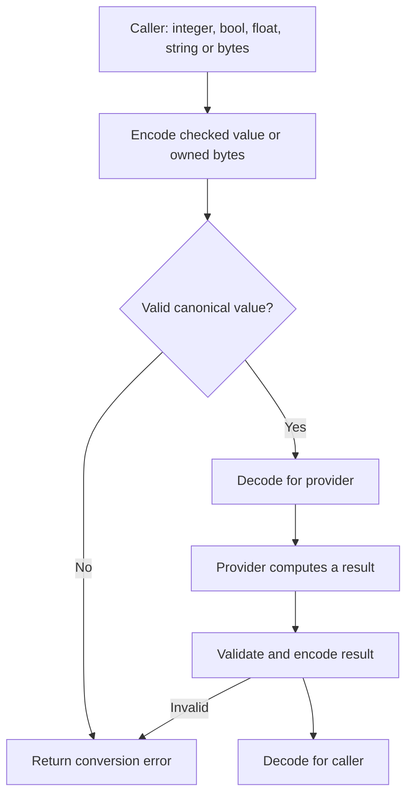

Text uses UTF-8. Ordinary bytes are independent values, not shared buffers.

#### Records and generic records

A record is a value, not a remote object. A concrete `Page<User>` uses the same field conversion rules as User.

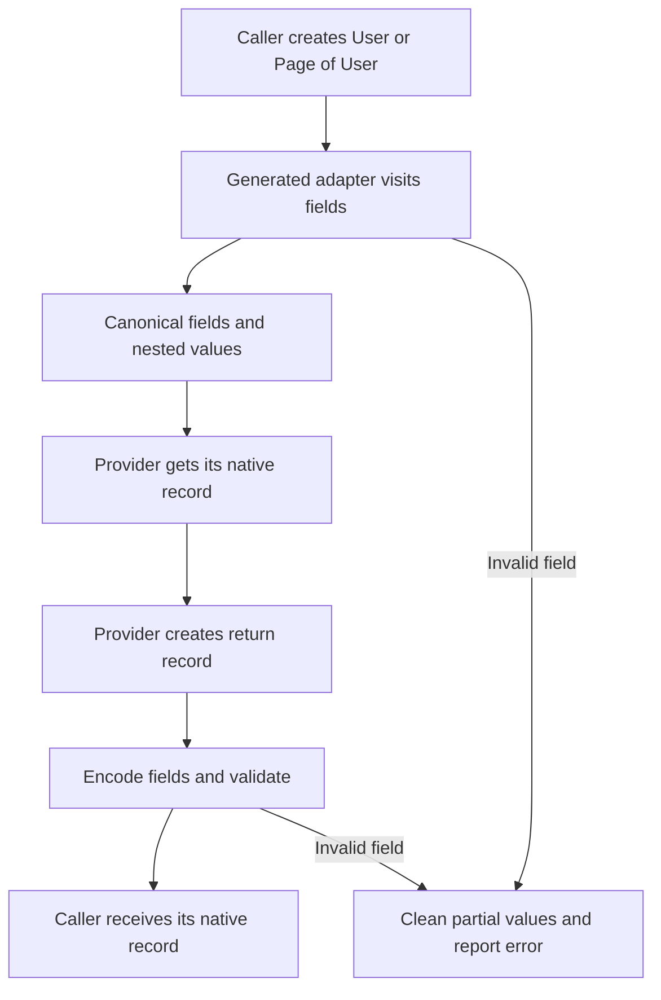

#### Enums

An enum represents exactly one declared value. For example, UserStatus.Active has the declared integer 1. Never transfer the ordinal position or a display name.

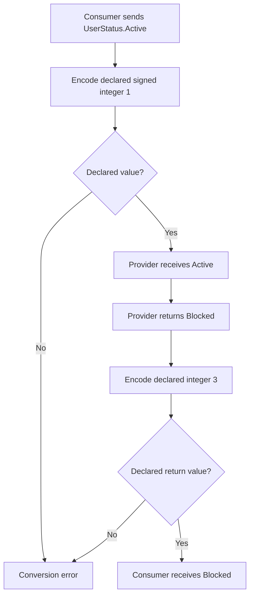

#### Flags

Flags describe independent bits that may be combined. For example, Read is 1, Write is 2, and Read plus Write is 3. Zero means no flags.

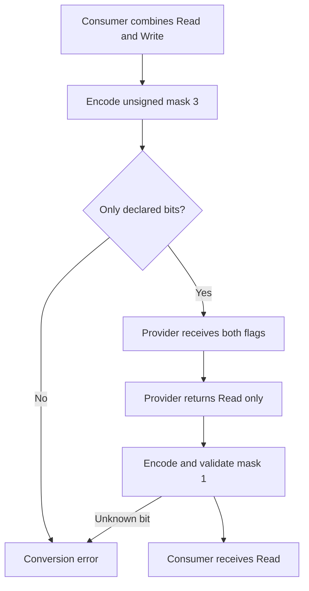

#### Variants

A variant holds exactly one declared alternative. An alternative may carry a value or be payload-free. For a payload-free case, validate only its known tag and initialized state, never allocate, read, retain or destroy a synthetic payload. The same active-branch conversion plan also implements optional and Result.

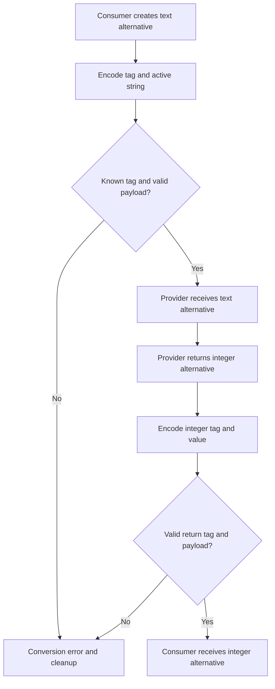

The tag identifies the declared case, not its payload type. Two alternatives with the same payload type and several payload-free cases are legal and remain distinct on every target. C++ uses distinct named case wrappers or explicit index-based tagged storage with unambiguous named construction/access; never rely on std::get<T> for repeated types or collapse all empty cases into one monostate. Swift/Kotlin/Dart/C#/Python/JS use actual named cases or tagged factories, not payload-type inference. Equality checks the tag before payload comparison. Validate unknown tags and mismatched payloads. Only the active payload, if the declared case has one, is read, retained or released. Never inspect inactive storage. A payload-free case is not an uninitialized aggregate, runtime error or null.

#### Lists and arrays

A list preserves element order for any legal element type; array is restricted to bool and fixed-width numeric scalar elements and uses the same sequence conversion machinery with an exact typed representation. Both represent independent values unless a separate shared-memory type is used. The ABI planner may optimize list storage without changing its public type.

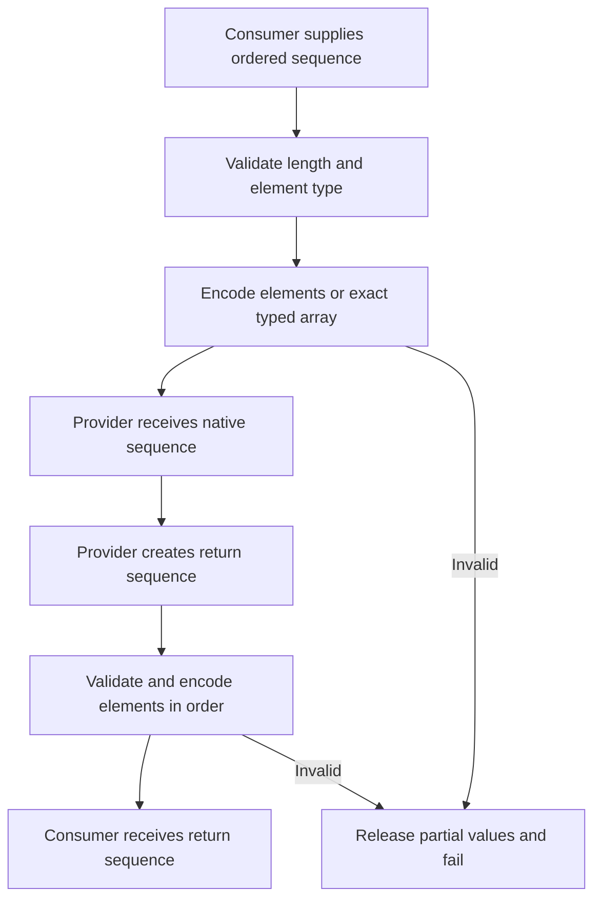

#### Sets and maps

A set holds unique values. A map holds a value for each unique key. Both use the canonical equality rules, even when the host's default equality differs.

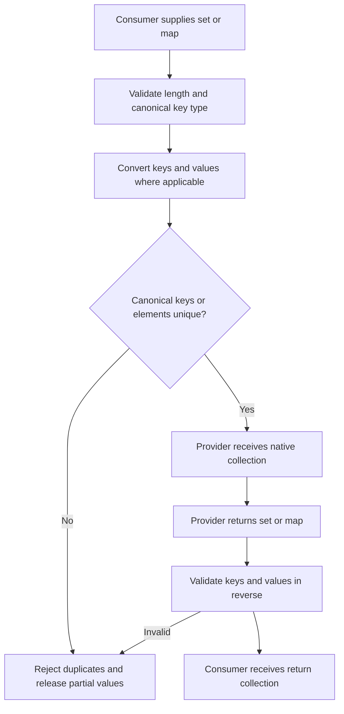

A missing key and a key with an optional absent value are different. A map or set has no portable iteration-order guarantee.

#### Optional values and defaults

Only construction applies defaults. The bridge carries the presence tag, not the original omission.

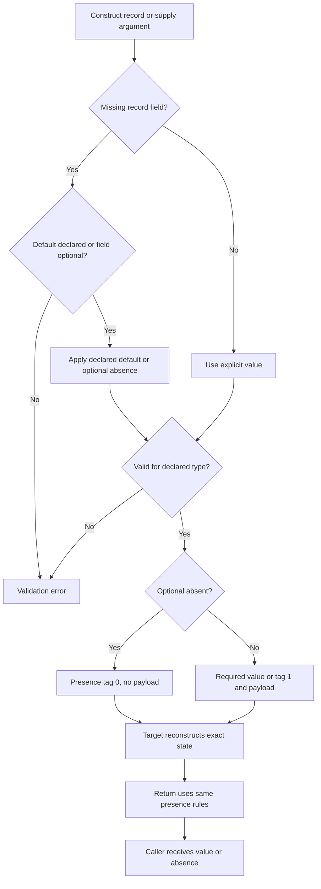

Direct nested optionals are rejected; optional values inside a distinct aggregate use their own presence decision. A runtime error is never converted into absence.

#### Result and runtime errors

A business error is an expected return from an implementation. A runtime error means the invocation itself failed.

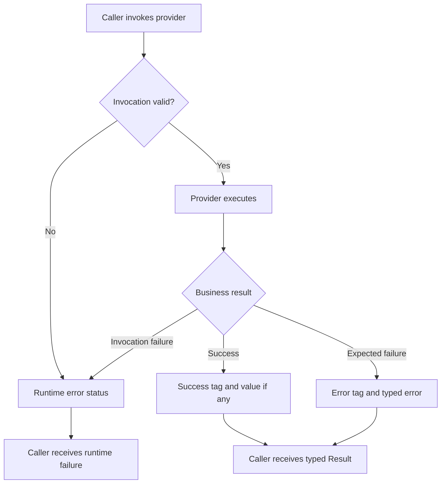

#### Dates, timestamps, durations and UUIDs

An instant is always normalized to UTC. A calendar date has no timezone.

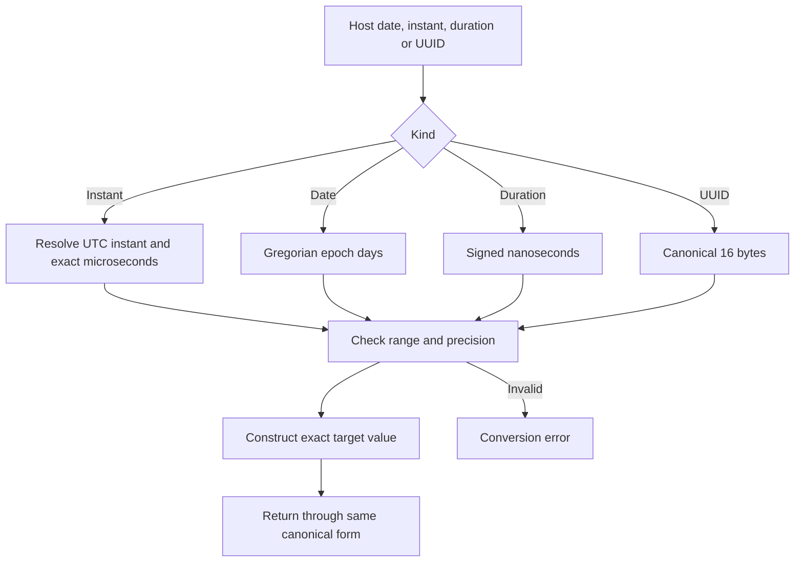

#### External types

An external type is converted by user-owned adapters. The generator itself remains unchanged.

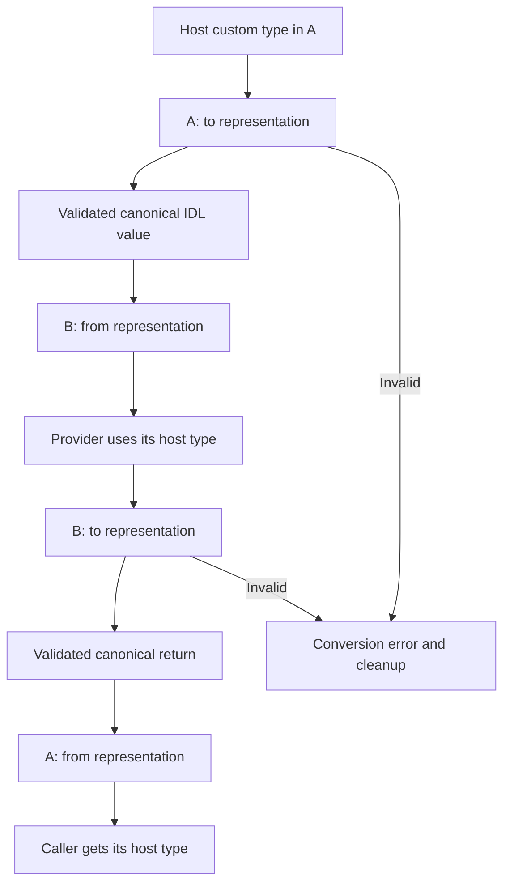

## 6. Modules and dependencies

### 6.1 Example application layout

```text
my-project/
├── polyglue.yaml
├── modules/
│   ├── domain/
│   │   ├── module.yaml
│   │   └── idl/
│   │       ├── user.idl
│   │       └── product.idl
│   ├── repository/
│   │   ├── module.yaml
│   │   └── idl/
│   │       ├── user-repository.idl
│   │       └── product-repository.idl
│   └── network/
│       ├── module.yaml
│       └── idl/
│           └── http-client.idl
├── native/
├── android/
├── apple/
├── python/
├── dotnet/
├── flutter/
└── web/
```

#### 6.1.1 Conventional implementation layout

```text
my-project/
├── polyglue.yaml
├── implementation/
│   ├── CMakeLists.txt          # optional project-owned native entrypoint
│   ├── project.cmake
│   ├── build.py
│   ├── package.py
│   ├── deploy.py
│   └── android/
│       └── package.py
└── modules/
    └── repository/
        ├── module.yaml
        ├── idl/
        │   └── user-repository.idl
        └── implementation/
            ├── module.cmake
            ├── c/
            ├── cpp/
            ├── java/
            ├── kotlin/
            ├── objc/
            ├── swift/
            ├── python/
            ├── dart/
            ├── csharp/
            ├── javascript/
            └── platforms/
                ├── android/
                ├── ios/
                └── linux/
```

All implementation directories and files are optional; no empty scaffolding. A module may contain only IDL. Use the actual declared target IDs for language folders and actual platform IDs for platform folders. Only modules in the selected dependency closure participate; only selected languages and platform variants contribute sources. Generation and clean never overwrite or delete handwritten code. Explicit implementation roots and extra source/dependency lists remain supported. Existing projects can opt out of conventional discovery with an explicit source plan. CMake integration and Python local actions are explained in sections 20.4.4 and 20.5.2.

A module is the fundamental unit of logical compilation, dependency resolution and independent generation. It can be distributed independently or composed into a library with other modules. A project is a collection of modules, optional library definitions and shared defaults, not a mandatory monolithic input. A logical module name is not automatically a public language import name.

### 6.2 Independent dependencies

```yaml
dependencies:
  domain:
    path: ../shared-domain/module.yaml
    mode: source
  networking:
    path: ../shared-networking/polyglue-manifest.json
    mode: prebuilt
```

| Mode | Behavior |
| --- | --- |
| source | Resolve IDL and generate required target dependencies |
| prebuilt | Reuse validated generated artifacts and contract metadata without regenerating |

A prebuilt manifest includes enough canonical contract information to resolve imported symbols (not just hashes), plus public include/import locations and ABI compatibility information. Validate actual artifacts, dependency closure and versions. Do not duplicate imported types.

Use the fully qualified case-sensitive logical module and symbol name as identity, independent of physical directory, output names and version. Module names use dot-separated ASCII identifier segments; declaration/member identifiers are ASCII identifier tokens. Reject invalid or reserved IDL identifiers rather than normalizing them. Resolve dotted module imports against the declared graph, not filesystem paths. Dependency aliases cannot rename canonical identities. Target casing and escaping happen only after logical resolution. Require a unique logical module name across the dependency closure, with qualified module names available for independently distributed libraries. Distinguish semantic identity, contract fingerprint and target ABI fingerprint. Check the current manifest schema and contract/ABI fingerprints directly. No old-schema reader or compatibility translation.

#### 6.2.1 Module versions and dependency identity

module.name is required and matches every IDL module declaration in its source roots. module.version is optional for local source-only modules; absence is recorded as unversioned, not 0.0.0 or the tool version. A separately distributed prebuilt module requires an explicit MAJOR.MINOR.PATCH module version and validated contract/ABI fingerprints. A packaged library may contain local unversioned source modules; its release version never fills module versions. Project version is optional application metadata. Source dependencies resolve from explicit manifest paths and logical identity. An optional exact dependency version constraint is checked against the manifest, not resolved by downloading another version. Reject conflicting logical IDs, incompatible fingerprints and competing artifact owners in the selected closure. Deduplicate identical references to the same owner. Version equality alone is not compatibility.

Source IDL and prebuilt manifests are two inputs to the same canonical declaration graph. Decode manifests into validated immutable canonical nodes and actual artifact references; run one symbol, import, generic and dependency resolver. Do not implement a parallel prebuilt compiler or remote version resolver. One schema/catalog defines canonical metadata; source and prebuilt use the same identity and compatibility rules.

### 6.3 Manifest

```json
{
  "schema_version": 1,
  "generator_version": "0.0.1",
  "runtime_abi_version": 1,
  "module": {
    "id": "domain",
    "version": "1.0.0"
  },
  "symbols": {
    "domain.User": {
      "kind": "record",
      "targets": {
        "cpp": {
          "name": "app::domain::User",
          "file": "include/app/domain/user.hpp",
          "import": "app/domain/user.hpp"
        },
        "dart": {
          "name": "User",
          "package": "app_domain",
          "file": "lib/src/user.dart",
          "import": "package:app_domain/app_domain.dart"
        }
      }
    }
  }
}
```

Illustrative versioned module excerpt. The full schema includes artifact kind (source plan, local build or distributed prebuilt), canonical type definitions, specialization owners, fingerprints, exact dependency identities, architecture-specific ABI information, effective naming/layout metadata and generated-file ownership/content hashes. module.version is absent or null for an unversioned local source/build manifest and must be explicit for a separately distributed prebuilt module. Packaging unversioned source modules inside a versioned library records their canonical fingerprints and containing library release identity, not invented module versions; consumers importing that library's internal module through its validated library manifest use the enclosing library coordinates and exact module fingerprints, not a standalone prebuilt module lookup. A requested exact module version cannot match an unversioned module. Manifest paths are relative to declared roots, validated before access; reject path escape, unknown schema, duplicate IDs, wrong architecture, missing dependency or mismatched content. Never emit fake fingerprints.

### 6.4 Acceptance tests

- Generate domain and repository together and separately, using source and prebuilt dependencies.
- Import a type by explicit symbol, module/symbol alias and grouped import. Reject wildcard imports and detect ambiguity.
- Change a domain output path, prefix or package and regenerate repository imports correctly.
- Reject incompatible duplicates, missing targets, invalid cycles, incompatible manifests and unavailable generated artifacts.
- Confirm stable logical identity regardless of generated target casing or path. IDL identifiers themselves are case-sensitive: User and user are distinct logical declarations and may cause a target collision.

### 6.5 Module imports and dependency flow

#### A module uses a type from another module

Logical imports resolve before file generation, even if the modules use different namespaces or output paths.

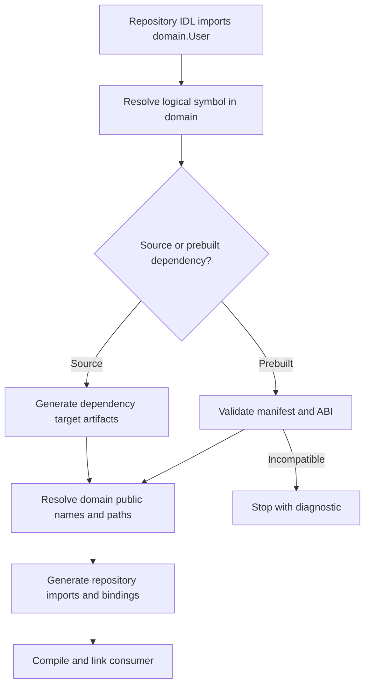

## 7. Module-first configuration

### 7.1 Precedence and semantics

From lowest to highest priority:

1. Built-in generator defaults for the selected target.
2. Project-wide defaults, including target-specific defaults.
3. Selected library defaults, only when generating or assembling that library.
4. Module-wide defaults.
5. Explicit target settings inside that module.
6. Declaration annotations for supported properties.

Library public entry-point identities and exposure rules are assembly settings, not inherited module naming overrides. They are resolved separately from module defaults. A library can specify its public module, package, namespace, facade aliases and export set. A source module's derived standalone physical scope may be planned in the unified library scope under section 10.5. Explicit defining-module names and prebuilt names are never silently rewritten. Module-level explicit naming and declaration annotations still control the defining symbols. Multiple libraries can consume the same module with distinct public facades. For different actual module render configurations, stage isolated outputs keyed by the effective configuration; never overwrite another library's files. Prebuilt modules cannot be renamed or recompiled by consumer defaults; use compatible public aliases or explicitly rebuild from source.

Project, library and module defaults use the same defaults key, with shared settings and nested targets. Library defaults are configured at libraries.<id>.defaults. Apply shared settings before target-specific settings at each level. Normalize naming shorthand before merging, for example methods: camelCase means methods: {case: camelCase}. Merge mappings recursively. Scalar and list values replace inherited values unless explicitly documented otherwise. Missing values inherit. Null is only valid for nullable options. Unknown keys, conflicting options and invalid types fail validation. Relative paths resolve from the file that originally declares them, even after inheritance. Reject duplicate YAML mapping keys, unsafe YAML tags, cyclic aliases and unbounded alias expansion before merge. Source roots and authorized output roots are distinct. External output paths are allowed when explicitly configured, but traversal outside the configured output root and unintended symlink writes are forbidden.

One schema and merge engine serves generation, annotations, template lookup and build planning. Normalize supported shorthand once, retain origin metadata, derive missing public identities once and feed every command the same resolved model. Runtime creation options are a typed resource policy, not a second configuration language. Keep internal naming and implementation switches out of YAML; reject obsolete options, no compatibility aliases.

Minimal standalone configuration (all output, source discovery and naming defaults are derived):

```yaml
module:
  name: repository
targets:
  cpp:
    namespace: app::repository
  swift:
    module: AppRepository
  kotlin:
    package: com.app.repository
```

Only explicit application choices and integration requirements should need configuration; do not require callers to repeat generated technical defaults.

### 7.2 Global configuration

`polyglue.yaml`:

```yaml
project:
  name: application
  version: "1.0.0"

modules:
  - modules/domain/module.yaml
  - modules/repository/module.yaml
  - modules/network/module.yaml

defaults:
  generation:
    encoding: utf-8
    line_endings: lf
  file_header:
    generated_warning: true
  targets:
    cpp:
      standard: 20
      naming:
        types: PascalCase
        methods: camelCase
        fields: camelCase
        files: kebab-case
    objc:
      swift_names:
        enabled: true
        remove_prefix: true
        remove_suffix: true
    dart:
      naming:
        types: PascalCase
        methods: camelCase
        files: snake_case
```

Global defaults must not enable undeclared targets automatically. A standalone module explicitly selects its public targets. An explicitly selected library declares its public targets and requests the necessary source-module generation closure for those targets, even when the modules rely on inherited target defaults rather than repeating target blocks. A module may explicitly disable a target with enabled: false; incompatible public library requests fail. Missing target blocks inherit the selected library's target plan. A module target block selects a standalone target unless enabled: false; inherited defaults alone do not select targets. Internal bridge representations do not imply a public target. Determinism, ABI validation, ownership safety, ARC where required, nullability correctness and strict concurrency checks are mandatory invariants, not options to disable.

### 7.3 Domain module configuration

`modules/domain/module.yaml`:

```yaml
module:
  name: domain
  version: "1.0.0"

sources:
  - idl/**/*.idl

targets:
  c:
    output: ../../native/domain/c
    prefix: app_domain_
    include_prefix: app/domain
  cpp:
    output: ../../native/domain/cpp
    namespace: app::domain
    include_prefix: app/domain
    header_extension: hpp
    source_extension: cpp
  java:
    output: ../../android/generated/domain/java
    package: com.app.domain
  kotlin:
    output: ../../android/generated/domain/kotlin
    package: com.app.domain.kotlin
    model_source: java
  objc:
    output: ../../apple/Domain/ObjC
    prefix: DOM
    module: AppDomain
  swift:
    output: ../../apple/Domain/Swift
    module: AppDomain
    model_source: objc
  dart:
    output: ../../flutter/packages/domain
    package: app_domain
    mode: package
  python:
    output: ../../python/domain
    package: app_domain
  csharp:
    output: ../../dotnet/Domain
    namespace: App.Domain
    assembly: App.Domain
  javascript:
    output: ../../web/domain
    module: "@app/domain"
  typescript:
    output: ../../web/domain
    module: "@app/domain"
    implementation_source: javascript
  wasm:
    output: ../../native/domain/wasm
```

The model_source and implementation_source settings express artifact ownership. Section 10.6 specifies automatic paired-target defaults and explicit independent mode. The owner target alone emits the shared files. Selecting a dependent target automatically includes the owner artifacts in its dependency closure. An internal C, JNI or Apple adapter does not automatically make that adapter's language a public target. Only explicitly requested public targets and declared shared public artifact owners are exposed. Internal adapters use the canonical representation for external types, without demanding an unrelated public host mapping. For shared Java/Kotlin models, Java owns JVM class identity and public field types. Kotlin adapters convert at the API boundary where needed. Java and Kotlin interfaces with different async signatures cannot occupy the same JVM name. In the paired example Java owns com.app.repository.UserRepository and Kotlin owns com.app.repository.kotlin.UserRepository with its suspend API. Both use the Java-owned shared models. Distinct real packages preserve the same simple type name. Names do not change based on command-level target filters. Resolve paired-target ownership from the complete declared module or library target set before filtering. Both use the same logical IDL descriptor and ABI. For Swift model_source: objc, use the imported type directly in the mixed framework; emit a qualified public typealias only in a genuinely distinct facade module. Never emit a recursive same-module alias. A plain Swift import does not itself re-export types. Shared JS/TS output has one JS runtime and package.json owner, with TypeScript adding declarations and type metadata to the joint file plan. Validate artifact ownership and emit only required files. If independent Java and Kotlin callable classes are required, use distinct real packages (derived automatically for a paired library unless explicitly configured). Independent value models are a separate opt-in choice. If independent Swift models are needed, use non-conflicting modules/names. JavaScript and TypeScript outputs may share a package only when their planned filenames and export contracts do not conflict.

### 7.4 Repository module configuration

`modules/repository/module.yaml`:

```yaml
module:
  name: repository
  version: "1.0.0"

sources:
  - idl/**/*.idl

dependencies:
  domain:
    path: ../domain/module.yaml
    mode: source

targets:
  c:
    output: ../../native/repository/c
    prefix: app_repo_
    include_prefix: app/repository
  cpp:
    output: ../../native/repository/cpp
    namespace: app::repository
    include_prefix: app/repository
  java:
    output: ../../android/generated/repository/java
    package: com.app.repository
  kotlin:
    output: ../../android/generated/repository/kotlin
    package: com.app.repository.kotlin
    model_source: java
  objc:
    output: ../../apple/Repository/ObjC
    prefix: REP
    module: AppRepository
  swift:
    output: ../../apple/Repository/Swift
    module: AppRepository
  dart:
    output: ../../flutter/packages/repository
    package: app_repository
    mode: package
  flutter:
    output: ../../flutter/plugins/repository
    package: app_repository_plugin
  python:
    output: ../../python/repository
    package: app_repository
  csharp:
    output: ../../dotnet/Repository
    namespace: App.Repository
    assembly: App.Repository
  javascript:
    output: ../../web/repository
    module: "@app/repository"
  typescript:
    output: ../../web/repository
    module: "@app/repository"
    implementation_source: javascript
  wasm:
    output: ../../native/repository/wasm
```

### 7.5 Network module configuration

`modules/network/module.yaml`:

```yaml
module:
  name: network
  version: "1.0.0"

sources:
  - idl/**/*.idl

targets:
  c:
    output: ../../native/network/c
    prefix: app_net_
    include_prefix: app/network
  cpp:
    output: ../../native/network/cpp
    namespace: app::network
    include_prefix: app/network
  java:
    output: ../../android/generated/network/java
    package: com.app.network
  kotlin:
    output: ../../android/generated/network/kotlin
    package: com.app.network.kotlin
    model_source: java
  objc:
    output: ../../apple/Network/ObjC
    prefix: NET
    module: AppNetwork
  swift:
    output: ../../apple/Network/Swift
    module: AppNetwork
  dart:
    output: ../../flutter/packages/network
    package: app_network
    mode: package
  flutter:
    output: ../../flutter/plugins/network
    package: app_network_plugin
  python:
    output: ../../python/network
    package: app_network
  csharp:
    output: ../../dotnet/Network
    namespace: App.Network
    assembly: App.Network
  javascript:
    output: ../../web/network
    module: "@app/network"
  typescript:
    output: ../../web/network
    module: "@app/network"
    implementation_source: javascript
  wasm:
    output: ../../native/network/wasm
```

None of these choices is imposed on domain or repository.

### 7.6 Configuration schema coverage

| Category | Required options |
| --- | --- |
| Sources | IDL roots/globs, dependencies, external manifests |
| Paths | Output root, headers, sources, public/private paths, runtime location |
| Naming | Per-category case, prefix, suffix, acronym policy |
| Namespace | C++, C# |
| Package | Java, Kotlin, Python, Dart, Flutter |
| Module | Swift, Objective-C, JS/TS |
| Assembly | C# |
| Imports | Public import path, include prefix, strategy, module maps, exports |
| Templates | Override directory and explicit inheritance policy |
| Formatting | Indentation, line endings, final newline, brace style where supported |
| Annotations | Registered semantic metadata and target-specific public names/labels/selectors; derive backend attributes automatically |
| Visibility | Exported/public/private/internal symbols |
| Availability | Platforms, SDK minimums and capability checks |
| Build | Sources or package mode. Platform build settings |
| Runtime | Shared runtime integration and supported version |
| ABI | Version and binary contract checks |
| Documentation | Comments and generated API docs |
| Headers | License, copyright, generated warning, version and source metadata |

Define a machine-readable schema with examples and reject unknown options. Do not invent settings without implementing their semantics. Test inherited defaults, module-only generation, target-specific overrides and invalid combinations.

#### 7.6.1 Discoverable defaults and resolved configuration

All supported options are described by one machine-readable typed schema, including key path, applicable target and scope, type, allowed values, default or deterministic derivation rule, nullability, whether required, merge rule, validation constraints, and examples. Generate the configuration reference and built-in defaults view from the same definitions used by validation and resolution. Every shipped default is explicitly versioned with the generator, not guessed from the installed formatter or environment. A target-specific default is only displayed for that target; unsupported properties are rejected with a path and reason. No advertised setting may be ignored.

```bash
polyglue config defaults
polyglue config defaults --target cpp
polyglue config schema
polyglue config resolved --module repository --target swift
polyglue config resolved --library ubook --target swift
polyglue config resolved --library ubook --format json
```

Defaults output contains all applicable presentation and integration settings, including the Swift import defaults, not just values explicitly supplied in YAML. A derivation rule is displayed as a rule when no project or module ID is available. Resolved output shows effective values and their source (built-in, project, library, module, target or annotation), normalized names/paths and selected export and dependency closure. Never print credentials. Config commands and validate operate without rendering or modifying files. The machine-readable schema supports editor completion and diagnostics. JSON output is deterministic; output format is distinct from library artifact format and used only by config commands here. Do not introduce parallel config engines or duplicate hand-maintained default tables.

#### 7.6.2 Default versus required input

| Area | Built-in default | Explicit input / override |
| --- | --- | --- |
| IDL source discovery | idl/**/*.idl relative to module.yaml, sorted by normalized path | Source globs, files and excludes |
| Module/target selection | Only requested standalone targets or explicit library target closure | Module IDs, library IDs, public targets |
| Output root | generated/<module-id>/<target-id> relative to module manifest for standalone generation; isolated library output under configured build root when necessary | Output paths, public/private dirs, header/source dirs |
| Generation mode | sources | package integration metadata when selected |
| Build root / artifact root | build/polyglue and dist relative to project config | Config-relative paths |
| Implementation roots | implementation relative to project or module; discover_implementation true | Explicit build.implementation_root, build.discover_implementation, additional sources |
| Native CMake root | Project implementation/CMakeLists.txt if present, otherwise generated root | build.cmake.source_dir and per-platform override |
| Native dependency provider | system (ordinary CMake) | build.native_dependencies.provider: cpm, conan or custom |
| Build configuration | release for library build/package; explicit debug/sanitizer profiles supported | Configuration, toolchain, flags, parallelism, environment allowlist |
| Library API exposure | unified, public selected modules plus required signature types | modular, export allowlist, aliases, entrypoint and public identities |
| Public imports | Resolved automatically from defining manifests and selected library export graph | Include/import prefixes, module/package/namespace, supported import strategies |
| Runtime linking | Explicit context selection per library integration; cooperating libraries may share a context; generated internal native adapter as needed | Static/shared linkage and explicit existing-context attachment |
| Registry | Optional; duplicate Reject | Explicit Replace or ScopedOverride per registration; separate registries and attachment policy |
| Templates | Versioned built-ins, explicit inheritance of unspecified overrides | Trusted directory, individual file overrides, inheritance policy |
| Text | UTF-8, LF, final newline, no timestamp, deterministic ordering | Supported encoding/layout overrides only when valid; deterministic source is mandatory |
| Source documentation | Propagate IDL docs, generated warning on, source path/version metadata off unless enabled | Header, license, copyright, doc layout, source metadata |
| Optional formatting tools | Off; built-in templates readable | Explicit supported formatter and settings |
| Package versions | No invented release version/build number | Required explicit version and build number for release artifact |
| Deployment | Off; local artifact only | Explicit destination, artifact identity and authorized invocation |
| Tests | 100% Python statement and branch coverage, full contract coverage, real selected target evidence | Selection of local test scope, sanitizer/configuration, bounded resources; no release bypass |

Derived defaults are deterministic and schema-validated. Required business intent, target selection, public release coordinates, credentials, platform capability and safe executor choice are not guessed. Every applicable configurable property has a documented override path; options that cannot be implemented without changing the IDL contract or breaking security are not offered. A user may configure a safe policy, not disable required validation, reference checks, type precision, deterministic generation or platform restrictions. Preserve security defaults and explicit failure semantics from sections 12–15.

#### 7.6.3 Operational defaults and diagnostics

Keep presentation/build options, context creation options and declaration semantics distinct. Runtime defaults are passed through typed initialization or provider/subscription options; no second hidden global configuration. A generator must not mutate the policy of an explicitly supplied live context.

| Setting | Built-in default |
| --- | --- |
| Native linkage | static for standalone native libraries where valid; required platform adapter/shared-runtime linkage takes precedence |
| Generation and build | incremental reuse of validated matching fingerprints; explicit clean supported |
| Parallel jobs | auto, max(1, detected available logical CPU count), subject to configured resource limits |
| Logging | info; diagnostics on stderr; debug/quiet configurable |
| Diagnostics | human-readable; JSON on request |
| Visibility | IDL declarations public unless private; generated marshalling helpers internal |
| Dispatch | existing owning executor; no per-call threads or automatic worker pool; explicit affinity and bounded dispatch under section 14.7 |
| Registry | Reject; no implicit context creation |
| Direct callback | scoped |
| Stream | ordered bounded lossless demand (section 14.3.1) |
| Deployment | disabled until explicitly selected |

Define generation.incremental, build.incremental, build.jobs, build.cmake and build.native_dependencies as specified in 7.7.3, diagnostics.format, diagnostics.log_level and target build.linkage in the schema. Use --jobs, --clean, --diagnostics and --log-level for command-local overrides of applicable operational settings. They do not override canonical semantics or security invariants. Config --format json is distinct from build/package artifact --format. Unavailable CPU count resolves to one job. Positive resource limits must be enforced; job count alone does not guarantee bounded memory.

Diagnostics have stable symbolic codes, severity, message, source path, line/column/span where applicable, related locations, module/target/library context and actionable guidance. Examples: CONFIG_UNKNOWN_KEY, IDL_UNRESOLVED_SYMBOL, NAME_COLLISION, ABI_INCOMPATIBLE, OUTPUT_UNOWNED and TOOLCHAIN_MISSING. Sort diagnostics deterministically by location and code. JSON emits structured records rather than scraped terminal text; ordinary result output stays separate. Exit 0 for success, 2 for invalid input/configuration, 1 for operation/build/test failure and host-conventional interruption status. Keep one typed code registry. Redact secrets and sensitive arguments; generated files remain free of machine-specific paths. Local diagnostic paths are allowed. Never downgrade errors to hide a missing toolchain or target failure.

### 7.7 Library and build configuration

A module remains the unit of logical generation. A library is an explicit aggregation of already-defined modules for public API exposure, linking, packaging and distribution. The configuration root is libraries, and the CLI selector is --library. A build system may call a library a product (for example a SwiftPM library product), but that ecosystem term is not a separate PolyGlue config entity. Do not implement an obsolete products key or --product alias. The library's identity does not override IDL type identities. The default unified public API exposes the chosen modules through an ecosystem-native entry point with one intended runtime context. Modular exposure is opt-in. See section 10.5.

A library without artifact settings can generate its source facade and selected bindings. Packaging a distributed library (binary or source) requires an explicit release version and build number. Library target selection is a list; per-target public identity and export customization belongs under api.targets. Keep this distinction rather than supporting competing YAML shapes for the same property.

Module-level build settings configure integration, not global compiler installation:

```yaml
targets:
  cpp:
    output: ../../native/repository/cpp
    namespace: app::repository
    include_prefix: app/repository
    mode: package
    build:
      library_name: app_repository
      linkage: static
      public_headers: include
      private_sources: src
      implementation_sources:
        - ../../native/implementations/repository.cpp
      dependencies:
        - app_domain
  kotlin:
    output: ../../android/generated/repository/kotlin
    package: com.app.repository.kotlin
    model_source: java
    build:
      android_namespace: com.app.repository
      consumer_rules: ../../android/consumer-rules.pro
```

Optional project and module configuration: build.implementation_root defaults to implementation relative to its own declaring project or module configuration. An optional build.discover_implementation boolean defaults to true; false selects only explicitly declared implementation inputs and applicable explicit CMake integration. Project implementation root contains optional CMakeLists.txt, project.cmake and local Python actions; module root contains module.cmake and sources. The existing targets.<target>.build.implementation_sources extends the conventional list; deduplicate canonical paths. The same schema, resolver and plan expose these choices. Generation must not require any build-only settings or implementation directory. Never execute embedded Python in YAML.

```yaml
build:
  implementation_root: implementation
  discover_implementation: true
```

Illustrative project-level libraries in polyglue.yaml (in addition to module paths and defaults from section 7.2). This unified-library example assumes source modules with derived package/namespace identities; it is an alternative to the explicit independent package/namespace layouts in sections 7.3–7.5. To use those exact independent module configurations, choose api.mode: modular or explicitly adapt their source package identities and export plans before using unified mode. Do not silently relocate prebuilt or explicitly scoped types:

```yaml
build:
  root: build/polyglue
  artifacts: dist
  configuration: release

libraries:
  mobile:
    modules: [domain, repository, network]
    targets: [c, cpp, java, kotlin]
    artifact:
      formats: [aar]
      name: app_bridge
      version: "1.0.0"
      build_number: 1
    platforms:
      android:
        min_sdk: 26
        abis: [arm64-v8a, armeabi-v7a, x86_64]

  apple:
    modules: [domain, repository, network]
    targets: [c, cpp, objc, swift]
    api:
      mode: unified
      targets:
        swift:
          module: AppBridge
        objc:
          module: AppBridge
          prefix: AB
    artifact:
      formats: [xcframework, swiftpm]
      name: AppBridge
      version: "1.0.0"
      build_number: 1
    platforms:
      ios:
        minimum_version: "17.0"
        device_architectures: [arm64]
        simulator_architectures: [arm64, x86_64]
      macos:
        minimum_version: "14.0"
        architectures: [arm64, x86_64]
      visionos:
        minimum_version: "1.0"
        device_architectures: [arm64]
        simulator_architectures: [arm64]

  desktop:
    modules: [domain, repository, network]
    targets: [c, cpp]
    artifact:
      formats: [cmake]
      name: AppBridge
      version: "1.0.0"
      build_number: 1
    platforms:
      linux:
        architectures: [x86_64, arm64]
      windows:
        architectures: [x86_64, arm64]
      macos:
        architectures: [arm64, x86_64]
```

SDK floors and architectures above are illustrative choices, not a verified toolchain matrix. The tool checks whether the installed SDK can build each requested slice. It must not silently remove an unavailable slice. Library manifests declare the exact module closure, native implementation sources, runtime linkage, library version, build number, requested output format and target/architecture matrix. artifact.formats declares the permitted outputs. The CLI --format selects one of them. When only one applicable format remains, infer it; otherwise require --format unless artifact.default_format explicitly selects a permitted applicable format. Reject an invalid or inapplicable default rather than choosing a different format. SwiftPM packaging depends on the matching XCFramework artifacts. A command builds only explicitly requested slices and never silently drops an unavailable one. For a desktop library spanning multiple host OSes, require explicit --platform selection unless the build plan can produce all requested platforms. CI assembles evidence across hosts rather than expecting one host to build every SDK. Library packaging can select source or prebuilt modules, with strict compatibility validation. A prebuilt module may carry its own module version but must not silently replace the library version. Library metadata is generated at the packaging boundary. Separate library output roots prevent cross-product contamination. A source-only project never has to declare libraries.

Dependency names in native build configuration refer to explicitly declared CMake targets, not arbitrary flags. IDL dependencies and native build dependencies are distinct. Module output paths, native implementation source paths, SDK settings, extra includes and link libraries are schema-validated. Accept additional CMake integration via an explicit, trusted consumer CMake target or source list. No arbitrary shell execution from IDL.

#### 7.7.1 Minimal library and explicit overrides

```yaml
project:
  name: ubook

modules:
  - modules/domain/module.yaml
  - modules/repository/module.yaml
  - modules/network/module.yaml
  - modules/helper/module.yaml

libraries:
  ubook:
    modules: [domain, repository, network, helper]
    targets: [cpp, objc, swift, kotlin, dart, python, csharp, typescript]
```

This is sufficient to generate a source library, provided the referenced module manifests declare valid module IDs and IDL sources (or use the default idl/**/*.idl glob). No boilerplate case, prefix, filename, import, template or formatter declarations are required. Library ID is explicit; public names derive deterministically from it, for example Ubook for Swift and C#, ubook for C++ and Python. Do not invent an organization reverse-DNS identifier or registry account: the minimal local JVM package is ubook; the application can explicitly set com.ubook. The same applies to Maven groups, npm scopes, signing identities and public release coordinates. Require real explicit identity where an ecosystem requires it. If the derived legal public name would collide or be invalid, diagnose it and require an override.

A full override of the public surface can be expressed as follows. Unspecified keys still inherit defaults. The artifact name is a distribution name, not an implicit override of a target's import name.

```yaml
libraries:
  ubook:
    modules: [domain, repository, network, helper]
    targets: [cpp, objc, swift, java, kotlin, dart, flutter, python, csharp, javascript, typescript, wasm]
    api:
      mode: unified
      targets:
        cpp:
          namespace: ubook
          include: ubook/ubook.hpp
          cmake_target: Ubook::Ubook
        objc:
          module: Ubook
          prefix: UB
          include: Ubook/Ubook.h
        swift:
          module: Ubook
        java:
          package: com.ubook
        kotlin:
          package: com.ubook.kotlin
        dart:
          package: ubook
          entrypoint: lib/ubook.dart
        flutter:
          package: ubook_flutter
        python:
          package: ubook
          entrypoint: ubook.api
        csharp:
          namespace: Ubook
          assembly: Ubook
        javascript:
          package: "@ubook/core"
        typescript:
          package: "@ubook/core"
        wasm:
          module: ubook
    artifact:
      name: Ubook
      version: "1.0.0"
      build_number: 1
```

This example shows names only, not a request to build every platform/format in one command. The selected library platform/build settings and ecosystem capability checks determine the actual distributables. When exactly one format is applicable to a requested platform and target set, infer it. Multiple compatible formats require explicit selection unless artifact.default_format was configured. Never infer unsupported architectures, signing credentials, deployment destinations, or publish coordinates. Native platform deployment floors and architecture sets must be explicitly resolved by the build plan, and must be compatible with selected toolchains and declared availability. Source generation stays independent of installed native SDKs. A library can define separate package identities for platform integrations without duplicating public canonical Dart models.

#### 7.7.2 Export selection and dependency closure

By default expose the public declarations of explicitly listed modules and the public types that are required to use their exported signatures. Other transitive dependencies stay implementation details. An explicit export set may select a subset of logical module IDs and fully qualified declaration IDs. Public signature dependencies must remain accessible through a faithful re-export or their declared dependency's real public import as allowed by section 10.7. A private or inaccessible signature type is an error. An explicit exclusion of a required public type that cannot be reached through a declared dependency is an error naming the missing type. Use api.exports for an explicit allowlist and api.targets.<target>.aliases for per-target public names keyed by canonical declaration ID where the language supports the alias or a proven typed facade. Validate unknown IDs, conflicting aliases and unsupported target mappings. No wildcard expansion based on filesystem order. Do not expose internal C ABI functions, bridge envelopes, native handles, vtable internals, support-only adapters or private fields just because they were linked into the library. A public type that cannot be represented using a target's idiomatic native type retains its required typed wrapper. In C the public typed ABI and opaque reference handles are intentional application-facing APIs; hiding internal bridge-only entrypoints does not hide the documented C consumer contract.

A library is not allowed to re-declare an interface with a different logical identity merely to move it to a convenient namespace. Re-exports, aliases, native public module ownership and forwarding facades must preserve canonical type identity and ownership. Validate the complete public symbol graph before rendering. If the target cannot offer a chosen unified layout with compatible prebuilt dependencies, require a compatible explicit modular layout or source rebuild. Do not silently generate duplicate classes or a second registry.

#### 7.7.3 Per-platform native build configuration

PolyGlue consumes the project's build intent from YAML, generates the integration, runs CMake for each native slice, then invokes the ecosystem packager. This is P1 convenience, not a prerequisite for P0 generation or actual source conformance. The user may point to an existing CMakeLists.txt directory or use the generated default. No extra handwritten script is required for ordinary projects.

Resolve project build defaults, libraries.<id>.build and libraries.<id>.platforms.<platform>.build in that order; explicit command-local selection of configuration/platform/architecture is last. Merge mappings per key, replace lists. Module/target build settings describe sources and dependencies, not competing top-level toolchains. Paths resolve relative to the YAML declaring them. Every slice has one CMake root, native product, provider and composed toolchain. For a single library product, the resolved native product linkage is controlled by build.linkage; a target's build.linkage describes only its own component integration when that component is separate. Do not use conflicting per-target linkage to create duplicate core instances. JNI/FFI/extension hosts require actual loadable outputs even if their internal core objects are static. Validate with one schema. Explicit null clears a nullable setting only where a default is defined.

| Path relative to build | Contract |
| --- | --- |
| cmake.source_dir | Optional directory containing CMakeLists.txt; default project implementation root if it contains that file, otherwise generated root. Explicit nonexistent root fails. |
| cmake.target | Optional actual native product target; default generated product; explicit custom target must satisfy 20.4.5. |
| cmake.generator | Optional generator; default compatible native choice (e.g. Ninja, Xcode, Visual Studio). |
| linkage | static or shared for the selected native library where applicable; default static for C/C++ install, shared for JNI/FFI/PInvoke/loadable extension, actual framework linkage for Apple; WASM module is its own format, not an OS shared library. |
| offline | Boolean, default false; true forbids dependency/tool downloads during build/package and uses available verified local/cache inputs. |
| native_dependencies.conan.build_missing | Boolean, default false; explicit permission to build missing dependency packages, subject to offline constraints. |
| cmake.toolchain_file | Optional user toolchain; compose with selected platform/provider, never pass two competing toolchains. |
| cmake.definitions | Map of CMake cache keys to bool/int/string or list of strings. Default empty. Reject overrides of reserved ABI/slice/ownership keys; preserve typed argument boundaries. |
| native_dependencies.provider | system (default), cpm, conan or custom. |
| native_dependencies.cpm.file / cache | Optional pinned local CPM.cmake and source cache; built-in pinned script if file omitted. |
| native_dependencies.conan.recipe | Explicit conanfile.py or conanfile.txt; if absent use exactly one conventional recipe in project implementation root. |
| native_dependencies.conan.build_profile / host_profile | Required explicit profile path or installed profile name for build tools and target dependency ABI. |
| native_dependencies.conan.lockfile | Existing lockfile, required for reproducible release dependency resolution. |
| native_dependencies.conan.settings / options / conf | Explicit Conan host mappings, empty default; validate against resolved slice. |
| native_dependencies.custom.setup_file | Explicit trusted local Python dependency setup action; required only for custom. |

Provider-specific inactive settings may be inherited but only the selected provider requires its tool/files. The existing targets.<id>.build.dependencies remains a list of CMake target names. Dependency recipes and versions live in ordinary CPM/Conan/CMake files, not a second package manager DSL. Profile and lockfile may be a mapping by exact normalized slice ID where graphs differ; no missing-entry fallback. A parameterized host profile can be used across ABIs only if checked slice settings actually select the correct ABI.

Minimal source project remains unchanged; the generated root builds from the conventional implementation directories. Example explicit roots/providers (illustrative SDK values and paths):

```yaml
build:
  root: build/polyglue
  artifacts: dist
  configuration: release
  cmake:
    source_dir: native
    generator: Ninja
    definitions:
      EXAMPLE_ENABLE_LOGGING: true
  native_dependencies:
    provider: cpm
    cpm:
      file: cmake/CPM.cmake

libraries:
  example:
    modules: [repository]
    targets: [c, cpp, java, kotlin, objc, swift]
    artifact:
      name: Example
      formats: [cmake, aar, xcframework, swiftpm]
      version: "1.2.3"
      build_number: 42
    platforms:
      android:
        min_sdk: 26
        abis: [arm64-v8a, armeabi-v7a, x86_64]
        build:
          cmake:
            source_dir: native/android
          native_dependencies:
            provider: conan
            conan:
              recipe: native/conanfile.py
              build_profile: profiles/build
              host_profile: profiles/android
              lockfile: locks/android.lock
      ios:
        minimum_version: "17.0"
        device_architectures: [arm64]
        simulator_architectures: [arm64, x86_64]
        build:
          cmake:
            source_dir: native/apple
            generator: Xcode
      macos:
        minimum_version: "14.0"
        architectures: [arm64, x86_64]
        build:
          cmake:
            source_dir: native/apple
            generator: Xcode
      linux:
        architectures: [x86_64, arm64]
```

Here the Android selection uses Conan and its specific CMake root; Apple uses CPM and Xcode; Linux uses the inherited native root. The actual Android profile must match every selected ABI through explicit per-slice settings or profiles. A platform/format plan selects the applicable declared public targets and private bridge closure; no irrelevant platform languages are compiled. An explicitly requested incompatible target fails. Ownership/identity is derived from the full declared graph, not filtered platform. Existing SDK/platform fields in sections 2 and 7.7 remain authoritative. Build/doctor checks actual CMakeLists.txt, tools and SDK availability before changing outputs; generate and config inspection do not execute native tools. The same standard layout can be used for the generator's own examples and tests.

### 7.8 Library version and build number

Keep the following identities independent. Never infer one from another.

| Identity | Source | Purpose |
| --- | --- | --- |
| PolyGlue version | Tool pyproject.toml | Generator and support library release |
| ABI version and contract fingerprints | Runtime and canonical IDL | Reject incompatible binary contracts |
| Module version | module.yaml | Logical module dependency metadata |
| Library version | libraries.<id>.artifact.version | Distributed library release version |
| Library build number | libraries.<id>.artifact.build_number | Identifies a particular build of that library version |

The library version and build number are required for every distributed library package, including source-only ecosystem packages, not only native binaries. They are not required for source-only IDL generation. Use an explicit numeric MAJOR.MINOR.PATCH string without leading zeroes and a positive integer build_number. The version is not derived from the Git tag, module version, tool version, CI run number or current time. The build number is supplied by the product owner, not incremented automatically. Keep library build numbers monotonic within a version for operational clarity. The tool need not contact a remote service to allocate a number. The same build identity is used by every requested architecture and format of a library for one build. Different platform and format outputs are distinct artifact sets under that identity. If changed bytes must replace an already deployed artifact set, assign a new build number explicitly. Local development may regenerate an unpublished artifact set at the same build number.

Example:

```yaml
libraries:
  apple:
    modules: [domain, repository, network]
    targets: [c, cpp, objc, swift]
    artifact:
      name: AppBridge
      formats: [xcframework, swiftpm]
      version: "1.2.3"
      build_number: 42
    platforms:
      ios:
        minimum_version: "17.0"
        device_architectures: [arm64]
        simulator_architectures: [arm64, x86_64]
```

Resolve these two values once in the Python build plan and pass the same immutable values to every downstream tool. Do not maintain duplicated editable versions in Gradle, CMake, Xcode, manifests or templates. Expose library_version and library_build_number in the existing versioned template context when generating for a versioned library package. For source generation without release metadata, these values are absent and templates must not invent a release version. A standalone module generation must not invent library metadata. Keep library-specific generated version files in the selected library staging directory so multiple libraries cannot overwrite shared module source. A module's logical ID and ABI fingerprint do not change merely because the library build number changed. The build and artifact fingerprints do change.

Validate version constraints for the selected ecosystems before building. Do not truncate, clamp, round, append an invented suffix or silently substitute a different value to fit a platform field. The library version remains the ecosystem package version. Build number is separate build metadata, not a new Maven/PyPI/npm/NuGet package version. Two builds of one ecosystem version are not two independently publishable releases in an immutable registry. Local and bucket paths distinguish them. Use a new library version if a registry requires a unique release coordinate.

#### 7.8.1 Propagation to toolchains

| Target | Library version | Build number |
| --- | --- | --- |
| C / C++ / CMake | Library project VERSION, generated library version header and package config version, target VERSION where applicable | Library version header and manifest |
| Windows native | File/Product version resource where emitted, checked platform representation | Checked fourth file version component when representable |
| Android AAR | Gradle project/publication version and local Maven coordinates | Packaged library metadata resource and native version metadata |
| JVM JAR | Gradle/Maven version and JAR Implementation-Version | JAR metadata and native version metadata |
| Apple framework | MARKETING_VERSION / CFBundleShortVersionString | CURRENT_PROJECT_VERSION / CFBundleVersion |
| SwiftPM | Distribution package metadata, archive and URL path. SwiftPM dependency versions are selected by actual Git tags or package configuration | Packaged metadata and referenced artifact build path |
| Python generated bindings | Wheel/sdist project version | Packaged metadata resource and native library version metadata |
| Dart / Flutter | pubspec.yaml package version | Packaged metadata and native library version metadata |
| C# | PackageVersion, Version and checked assembly/file version mapping | Informational metadata and checked file version where applicable |
| JS / TS | package.json version | Packaged library metadata |
| WASM | Product metadata emitted with the JS loader or packaged WASM assets | Same metadata and native library version where applicable |

AAR libraries do not have an application versionCode requirement. Only an application artifact with a supported versionCode field may map the library build number to it. Do not pretend JARs, archives, static libraries or WASM modules have a standard OS-level build number field. Where native metadata has no matching field, include the canonical values in a small packaged metadata resource. Use the resolved build plan as the source for embedded metadata and the final artifact manifest. Only add a small version header/resource where a runtime or ecosystem needs it. Never embed the final artifact manifest inside a file whose own hash that manifest records. Verify metadata in installed consumers. Do not add a new version service or ABI call solely for build numbers.

For CMake, pass explicit cache inputs from Python:

```bash
cmake -S . -B build/example -DPOLYGLUE_LIBRARY_VERSION=1.2.3 -DPOLYGLUE_LIBRARY_BUILD_NUMBER=42
```

The product integration uses these values for its project VERSION, configure_file version metadata and native target version properties as appropriate. Do not overwrite the parent project's version or set unrelated global version properties when using add_subdirectory. Shared library SOVERSION follows the runtime's actual ABI major, not the library's build number. Do not apply versioned shared-library properties to static archives. Keep compiler, platform SDK deployment floor and library version separate. Resolve the library version before the product CMake project() call. The PolyGlue runtime's own CMake project retains the tool/runtime version when built as a dependency. A generated product header must not redefine runtime version macros or collide with another product's header.

For Apple libraries, verify the framework Info.plist values after building each device/simulator slice and before assembling the XCFramework. Use the same library build identity across all constituent frameworks. For Windows/.NET numeric file version fields, check the range of each component before assigning it. For Android and JVM, verify the publication metadata and the packaged resource independently. For all formats, inspect final manifests and packaged version metadata and reject any mismatch with the resolved plan.

#### 7.8.2 Acceptance

- A single library configuration produces matching version and build metadata in the native outputs, ecosystem packages, archive metadata and artifact manifest.
- Changing only the build number invalidates relevant generated metadata and builds without changing logical type IDs or ABI fingerprints.
- Two builds with the same library version but different build numbers have separate output directories and can coexist.
- Distinct library versions or concurrent library builds do not overwrite common module source files.
- Invalid or unrepresentable version/build values fail before compilation. No silently modified version.
- Build and deploy reject a manifest whose version, build number, files or selected library identity differ from the requested configuration.

### 7.9 How configuration reaches generated files

#### Configuration, naming and annotations

The selected module and target have their own effective settings.

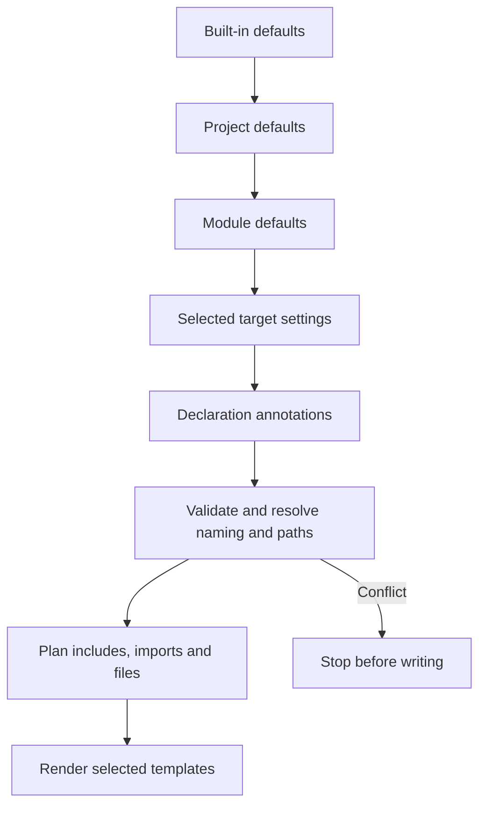

### 7.10 Single configuration and runtime options inventory

Use one machine-readable schema and one resolution implementation. The following paths close the gaps in the previously named options. These are project defaults, not a second runtime configuration file. Per-module or target overrides may tune generation, naming, templates and build settings but may not silently change the policy of a shared core/context supplied by the application. Resolve context initialization defaults at the embedding/library integration boundary; if independently selected libraries disagree, require the context owner to explicitly choose one supported policy. No last-loaded-wins. The actual typed options passed at create/attach override generation defaults for that resource only; subsequent adapters inspect effective policy without mutating it.

| Path | Value / built-in default | Scope |
| --- | --- | --- |
| compiler.limits.max_text_input_bytes | 16777216 | Each decoded text input |
| compiler.limits.max_total_input_bytes | 268435456 | Compiler invocation |
| compiler.limits.max_syntax_depth | 256 | Parser |
| compiler.limits.max_declarations | 100000 | Resolved graph |
| compiler.limits.max_specializations | 10000 | Concrete generic graph |
| compiler.limits.max_specialization_depth | 128 | Expansion path |
| defaults.runtime.resources.max_value_depth | 64 | Value conversion |
| defaults.runtime.resources.max_container_elements | 1048576 | Container |
| defaults.runtime.resources.max_value_bytes | 67108864 | Individual payload |
| defaults.runtime.resources.max_conversion_bytes | 268435456 | Invocation |
| defaults.runtime.resources.max_owned_buffer_bytes | 268435456 | DataRef allocation/adoption |
| defaults.runtime.resources.max_context_owned_bytes / max_context_temporary_bytes / max_context_operations / max_context_access_leases | Unset | Context aggregates |
| defaults.runtime.resources.max_attachment_queued_bytes / max_attachment_roots | Unset | Attachment aggregates |
| defaults.runtime.resources.max_subscription_queued_bytes | Unset | Subscription aggregate |
| defaults.runtime.resources.stream_capacity | 16 | Subscription default |
| defaults.runtime.executor.max_pending_dispatch | 64 | Bound executor |
| defaults.runtime.diagnostics.trace_enabled | false | Context |

All sizes/counts are positive integers (not YAML booleans, floats or coercible strings), bounded by checked runtime and compiler representations; optional aggregate absence is distinct from zero. A typed explicit null may clear an inherited optional aggregate, not a mandatory finite limit. Units are bytes, elements, depth or count, not ambiguous decimal/IEC string parsing. A latest-frame policy has one pending item slot (fixed), separate from an already admitted delivery, and never inherits lossless stream capacity. Provider execution profile, actual executor bindings, ownership, stream policy and transfer support are typed per-resource runtime options, not a YAML name that creates a thread or grants affinity. Application-specific HTTP timeout remains outside core defaults. Expose resolved values and origins through config inspection; runtime diagnostics expose actual initialization values without credentials. Validate unknown keys, duplicates, invalid scope, inconsistent limits, incompatible host capability and positive range before allocating or writing. Add a schema coverage test requiring every documented option and default to match the canonical implementation; no arbitrary undocumented environment variable overrides.

## 8. Naming and file formatting

### 8.1 Naming categories and defaults

| Target | Types | Methods | Fields | Files |
| --- | --- | --- | --- | --- |
| C | snake_case | snake_case | snake_case | kebab-case |
| C++ | PascalCase | camelCase | camelCase | kebab-case |
| Java / Kotlin | PascalCase | camelCase | camelCase | PascalCase |
| Swift | PascalCase | camelCase | camelCase | PascalCase |
| Objective-C | prefixed PascalCase | camelCase | camelCase | PascalCase |
| Python | PascalCase | snake_case | snake_case | snake_case |
| Dart / Flutter | PascalCase | camelCase | camelCase | snake_case |
| C# | PascalCase | PascalCase | PascalCase | PascalCase |
| JS / TS | PascalCase | camelCase | camelCase | kebab-case |

These are PolyGlue's explicit defaults, not claims that every language enforces these conventions. C++ uses camelCase by default for methods, async methods, fields, parameters, local variables and private member base names. For example repository.findAll() and repository.findById(id), with arrow syntax when using a pointer-like interface reference. Consumers may override public naming categories without changing the logical contract. Private implementation names and temporary variables are derived internally. Support PascalCase, camelCase, snake_case, SCREAMING_SNAKE_CASE, kebab-case, lowercase, UPPERCASE and dot-separated paths where legal. Configure types, records, interfaces, methods, async methods, fields, parameters, constants, enum values, files, namespaces and packages independently. Private fields, temporary names, proxy/adapter names and internal generic parameter spellings are not configurable.

### 8.1.1 Mandatory dash-based filenames

Use hyphens for multiword repository-owned filenames and directories wherever possible, including IDL, native C/C++ headers and sources, Jinja2 templates, CMake helper scripts, documentation, standalone Python scripts, CI workflows, assets and tests. Do not use underscores unless a language or tool requires them or the adopted language profile mandates the exact convention. Python importable modules/packages and __init__.py, enforced Dart file_names conventions, symbol-named Java/Kotlin/Swift files and required tool entrypoints are narrow exceptions. Keep these exceptions explicit. This is a filename policy, not a rule to rename valid identifiers, ABI symbols, JSON/YAML keys, package names or environment variables. Consumer naming overrides are still available, but the built-in defaults follow this policy. Validate path conventions and compile generated imports/includes after changing filenames.

Within each naming category, an explicit case, prefix or suffix overrides only that property. Inherit unspecified properties from the appropriate general category or target defaults. An async-method suffix does not discard method casing. Apply prefixes exactly once.

### 8.2 Prefixes and suffixes per module and category

Within domain:

```yaml
targets:
  objc:
    prefix: DOM
    naming:
      records:
        prefix: DOM
        case: PascalCase
      interfaces:
        prefix: DOM
        suffix: Protocol
        case: PascalCase
      enums:
        prefix: DOM
        case: PascalCase
      files:
        case: PascalCase
    swift_names:
      enabled: true
      remove_prefix: true
      remove_suffix: true
```

All three swift_names values above are built-in defaults even when the entire swift_names block is omitted. They remove only affixes introduced by Objective-C naming resolution, not characters that happen to match the original logical IDL name. Repository can independently use REP and an interface suffix such as Protocol. With that optional override applied in repository as well:

| IDL | Objective-C | Swift public name |
| --- | --- | --- |
| domain.User | DOMUser | User |
| domain.UserStatus | DOMUserStatus | UserStatus |
| repository.UserRepository | REPUserRepositoryProtocol | UserRepository |

A category-specific prefix replaces the target-wide prefix. It is not concatenated twice. Apply the configured filename convention to the final emitted symbol, subject to required type filenames. C/C++ filenames default to kebab-case while identifiers retain their configured case. An imported type always uses the defining module's resolved name, never the consuming module's prefix.

C# naming configuration example (I is opt-in; Async is the default only for genuinely asynchronous operations):

```yaml
targets:
  csharp:
    naming:
      types: PascalCase
      interfaces:
        case: PascalCase
        prefix: I
      methods: PascalCase
      parameters: camelCase
      async_methods:
        suffix: Async
```

### 8.3 Acronyms, reserved words and collisions

```yaml
naming:
  acronyms:
    - HTTP
    - URL
    - UUID
    - ID
    - GPU
    - XML
    - JSON
    - API
    - RGBA
    - IPv6
```

Define normalization and preservation policies per target. Default acronym segmentation recognizes the listed acronym dictionary and normalizes word casing deterministically. The acronym list and per-target casing/preservation rules are configurable. Test HTTPClient, XMLParser, getUserID, GPUTexture2D, URLRequest and IPv6Address. Expected normalized examples: httpClient / http_client, getUserId / get_user_id, gpuTexture2D / gpu_texture_2d. Swift-specific public names may explicitly preserve ID/URL spelling via the resolved acronym policy or annotations; do not invent semantic rewrites.

Handle reserved words through legal escaping where appropriate (Swift/Kotlin backticks, C# @identifier) or configured suffixes. Detect collisions after all conversions, including user_id vs userId, private-name allocation vs user types, Unicode/case-folded filenames, Java/Kotlin duplicate JVM types and reserved Windows filenames. Fail genuine public collisions with both source locations; allocate private implementation names internally under section 8.11.5. Never silently rename public symbols to resolve an ambiguity.

### 8.4 Formatting and headers

```yaml
targets:
  cpp:
    formatting:
      indent: 4
      indent_style: spaces
      line_length: 0
      brace_style: allman
      line_endings: lf
      final_newline: true
    file_header:
      copyright: "Copyright (c) 2026 Example"
      license: MIT
      generated_warning: true
      include_generator_version: true
      include_source_path: true
```

Use generation.encoding for the source text encoding and generation.line_endings as the common default; a target formatting.line_endings overrides the common default. Generated-header options belong to file_header (including defaults.file_header), not a competing generation.generated_warning key. Resolve all presentation options into one effective text/header plan. Generate deterministic UTF-8 text by default, ordered and deduplicated imports and appropriate documentation comments. Do not include wall-clock generation timestamps or machine-specific absolute source paths. If source metadata is selected, use a normalized logical module-relative path. Build provenance may record execution times separately from generated source and its fingerprints. Default formatting must be readable without external tools and follow the owner conventions in AGENTS.md, including single-line calls, signatures and string literals. Optional formatters: clang-format, google-java-format, ktlint, swift-format, Ruff, dart format, dotnet format, Prettier. Only advertise options a backend actually honors. Test custom formatting, output byte reproducibility and unchanged-file preservation.

### 8.5 Complete public naming defaults

Use the canonical case names PascalCase, camelCase, snake_case, SCREAMING_SNAKE_CASE, kebab-case, lowercase and UPPERCASE; dot-separated namespace/package segments are planned separately. UPPERCASE means uppercase without inserted separators, whereas SCREAMING_SNAKE_CASE means uppercase words separated by underscores. A target/category may override any case that can produce legal identifiers. All categories have an effective default even if omitted from YAML.

| Target | Types / records / interfaces / enums | Methods / async methods | Fields / parameters / locals | Constants | Enum cases |
| --- | --- | --- | --- | --- | --- |
| C | snake_case | snake_case | snake_case | SCREAMING_SNAKE_CASE | SCREAMING_SNAKE_CASE |
| C++ | PascalCase | camelCase | camelCase | SCREAMING_SNAKE_CASE | PascalCase |
| Objective-C | PascalCase with configured prefix | camelCase | camelCase | PascalCase with configured prefix | PascalCase with enum prefix |
| Swift | PascalCase | camelCase | camelCase | camelCase | camelCase |
| Java | PascalCase | camelCase | camelCase | SCREAMING_SNAKE_CASE | SCREAMING_SNAKE_CASE |
| Kotlin | PascalCase | camelCase | camelCase | SCREAMING_SNAKE_CASE | SCREAMING_SNAKE_CASE |
| Dart / Flutter | PascalCase | camelCase | camelCase | camelCase | camelCase |
| Python | PascalCase | snake_case | snake_case | SCREAMING_SNAKE_CASE | SCREAMING_SNAKE_CASE |
| C# | PascalCase | PascalCase; Async suffix only for async declarations | public properties PascalCase; parameters/locals/private camelCase | PascalCase | PascalCase |
| JavaScript | PascalCase | camelCase | camelCase | SCREAMING_SNAKE_CASE | PascalCase |
| TypeScript | PascalCase | camelCase | camelCase | SCREAMING_SNAKE_CASE | PascalCase |
| WASM | C ABI internal representation; JS/TS facade uses its target defaults | C ABI internal names; no public raw offsets | Canonical boundary layout; JS/TS facade defaults | Facade target defaults | Facade target defaults |

| Target | Source file naming | Default scope for standalone module |
| --- | --- | --- |
| C | kebab-case .h/.c | module-derived snake_case symbol prefix and include path |
| C++ | kebab-case .hpp/.cpp | module-derived snake_case namespace |
| Objective-C | PascalCase .h/.mm | module-derived PascalCase prefix and Clang module |
| Swift | PascalCase .swift | module-derived PascalCase Swift module |
| Java | PascalCase .java | module-derived lowercase legal package |
| Kotlin | PascalCase .kt | module-derived lowercase legal package |
| Python | snake_case .py | module-derived snake_case package |
| Dart / Flutter | snake_case .dart | module-derived snake_case pub package |
| C# | PascalCase .cs | module-derived PascalCase namespace/assembly |
| JS / TS | kebab-case .js/.ts/.d.ts as applicable | module-derived kebab-case package |
| WASM | kebab-case .wasm and adapter source | owning library/selected module ID |

A library facade uses the library ID rather than the module ID to derive its public entrypoint. Standalone scopes and actual artifact ownership are resolved from the defining module, not the consuming module. Never derive a reverse-DNS organization, public registry owner or abbreviation such as UB from an arbitrary name. An Objective-C prefix uses the logical module name in PascalCase by default. When Objective-C and Swift are both declared in one Apple integration, the default is one mixed public framework/module using the unsuffixed derived PascalCase library name (or module name for standalone). Both languages import the same identity. The Apple build system coordinates the Swift module with its underlying Clang module; do not register two unrelated top-level modules with the same name. Internal modules use deterministic collision-free technical names, never required consumer imports or independent naming settings. Explicit separate public modules are opt-in and must use distinct names. See section 10.6.1. A project or library may explicitly choose a project-wide prefix with per-module/category overrides. Do not change a defining module's default based on whether another library consumes it. Detect cross-module Objective-C runtime class-name collisions before publication. Library-level Objective-C public prefix can be specified explicitly, but existing prebuilt Objective-C runtime class names cannot be physically renamed by a facade. A C public prefix uses a module-derived snake_case base plus an underscore. Internal stable ABI symbols use the ABI identity plan, not consumer naming heuristics. Required platform symbols, reserved filenames and language syntax take precedence over cosmetic preferences.

Each naming category is independently resolved: types, records, interfaces, classes, enums, flags, variants, callbacks, methods, async_methods, static_methods, fields, parameters, constants, enum_values, factories, namespaces, packages, modules, assemblies, files, directories and public entrypoints. Unsupported categories or operations on a particular target fail validation, not silent no-ops. Specific public categories inherit the general category's case and affixes unless explicitly overridden. The fields category governs record field names whether rendered as fields, properties or accessors; do not introduce a second naming setting for the same declaration. Allocate implementation-only proxy/adapter names privately and deterministically; no public naming options for them. They do not appear in ordinary API contracts. No default public interface prefix I except where explicitly configured. No language-name prefix or separate static-helper suffix is added by default. C# adds Async only to genuinely asynchronous operations; other targets have no automatic async suffix unless explicitly configured. Mixed Apple frameworks use one unsuffixed public identity. C and Objective-C keep configurable global-symbol prefixes to prevent real native linkage/runtime collisions. Java/Kotlin use distinct actual package scopes if independent callable artifacts must coexist (section 10.6). C# I is opt-in. C# Async is the default for genuinely async operations only and may be explicitly disabled. Generated implementation names are not public options. A suffix is applied once to the resolved stem; an explicitly named declaration can intentionally include the same word. Track generated affixes structurally, not by repeatedly trimming strings. Naming defaults do not force users to rename IDL declarations.

Example effective C++ defaults:

```yaml
naming:
  types: PascalCase
  records: PascalCase
  interfaces: PascalCase
  classes: PascalCase
  enums: PascalCase
  flags: PascalCase
  variants: PascalCase
  callbacks: PascalCase
  methods: camelCase
  async_methods: camelCase
  static_methods: camelCase
  fields: camelCase
  parameters: camelCase
  constants: SCREAMING_SNAKE_CASE
  enum_values: PascalCase
  namespaces: snake_case
  files: kebab-case
  directories: kebab-case
```

This is the built-in resolved profile, not required YAML in a consumer project. Other supported categories inherit documented base categories. For example a user can override methods.case, async_methods.suffix, interfaces.prefix, files.case or a single declaration with its target annotation. Empty affix explicitly removes an inherited affix. Missing settings inherit. Use a single casing resolver and preserve token boundaries and acronym rules deterministically, including mixed ID, URL, HTTP, GPU, IPv6, numbers and configured acronyms. Do not infer semantic abbreviations or shorten methods by guessing which words are redundant.

### 8.6 Formatting and customization profiles

| Setting | Default |
| --- | --- |
| Encoding / line endings | UTF-8 / LF |
| Final newline | true |
| Indentation | four spaces for native/Python/Swift/Kotlin/Java/C#/Dart; two for JS/TS/JSON/YAML/HTML/CSS/SVG |
| Make recipes | tabs |
| Trailing whitespace | remove unless syntactically significant |
| Line length | 320 where the formatter supports a width; C++ clang-format ColumnLimit 0 |
| Function calls/signatures/string literals | single line by default, except structural syntax and language-required layout |
| Imports/includes | deterministic, deduplicated, target-appropriate order |
| Generated warning | true |
| User copyright/license | unset unless configured; preserve required notices |
| Generator version/source path in file header | false |
| External formatter execution | false; optional explicitly configured |
| Build timestamps in generated source | never |

Support independent overrides for applicable formatting properties: indentation width/style, line length, brace style, blank-line rules, quote style where valid, line endings, final newline, import ordering, header text, generated documentation and formatter options. Do not promise an unsupported formatter flag; validate capabilities per target. Repository-owned files follow AGENTS.md, separate from consumer-configured generated output. A trusted custom template may change the presentation of any emitted file while respecting the resolved model and validated public contract. Templates must not invent imports, type identities or unsafe marshalling. Default built-ins remain usable with no external formatters.

### 8.7 Idiomatic public signatures and Swift import defaults

Plan public names from the IDL declaration and target naming policy before computing bridge names. This applies to public models, interfaces, static/instance members, enums, flags, derived constructors, callbacks, factories, public lifecycle controls and async APIs. Internal proxies/adapters are not configurable public naming categories. Public callable shape is independently resolved: base name, argument labels where legal, async suffix, parameter identifiers, return/error representation and visibility. Never generate a public name by parsing a C symbol, JNI export or Objective-C selector. Default naming preserves semantic IDL words; explicit annotations can make a long logical name concise without changing the contract. Never heuristically drop meaningful terms or imply a different sort order or behavior.

For Swift, Objective-C swift_names.enabled, remove_prefix and remove_suffix are all true by default. Generate explicit NS_SWIFT_NAME metadata for representable types and methods and NS_SWIFT_ASYNC_NAME where supported, using the resolved Swift signature rather than relying on importer heuristics. The native Swift backend uses the same planned Swift names and argument labels. For selected Swift callable targets generate a native contract/facade with the resolved signature; keep imported Objective-C bridge declarations internal or appropriately refined. For imported shared value models use a checked native refinement only where needed. A shared imported model has one canonical type; do not emit an independent public Swift type with the same role. Avoid underscored compiler-only re-export attributes as a required public strategy. See sections 9.3 and 10.5.

Swift parameters use their resolved camelCase names as argument labels by default. Configure argument_labels.policy directly under the Swift target (not under naming) as parameter_names (default), omit_first or omit_all. Use @swift.label("of") or @swift.label("_") on a parameter to override its label. A conflicting full @swift.name signature and explicit parameter label is an error. Completion/error bridge parameters are excluded from logical label arity. Explicitly configure a per-target label policy or declaration/parameter override to omit labels, change individual labels or express natural prepositions. A full @swift.name annotation specifies the complete base name and ordered external argument labels, with _ for an omitted label. It does not change parameter order, arity, value types, instance/static semantics or async/error contract. Internal parameter names may differ from external labels. Validate the Swift name grammar, argument count, reserved identifiers, constructor/static context and overload conflicts before emission; Objective-C selector collisions are independently checked. If both a full-signature annotation and a parameter label override specify the same label inconsistently, fail with both source locations. Simple @swift.name("User") remains valid for a type, and a simple method name override retains resolved labels.

```text
interface ProductChapterRepository {
    @swift.name("findAll(catalogId:ascending:)")
    async findAllByCatalogIdOrderBySequence(catalogId: int64, ascending: bool): list<ProductChapter>;
}

interface ProductChapterHelper {
    @swift.name("index(of:in:)")
    getIndexByChapterIdAndList(chapterId: int64, list: list<ProductChapter>): int32;
}
```

Illustrative consumption of interface references in Swift, with the same semantic method contracts:

```swift
import Ubook

let chapters = try await repository.findAll(catalogId: product.catalogId, ascending: true)
let index = try helper.index(of: chapter.chapterId, in: chapters)
```

A synchronous method may cross only a supported synchronous execution path; choose an async IDL method for a helper that can run on a different executor. The naming example uses instance operations; section 4.6 defines the explicitly bound static form. Synchronous operations never imply safe cross-isolate dispatch.

| Objective-C emitted name | Swift public name |
| --- | --- |
| UBRepositoryProductChapterRepository | ProductChapterRepository |
| UBHelperProductChapterHelper | ProductChapterHelper |
| UBDomainProduct | Product |
| UBNetworkHttpClientProtocol | HttpClient |

The prefix remains in Objective-C symbols. To keep a generated affix on Swift imports, set remove_prefix or remove_suffix to false explicitly. Setting swift_names.enabled false disables the optional imported-name metadata, not the independent Swift backend's native naming rules. An imported-model configuration that cannot satisfy the selected public Swift contract must generate an appropriate typed facade or report an incompatibility; it must not silently leak a different public API. Validate actual Swift compiler-visible names, not macro text alone.

Other language profiles follow the same principle: C++ camelCase and RAII, Java CompletableFuture, Kotlin suspend, Swift async throws, Dart Future, Python owning awaitable consumer / async def provider, C# Task with the Async suffix only for genuinely async declarations, JS/TS Promise. Explicit per-target names and supported labels/annotations can override presentation; a language cannot turn an asynchronous logical operation into a blocking or fire-and-forget call merely to match another API. Use native Optionals/nullables, typed collections, exceptions/status and Result mappings only when the canonical semantics are preserved. The naming plan records logical ID, defining declaration, final public name and bridge linkage separately.

### 8.8 Public signature resolution and identity

**Mandatory language-native public API.** A consumer or provider should not need to learn the spelling, naming conventions or incidental representation of any other language to use a generated library. The bridge is an implementation detail. Preserve the logical meaning, ordering, types, errors, ownership, dispatch and cancellation of every operation. Do not automatically shorten semantic names: findAllByCatalogIdOrderBySequence may explicitly become findAll, but its ordering behavior remains part of the contract and documentation. A target name is not a semantic alias and cannot select a different provider.

Resolve the following distinct layers before rendering any output:

| Layer | Examples / rules |
| --- | --- |
| Canonical identity | Defining module, declaration ID, canonical signature, static/instance discriminator, generic specialization identity; independent of target spelling |
| Public source identity | Actual owning module/package/namespace, enclosing type, public member name, argument labels or keyword names, local parameter names, mapped types, visibility, async/error form and generic constraints |
| Public binary identity | Objective-C runtime names/selectors, JVM binary descriptors, .NET metadata, Swift compiler symbols, exported C/C++ symbols as applicable; not necessarily identical to source identity |
| Internal linkage | Canonical ABI descriptors and stable function/operation IDs, thunks, adapter symbols, ownership and executor metadata; never derived from public names |
| Presentation | File paths, documentation, source aliases and import spelling; cannot change actual ownership or runtime meaning |

Use the precedence in section 7.1 independently per property. For callable categories, first merge each category across the configuration layers in section 7.1, then resolve general method settings followed by static/async category settings (async-specific settings override the same static-specific property for a static async operation), then declaration annotations. A project async_methods.suffix wins over a module methods.suffix unless the module overrides async_methods.suffix itself; an explicitly empty specialized suffix clears the inherited one. C# has a built-in Async suffix only for async_methods; all other targets default to an empty async suffix. Never apply an async-specific affix to a synchronous operation. Explicit complete public names replace automatic case/affix application for that identifier; an explicit empty name is invalid. Module/package names, type names, parameter identifiers and external labels are separate properties. Declaration annotations never rename a dependency as seen through another module. Validate all known annotations even when a target is not selected; target-specific collision and representability checks run on the selected public plan and its dependency closure. The registered annotation catalog must document accepted declaration kinds, value grammar, precedence and any applicability constraints.

Implement a target-independent resolved public signature IR, with backend-specific semantic validation, not template string replacement. Include canonical operation ID, declaration span, effective setting origins, owner, public qualified name, member kind, static/instance/factory status, ordered parameter IDs, public labels/keyword names, local identifiers, mapped parameter and result types, generic/receiver constraints, async/error form, availability and visibility, native linkage, and any facade-to-owner mapping. Model generated constructors, accessors, static member exposure, callback adapters, protocol requirements, default helpers and aliases in the same symbol inventory. The provider, consumer, proxy, registry helpers, docs, imports, manifests and tests must read the same plan. Do not independently recompute spelling in templates. Parameter conversion is by canonical position/ID, never by a public string lookup.

Resolution order:

1. Resolve the canonical declaration graph, including inherited operations, concrete generic owners and source/prebuilt dependencies.
2. Normalize effective naming settings, tokenize acronyms and derive each target's public scope and symbols from logical IDL names.
3. Apply explicit names, labels and other supported annotations; map actual host types and callable forms, including any generated helpers and synthetic bridge parameters.
4. Plan public ownership, aliases, native/imported Apple representation and other shared artifact surfaces before computing final imports.
5. Check source, runtime, binary, inherited, generated-member, export and filesystem collision domains, including the full selected dependency and library assembly closure.
6. Compute canonical linkage independently; produce the validated render model and manifests. Fail before changing generated files if a collision or unsupported mapping exists.

A naming-only override must leave canonical operation identity, ABI contract fingerprints, provider dispatch, parameter ordering and value marshalling unchanged. It can change public binary or source compatibility, so record a separate public API fingerprint. A source or prebuilt library may not be silently renamed by downstream defaults. Re-export only real supported aliases and reject ambiguous publication. The generator must not automatically append arbitrary numbers to public names, hide a user symbol, drop a meaningful word, change an async operation to sync, or resolve a collision by generation order.

Collision analysis uses the language's actual rules, not one global case-insensitive set. Check keywords and legal escaping, lexical normalization, namespaces, package exports, inherited and generated members, overloads after type mapping/erasure, host runtime names, library dependencies, and normalized filesystem paths. Two declarations sharing a canonical operation through inheritance may share one implementation where the host supports it; unrelated logical operations must not merge. Require explicit overrides for unresolved ambiguity. Diagnostics must identify target, logical IDs, original source locations, conflicting final qualified signatures, configuration origins, collision domain and suggested legal resolution. Escaping a keyword must be tracked as syntax rather than part of the underlying name. No invisible fallback or lossy transliteration. External/adapter types participate in collision analysis using their actual resolved host representation.

### 8.9 Swift signature grammar and Apple exposure

#### 8.9.1 Names, labels, parameters and precedence

Swift has distinct type names, base member names, external argument labels and internal parameter identifiers. The Swift native facade owns its planned public name; Objective-C owns its own selector and runtime class/protocol name. The same Swift call shape is required for native and imported exposure when both represent the same logical operation. Use Swift's [API design guidelines](https://www.swift.org/documentation/api-design-guidelines/) and compiler-verified names; defaults are deterministic rather than an attempt to infer English semantics.

The following forms extend the existing registered annotations in sections 8.7 and 9.2:

| Form | Meaning |
| --- | --- |
| @swift.name("Product") on a type | Explicit unqualified Swift type name |
| @swift.name("find") on a method | Override base name; keep separately resolved labels |
| @swift.name("find(id:)") | Explicit base name and one external label |
| @swift.name("find(_:)") | Omit one external label |
| @swift.name("index(of:in:)") | Two ordered labels; internal names remain independent |
| @swift.name("reset()") | Explicit zero-argument method |
| @swift.name("init(id:name:)") | Reserved for a future explicit initializer declaration; illegal on current methods, factories and records |
| @swift.name("identifier") on a parameter | Override local parameter identifier; default parameter_names policy uses this identifier unless a label is explicitly supplied |
| @swift.label("of") or @swift.label("_") on a parameter | Override that parameter's external label; _ means no external label |

For ordinary callable names, the signature string is an identifier optionally followed by parentheses containing zero or more identifier-or-underscore tokens, each terminated by a colon. Parse the entire string; no whitespace, dots, module qualification, operators, generic argument syntax, types, default values, return arrows, async/throws suffixes, arbitrary Swift expressions or backticks in this annotation grammar. Use legal target identifiers; escape permitted contextual/reserved identifiers in emitted source only where the compiler and selected importer support them. The underscore is reserved as the no-label marker, never a standalone type/base/local parameter name. The special base init is rejected by the current callable annotation grammar because the IDL has no explicit initializer declaration. Record initializers derive from fields. Never rename an ordinary method or factory into an initializer. Type/field/enum/parameter simple-name annotations do not accept callable syntax. Record constructors derived from fields use the resolved field names and existing record-construction contract; do not invent new IDL constructor declarations or allow arbitrary per-constructor annotations until that declaration form is supported. An annotation on a callback type names the type, not its invocation signature.

Full signatures describe only the ordered logical parameters of the declaration. Exclude self, implicit context, continuation, completion block, NSError out parameter, buffer counts and other synthetic bridge arguments. Parameter order and count are invariant. The Swift code generator emits a local identifier distinct from its external label when needed, e.g. index(of chapterId: Int64, in chapters: [ProductChapter]); use find(_ id: Int64) for omission. A parameter annotation cannot change its type or introduce a default. All ordinary method arguments remain mandatory under section 5.8.

Configuration follows existing target settings and inherits through project/library/module defaults:

```yaml
targets:
  swift:
    argument_labels:
      policy: parameter_names
    naming:
      methods: camelCase
      parameters: camelCase
  objc:
    prefix: UBRepository
    swift_names:
      enabled: true
      remove_prefix: true
      remove_suffix: true
```

argument_labels.policy is a validated enum: parameter_names (all use resolved Swift parameter names), omit_first (only index zero is unlabeled), omit_all (all unlabeled). Empty parameter lists remain empty. Resolve local identifiers, then derive labels from the policy, then apply @swift.label; a full @swift.name signature is authoritative for labels but any explicit @swift.label on the same slot must agree or fail with both spans. A simple method-name override leaves those labels intact. Two conflicting name annotations or duplicated annotations are rejected. No automatic removal of the first label merely because Objective-C embeds it in a selector. Apply the same policy to native Swift instance/static operations and their importer/facade plan; generated record construction keeps its field-label defaults unless supported constructor-specific metadata explicitly changes them. Closures/function types use the host's actual unlabeled invocation syntax, not artificial external labels.

#### 8.9.2 Static helpers, services and end-to-end examples

This all-static fixture is independent of the instance-service fixture in section 8.7. It assumes the domain import exists. Both interfaces are bound to a provider as specified in section 4.6.

```text
module repository;

import domain.ProductChapter;

interface ProductChapterRepository {
    @swift.name("findAll(catalogId:ascending:)")
    static findAllByCatalogIdOrderBySequence(
        catalogId: int64,
        ascending: bool
    ): list<ProductChapter>;
}

interface ProductChapterHelper {
    @swift.name("index(of:in:)")
    static getIndexByChapterIdAndList(
        chapterId: int64,
        chapters: list<ProductChapter>
    ): int32;
}
```

Illustrative native Swift public declarations (bodies dispatch through the already bound static facade):

```swift
public enum ProductChapterRepository {
    public static func findAll(
        catalogId: Int64,
        ascending: Bool
    ) throws -> [ProductChapter] {
        // Generated typed invocation and error conversion.
        try repositoryBinding.findAllByCatalogIdOrderBySequence(
            catalogId, ascending
        )
    }
}

public enum ProductChapterHelper {
    public static func index(
        of chapterId: Int64,
        in chapters: [ProductChapter]
    ) throws -> Int32 {
        // Generated typed invocation and error conversion.
        try helperBinding.getIndexByChapterIdAndList(chapterId, chapters)
    }
}
```

The binding identifiers above stand for generated private typed adapters, not globals that create or guess a runtime context. Their actual implementation follows section 4.6. A real consumer, after explicit context setup and binding, writes:

```swift
import Ubook

let chapters = try ProductChapterRepository.findAll(
    catalogId: product.catalogId,
    ascending: true
)
let index = try ProductChapterHelper.index(
    of: chapter.chapterId,
    in: chapters
)
```

For an async declaration use try await; do not suppress bridge errors or make a synchronous cross-executor call legal through naming. A real instance service instead uses the typed registry or an injected reference, e.g. try await repository.findAll(catalogId: catalogId, ascending: true). The class-level and instance forms are not interchangeable. Mixed interfaces expose static and instance operations through the original public type name; an all-static interface owns its short name. Provider and static-contract adaptation follows section 8.11. A factory remains a factory even when renamed and must preserve its return ownership and explicit binding.

Additional examples (shown as independent method names/call shapes, not a change to runtime/error syntax):

| Annotation | Planned Swift invocation spelling |
| --- | --- |
| @swift.name("find(id:)") | find(id: 10) |
| @swift.name("find(_:)") | find(10) |
| @swift.name("remove(at:)") | remove(at: 2) |
| @swift.name("save(_:)") | save(product) |
| @swift.name("move(_:to:)") | move(item, to: destination) |
| @swift.name("index(of:in:)") | index(of: id, in: chapters) |
| @swift.name("refresh()") | refresh() |

#### 8.9.3 Objective-C selectors, imported names and native wrappers

For a representable imported type, generate a legal Objective-C declaration and explicit NS_SWIFT_NAME (or applicable compiler attribute) from the planned Swift signature. Do not concatenate the Objective-C prefix into the native Swift type name. The default swift_names affix flags act only on affixes introduced by the Objective-C name resolver. An explicit @swift.name wins over those flags; when a native Swift naming profile is explicitly configured it must be reflected in importer metadata where representable. When no explicit Swift naming override exists, retaining an Objective-C-generated affix via remove_prefix/remove_suffix false affects the imported public surface, and any corresponding native facade must agree or the mixed plan must be rejected. With swift_names.enabled false, an importer-only exposure must still be proven to match the planned Swift contract, or use a native facade or diagnose the mismatch. An independent native Swift API does not obtain its names from the selector.

Illustrative header for the importer-owned model path (shared ProductChapter assumed, with an actual typed error mapping):

```objc
NS_SWIFT_NAME(PolyGlueImportedProductChapterHelper)
@interface UBHelperProductChapterHelper : NSObject

+ (BOOL)getIndexByChapterIdAndList:(int64_t)chapterId
                         chapters:(NSArray<UBDomainProductChapter *> *)chapters
                            index:(int32_t * _Nonnull)index
                            error:(NSError * _Nullable * _Nullable)error
    NS_SWIFT_UNAVAILABLE("Use the generated Swift facade");

@end
```

This error/out-parameter example is intentionally not a claim that the importer can synthesize an Int32 throwing return. For this shape, the public Swift helper is a native facade; do not also import the Objective-C type under the same Swift name. In this native facade layout the Objective-C class has a distinct technical Swift import name; additionally keep that bridge type outside the normal public Swift API using a supported private implementation boundary or importer unavailability where applicable. The facade must call an accessible private bridge thunk (not the unavailable method). The actual Objective-C public API remains usable. For Objective-C-only artifacts, emit faithful importer metadata where possible. When Swift is selected, its callable contract is native, not a competing imported public owner. For example, the following independent no-error illustrative declaration demonstrates the attribute syntax and label mapping only, not a PolyGlue invocation that can fail:

```objc
NS_SWIFT_NAME(IndexExample)
@interface UBIndexExample : NSObject
+ (int32_t)indexForValue:(int64_t)value
    NS_SWIFT_NAME(index(of:));
@end
```

Objective-C selector arity counts the actual Objective-C parameters including synthetic error/completion parameters. Swift logical label arity counts logical parameters only. Compute both from their respective lowering plans; do not mechanically reuse the label count for NS_SWIFT_NAME or NS_SWIFT_ASYNC_NAME. For async use actual supported Clang/Apple SDK attributes only when completion/error/optional shapes and ownership agree with the planned Swift signature. Otherwise emit an explicit native Swift async throws wrapper with the same planned labels, exactly-once completion and cancellation semantics. A native Swift-only public type need not be exposed through @objc. Do not use @objcMembers indiscriminately, attach invalid Sendable metadata, or introduce a second native model simply to hide an imported one.

For each canonical Apple declaration choose one exposure owner per public Swift scope. When Swift is selected, native Swift owns callable contracts (interfaces, static operations, callbacks and streams); imported Objective-C declarations may own representable shared value models. Genuine aliases/re-exports may refer to existing owners without duplicating them. Objective-C-only output can emit importer metadata but is not a second Swift backend. For native facade ownership, eliminate competing imported names for Swift (private implementation module, distinct internal/refined name, or supported importer unavailability as appropriate). NS_REFINED_FOR_SWIFT alone is not proof of absence of a conflicting public symbol. Never call an unavailable symbol from Swift; use accessible private typed C/Objective-C++ adapter paths. Do not promise that an underscored imported declaration is private simply because of spelling. Check the actual public module interface and usable exports. Shared models preserve one canonical public host type unless explicitly separate representation and conversion are configured under section 10.6.1. Public Objective-C selectors/runtime class names are checked separately, including across loaded modules and frameworks; separate Swift modules cannot resolve Objective-C runtime class collisions.

#### 8.9.4 Modules, overloads and generated members

By default a selected mixed Apple library publishes one real unsuffixed module (section 10.6.1), e.g. import Ubook. In explicitly modular or separate-library layouts where the corresponding modules actually exist, the consumer can import UBDomain, UBRepository and UBHelper and use UBRepository.ProductChapterRepository for disambiguation. Do not manufacture these imports as aliases for folders or require language-suffixed modules. In one unified module duplicate short public types must be explicitly renamed or exported through a valid distinct namespace/facade; a fictitious submodule qualifier is not a solution.

Validate Swift collisions by enclosing scope, declaration kind, base name, ordered external labels, host-mapped types, generic constraints, static/instance and actual Swift compiler overload rules. Check potential ambiguity introduced by default arguments on generated constructors, inherited protocol requirements, extensions, generated accessors, static member exposure, imported Objective-C categories/selectors and compiler-synthesized names. Neither local parameter identifiers nor return/error spelling alone is a valid way to disambiguate logical overloads. Do not rely on async/throws differences to split operations with the same canonical signature. Reject unsupported or ambiguous call shapes, including optional/literal conversions that make required fixture calls ambiguous. Check Objective-C method families (init, new, copy, mutableCopy, alloc), ARC ownership, selectors and availability so a naming override cannot change ownership semantics. A distinct Swift name does not repair a conflicting Objective-C selector. Override a selector independently or use the appropriate facade.

### 8.10 Idiomatic callable surfaces for every target

All targets use independent names derived from IDL and registered target annotations. The language profile owns syntax, not semantics. Use target-specific name overrides for deliberate semantic shortening; do not automatically translate Swift labels to other languages. Parameter name overrides affect keyword/named-argument APIs only where supported. For positional languages they affect declaration/documentation, not call dispatch. No target may change parameter order, required argument count, ownership, execution or errors because of presentation.

| Target | Public shape and naming-specific validation |
| --- | --- |
| C | snake_case module-prefixed functions and typed receiver/static handles; no language overloads or named arguments. Stable signature-derived overload symbols as in section 4.7. Check global identifiers, typedef/tag/macro names, exported symbols and reserved implementation prefixes. Preserve typed status/out parameters. |
| C++ | PascalCase types, camelCase methods/parameters by default; namespace-qualified types, actual overloads, RAII and static methods on the declared class. Check mapped signatures, cv/ref constraints where supported, inherited members, constructors/destructors and reserved identifiers. Do not expose raw ABI names in normal API. |
| Objective-C | Independent configurable prefixed types, complete selectors via registered @objc.selector, distinct instance/class dispatch, compiler-checked method families, property accessors, protocol requirements, nullability and synthetic error/completion arity. Swift annotations do not change selectors. |
| Swift | PascalCase types, camelCase methods, independently configurable labels/local names, native protocols and async throws where required; section 8.9 owns imported/native visibility, static and constructor rules. |
| Java | PascalCase types, camelCase methods, positional arguments, actual packages, CompletableFuture for async. Check JVM descriptors after erasure, inherited/interface/default methods, generated accessors and static helpers. No parameter-name-only overloads. |
| Kotlin | PascalCase types, camelCase methods, named arguments where Kotlin declarations support them, suspend for async, companion/static exposure where supported. Check JVM erasure, suspend lowering, property getter/setter collisions and Java-visible synthetic methods. Java-origin methods do not acquire Kotlin named-argument support. Use a genuine Kotlin facade where required; share the JVM owner. |
| Python | PascalCase classes, snake_case methods/parameters, explicit positional-or-keyword names where supported, async provider/consumer as specified. Check self/cls and Python reserved names, generated special methods and package exports. No runtime overload guessing or unsupported typing-only overloads. |
| Dart | PascalCase classes, camelCase methods/parameters, Future for async. Preserve mandatory positional arguments by default; use required named parameters only when a separately registered callable-form feature explicitly supports them and preserves the same required canonical arguments. No overloads by type, no implicit optionality. Check library privacy and generated accessors. |
| Flutter | Uses the same resolved Dart public API on supported native and web platforms, not separate Flutter naming rules. Platform adapters, plugin channel names if used, JNI and Apple internals do not enter the public Dart signature. |
| C# | PascalCase public types/methods/properties, camelCase parameters and Task and the Async suffix for genuinely asynchronous operations only. An explicit empty async suffix or full explicit name may omit it without changing semantics. Check CLR mapped overloads, inherited members, property/event accessors and generated members. Named arguments use resolved parameter identifiers. |
| JavaScript | PascalCase public types, camelCase methods/parameters, Promise for async, positional arguments by default. Check package exports, prototype/static members and dangerous or reserved property names. No runtime guessing of overloads; explicit distinct names where necessary. |
| TypeScript | Same actual callable exports and runtime names as paired JavaScript, with typed declarations and Promise. Type-only overload declarations are valid only if a real unambiguous runtime implementation preserves the canonical operation identity; never fabricate overload support by declaration alone. |
| WebAssembly | Internal typed ABI exports/imports and canonical layout; public consumer uses selected JS/TS or Dart facade. Validate export and adapter names independently; no raw numeric pointer/offset API as an idiomatic facade. |

Where two targets share a physical artifact, maintain one owner under sections 10.5–10.6. Independent naming does not authorize two incompatible definitions of one JVM class or JS runtime export; plan a legal facade, alias or separate explicit layout, otherwise diagnose the conflict. Python keyword names, Kotlin named arguments, Dart required named arguments and C# named arguments are source API compatibility surfaces; preserve them in the public manifest. A target without a registered argument-label feature rejects such metadata rather than ignoring it. Known annotations for an unselected language still follow section 9.2 validation. Do not add generic raw language snippets to the IDL.

Example public spelling for an ordinary already-resolved instance repository with independently configured names, with error and async syntax omitted here solely to illustrate names and parameter presentation:

| Target | Call spelling |
| --- | --- |
| C | repository_find_all(repository, catalog_id, ascending, ...out) (illustrative status/out form) |
| C++ | repository.findAll(catalogId, ascending) |
| Objective-C | [repository findAllByCatalogIdOrderBySequence:catalogId ascending:ascending] (actual lowered error/completion arguments may follow) |
| Swift | repository.findAll(catalogId: catalogId, ascending: ascending) |
| Java | repository.findAll(catalogId, ascending) |
| Kotlin | repository.findAll(catalogId = catalogId, ascending = ascending) (Kotlin-owned declaration) |
| Python | repository.find_all(catalog_id=catalog_id, ascending=ascending) |
| Dart / Flutter | repository.findAll(catalogId, ascending) |
| C# | repository.FindAll(catalogId: catalogId, ascending: ascending) |
| JS / TS / WASM facade | repository.findAll(catalogId, ascending) |

These names are presentation examples with explicit shortening of the long IDL name, not new automatic naming heuristics. The native API must remain typed and idiomatic for providers as well as callers, in both directions. A provider override/implementation must implement the resolved native contract and dispatch to the same canonical operation ID.

### 8.11 Public API without generator artifacts

**Mandatory product invariant:** the generator owns interoperability complexity. Normal application source uses domain names, native language syntax and explicit lifetime/context controls only when they represent real application responsibility. Do not require internal proxy, adapter, bridge, thunk, raw handle, extra static invocation type, language-name prefix or synthetic descriptor name merely to call, implement, inject, register or retrieve a service. Implement a typed facade or a legitimate host language construct instead. Fail when a real host restriction prevents faithful representation; do not weaken typing, errors, async, ownership or execution guarantees. C global function names, Objective-C runtime class names, JVM binary identity and explicit lifetime/executor selection are real constraints, not cosmetic generator artifacts.

#### 8.11.1 Same public type for static and instance methods

Keep distinct canonical static and instance contracts and bindings internally. A factory returns the normal owning instance type, never an implementation-specific proxy or a separately named static invocation type. All-static interfaces have no empty instance provider. After explicit runtime integration and binding, this fixture:

```text
module repository;
import domain.ProductChapter;

interface ProductChapterRepository {
    static async create(catalogId: int64): ProductChapterRepository;
    async findAll(): list<ProductChapter>;
}
```

requires these default public call shapes (illustrative, not full executable programs):

| Target | Factory and instance call |
| --- | --- |
| C | product_chapter_repository_create(bound, catalog_id, ...); product_chapter_repository_find_all(repo, ...); (configured prefix and actual typed async operation controls follow C ABI) |
| C++ | auto repo = co_await ProductChapterRepository::create(catalogId); auto chapters = co_await repo->findAll(); |
| Objective-C | [UBProductChapterRepository createWithCatalogId:catalogId completion:...]; [repository findAllWithCompletion:...]; |
| Swift | let repository = try await ProductChapterRepository.create(catalogId: catalogId); let chapters = try await repository.findAll() |
| Java | ProductChapterRepository.create(catalogId).thenCompose(repository -> repository.findAll()); |
| Kotlin | val repository = ProductChapterRepository.create(catalogId = catalogId); val chapters = repository.findAll() |
| Python | repository = await ProductChapterRepository.create(catalog_id=catalog_id); chapters = await repository.find_all() |
| Dart / Flutter | final repository = await ProductChapterRepository.create(catalogId); final chapters = await repository.findAll(); |
| C# | var repository = await ProductChapterRepository.CreateAsync(catalogId); var chapters = await repository.FindAllAsync(); |
| JS / TS | const repository = await ProductChapterRepository.create(catalogId); const chapters = await repository.findAll(); |
| WASM | Same public JS/TS or Dart facade; internal typed ABI is not the consumer API |

C# follows its native convention: static async create becomes CreateAsync returning Task<ProductChapterRepository>; static create becomes Create returning ProductChapterRepository (or the specified synchronous error/result form). Likewise async findAll becomes FindAllAsync and sync findAll becomes FindAll. The Async suffix is configurable via naming.async_methods.suffix (explicit empty string disables it), and an exact target name may omit it. Do not append Async twice when the resolved stem already ends in that semantic token. No generated synchronous method may advertise Async merely because it calls native code, executes on an application worker, uses a callback internally, or returns an already completed wrapper around blocking work. Validate Async as a terminal naming token across target conventions: reject misleading synchronous callable names or configured async affixes rather than silently altering an explicit name. A genuinely async operation has the canonical async contract and real asynchronous admission/completion, cancellation and execution semantics in section 14; immediate completion is legal, but blocking the caller to perform the underlying work then returning a completed Task is not an async adapter. A bounded worker for genuinely blocking provider work is permitted only under the explicit executor policy, with nonblocking caller admission. Do not generate duplicate aliases by default. Other targets retain native async/await, Future, Promise or completion forms with their documented naming defaults.

#### 8.11.2 Native strategies

| Target | Required native public strategy |
| --- | --- |
| C | Typed prefixed functions and bound handles, not untyped pointers; adapter tables and dispatch IDs stay internal. |
| C++ | Abstract class with static methods and virtual instance requirements, or typed facade if necessary; RAII. |
| Objective-C | Prefixed public class owns class methods and conforms to the same-name instance protocol where needed (separate class/protocol namespaces); native typed instances. Check Swift importer names independently. |
| Swift | Instance-only native protocol; mixed native owning facade with static and instance methods and nested Provider protocol for instance implementation; pure static native namespace type. |
| Java | Interface static methods plus instance requirements where legal, or typed class where needed. |
| Kotlin | Interface/class with companion object methods callable on the type itself, native suspend and named arguments; no Companion qualifier in Kotlin code. |
| Python | ABC/class with class/static methods and ordinary instance implementation; native async and keyword arguments. |
| Dart / Flutter | Abstract interface class with static methods and instance requirements, or typed facade; static members are not required of implements providers; one native/Web API. |
| C# | Abstract class with static and abstract instance methods where legal, or typed facade and provider contract when required by inheritance/other host constraints. Do not rely on static-abstract generic dispatch for ordinary calls. |
| JS / TS | Real same-name ESM value/class with static methods; TypeScript interface and value may share a name in separate namespaces. Static members exist at runtime and are not instance implementation requirements. |
| WASM | Canonical exports and imports remain internal; public facade uses host-native API. |

Do not impose a facade class in a language that supports the same surface with a native interface. A concrete facade wraps the existing owning capability, not a second business object, registry key, or provider implementation. Preserve weak references, base views, callbacks, return values, exact type identity and lifetime. Reuse valid wrappers rather than wrap repeatedly. For inheritance that cannot be represented by native subtype relationships, use validated typed base-view conversion preserving provider identity; never pretend a final facade inherits an unrelated concrete type. Avoid fake abstract methods with trap bodies, unsafe casts and untyped reflection. A distinct provider role is legitimate only if necessary to represent a real different implementation responsibility; scope it under the domain type where legal, e.g. ProductChapterRepository.Provider, otherwise use a configurable meaningful role name. Static bindings use typed closures for a single operation where supported, or typed provider objects for several operations. The static implementation contract is not the public invocation surface.

#### 8.11.3 Swift mixed interface, provider and registry

For a mixed interface use a concrete owning class under the original name, with a native nested provider protocol (supported in nongeneric types since Swift 5.10, SE-0404). Illustrative generated declaration shape, bodies omitted for explanation:

```swift
public final class ProductChapterRepository {
    public protocol Provider {
        func findAll() async throws -> [ProductChapter]
    }

    public static func create(
        catalogId: Int64
    ) async throws -> ProductChapterRepository {
        // Generated typed static dispatch.
    }

    public func findAll() async throws -> [ProductChapter] {
        // Generated typed instance dispatch.
    }
}
```

The wrapper owns the same validated native capability, not a duplicate provider. A mixed facade with a base must follow 4.7's base-view rule; do not subclass a final facade or require consumers to reconstruct providers. A handwritten provider conforms to ProductChapterRepository.Provider. Generated registry registration accepts the provider with ProductChapterRepository.self, creates its typed adapter once and uses the same instance descriptor as lookup, dynamic proxy and factory result. Direct injection and local factory implementations can use an explicit generated typed wrap(provider, in: attachment) operation that validates actual ownership/executor and returns the ordinary public type. Instance-only protocols keep direct conformance without an extra provider name. Static binding remains separate from registry registration; binding a factory never registers its result. Preserve base-view identity across inheritance and avoid illegal native subtype claims. If a compiler cannot express the selected native shape, diagnose incompatibility rather than exposing an extra static caller type. In mixed Apple frameworks the native Swift facade owns the mixed callable name; competing Objective-C imports must be refined or unavailable to Swift without breaking Objective-C consumers.

#### 8.11.4 Static context selection and native type tokens

Resolve a default static call through an explicitly configured integration default, selected once by embedding initialization, not by last initialized context, thread ID or a global search. Selection has a unique owning generation token associated with the actual host integration/attachment and compatible Open context. Duplicate selection fails; removal of a stale token cannot remove a newer selection. Resolve selection and acquire static binding lease atomically with admission; removal, detach and shutdown stop new default admissions, while accepted calls retain their captured provider and drain. Explicit fixed context-bound calls bypass the default and support concurrent independent contexts. No implicit worker, context creation, thread-local routing or hidden service lookup. Expose native lifecycle operations selectDefaultContext, clearDefaultContext and acquireStatic with the semantics in section 12.5; normal callers use Type.create after one setup. C keeps explicit bound handles.

Use actual native identity for typed registry resolution: Java Class<T>, Kotlin KClass/reified T, Swift metatype, C++/C# typed generic, Python class, Dart reified T, and a real same-name JS/TS runtime value. Dart resolves only exact generated type identities in the selected integration, rejecting dynamic/unknown types; no reflection by name. JS/TS exports the runtime value under the same name as the contract, never relies on erased interface values or type-only imports. C and Objective-C may expose typed descriptor accessors when necessary. Never match unrelated physical types by simple spelling or require raw descriptors in ordinary host APIs. Aliases of the same actual public type resolve to one canonical descriptor.

#### 8.11.5 No public names for internal collision workarounds

Allocate technical symbols in private/reserved implementation scopes using deterministic canonical identity. A user symbol that happens to match a private proxy or adapter must not require a user override; rename the internal artifact safely. Public roles that really occur in signatures are scoped under their owning type where legal. Only genuine public collisions, e.g. erased overloads, explicit duplicate user names or conflicting fully qualified JVM identities, require precise diagnostics and legal scope/name alternatives. Never silently suffix a public type, weaken semantics or move prebuilt owners. Separate public visibility from internal ABI symbols that need loader visibility. Generated docs, imports, manifests, autocomplete and tests must show the clean native surface.

## 9. Annotations and platform attributes

### 9.1 Universal annotations

```text
@deprecated("Use UserProfile instead")
record User {
    id: int64;
    name: string;
}

interface Camera {
    @thread("main")
    async start(): void;
}
```

Universal annotations carry defined semantic meaning. The allowed thread/executor annotation vocabulary, inheritance and runtime enforcement are defined in section 14.7.2. For callback parameters, @ownership accepts the scoped, retained and one-shot lifetime values defined in section 14.2, including optional callback parameters. It is validated on the parameter and does not change the callback's synchronous/asynchronous signature. An executor/thread annotation must affect dispatch, not just comments. Record value semantics apply without a readonly annotation. No interface property mapping or mutability annotation. Availability and ownership constraints cannot be overridden by an unsafe target-specific annotation.

The supported universal catalog is deliberately small: @deprecated(message) on public declarations; @ownership(mode) on callback parameters with the modes in section 14.2; @thread(executor) on interfaces/operations/callbacks as defined in section 14.7; @platform.apple with named Apple minimum-version keys as below. A catalog entry specifies exact spelling, argument names and types, legal declaration kinds, repetition and merge rules; no arbitrary vendor namespace or compiler attribute passthrough. Public/private and async/static are IDL modifiers, not annotations. Record field access and value semantics do not require readonly. Do not add arbitrary compiler attributes, arbitrary host expressions or a second property grammar. One typed annotation catalog provides placement, arguments, repetition, inheritance, conflicts, effective semantics and diagnostics; unknown or inapplicable annotations fail.

### 9.2 Language-specific annotations

```text
@objc.name("DOMUser")
@swift.name("User")
@csharp.name("UserModel")
record User {
    @swift.name("userID")
    @kotlin.name("userId")
    id: int64;
}
```

```text
@platform.apple(ios: "17.0", macos: "14.0", visionos: "1.0")
interface SpatialRenderer {
    @thread("main")
    @swift.main_actor
    @objc.selector("initializeWithCompletion:")
    async initialize(): void;
}
```

Annotations are allowed on modules, records, interfaces, enums, enum members, fields, methods, parameters, callbacks and constants where their registered schema permits. Validate argument count/type, duplicates, placement, conflicts and target availability. An unknown annotation is an error even if its namespace is not selected. Known annotations for non-selected targets may be validated and ignored for rendering.

The initial target name namespaces are exactly the declared IDs c, cpp, java, kotlin, objc, swift, python, dart, csharp, javascript and typescript: @<target>.name accepts one string on the public declaration kinds supported by that target, with the Swift callable grammar in 8.9. Flutter reuses Dart names and WASM internal ABI identifiers are derived, not independently renamed. @swift.label accepts one string on a logical parameter; @objc.selector accepts one physical selector string on an operation, including actual synthetic parameters (validate against the lowerer). @swift.main_actor is a zero-argument marker on a Swift-exposed interface or operation, valid only when the effective canonical thread policy is main; it cannot turn an owner/named executor into a main executor or weaken an inherited restriction. @platform.apple accepts a nonempty subset of named ios, macos, tvos, watchos, visionos, catalyst minimum-version strings on public types/operations; iPadOS shares ios. Reject duplicates, unknown keys, malformed versions and incompatible overrides. Unspecified platforms are not made unavailable merely by omission. Effective availability cannot be wider than containing type, inherited requirement or signature dependency; reject an explicit wider claim and derive the intersection for omitted metadata. Platform availability constrains actual emission and admission, not canonical identity across filters. All registered annotations are nonrepeatable per declaration unless their catalog specifically declares a different rule. Do not interpret compiler attribute inventories in sections 9.3–9.4 as an automatic list of user annotations: derive required ABI/ownership/nullability/deprecation attributes in backend code. A new public annotation requires a concrete interoperability need and semantic validation/test coverage.

### 9.3 Apple interop details

| Mechanism | Purpose |
| --- | --- |
| @objc / @objcMembers / @nonobjc | Objective-C exposure from Swift |
| NS_SWIFT_NAME / CF_SWIFT_NAME | Explicit names imported into Swift |
| NS_REFINED_FOR_SWIFT | Wrapper refinement |
| NS_SWIFT_UNAVAILABLE | Prevent import where appropriate |
| NS_SWIFT_ASYNC / NS_SWIFT_ASYNC_NAME | Async import customization |
| NS_SWIFT_SENDABLE / @MainActor | Concurrency metadata only when valid |
| @available | OS and SDK availability, including visionOS |
| NS_ASSUME_NONNULL_BEGIN / _Nullable / _Nonnull | Nullability |
| NS_ENUM / NS_OPTIONS | Swift-friendly enum and flags |
| NS_DESIGNATED_INITIALIZER / NS_UNAVAILABLE | Initialization contract |
| @discardableResult | Intentional result-discard support |

Automatically infer safe attributes from IDL when possible. Annotations override naming or supported metadata, not safety rules. Section 8.7 is the required default Swift public-signature and importer policy. NS_SWIFT_NAME and NS_SWIFT_ASYNC_NAME must be generated only for valid declarations and tested against the actual Clang/Swift importer. The Swift signature plan, not selector spelling, defines public argument labels and names. Sections 8.8–8.10 define the exact signature grammar, parameter-label precedence, native/imported exposure ownership and independent collision domains; section 18.18 defines the compiler-backed acceptance inventory. The generated Objective-C and Swift APIs must both remain usable.

Illustrative Objective-C output for a reduced User record (id, name and optional email):

```objc
#import <Foundation/Foundation.h>

NS_ASSUME_NONNULL_BEGIN

NS_SWIFT_NAME(User)
@interface DOMUser : NSObject
@property(nonatomic, readonly) int64_t userId;
@property(nonatomic, copy, readonly) NSString *name;
@property(nonatomic, copy, readonly, nullable) NSString *email;

- (instancetype)initWithUserId:(int64_t)userId
                          name:(NSString *)name
                         email:(nullable NSString *)email
    NS_DESIGNATED_INITIALIZER
    NS_SWIFT_NAME(init(id:name:email:));
- (instancetype)init NS_UNAVAILABLE;
@end

NS_ASSUME_NONNULL_END
```

Swift consumption:

```swift
let user = User(id: 10, name: "John", email: nil)
```

For a repository async method, generate a compatible Objective-C completion API. In Objective-C-only exposure emit NS_SWIFT_ASYNC_NAME when faithful and supported; when Swift is selected, its native async contract owns the public call and the competing imported callable name is hidden/refined according to 8.9.3. A failed importer mapping is not a reason to expose two Swift APIs. Test both nullability and the difference between a valid absent optional result and a runtime failure. Compile actual Swift imports, not just macro strings. Test selector conflicts and exposure restrictions (not every Swift type is representable in Objective-C).

### 9.4 Other backend attributes

| Target | Examples |
| --- | --- |
| Kotlin | JvmName, JvmStatic, JvmOverloads where valid |
| Java | Nullable, NonNull, Deprecated |
| C/C++ | symbol visibility, calling convention, nodiscard, deprecated, noexcept when guaranteed |
| C# | StructLayout, LibraryImport, MarshalAs |
| Python | typing, property, staticmethod |
| Dart | Native / pragma where appropriate, immutable |
| TypeScript | readonly, JSDoc deprecated |
| WASM | Export and visibility controls |

The table lists backend-emitted attributes, not a public annotation catalog. Derive necessary attributes from the canonical plan. Only the small explicitly registered metadata catalog is accepted in IDL; do not add raw language attribute passthrough or code injection.

### 9.5 Annotation processing flow

#### From IDL annotation to native API

Semantic annotations must affect real behavior, and language-specific annotations must be validated by the target compiler.

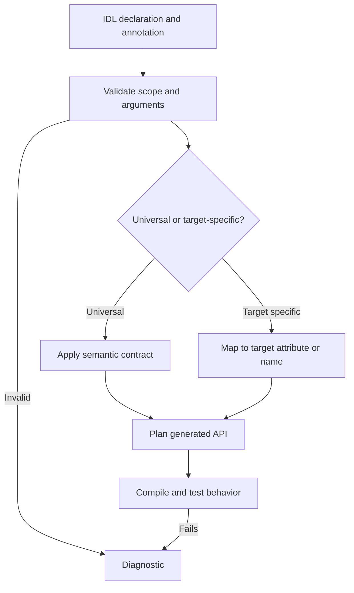

## 10. Output layout and import resolution

### 10.1 Logical versus physical identity

| Concept | Example |
| --- | --- |
| IDL symbol | domain.User |
| C++ symbol | app::domain::User |
| C++ public include | app/domain/user.hpp |
| Java/Kotlin type | com.app.domain.User |
| Objective-C type | DOMUser |
| Swift module/type | AppDomain.User |
| Dart public import | package:app_domain/app_domain.dart |
| Python import | app_domain.user.User (defining module), app_domain.api.User (unified public entrypoint) |
| C# namespace/type | App.Domain.User |

Plan all generated symbols before rendering any file. The repository refers to the defining domain module's planned artifacts, including prebuilt manifests, not a guessed relative path.

### 10.2 Expected cross-module output

For the repository contract in section 4, using naming overrides in sections 7.2–7.5 where relevant. The C# declaration uses the optional I prefix from section 8.2, not the default. These are deliberately reduced excerpts, not complete generated files. The Java and Kotlin snippets show independent API naming. The paired JVM layout keeps UserRepository in each target's actual package as defined in section 7.4.

**C**

```c
#include <app/domain/user.h>
#include <polyglue/runtime.h>

/* Illustrative names; final signatures follow the versioned C ABI. */
typedef struct app_repo_user_repository app_repo_user_repository;
```

**C++**

```cpp
#include <app/domain/user.hpp>
#include <polyglue/future.hpp>
#include <cstdint>
#include <optional>
#include <vector>

namespace app::repository {
class UserRepository {
public:
    virtual ~UserRepository() = default;
    virtual polyglue::Future<std::vector<app::domain::User>> findAll() = 0;
    virtual polyglue::Future<std::optional<app::domain::User>> findById(std::int64_t id) = 0;
};
}
```

**Kotlin**

```kotlin
package com.app.repository.kotlin

import com.app.domain.User

interface UserRepository {
    suspend fun findAll(): List<User>
    suspend fun findById(id: Long): User?
}
```

**Java**

```java
package com.app.repository;

import com.app.domain.User;
import java.util.List;
import java.util.concurrent.CompletableFuture;

public interface UserRepository {
    CompletableFuture<List<User>> findAll();
}
```

These examples show the paired JVM profile: separate actual callable packages let the same simple names coexist. In Kotlin-only generation the package may be com.app.repository. Both contracts share canonical descriptors and models; compile them together.

**Objective-C**

```objc
@import Foundation;
@import AppDomain;

// Mixed framework: the imported bridge protocol must not occupy the native Swift name.
NS_SWIFT_NAME(UserRepositoryBridgeContract)
@protocol REPUserRepository
- (void)findAllWithCompletion:
    (void (^)(NSArray<DOMUser *> * _Nullable,
              NSError * _Nullable))completion;
@end
```

**Swift**

The following native callable contract owns UserRepository in the mixed framework. The preceding Objective-C protocol keeps its Objective-C name and is imported under an implementation-oriented Swift name (or hidden/refined where supported). No consumer needs that bridge name in ordinary source. When Swift is selected, retain this native callable contract; importer metadata is for Objective-C exposure and shared value models, not an alternative public callable backend.

```swift
import AppDomain

public protocol UserRepository {
    func findAll() async throws -> [User]
    func findById(id: Int64) async throws -> User?
}
```

**Dart (portable native/Web profile)**

```dart
import 'package:app_domain/app_domain.dart';

abstract interface class UserRepository {
  Future<List<User>> findAll();
  Future<User?> findById(BigInt id);
}
```

**Python**

```python
from abc import ABC, abstractmethod
from collections.abc import Awaitable
from app_domain.user import User


class UserRepository(ABC):
    @abstractmethod
    def find_all(self) -> Awaitable[list[User]]: ...
```

**C#**

```csharp
using App.Domain;
using System.Collections.Generic;
using System.Threading.Tasks;

namespace App.Repository;

public interface IUserRepository
{
    Task<IReadOnlyList<User>> FindAllAsync();
}
```

**TypeScript**

```typescript
import type { User } from "@app/domain";

export interface UserRepository {
    findAll(): Promise<ReadonlyArray<User>>;
    findById(id: bigint): Promise<User | null>;
}
```

These excerpts show public contract shape. Generated proxies, C ABI declarations, converters, initialization and all remaining methods are required separately.

### 10.3 Generated directory examples

```text
native/domain/cpp/
├── include/app/domain/user.hpp
└── src/user.cpp

native/repository/cpp/
├── include/app/repository/user-repository.hpp
└── src/user-repository.cpp

android/generated/domain/java/
└── com/app/domain/User.java

android/generated/repository/kotlin/
└── com/app/repository/kotlin/UserRepository.kt

apple/Domain/
├── ObjC/
│   ├── include/DOMUser.h
│   └── module.modulemap
└── Swift/
    └── Sources/AppDomain/

apple/Repository/Swift/
└── Sources/AppRepository/UserRepository.swift

flutter/packages/domain/
├── pubspec.yaml
└── lib/
    ├── app_domain.dart
    └── src/user.dart

flutter/packages/repository/
├── pubspec.yaml
└── lib/
    ├── app_repository.dart
    └── src/user_repository.dart

python/domain/
└── app_domain/
    ├── __init__.py
    └── user.py

dotnet/Domain/
├── App.Domain.csproj
└── User.cs

web/domain/
├── package.json
└── src/user.js
```

These trees illustrate public artifacts, not exhaustive bridge sources. The domain package exposes User through its explicit public module (app_domain.user in Python). Python __init__.py files remain empty. The repository package declares the dependency in its package/build manifest in package mode.

### 10.4 Target artifact rules

| Backend | Layout / imports / package files |
| --- | --- |
| C | Public .h, sources, include guards, C names and calling convention |
| C++ | include/ and src/, namespace, includes/forward declarations, CMake |
| Java/Kotlin/JNI | Package directory tree, JVM type ownership, JNI names, Gradle |
| Swift | Sources/<target>, module imports only between distinct modules, Package.swift |
| Objective-C | Prefixed public headers, umbrella header/module.modulemap, .mm sources |
| Python | Package tree, empty __init__.py, explicit public modules, pyproject.toml |
| Dart | lib/src, public library exports, pubspec.yaml |
| Flutter | Plugin metadata, Dart package and platform adapters |
| C# | Namespace, project/assembly references, .csproj |
| JS/TS | ES module exports/imports, package.json, .d.ts and tsconfig as appropriate |
| WASM | Emscripten build configuration, exports and JS loader |

Provide sources mode (integrate into existing build) and package mode (standalone buildable package). Paths, filenames, extensions and public import strings are separately configurable. Do not overwrite consumer-owned build files. Test both modes, separate source roots and external dependencies, same-module Swift imports, Python circular imports, C++ forward declarations and package export validity.

### 10.5 Unified library public entry points

Every library has an explicit public import plan per selected target. The default api.mode is unified. A single consumer-facing import or include path exposes the library's selected public API without requiring the consumer to know the IDL directory layout. The module names remain in manifests, dependency graphs, logical IDs and generated internal paths. This is an API and package assembly requirement, not an assertion that every language has the same module feature.

| Target | Example public consumption | Required assembly strategy |
| --- | --- | --- |
| C | `#include <ubook/ubook.h>` | Umbrella header with exported typed API and stable prefixed C symbols |
| C++ | `#include <ubook/ubook.hpp>` | Self-contained umbrella header, public namespace aliases or intentionally unified declarations, relocatable CMake target |
| Objective-C | `@import Ubook;` | Actual Clang module, umbrella header and compatible prefixed runtime classes |
| Swift | `import Ubook` | Actual importable Swift module/target, native public declarations or explicit public typealiases and forwarding APIs |
| Java | `import com.ubook.ProductChapterRepository;` | Actual public class/package layout in JAR/AAR; no fictitious Java re-export |
| Kotlin | `import com.ubook.ProductChapterRepository` (Kotlin-only); `import com.ubook.kotlin.ProductChapterRepository` (paired callable scopes) | Actual public package declarations or compatible Kotlin aliases/wrappers; Java consumers validated when selected |
| Dart | `import 'package:ubook/ubook.dart';` | Public library entrypoint exports selected src declarations; conditional native/web adapter imports |
| Flutter | `import 'package:ubook_flutter/ubook_flutter.dart';` | Plugin entrypoint exports the shared Dart API and platform initialization |
| Python | `from ubook.api import ProductChapterRepository` | Explicit public api.py module re-exports selected defining symbols; __init__.py stays empty |
| C# | `using Ubook;` | Actual namespace and assembly public types; type forwarding only where CLR supports it |
| JS / TS | `import { ProductChapterRepository } from "@ubook/core";` | ESM export map, actual JS implementation, corresponding type declarations and assets |
| WASM | Import the owning JS/TS or Dart Web entrypoint | One intended WASM instance behind generated host adapters, not direct public pointer access |

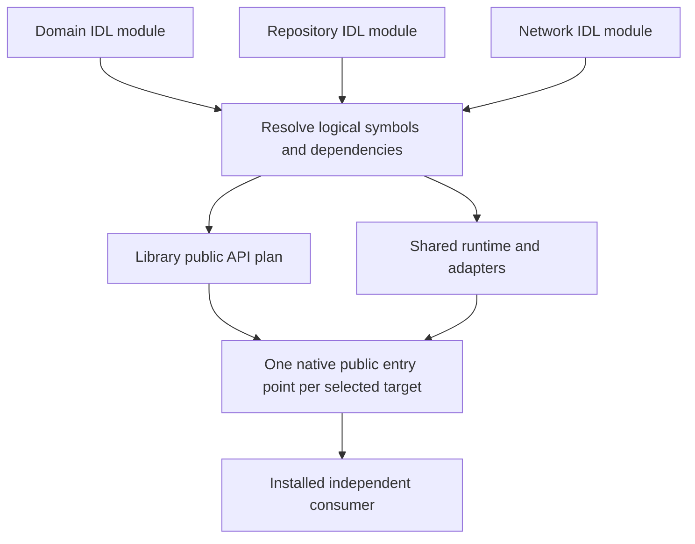

The entrypoint must be a real language mechanism. A SwiftPM product named Ubook is insufficient if the only available Swift modules are Domain and Repository. Emit a Swift target/module named Ubook when unified mode requires it. Use public typealiases to the canonical imported or generated models and public forwarding functions/proxies where needed. A plain import in a Swift source file is not a re-export. Generate actual public declarations or explicitly imported typealiases instead of relying on underscored attributes. Do not generate two protocols with the same role into one public namespace; choose one canonical public surface and keep the lower bridge in a distinct internal module where necessary. Test actual import Ubook in a clean consumer, including type checking of values crossing module boundaries, async and errors, not only package resolution.

For Java/Kotlin and C#, putting multiple already-compiled module artifacts in one package archive does not move their class/namespace identities. To support a unified source library, plan the defining public declarations in the selected package or namespace, with distinct internal paths and one actual type owner. Source-only assembly renders those declarations directly into the final public scope by default in unified mode when there is no conflicting explicit module identity. Built-in or inherited derived standalone scope names are not explicit conflicting identities. Explicit module package/namespace settings take precedence and must be compatible with unified mode. Such output has a distinct physical artifact plan, not a different canonical ID. Explicit module package overrides and prebuilt binaries retain their names. Where aliases are not equivalent (Java lacks type aliases), require an explicitly compatible source layout or modular distribution; do not create duplicate model classes or claim a facade is a transparent re-export when it changes identity. Java/Kotlin shared artifacts have one JVM class owner. Paired callable scopes follow section 10.6, and shared models retain their actual defining package. Kotlin-only aliases cannot satisfy a Java import contract.

A public Objective-C library umbrella can expose actual prefixed classes from multiple defining headers, but its import module does not rename existing runtime class names. A public C++ umbrella may include defining headers and expose configured aliases without duplicate declarations. C header naming cannot discard required ABI prefixes. Python api.py, Dart entrypoint, JS/TS barrel exports and package exports must contain only explicitly selected public API and required public dependencies, not arbitrary recursive wildcard exports. A Flutter plugin reuses canonical Dart contracts; the integration layer is not another source of data model identities.

In modular mode, expose selected modules through their own configured package/module/namespace and optionally package compatible components together. No implicit unified facade is required. A consumer can deliberately distribute a reusable module independently or assemble several libraries. Mode and export choices do not change canonical IDL descriptors. A public alias may be an additional name for a type; it does not create another interface key or service registration. Detect collisions in the final merged API, including modules with the same simple type name, generated helpers, methods whose labels collide, filesystem paths and package exports. Resolve only via explicit aliases or module qualification where the target supports it. Do not add numeric suffixes or leak bridge prefixes to hide collisions.

#### 10.5.1 Library API manifest and compatibility

Alongside module manifests, emit a library API manifest derived from the resolved public plan. Include library ID, selected targets, api.mode, exported canonical declaration IDs, target public qualified names and signatures, actual defining artifact owners, import/include/entrypoint names, required dependencies, runtime/ABI identity, visibility, effective config fingerprint and the owned files/content hashes. Version/build identity is included only for packaging as defined in section 7.8. Different libraries with the same logical type may have distinct physical presentation plans; the runtime must still validate matching logical identity and compatible ABI before sharing a handle. Record the resolved public signature inventory from section 8.8 (including external labels, keyword names, local identifiers, member kind, host-mapped signature, owner and exposure strategy) and a separate deterministic public API fingerprint. A naming-only change does not alter the logical ID or canonical operation contract, but can change source/binary public compatibility, selectors, JVM class identities and package fingerprints. Distinguish those changes from ABI compatibility. Build plans and installed consumer checks use actual names and fingerprinted artifacts. Never silently publish a changed public API under already committed immutable package coordinates.

### 10.6 Shared target artifact ownership

Compute ownership from the complete declared target set, effective configuration and actual artifact identity before CLI filtering. The plan assigns one owner for every model, interface, adapter, runtime implementation and package/build metadata file. An internal dependency target emits only required files unless also publicly selected. Public artifact ownership choices are discoverable and configurable where explicitly documented; internal adapter/runtime/file ownership is deterministic compiler responsibility, not an independent configuration surface. Reject incompatible ownership rather than creating duplicate classes or runtimes.

| Combination | Automatic default for the same package/library | Explicit alternative |
| --- | --- | --- |
| Java + Kotlin, paired JVM library | Java owns shared value models and CompletableFuture interface; Kotlin owns independent suspend interface with the same simple name in a distinct real package when required | Explicit distinct packages, proven compatible single callable owner, separate model layouts or one public contract target |
| Objective-C + Swift | One mixed public framework/module; shared representable imported Obj-C value models by default, native Swift callable contracts | Native Swift value models with checked conversions; explicit separate modules |
| JavaScript + TypeScript | JavaScript owns ESM implementation and package metadata; TypeScript contributes declarations/type exports | Separate packages with explicitly selected implementation owners/loaders |
| Dart + Flutter | Dart owns shared typed models/API; Flutter owns plugin metadata and exports the Dart API | Explicit separate Dart package dependency |

For Java/Kotlin, derive ownership from the complete declared target set, not the CLI filter. Kotlin-only modules own their models and use short names. In a paired JVM library incompatible callable shapes (e.g. CompletableFuture versus suspend) cannot occupy one JVM binary name. Preserve the simple type name: Java retains its resolved base package, and the Kotlin callable package defaults to that base plus .kotlin if no explicit Kotlin package was configured. Apply this scope consistently to the entire paired callable plan, even if some individual interfaces happen to have identical methods. Shared Java-owned model types remain in their actual defining package; Kotlin imports them directly instead of generating duplicates. Explicit distinct packages take precedence. If explicitly configured equal packages require incompatible classes, reject with both binary identities and suggest a distinct actual package or a compiler-proven compatible single owner; never silently add a language prefix or pretend Java methods support Kotlin named arguments. A Kotlin-only package has no automatic .kotlin suffix. Typed adapters bridge both contracts through one canonical descriptor; never cast unrelated interfaces. Resolve callable and model ownership separately for unified, modular and prebuilt artifacts. A consumer deliberately using both APIs can qualify or alias the real package names. Validate erasure, mangling, mixed consumers and filter-independent naming.

For Apple use the mixed-framework identity defined in section 10.6.1. The paired profile defaults to model_source: objc for representable shared value models; Swift-only uses native Swift models. A type requiring a native Swift representation for exact semantics uses an explicit typed refinement/conversion without duplicate visible names. model_source: swift selects independent native value models and checked conversions. Objective-C remains usable with configurable prefixed symbols. Native Swift callable contracts expose one short Swift name; supported importer metadata and private bridge declarations prevent collisions. Compile actual imports, optional/error cases and model identities.

For JS/TS, emit one ESM runtime, package metadata and loader per shared artifact, with .d.ts matching real exports and actual descriptor values. TypeScript-only generation still supplies executable JS, whether owned by its backend or explicitly declared JS dependency. A declaration file alone is not a provider. Dart/Flutter share one canonical Dart API for the same package integration. Native FFI and Web adapter selection does not duplicate models. Test target-filtered generation, then full generation; ownership and names must not drift or leave stale duplicate files.

**Stable host-family plans.** Resolve callable package ownership once from the declared paired library, not per method or based on whether its current members are async. A paired Java/Kotlin library with separate native callable surfaces uses the derived Kotlin package consistently for all callable declarations; adding an async method or filtering a target cannot move an existing type. The shared JNI bridge owns VM/thread admission, reference management, errors and canonical conversion. Shared Java models retain actual field types; a Kotlin-native unsigned method uses its exact native type with checked conversion. If a shared model cannot preserve the requested public semantics, use the explicitly selected independent model layout rather than duplicate models silently. Objective-C and Swift share the Apple native bridge and ownership machinery but Swift callable generation is native by default and the only selected Swift callable strategy. Use importer metadata for actual shared models or Objective-C-only usage; do not select between competing callable generators based on a compiler heuristic. JS/TS always share one actual ESM implementation; Flutter is integration over the Dart API. No extra language-specific core or duplicate registry. An explicitly separate package still reuses common support code.

#### 10.6.1 One public Apple module without language suffixes

Default api.apple.layout is mixed_framework when Swift and Objective-C are selected together. Derive the one public module/framework name from the library ID, or from the standalone module ID. A supported mixed Xcode framework exposes Objective-C through its umbrella header and Swift through the compiler's module and generated compatibility header. This is one coordinated framework identity, not two unrelated top-level modules or just a SwiftPM product alias. Do not invent a mixed-language SwiftPM source target where unsupported; build the mixed framework with Apple tooling and distribute its XCFramework through a binary target. Source integration uses supported native build metadata or proven private implementation targets and public facade. If the requested format cannot realize this identity, diagnose it and require a compatible explicit layout, never silently suffix the public name.

```yaml
libraries:
  ubook:
    modules: [domain, repository]
    targets: [objc, swift]
    api:
      mode: unified
      apple:
        layout: mixed_framework
        module: Ubook
      targets:
        objc:
          prefix: UB
```

api.apple.module sets the common identity. Explicit api.targets.objc.module and api.targets.swift.module must agree in mixed_framework mode. Distinct explicit names require api.apple.layout: separate_modules. No default public ObjC, Swift, Native, Bridge or Internal suffix. Internal implementation modules have deterministic technical names and are not required consumer imports. Objective-C runtime class/protocol prefixes remain independently configurable and Swift imports remove generated affixes by default.

```swift
import Ubook

let product = Product(id: 10)
```

```objc
@import Ubook;
// Alternatively: #import <Ubook/Ubook.h>
UBProduct *product = [[UBProduct alloc] initWithId:10];
```

These are illustrative calls to the same representable model. A shared imported model already owned by the underlying Clang module must not be redeclared as a Swift type or recursive same-module typealias. Use NS_SWIFT_NAME for the short name; explicit qualified aliases are valid only for genuinely distinct defining modules. Native Swift refinements hide/rename competing imported declarations for Swift without removing Objective-C usability. Include the compiler-generated Swift compatibility header only where needed and avoid circular umbrella imports. Swift-only types are not fictitiously representable in Objective-C. Test separate installed Swift and Objective-C clients with the same Ubook import, shared models, callbacks, async optional results, native providers, static helpers, module verification and each actual Apple slice. SwiftPM binary targets must expose the actual module Ubook. Explicit separate public layouts remain configurable. See Apple's [Objective-C into Swift](https://developer.apple.com/documentation/swift/importing-objective-c-into-swift) and [Swift into Objective-C](https://developer.apple.com/documentation/swift/importing-swift-into-objective-c).

### 10.7 Composition of libraries

Libraries may declare explicit assembly dependencies on other libraries in the same project:

```yaml
libraries:
  core:
    modules: [domain, repository]
    targets: [cpp, swift, kotlin]
  media:
    modules: [audio, video]
    targets: [cpp, swift, kotlin]
  application:
    modules: [network, helper]
    dependencies: [core, media]
    targets: [cpp, swift, kotlin]
```

Library dependencies do not replace IDL module imports. Resolve both graphs before rendering; reject unknown IDs, cycles, missing public targets and conflicting owners. A dependency library uses its own resolved configuration and actual artifacts; a consumer cannot regenerate its types with consumer defaults. When multiple linked libraries need one logical module, designate one defining artifact owner through an explicit dependency edge. Deduplicate references to that owner, not unrelated compiled copies with matching names. Different physical presentation plans remain valid for separately consumed libraries, or proven compatible alias/adapter plans, not accidental duplicate class identities in one process.

Expose required public signature types where the target supports faithful re-export; other dependency APIs remain in their own entrypoint by default. Explicit api.exports may re-export a dependency using the existing alias/export rules. If a host cannot transparently re-export a prebuilt type, preserve its defining import and report an incompatible unified plan where the requested export cannot be implemented. Do not duplicate models to simulate re-export. Record exact dependency fingerprints, artifact ownership and ecosystem dependency declarations. Existing external prebuilt module manifests remain the supported external dependency mechanism; no new remote resolver or package registry.

Linked libraries share a native core/context only through deliberate embedding initialization. Package import must not instantiate another core. Independent contexts remain supported. If separately linked static runtime copies exist, reject cross-copy handles; test shared linkage does not create accidental copies. Library dependency order is not registry priority or runtime ownership. Closing a library's attachment leaves unrelated live attachments intact. Full shutdown belongs to the explicit context owner (sections 12.4 and 15.9).

## 11. Compiler and templates

### 11.1 Pipeline

The compiler resolves and validates the complete selected module graph before any generated output is committed. Template overrides affect rendering, not semantic validation.

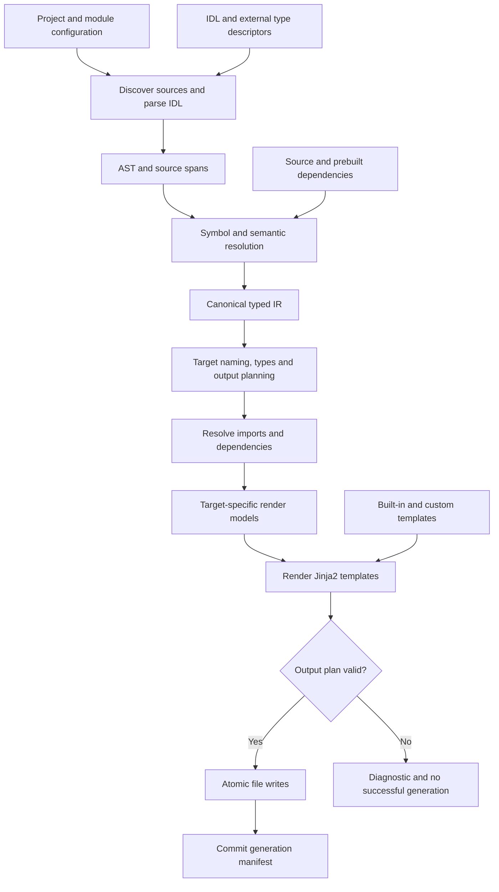

Any validation or rendering failure stops generation. An interrupted write must not leave a successful manifest. See section 11.4.

The compiler maintains one canonical semantic IR and one target output/render plan per selected artifact, not separate type graphs for naming, imports, annotations, ABI, documentation and each rendering stage. AST/source spans and validated target projections are ordinary data, not plugin interfaces. Share identifier resolution, canonical type operations, validation, layout collision checks, diagnostics and manifests. Keep backend hooks only for real host differences (public types/syntax, lowering, host ownership and tooling). Avoid generic factories or layers that only forward data. Do not create custom template semantics or a second parser for type annotations. Reuse section 11.4's transaction/ownership implementation for every generation command.

### 11.2 Responsibilities

| System | Responsibility |
| --- | --- |
| Project / Module | Inputs and independent generation units |
| Configuration | Schema, inheritance and effective settings |
| Type / Symbol | Canonical identities and validated type graph |
| Dependency | Source and prebuilt graph resolution |
| Naming | Case, prefixes, suffixes, acronyms, escaping |
| Layout | Physical paths and public artifact names |
| Imports | Includes/imports/forward declarations/export maps |
| Annotation | Semantic and target-specific attributes |
| Backend | Type mapping, capabilities, render models, marshalling |
| Template | Presentation only |
| Diagnostic | Actionable errors and source spans |
| Manifest | Contract metadata and generated-file ownership |
| ABI / Runtime | Native interoperability and lifetime |
| Service | Optional lookup and replacement |
| Testing | Conformance and regression evidence |

### 11.3 Backend shape

```python
from typing import Protocol


class LanguageBackend(Protocol):
    def plan_outputs(self, module, context): ...
    def resolve_symbol(self, symbol, context): ...
    def resolve_type(self, type_ref, context): ...
    def resolve_import(self, source, dependency, context): ...
    def build_render_models(self, module, context): ...
```

The protocol is illustrative. Freeze actual interfaces with tests. Keep the implementation small and share only genuinely common logic. The common compiler owns naming categories, canonical type checking, import graph, layout planning, annotation validation and diagnostics. Each backend supplies only its native mapping rules, actual imports/syntax, host conversion/adapter logic and templates. Do not create separate general-purpose resolution engines per backend. Do not implement a general plugin framework. Built-in backends, template overrides and declarative external types cover the requested extension use cases.

Template example:

```jinja2
package {{ package }}


import {{ dependency }}


interface {{ interface.name }} {

    {{ method.declaration }}

}
```

Template override:

```yaml
targets:
  cpp:
    templates:
      directory: ./custom/templates/cpp
      inherit_builtin: true
```

Use StrictUndefined. All imports/types/names are resolved in Python before rendering. Custom template selection and resource paths must be validated. Templates are explicitly trusted developer inputs. Never load them implicitly from untrusted IDL.

### 11.4 Generation guarantees

Validate the whole output plan before writing. Include selected library facades and shared artifact owners in a single plan. Plan-level incremental reuse requires the current success manifest, matching input fingerprint and verification of every reused owned file's content hash. A manually modified generated file is a conflict by default, even if its path is still manifest-owned; report it and require explicit regeneration authorization for that owned file. Never turn this authorization into permission to overwrite an unowned path. If a previously owned output is missing, regenerate it after validation. Preserve unrelated user files and the previous ownership records during interrupted writes. A target-filtered invocation must not declare the entire library complete or silently erase the success evidence for unrelated independently owned outputs. A shared physical artifact has a single planned owner and input identity; a filtered generation either regenerates that complete owned artifact or verifies its matching bytes. It cannot replace it with a partial public surface. If a changed shared artifact invalidates a dependent previously successful plan, mark that plan stale by input fingerprint rather than treating old files as current. No duplicate ownership of shared files across manifests. Reject overlapping files, collisions on case-insensitive systems, invalid path components and symlink escapes. Render and validate all planned files before writing. Write changed files atomically per file. A multi-file update is not an atomic filesystem transaction. Invalidate the previous success state before modifying outputs and commit the new manifest last. On interruption or write failure, keep enough owned-file information to repair the incomplete generation and refuse to build or consume it as successful. Never overwrite an existing unowned file even if its path matches a planned output. Prevent two invocations from writing overlapping output roots concurrently using the simplest appropriate filesystem locking mechanism. No global lock for independent roots. Do not rewrite identical files or delete user-authored files. Only remove obsolete manifest-owned generated files when explicitly requested. Otherwise mark them retired, exclude them from manifests/build/install/import plans and report their paths; if they would still be discovered by an ecosystem's source/import glob, fail with a targeted clean/regenerate instruction rather than compile stale declarations. Never treat a leftover retired file as a current generated output. Test failure recovery, deterministic generation and standalone installation.

### 11.5 Template override system (mandatory)

Template override support is a first-class public feature, not a fork-only customization. All files generated from templates must have stable, documented template IDs: public models, enums, variants, interfaces, callbacks, proxies, provider adapters, ABI glue, marshallers, module exports, package metadata, CMake integration, Gradle files, SwiftPM files, Dart/Flutter integration, .NET project files and JS/TS exports. Runtime source files are separately versioned handwritten code, not implicitly replaced by a template.

A default built-in template catalog is packaged with the Python wheel. Each entry declares target, ID, output kind, render-model schema version, required variables and related partials. IDs are independent of target filenames, module prefixes and physical output directories. Names below define a proposed initial catalog convention:

```text
templates/
├── common/
│   └── file-header.j2
├── cpp/
│   ├── record.hpp.j2
│   ├── interface.hpp.j2
│   ├── proxy.cpp.j2
│   ├── provider.cpp.j2
│   └── CMakeLists.txt.j2
├── kotlin/
│   ├── record.kt.j2
│   ├── interface.kt.j2
│   └── build.gradle.kts.j2
├── objc/
│   ├── record.h.j2
│   └── module.modulemap.j2
└── swift/
    ├── interface.swift.j2
    └── Package.swift.j2
```

Actual catalog covers all targets. Do not create redundant placeholder templates. Reusable macros and partials are allowed when they simplify rendering.

Use one Jinja2 environment/loader policy, stable catalog and the precedence engine from section 7.1. Template IDs identify actual emitted files or reused partials; do not create a template hierarchy just to wrap one template. No custom plugin registration or per-template semantic execution. Rendering receives validated data; documentation and source share the same resolved signature plan. Preserve the owner's directory and individual file override feature.

#### 11.5.1 Directory override and individual override

```yaml
defaults:
  targets:
    cpp:
      templates:
        directory: ./templates/cpp
        inherit_builtin: true
```

```yaml
# modules/repository/module.yaml
targets:
  cpp:
    templates:
      directory: ./templates/cpp
      overrides:
        interface.hpp.j2: ./templates/special/repository-interface.j2
        CMakeLists.txt.j2: ./templates/special/repository-cmake.j2
      inherit_builtin: true
```

Only matching template IDs are overridden. All other files use the next permitted layer. A module-specific directory need not duplicate the complete built-in tree. Resolve lookup per ID from highest to lowest precedence: explicit module target, module target defaults, module-wide defaults, selected library target defaults, library-wide defaults, project target defaults, project-wide defaults, then built-in catalog. Standalone module generation has no library layer. Library-only facade templates use library target/wide defaults, project target/wide defaults and built-ins, without arbitrary member-module ownership. Each layer has its own explicitly mapped files and directory. Do not merge directories into one path or skip module or library target defaults. Resolve the same layer order for an included partial, unless the selected template explicitly references a documented built-in namespace. Explicit mapping takes precedence over directory lookup at the same layer. Preserve path origin at each layer rather than flattening inherited directories into one. A configured inherit_builtin: false disallows use of the built-in catalog for that target's effective set.

This includes explicit built-in namespace references in include/import/extends, not just fallback search. A custom file cannot bypass the effective policy by explicitly naming a built-in partial. When inheritance is enabled, an explicit built-in namespace resolves only that catalog ID; otherwise report the forbidden reference and its source. A template check/export command may inspect the catalog explicitly without changing a generation plan. Missing required templates fail before any outputs are written. A missing explicitly mapped file always fails. An existing selected template that fails to parse or render is an error. Never try another template after a failure. Validate unknown IDs and conflicting overrides.

#### 11.5.2 Custom template workflow

```bash
polyglue templates list --target cpp
polyglue templates export --target cpp --output ./templates/cpp
polyglue templates check --module repository --target cpp
polyglue config resolved --module repository --target cpp
polyglue generate --module repository --target cpp
```

Export does not overwrite existing custom files without explicit authorization. The check command renders against real validated IR fixtures or the selected project. Show syntax errors, missing variables, incompatible schema versions, unknown IDs and the originating config/template path. Report effective template source and content hash in the generation manifest, including transitive include/import/extends dependencies. Changes invalidate incremental build and generation fingerprints.

#### 11.5.3 Render context and safety

Publish a versioned render-model contract with examples for every public template. Backend code supplies names, includes/imports, type declarations, annotations, ownership and ABI-specific render metadata. Jinja2 is presentation, not a second semantic compiler. StrictUndefined, deterministic rendering, documented filters/macros and no implicit environment or timestamp dependence. Use a restricted filesystem loader with explicit roots, normalized relative IDs and no traversal/symlink escape. Templates may reference catalog partials through a documented namespace or allowed relative ID. Prevent accidental recursive inclusion and report its chain.

Custom templates are trusted local developer input, not a security sandbox. A template cannot declare a new output path, change the validated file plan or bypass capability/ABI validation. Custom templates cannot replace the runtime implementation. Runtime changes follow the normal source development and validation process. A custom template that changes ABI-visible code must be validated by downstream compilation and ABI checks. Do not certify arbitrary overrides based on rendering alone.

#### 11.5.4 Acceptance tests

- Single-file override retains all other built-ins. Partial override and multiple modules with different overrides.
- Project/library/module precedence, correct relative paths, strict missing template behavior, duplicate/unknown ID and inheritance disabled.
- Override of nested partials and generated build files. Stable manifest fingerprints and invalidation when content changes.
- Syntax error, undefined variables, context schema mismatch, traversal, recursive inclusion and deterministic rerender.
- Generated outputs compile and run in each target, including an actual package consumer using customized source/build templates.
- Wheel installation includes the same template catalog, export/check commands and behavior as a source checkout.

### 11.6 Template selection flow

#### Override a template without changing the generator

Choose the first applicable declared source. An invalid selected template must fail, not trigger another lookup.

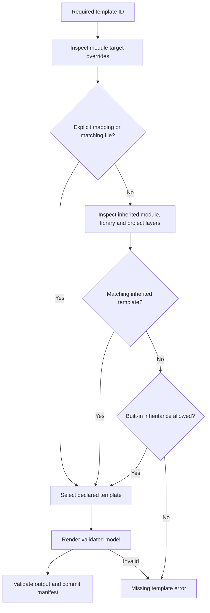

### 11.7 Compiler input bounds, trust and transactional output

The compiler and build orchestrator process project-owned input, but malformed or imported input must fail without uncontrolled recursion, memory use or filesystem access. Define a single typed compiler.limits configuration (separate from runtime limits). Initial configurable defaults: 16 MiB per text input, 256 MiB cumulative decoded input per invocation, 256 syntactic nesting depth, 100000 resolved declarations, 10000 concrete generic specializations and 128 generic expansion depth. Positive checked limits; no silent truncation. Count transitive imports, manifest definitions and expansions before allocating; detect cycles/duplicate identities independently of numeric limits. Report source spans and the expansion/import chain. Bound YAML alias expansion before constructing merged objects; require strict UTF-8 and canonical path normalization. No arbitrary host expression evaluation in IDL/config. Templates and external adapter sources are trusted executable developer input, not a sandbox for untrusted third-party code. An imported manifest cannot authorize an executable, arbitrary filesystem root or hidden dependency download. Build commands use explicit argv, validated executable/toolchain paths and an allowlisted environment; no shell interpolation of IDL, names or paths. A user-supplied executable/flags/template is an explicit trusted configuration, not a secure execution sandbox.

Use the generation ownership transaction defined in section 11.4 for all writers. Acquire interprocess ownership locks on normalized overlapping output/staging roots in deterministic order before mutating them; locks cover generation, clean, package and other writers. Reject/serialize conflicting plans instead of last-writer-wins. Use OS-supported advisory/ownership mechanisms with crash recovery, not a guessed stale PID or deleting another process's lock. Validate canonical containment including case-folded paths and symlink ancestors; use safe root-relative operations/no-follow where supported and reject changed path identities before publication. Do not claim protection against an adversary with equivalent local write permissions. Stage complete files and ownership metadata, verify hashes, then publish atomically per file or as a directory when supported. The success manifest is committed last; an interrupted multi-file publish is not a successful generation. Maintain a recoverable transaction record with previous and intended owner/hash sets, distinguish unowned from partially published owned files, verify them on next invocation and reconcile only known owned files; never delete arbitrary paths or mark an incomplete plan valid. Manually edited owned files require explicit regeneration permission. Test killed writers, overlapping roots, source changes during generation, stale manifests and path escapes. Inputs are snapshotted or revalidated before publishing. No new distributed lock or daemon is required.

## 12. Native runtime and ABI

The support runtime implements only shared interoperability mechanics, while generated adapters provide contract-specific behavior.

Required ABI rules:

- Versioned C ABI with fixed-width primitives, explicit alignment, size/version headers and documented calling conventions.
- Stable logical type IDs distinct from contract fingerprints and target-specific ABI fingerprints.
- Validate architecture, ABI version, handle origin, kind and generation before invocation.
- Explicit ownership for every argument and return, allocator/deallocator pairing and checked length/offset arithmetic.
- No C++ STL layout, foreign object memory layout or exception crossing the ABI directly.
- One compatible shared runtime per context. Detect unintended duplicate instances.
- Explicit close/dispose and safe finalization for abandoned resources. Never rely on finalizers alone.
- Define identity, strong and weak references, refcount overflow, cycles and thread-affine destruction.

Buffer-specific rules are in section 13. Asynchronous lifecycle rules are in section 14.

**Shared core implementation contract.** Build one small C++20 implementation with typed C11 ABI exports, also compiled to WASM. Core mechanisms are shared implementation code, not a public framework:

| Internal mechanism | Reused by | Required boundary |
| --- | --- | --- |
| Validated resource identity and ownership | Interface/callback references, DataRef owners, context/attachment control, operations, subscriptions, registration and cancellation controls | Typed kinds and descriptor checks; owning tickets and weak metadata; no untyped public handle or unchecked cast |
| Admission and execution lease | Sync calls, async starts, reverse callbacks, stream deliveries, static binding, registry resolution and host cleanup | Atomic live checks and pin/claim; execute host code outside locks; preserve caller/provider/attachment lifetimes |
| Owning value conversion and cleanup | Records, arrays/lists, tagged values, external adapters, async captures and results | One recursive lowering/initialization plan; release only active initialized owners; transactional conversion |
| Terminal result and cancellation | Async method/callback, host promise/future adapter, stream item/terminal delivery | Exactly-once consumer result; separate actual execution end and host delivery; no second cancellation engine |
| Resource retirement and host-affine cleanup | All resource kinds with owner/root/code leases | Revoke new admission before draining; one cleanup claim; cleanup remains possible while business calls are closed |
| Typed discovery/binding | Static binding and optional service registry | Reuse descriptor validation, tokens, retained entries and admission; keep distinct static-slot versus service-stack semantics |

These are implementation reuse boundaries, not six mandatory classes or six independent systems. A common handle store or equivalent validated mechanism can use type-specific payload and state; do not force unrelated resources into a universal public object or a single giant state enum. Start with the simplest synchronization that proves correctness; split locks or add fast paths only when measured contention requires it. Never invoke callbacks, schedulers or destructors under bookkeeping locks. No independent host-side copy of canonical registry, cancellation, handle or admission state. Host adapters retain native roots and translate host errors/scheduling only. Use canonical identity across C/C++, JNI, Apple, CPython, Dart, .NET and JS/WASM. Native direct calls may avoid redundant conversion only when the same validation/ownership guarantees are established by the fast path.

### 12.1 Typed function tables

A generated interface adapter holds a typed table of functions, an opaque context and lifetime operations. Foreign objects are never interpreted directly by another language. As an illustrative C ABI shape:

```c
typedef struct {
    uint32_t abi_version;
    uint32_t struct_size;
    void *context;
    void (*retain)(void *context);
    void (*release)(void *context);
    pg_status (*request)(void *context, const pg_http_request *input, pg_http_completion completion, pg_completion_token completion_token, pg_operation_handle *operation);
} pg_http_client_vtable;
```

The final ABI must define calling convention, status propagation, context validity, ownership of input/output, cancellation and completion lifetime before adapter rollout. The void *context above is an illustrative private provider cookie, not a public handle or a caller-provided address to validate by dereferencing. The runtime obtains this cookie and function table only from a previously validated, retained provider control record; the public ABI uses the validated tokens of section 12.6. A provider-owned cookie may only be accessed under its actual lifetime and executor contract. A table contains immutable function pointers and a separately owned context reference. A retained completion token remains valid for the provider's documented lifetime, including late completion after cancellation. Duplicate completions while the token is valid are rejected and any transferred payload is released exactly once according to ownership. Do not dereference a freed callback context to detect a duplicate. A call after the provider has relinquished its last valid token is an invalid use, not a supported callback pattern. This is a conceptual table, not a finalized header. The status, completion token and operation handle names stand for runtime-owned ABI types. The return status reports whether the start was accepted. An accepted operation publishes its final outcome through completion, including inline completion, and exposes a valid operation handle until the caller releases it. A rejected start leaves no operation or completion outstanding. The input descriptor is borrowed for the start call only. Retain or convert all values needed later before accepting/publishing the start or entering the provider, not merely before returning. Never store the descriptor pointer.

A JNI adapter's context owns a global Java object reference. A Swift adapter owns an ARC-managed object. A Dart adapter owns an isolate-bound registration. The generated native adapter invokes the correct runtime's method. Direct references and registry lookups reuse the same mechanism.

### 12.2 Runtime lifecycle

One explicit context belongs to exactly one runtime/core instance. A core instance may own multiple isolated contexts with distinct identities and policies; sharing a core does not imply sharing a context or registry. Multiple cooperating libraries must acquire the same intended context and actual core instance. Use opaque generation-checked handles. Validate kind, generation, origin and ABI against runtime-owned metadata before obtaining a live reference. Do not dereference an arbitrary caller-supplied pointer for validation. Acquire a strong reference atomically with validation to prevent concurrent disposal. This is an in-process interoperability contract, not a sandbox against arbitrary native memory access. Pair allocators and deleters. No managed object pointer, C++ STL layout or exception crosses the C ABI directly.

Do not hold internal locks during foreign calls, callbacks, scheduling or destruction. Apply the per-attachment admission, removal and drain rules in section 15.9 to partial detach without shutting down other live owners of the shared context. Pin runtime-owned reference state under the lock, then release the lock before calling foreign retain/release or executing the provider. Do not obtain safety by calling user code inside the registry mutex. Define shutdown ordering, pending-operation drain/cancellation, registration invalidation and thread-affine release. Test reentrancy, nested cross-language calls, duplicate runtime instances, stale handles, allocator mismatch, refcount overflow, weak references and shutdown races.

### 12.3 Call and return across the ABI

#### Runtime initialization

A consumer and provider must deliberately share a live runtime context before exchanging references. The application decides which component owns startup and shutdown.

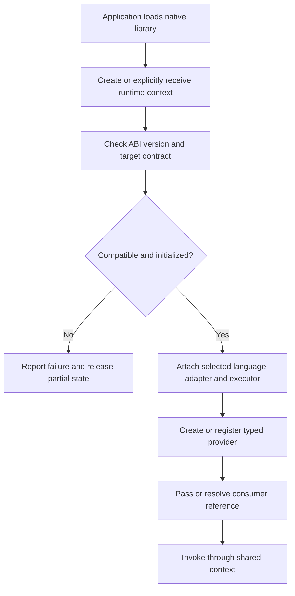

Loading two independent runtime instances is not the same as sharing a context. Do not pass handles between them. Keep registration and lookup unavailable until initialization completes successfully. The context and attachment state machines are defined in section 12.4; full and partial shutdown sequences are in sections 15.5 and 15.9.


#### A synchronous interface call

The caller and provider can be written in different languages. The generated proxy and adapter handle the conversion, not the business logic.

```mermaid
flowchart TD
    A["Consumer calls typed proxy"] --> B["Validate handle and retain provider"]
    B --> C["Convert arguments to C ABI"]
    C --> D["Invoke typed function table"]
    D --> E["Provider adapter converts arguments"]
    E --> F["Real provider method"]
    F --> G["Provider adapter encodes return or status"]
    G --> H["Consumer adapter decodes return"]
    H --> I["Release call references and return"]
    B -->|Invalid| X["Runtime error and cleanup"]
    C -->|Conversion fails| X
    G -->|Failure| X
    H -->|Conversion fails| X
```

The return path must release temporary values on both success and failure. A foreign method or deleter is never invoked under the runtime lock.

#### The same interface in both directions

For an async UserLookup contract, the Kotlin implementation can answer a Dart call. A separate Dart implementation can answer a Kotlin call. The return is not the reverse invocation. Each role can initiate a new request independently.

```mermaid
sequenceDiagram
    participant D as Dart consumer or provider
    participant F as Dart adapter
    participant R as Shared C ABI
    participant J as JNI adapter
    participant K as Kotlin consumer or provider
    D->>F: findById(BigInt.from(10))
    F->>R: Start typed async call
    R->>J: Invoke Kotlin provider
    J->>K: Execute lookup
    K-->>J: User or absence
    J-->>R: Complete with owning result
    R-->>F: Deliver completion
    F-->>D: Resolve Future
    Note over D,K: Independent call in the opposite direction
    K->>J: findById(20)
    J->>R: Start typed async call
    R->>F: Dispatch to Dart provider
    F->>D: Execute on owning isolate
    D-->>F: User or absence
    F-->>R: Complete with owning result
    R-->>J: Deliver completion
    J-->>K: Resume suspend call
```

Both directions use the same declared types. A runtime error or cancellation completes through its own status instead of returning an absent User.

### 12.4 Contexts, attachments and admission

The C ABI must distinguish the lifetime of the native context, the lifetime of each host attachment and the lifetime of an individual handle. An attachment represents one independently closable host execution/lifetime domain with its bound executor(s), not a programming language or necessarily one OS thread. Every bound executor has an explicit identity, capability and lifetime under section 14.7. A JVM attachment may serve both Java and Kotlin; an Apple attachment may serve Swift and Objective-C; two Dart isolates require distinct attachment identities. An application-owned native attachment can outlive a Flutter engine. A browser context is tied to the intended WASM runtime instance and its host adapters.

| Resource | Identity and owner | Closing rule |
| --- | --- | --- |
| Runtime context | Unique context identity; explicit application owner | Stops all new work and drains every attachment before releasing the core |
| Attachment | Context plus unique attachment identity/generation; host owns the executor | Stops its own new work and releases its own host resources without closing unrelated attachments |
| Registry | Context plus registry identity/generation | Removes its own registrations and rejects new lookups; does not invalidate independently retained fixed providers |
| Interface/callback handle | Context, kind, slot/generation and validated contract; actual owning attachment | Ordinary release drops a reference; attachment closure prevents new calls |
| Operation/delivery | Selected provider, caller, participating callback/stream attachments and unique completion state | Terminal result and actual execution lifetime are tracked separately |
| Registration/subscription | Unique control identity; resource owner and relevant host attachment identities | Removal ends new discovery or delivery; already admitted execution retains its resources |

The runtime's semantic control surface comprises context creation, attachment to an existing context, explicit registry acquisition/creation, explicit static binding/acquisition and default integration selection/removal, attachment close and full context shutdown, plus reference release. These are lifecycle operations, not IDL services. Use opaque handles and the existing versioned ABI; concrete function names and binary layouts are finalized during implementation. A generated binding receives the context/attachment from the embedding application or plugin initialization. It must not initialize a second core as a side effect of importing a package or obtaining a registry. The context owner alone initiates full shutdown. Ordinary plugin disposal closes only resources for its attachment. Failure during attachment initialization rolls back partial resources without affecting live peers.

Contexts and attachments have Opening, Open, Closing and Closed states. Opening admits no business work. Initialization failure with mandatory cleanup pending transitions to Closing, not Closed, and preserves an owner-controlled rollback/drain result (section 12.9). Closing is irreversible for that generation: reject new work, allow idempotent cleanup, drain admitted execution and required releases; Closed retains only the validation/control metadata necessary for safe late release. A failed or timed-out drain remains Closing and can be inspected or resumed by the owner; it must not reopen or be reported as closed. A successful replacement/restart attaches a new generation. A host object wrapper may outlive its target attachment, but it cannot resurrect its adapter.

Define invocation admission as the atomic validation and acquisition of the necessary runtime-owned execution references while the caller and target attachments are Open. A dynamic registry lookup and acquisition of the selected provider for a call are one admission transaction. After ordinary registration removal, an already admitted operation can complete. Closing a participating attachment additionally requests cancellation and prevents any not-yet-started host execution from entering a closing executor. Check the attachment generation and lifecycle again at the host dispatch gate, without resolving the registry again. If dispatch is denied after the operation was accepted, complete the still-live consumer with the appropriate cancellation or lifetime status and release the owning envelope exactly once. A close request racing with dispatch must either prevent entry or account for that execution in the drain. No check-then-call gap may permit untracked execution.

Pin internal control blocks and reference state under the appropriate synchronization; foreign object roots must already be owned before publication. A release or conversion failure after dropping a lock must not leave a partially published registration. Establish and document lock ordering for context, registry, handle, subscription and operation bookkeeping; never execute foreign code, enqueue through a host scheduler or run a foreign destructor under those locks. Scheduler enqueue failure before acceptance rejects the start with no completion. After acceptance it terminates through the operation's delivery protocol (14.4.5); reclaim the rejected dispatch envelope once. Failure to enqueue the consumer notification itself follows the reserved delivery or pending owner-resolution rule in 14.4.5, not a second terminal outcome. Counters for active execution, pending dispatch and required thread-affine releases are distinct from reference counts.

```mermaid
stateDiagram-v2
    [*] --> Opening
    Opening --> Open: Initialization succeeds
    Opening --> Closing: Initialization failed; revoke and drain rollback
    Opening --> Closed: Rollback complete without pending cleanup
    Open --> Closing: Close admission
    Closing --> Closing: Drain incomplete
    Closing --> Closed: Execution and releases drained
    Closed --> [*]
```

#### Cooperative shutdown and external host termination

The embedding application must coordinate teardown before destroying an executor, interpreter, isolate or WASM instance. The runtime cannot promise to keep an externally destroyed host alive or execute its cleanup code after destruction. Cooperative close is the normal supported path. Where the platform can revoke a host unexpectedly, atomically revoke its admission, reject stale dispatch/completion envelopes without entering the host, release independently owned native resources when safe and report any cleanup that cannot be completed. Do not claim that an externally destroyed host drained successfully; document the actual platform lifecycle guarantee and test the supported path. A surviving native context must not unload code or free memory still accessible by an admitted native execution. No automatic retry, provider resurrection or fabricated successful cleanup.

### 12.5 Public lifecycle control and errors

Expose equivalent typed lifecycle operations on every target. Context-control authority is distinct from an ordinary context reference; attachment close authority is distinct from registry/static binding or interface ownership. Releasing a facade never closes an unrelated context or attachment.

| Operation (semantic name) | Contract |
| --- | --- |
| createContext(options) | Explicit new isolated context, returns owning control |
| attach(context, executor) | Attach current host domain to a compatible Open context with explicitly bound executor(s) |
| defaultRegistry(attachment) | Obtain default registry for explicitly selected attachment |
| createRegistry(attachment) | Create independent registry and close authority |
| closeRegistry(control) | Revoke only that owned scoped registry, without closing its context or canceling admitted work (15.7) |
| bindStatic(attachment, descriptor, implementation) | Explicit binding per section 4.6; resolve descriptors internally where native identities suffice |
| selectDefaultContext(integration, attachment) | Select a live default for class-level static calls; returns owning generation control; duplicates fail |
| clearDefaultContext(selection) | Remove only matching generation; accepted work keeps its captured provider |
| acquireStatic(attachment, contract) | Acquire fixed explicitly context-bound static facade/handle without changing default selection |
| closeAttachment(control) | Revoke admission and initiate asynchronous cooperative attachment drain |
| shutdownContext(control) | Revoke all admission and initiate full cooperative shutdown |
| release(reference) | Release only the specified owned reference |
| awaitClosed(control) | Await actual execution and required release drain; report incomplete drain on timeout |

Prototype names/layouts in phase 1; freeze the physical ABI and lifecycle surface at the end of phase 2 after representative foreign-host proofs, before broad adapter rollout (21). Facades do not require raw pointers in application code. Close requests racing with each other converge on one irreversible transition. Close can be initiated from work that must itself drain, but awaiting that drain from the same work must fail with a typed reentrant-wait error or be deferred to an external owner. Never block an executor on work requiring that executor. Timeout bounds waiting, not execution ownership; the owner can resume awaiting later. External host destruction follows section 12.4.

Distinct error codes include invalid argument/descriptor, incompatible contract/ABI, invalid origin, stale handle, closed context/attachment/registry, missing default selection, duplicate default selection, missing service, duplicate registration, missing/duplicate static binding, unsupported synchronous invocation, reentrant wait, conversion/precision failure, resource exhaustion, scheduler failure, provider failure and cancellation. Business Result remains separate. C uses allocation-independent status and optional owned error details (section 12.7); managed APIs use native exceptions or explicit typed results consistent with public signatures. Details include stable symbolic code, logical contract/operation identity and safe message. Do not transport foreign exception objects or sensitive arguments. Release owned details once. Numeric status values and binary detail layouts are ABI gates, not permission to merge error semantics.

### 12.6 Handle identity, contract fingerprints and start/completion invariants

Use a versioned canonical descriptor encoding and deterministic SHA-256 fingerprints (full digest in metadata; a compact runtime identifier may be derived only with collision detection against the full descriptor). Distinguish logical identity and three contract fingerprint domains: logical declaration ID (fully qualified case-sensitive IDL name and declaration kind, including canonical generic arguments or overload parameter types where applicable); semantic contract fingerprint (canonical types, ordered fields/parameters, defaults, value rules, ownership, execution semantics and operation identities); boundary ABI fingerprint (version, target ABI profile, canonical lowering, layouts, tags, calling conventions and function-table order); and public API fingerprint (actual generated names, public signatures, package/module and ownership plan). Artifact content hashes independently identify the generated/packaged bytes. Use one canonical deterministic encoding/hash implementation and domain-separated projections; do not build several fingerprint engines. Use deterministic length-delimited fields and documented ordering, not concatenation ambiguities or language-process hash functions. A naming or formatting-only change must not change logical identity or canonical boundary ABI; a field-order, ownership, operation signature or ABI layout change must be detected. Module/library versions are independent metadata. An exact required semantic and ABI mismatch fails before invoking an adapter; no compatibility translation. Target-specific ABI profiles describe the actual common boundary used by the two adapters, not the host language's high-level type spelling. The same canonical interface may have different native and WASM ABI profiles that cannot exchange handles.

Use opaque runtime-owned non-reused identity/generation checked tokens or an equivalent validated handle table. Public C pointer-looking handle examples are opaque illustrative spellings, not permission to dereference untrusted addresses or accept an address reused for a different generation. The final ABI chooses a representation that can actually distinguish stale and foreign handles on every supported word size. Do not wrap generation counters or refcounts into valid live identities. Exhaustion is a typed resource error. Validate origin, generation, kind and required descriptor and acquire a strong internal pin as one transaction. Weak acquisition and release races use the same mechanism; a valid expired weak token yields absence while invalid origin/kind is an error. A token is not an authorization mechanism against hostile native code. Never claim a C process is memory-safe merely because handle validation exists.

For owning native values, document initialization, transfer on success, failure cleanup and the exact destroy operation per type. Out parameters must have an explicitly defined empty state on rejected start/failure; inactive tagged storage is not read. A rejected async start cannot also publish completion or expose an accepted operation handle. Capture and reserve resources before acceptance/publication as specified in section 14.4.1. If the core accepts a start and the provider completes inline, its start return must still report acceptance and expose a valid caller-owned operation handle. The runtime holds independent start-call, execution and completion-token references so inline completion, caller cancellation or duplicate valid-token completion cannot free state still in use. A provider's return after cancellation is not proof that separately scheduled work finished; its execution lease ends only at the documented safe boundary. All completion payload ownership transfers are exactly once; after final token release, subsequent calls are invalid provider behavior, not a safe retry.

The same context can contain independent logical registries and distinct host attachments, but a context/control handle must not be passed into an unrelated core. Runtime code and cleanup metadata must remain loaded while any valid owning release or admitted execution can reference them. A successful cooperative close invalidates invocation and drains actual host-dependent release; outstanding inert wrappers can release their control metadata later without re-entering a closed host. Unload the native library only after those remaining references no longer need it. An application must not force unload a library with live callbacks, owning handles or code execution.

### 12.7 Physical ABI baseline and compatibility gates

The semantic descriptor is independent of physical memory layout. Use one versioned C11-compatible native ABI profile per actual architecture/calling convention and a separate versioned WASM32 profile. Native fields follow target C ABI natural alignment and byte order; no packed structs, compiler-sized enum, native bool, long, size_t, wchar_t, C++ reference, STL or managed-object layouts in the public ABI. Use uint8_t for canonical bool, explicit intN_t/uintN_t fields, IEEE binary32/64 (reject incompatible host profile), uint32_t for status and tags, uint64_t for lengths, explicit pointers only for trusted native payloads/function entries. Use uint32_t WASM offsets/table indices with checked bounds and uint64_t lengths; WASM memory is little endian. UUID canonical bytes remain network order on all targets. Raw buffer content is not endian-converted unless explicitly interpreted as typed values. Do not use native structs as a portable serialized wire format. Native endianness, pointer width, alignment, calling convention and layouts are part of ABI compatibility, not semantic identity. The baseline is local interop, not IPC.

Use a common descriptor header with uint32_t abi_version and uint32_t struct_size, and generated layouts for each concrete value/function table. Define each field's width, alignment, offsetof, sizeof, calling convention, ownership and legal tag values in a versioned machine-readable ABI inventory emitted from the same lowering plan. Compile static assertions in actual C and C++, and verify offsets/sizes in each FFI implementation using real host tooling. No host infers padding or treats it as data. Optional uses uint32_t tags 0 absent/1 present; Result 0 success/1 business error; variant uses assigned uint32_t ordinal tags, including valid payload-free cases. Reject unknown tags; never access inactive payload or treat a no-payload tag as uninitialized storage. Initialize output descriptors to a documented safe empty storage state before call; status success is necessary before reading the declared active value. Empty storage for a required value is not automatically a valid semantic value. Destroy only initialized ownership, including partial failures; no memcpy of owning descriptors, no padding-based equality/fingerprint, no copying uninitialized bytes to consumers. A typed array descriptor specifies element count, representation, alignment and stride (canonical fixed-width primitive contiguous stride where valid); check length * stride and offsets. C function pointers use one declared export/call convention macro, including callbacks (cdecl on Windows unless another explicitly versioned profile is selected); managed FFI matches it. Exceptions never unwind across C.

Opaque public handle representation must encode a core/context origin, kind, slot and generation without dereferencing caller-provided object addresses. Define a candidate token encoding with the first C ABI implementation, including reserved bits, invalid zero, limits, 32/64-bit and WASM representation. Freeze after phase 2 representative ABI proofs; no adapter claims support against an unfrozen contract. Use an explicit runtime-instance handshake and nonreused context/generation identities; independent loaded runtime copies must not accept each other's tokens. A foreign library cannot establish shared-core compatibility by comparing version strings alone. All validation precedes function table invocation. For trusted pointer descriptors validate null/length/range/alignment where possible; arbitrary native pointers cannot be proven safe from malicious native code. Never represent a host object address as a portable scalar identity. The phase-2 gate is a checked-in ABI header, concrete layout inventory, compiled C/C++ and at least one real foreign FFI round trip; all other targets consume the frozen profile or a separately versioned proven profile. Exact descriptor structs and numeric status assignment remain implementation deliverables, not guessed prose ABI.

Runtime errors use an allocation-independent status code, including resource exhaustion. Error detail is optional owning data, absent on allocation failure or when the host cannot safely provide it. A status alone always suffices to distinguish failure from success/business error/cancellation. Reserve state necessary for accepted completion and required cleanup before acceptance; OOM while producing detail/log text must not strand a caller or suppress cleanup. Preserve the primary error, record cleanup failure separately where possible, and use bounded/nonallocating fallback diagnostics. No throwing destructor or allocation-dependent last-release path. Host fatal OOM or process termination is outside cooperative guarantees.

### 12.8 Canonical recursive contract fingerprints

Compute fingerprints over a canonical graph, not recursively nested hashes of neighbors. Build the complete reachable closure of concrete declared types, operations, generic specializations, external canonical mappings and contract-relevant semantics. Each node has a stable case-sensitive logical ID and kind. Encode nodes sorted by logical ID (UTF-8 byte ordering), references as length-delimited logical IDs, and declared ordered fields/arguments/variant alternatives in contract order. Include explicit normalized tags, widths, defaults, ownership, execution/cancellation semantics and relevant constraints. Sort unordered semantic sets by their canonical encoding; do not sort ordered declarations or include generated names, paths, comments, timestamps or filesystem order. Encode signed/unsigned numeric literals exactly and canonical string UTF-8, not host JSON float coercion. Use versioned length-delimited encoding with domain separators for semantic, ABI and public artifact hashes and SHA-256. Include the root logical ID and its reachable canonical node table in a root digest; cycles through reference types terminate because each logical node is visited once. A dependency's change changes every root digest whose closure actually reaches it. No iterative fixed-point hash or language-native hashCode. For ABI digests include the compatible semantic closure and physical lowering/profile/layout inventory; presentation-only changes must not alter those two digests. Public signature and artifact-content fingerprints remain separate where formatting changes bytes without changing API. Freeze encoding and golden digests independent of traversal order; test mutually recursive interfaces, nested concrete generics, renamed generated symbols and changed dependent field. Reject recursive expansion without finite concrete identity. Do not conflate a legal reference cycle with an illegal infinitely sized by-value layout.

Public API hashing includes externally significant parameter names (Python/Kotlin/C# named arguments, Swift external labels) but excludes a purely local implementation parameter identifier. Source formatting/comments and artifact byte changes do not change logical, semantic, ABI or public API digests unless they actually change the corresponding contract projection. Store separate file SHA-256 hashes in the manifest; do not hash a manifest recursively. Build plans and semantic descriptors share the same underlying resolved catalog but different projections.

### 12.9 Explicit initialization, construction and teardown

Do not conflate loading generated code, creating a core, attaching a host, binding an executor, constructing a provider, registering a service, starting an operation and starting an application-defined service. Each step has an independent owner and outcome. Importing a package or loading a dynamic library may initialize language metadata and static constants; it must not create a context, launch workers, register providers, open sockets or infer the caller's UI executor. A native library may provide an explicit initialization entrypoint for its resources. Do not run application teardown from DLL loader callbacks, static destruction order, interpreter finalization or an arbitrary GC finalizer.

| Resource | Creation and publication | Close/destroy responsibility |
| --- | --- | --- |
| Runtime core/context | Explicit owner creates and validates ABI/profile and resource options | Context control revokes all affected work, drains, then releases core resources; ordinary references have no shutdown authority |
| Executor binding | Host supplies valid scheduler, affinity test, enqueue/abandon/cleanup contract and ownership | Borrowed executor stays host-owned; transferred/owned executor stops only after dependent work and releases drain |
| Host attachment | Reserve identity, acquire roots and executor/loader leases, bind dispatch and publish Open atomically | Attachment control closes this domain only; unrelated live attachments remain |
| Provider object / static facade | Construct actual provider, validate and root adapter before exposing reference | Release provider ownership on allowed domain; business close/stop is not inferred from its name |
| Registry / registration | Explicit registry and token; validate all required provider/owner roots before publication | Registry close removes discovery; token release removes only its generation; fixed references can survive |
| Operation / cancellation source | Prepare captured arguments and reserves; publish accepted operation once; source independently owns observation state | Operation cancel revokes its own delivery; source dispose is not cancellation; actual execution drains |
| Stream / subscription / listener | Acquire source, then distinct delivery identity and owners | Explicit consumer disposal/cancel; source-close authority distinct; drain admitted deliveries |
| Value / buffer / external resource | Transactional init and matching allocator/owner; no partially built value escapes | Destroy only active initialized ownership; last owner and leases end before deleter/code release |

Use a preparation transaction for context/attachment initialization. Verify the core descriptor and host capability, resolve the selected executors, acquire loader and host leases, allocate the control record and release bookkeeping, install callbacks and publish the generation as Open only when all are ready. Reserve parent-context admission before starting attachment setup; if the context closes concurrently, either attachment publication wins and the context includes it in drain or publication is denied and the parent tracks rollback. No untracked Opening attachment may acquire roots after the parent considers itself drained. Roll back in reverse acquisition/dependency order on failure; never close a borrowed application scheduler or existing core as a side effect. If rollback needs a pending host release, expose a failed initialization outcome and an owning cleanup/drain control to the embedding owner (or retain it in the parent with visible failed-init diagnostics), not a usable attachment or a falsely closed record. Initialization retries are explicit new identities, only after safe disposition of prior resources; no reuse of failed generation or callback address. A failed core initialization similarly retains necessary cleanup control until drain. Distinguish recoverable configuration failure from host termination or incomplete cleanup.

Construction of user-defined objects is through explicit generated value constructors or IDL factories (section 4.6); do not infer cross-language construction from a host class name. For an async factory, owning result is published only after fully constructed; caller cancellation/failed conversion releases an unclaimed owner through the provider's documented cleanup. Application services that open files, sockets, sensors or worker pools should expose explicit async lifecycle methods as appropriate and implement their own business states, e.g. Created, Starting, Running, Stopping, Stopped/Failed. Their stop/close must coordinate with their provider's actual operations and resources; the runtime does not automatically invoke a method named start, stop, close or dispose on an ordinary interface. Document which application owner calls it before detaching and what happens to failed/partially started services. The generated control close/release operation remains distinct. For a restart, use a new application/provider generation or an explicitly documented restartable business contract; runtime attachment generations never reopen.

Cooperative teardown sequence: stop application intake and request service-specific stop where required; revoke affected runtime admission and discovery; cancel operations/subscriptions; let actual execution and host-affine cleanup drain; close adapter callback entry points; release attachment and owned executor/loader resources when no dependency remains; finally destroy the embedding host or shared core if the application owns it and all peers are drained. Avoid circular ownership (a scheduler holding a context that waits for that scheduler to stop). Keep control authority with an external owner not itself dependent on the drain. A user may await asynchronous close from another live execution domain; synchronous destruction cannot block an executor needed by its own cleanup. A native thread may join owned workers only from a safe external domain, never itself or a UI thread needed by work or cleanup; even implicit std::jthread destruction joins and must follow the same restriction. Distinguish cooperative success, timeout/pending cleanup, and irrecoverable external destruction. On forced process exit no language runtime can guarantee all destructor callbacks will run; do not advertise that guarantee.

```mermaid
flowchart TD
    A["Load generated metadata"] --> B["Explicitly create or acquire context"]
    B --> C["Bind host executor and prepare attachment"]
    C --> D{"All resources valid and parent Open?"}
    D -->|No| E["Rollback acquired resources; retain cleanup control if pending"]
    D -->|Yes| F["Publish Open attachment"]
    F --> G["Create provider and optionally register"]
    G --> H["Invoke operations"]
    H --> I["Stop application intake and request service stop"]
    I --> J["Revoke attachment admission and cancel affected work"]
    J --> K{"Execution and mandatory releases drained?"}
    K -->|No| L["Closing; report pending or irrecoverable cleanup"]
    L -->|Resume on live owner| K
    K -->|Yes| M["Close callback entrypoints and release attachment"]
    M --> N["Stop owned executors and unload only when all dependencies end"]
```

**Initialization simplicity.** One normal application integration initializes or attaches once and uses native typed calls thereafter; no per-method context lookup by the application, no repeated root registration and no mandatory service registry. Additional contexts/attachments are explicit only when actual lifetime/execution domains differ. Reuse one lifecycle/admission implementation for attach, static binding, registry registration and shutdown, with typed authority-specific controls. Do not introduce a service lifecycle framework, reference graph collector or separate startup engine per backend.

### 12.10 Operational ABI contract and ownership inventory

The initial ABI must implement a single typed contract shared by all adapters. This table defines required semantic operations and their ownership/failure rules, not final exported C symbol spellings. Every output slot is initialized-empty before entry; success transfers exactly its documented owner. A required output pointer must designate writable, aligned, nonoverlapping storage; null/alias misuse is rejected where checkable. The caller must release a previously owned output before reusing its slot; initialization never silently destroys unknown or live caller storage. Initialization/rollback cleanup control returned on failed create/attach is a separately documented output, not an exception to ordinary result-empty-on-failure semantics. Inputs are borrowed for the immediate invocation unless explicitly consumed on success; failure does not consume a caller-owned argument except the explicit completion-submission payload convention below. Operations use allocation-independent statuses and optional owned error details. Reject invalid origin/kind/generation before entry. Cleanup of a valid owner remains available during Closing and for inert wrappers after Closed. Do not expose raw pointers as unvalidated identity or user-facing lifetime authority.

| Family / operation | Required transfer, state and concurrency behavior |
| --- | --- |
| Context create / acquire / release | Create returns unique shutdown authority plus a retainable ordinary reference; acquisition validates runtime instance; release ordinary reference does not close; failed init exposes cleanup control if needed |
| Context shutdown / drain | Borrow control, atomically revoke admission, return owning drain observer or status; repeated close converges; self-wait rejected; timeout leaves Closing |
| Attachment attach / close / drain | Borrow context and explicit scheduler descriptors; acquire host/executor roots transactionally; return owning control; parent close orders publication or rollback |
| Executor bind / release | Borrow or explicitly transfer scheduler owner on success; validated identity, abandonment and cleanup callbacks; owned executor stops only after dependents drain |
| Interface create / retain / release / view | Validate typed contract, acquire host root/code lease before publication; return owning fixed handle; retain returns separate owner; base/downcast preserves identity; atomic pin versus final release |
| Interface invoke (sync) | Borrow arguments for call scope; validate caller/provider and affinity, pin, convert and invoke outside locks; success owns output; failure leaves empty |
| Operation prepare / start | Prepare owns canonical snapshot and reservations; start borrows the prepared control, atomically consumes its single start right on first valid attempt, accepted or rejected; the control remains releasable, captured owners are transferred or unwound; return caller operation owner only on acceptance; rejected start cannot publish completion; no second invocation |
| Operation cancel / observe / release | Cancel via operation authority, observe via owning state; release observer does not itself cancel; consumer delivery and execution drain are independent |
| Provider complete / execution end | Completion token claims one canonical outcome; each submission with a valid token and valid owning payload descriptor consumes the submitted owner even if late/duplicate; invalid token or invalid ownership descriptor does not consume it; caller must not resend the same owning descriptor without a fresh owner; execution-end acknowledgement independent and idempotent while valid |
| Completion token retain / release | Provider retains token before scheduling independent work; final release retires token only after actual code dependencies end; invalid token submission does not consume caller payload; no dereference of freed token context |
| Callback acquire / invoke / revoke / release | Preserve declared scoped/retained/one-shot identity; validate independent owner executor; admit once for one-shot; revoke no new admissions; already admitted work drains; release distinct from arbitrary business call |
| Weak create / acquire / release | Nonowning metadata; atomic promotion returns owning fixed reference or absence for valid expired token; wrong-origin failure; cannot resurrect |
| Registry / static bind / resolve / remove | Validate all owners and descriptor, publish atomically; return unique control; fixed resolve returns pinned owner; dynamic selection at admission; remove does not cancel existing work |
| Scoped registry close / default integration select / clear | Typed control authority; close only scoped registry, clear only matching integration generation; no second global routing mechanism; already admitted work retains its captured binding |
| Stream acquire / subscribe / request / cancel / release | Own stream and separate subscription; successful subscribe claims single-use right; demand and publication per section 14.3.3; cancel and drain separate; no implicit consumer authority over other subscriptions |
| Cancellation source / token / observer | Source authority separate; token retains observation state; registration and signal atomic; observer release revokes new entry; source dispose does not cancel |
| DataRef allocate / copy / adopt / slice / retain / release | Fully initialized owner; adopt transfer on success only; slice pins same storage; checked range; last owner and lease precede matching deleter |
| Borrow acquire / access / close | Validate owner/range/alias and acquire actual access lease atomically; direct sync only; revoke new access and drain existing; no raw managed escape |
| Transfer create / claim / abandon | Explicit owning control, same core and compatible live attachments; one successful claim or abandon, release temporary owners; section 14.7.9 |
| Error detail / diagnostics | Status independent of allocation; owned details released with matching destroy; diagnostic observation conveys no runtime authority |

The final C ABI inventory specifies per function: exact parameter and return layout, input ownership and consumption on every status, initialization rules, permitted caller and required release domain, concurrency/linearization point, lifetime preconditions, valid operation states and failure code. Use typed generated function tables for business operations and shared runtime primitives for lifecycle; do not introduce an untyped universal invocation API. For WASM use the proven instance-specific profile with equivalent semantics. Before expanding backends, freeze actual headers, table sizes and calling convention, exact token encoding, status assignments and independent layout/ownership test fixtures (sections 12.7–12.8). This is a mandatory implementation gate, not a claim these headers exist now.

### 12.11 Shared core acquisition across independently built libraries

A library's native code can be statically linked or dynamically loaded without automatically sharing its runtime instance. Shared context mode has one explicit core owner. Export a small versioned C bootstrap/descriptor entrypoint from that owner, or receive the identical validated bootstrap descriptor through explicit embedding initialization. Bootstrap returns the supported ABI profile, descriptor schema version, required runtime features, immutable runtime function table and owning runtime-instance reference; compare the full compatibility fingerprint and validate core identity before attach. A descriptor is not a global service registry. Use an explicit context-control/reference supplied by the embedding application; no default lookup by library name, process-global address, symbol interposition, first-loaded library or version string. No context creation on package import.

A consumer adapter acquires a code-loader lease for the actual shared core and its own implementation library, verifies the ABI/contract and dependency manifests, then attaches to the provided context. Independent native copies may coexist as isolated cores; their handles cannot cross even when their bytes and ABI versions are equal. If a static archive is linked into several shared objects, either arrange one real owner and forward to its bootstrap descriptor or treat each linked copy as isolated; never silently merge handle tables. Linker visibility and exported symbols must prevent accidental interposition. The owner of any allocation/function table remains responsible for its matching destroy. A shared dependency library's detach does not close unrelated attachments or stop a borrowed core. The explicit context owner coordinates full shutdown and loader lifetime.

| Environment | Verification requirement |
| --- | --- |
| Linux / Windows | Actual shared-object/DLL identity, exported bootstrap, loader lease, independent CRT/allocator pairing, two isolated copies rejected |
| Apple | Explicit framework/static-link ownership; real mixed module import unchanged; no duplicate runtime through several XCFrameworks |
| Android/JVM | Actual native .so and JavaVM/class-loader ownership; separate host attachments even when native core shared |
| Python | Extension loader and interpreter identity independently validated; no static-copy assumption |
| Dart / Flutter / .NET | Explicit native library/FFI/PInvoke resolver and attachment binding; engine/isolate/CLR host lifetime independent |
| JS / WASM | Exact selected WASM core instance and memory profile; separate instances/realms are not shared by name; no pointer transport |

Test two independently installed libraries calling the same fixed provider and optional registry through an explicitly acquired core; then test incompatible/isolated copies, detach one library while the other remains live, outstanding deleter preventing unload and explicit ownership of final close. Host packaging must preserve the bootstrap dependency and actual loaded code; no compatibility shim or remote transport is implied.

### 12.12 Handle ownership tickets, status and delivery protocol

Distinguish object identity, ownership tickets and internal execution pins. Two retained handles may designate the same canonical object, but each owning acquisition has one release obligation. Choose a generation-checked ownership-ticket representation (or a proven equivalent with independently tracked ownership rights) for externally releasable handles. A copied raw token is not a retain; releasing it twice must never consume another owner's reference. In the safe generated APIs, wrapper close atomically exchanges its own live ticket for an empty state; concurrent close and use either obtains an invocation pin first or fails. An opaque identity-only token is not sufficient to distinguish two valid release rights. Weak tickets, control tickets, operation tickets and transfer tickets have their own kinds and permissions. Ownership metadata for retired tickets may be reclaimed using nonreused generation/slot validation; do not require an unbounded tombstone per historical release. The final encoding is frozen at the end of phase 2, with exhaustion/overflow rejection and independent 32/64-bit and WASM proof. Trusted native code that copies owning by-value descriptors or forges pointers still violates the ABI; no false guarantee of arbitrary memory safety.

A public ABI call returns its own status and optional owned error details, never a mutable thread-local last-error slot. Each invocation initializes error and output storage, publishes only the valid outcome, and preserves status across nested/reentrant calls. Use one uint32 status registry, with 0 exclusively successful invocation/acceptance, nonzero distinct typed failures. Freeze numeric assignments once the real ABI header is implemented. Required symbolic families include INVALID_ARGUMENT, INVALID_DESCRIPTOR, INVALID_ORIGIN, STALE_HANDLE, WRONG_HANDLE_KIND, INCOMPATIBLE_CONTRACT, INCOMPATIBLE_ABI, CLOSED_CONTEXT, CLOSED_ATTACHMENT, CLOSED_REGISTRY, INVALID_STATE, MISSING_DEFAULT_SELECTION, DUPLICATE_DEFAULT_SELECTION, MISSING_SERVICE, DUPLICATE_REGISTRATION, MISSING_STATIC_BINDING, DUPLICATE_STATIC_BINDING, UNSUPPORTED_CAPABILITY, UNAVAILABLE_PLATFORM, WRONG_EXECUTOR, UNSUPPORTED_SYNC, REENTRANT_WAIT, CONVERSION_FAILED, PRECISION_LOSS, RESOURCE_EXHAUSTED, SCHEDULER_REJECTED, PROVIDER_FAILED, CANCELLED, DEADLINE_EXCEEDED, DRAIN_PENDING, HOST_LOST and INTERNAL_ERROR. Status identifies the actual failing stage; error detail may add safe logical operation and phase information. Do not invent a business Result error from a runtime status. Timeouts of a drain wait are DRAIN_PENDING (or a separately defined wait-timeout code), not proof of execution end; provider deadline and explicit cancel remain distinguishable. On OOM return status without allocating details. Never throw across C, use process-global error state, expose raw foreign exception pointers or swallow errors in release paths.

| Delivery operation | Contract |
| --- | --- |
| Provider complete | Claim canonical outcome and consume validated explicitly transferred owner, including late/duplicate submissions; no consumer success promise |
| Delivery acquire / claim | Pin live consumer and canonical envelope, allow one admitted materializer; reject revoked/closed delivery |
| Delivery commit | Borrow delivery control, commit exactly one fully materialized success or typed failure while cancellation gate is live; no foreign notification under lock |
| Notify / acknowledge | On allowed consumer executor, settle native completion once; acknowledge notification or revoked/undeliverable outcome; retain any roots until actual notification ends |
| Execution end | Acknowledge actual provider work safely ended, independent of result delivery and token release |
| Drain / release | Release all remaining host/code/storage owners on permitted domains; acknowledge actual cleanup, not merely enqueue |

Internal materialization controls do not grant arbitrary caller authority to complete provider work. If provider entry fails after accepted start (including dispatch or conversion), the runtime itself claims a typed canonical failure and retires not-entered execution. If a provider ends without ever completing an accepted operation, the adapter must synthesize a typed provider-protocol failure while its valid completion right remains live, unless the outcome is already committed/canceled; never strand a live consumer. An implementation that abandons execution or loses its host follows explicit pending/host-loss rules, not invented successful completion. Before first adapter rollout test error detail ownership, reentrant error isolation, duplicated raw ticket release, retained independent owner, completion without execution end, execution end without completion, invalid-token payload nonconsumption and consumer materialization cancellation. Record concrete prototypes, status values, initialization flags and ownership/consumption truth tables in the checked-in ABI inventory.

## 13. Memory and buffers

### 13.1 Contracts

| Type | Ownership | Copy policy | Allowed lifetime |
| --- | --- | --- | --- |
| bytes | Independent value | Snapshot by default; exclusive transfer may avoid physical copy | Independent |
| DataView | Borrowed read-only | No implicit copy | Scoped synchronous access |
| MutableDataView | Exclusive borrowed write | No implicit copy | Scoped synchronous access |
| DataRef | Shared owned buffer | No implicit copy | Until last owner and all active leases end, then required deleter completes |

```text
interface ImageProcessor {
    process(data: DataView): DataRef;
    processInPlace(data: MutableDataView): void;
    async processAsync(data: DataRef): DataRef;
}
```

Borrowed views may not escape the validated synchronous scope. DataView and MutableDataView are permitted only as direct synchronous parameters, including synchronous callback parameters under the same scope rules. Reject borrowed returns, stored fields, collection elements, async parameters and escaping captures. Use DataRef for independent or asynchronous lifetimes. A DataRef does not grant exclusive write access merely because its reference count is one. Managed wrappers must provide checked scoped access. Unrestricted raw pointers are not part of the default safe API. Couple validation to actual access so concurrent close cannot invalidate memory between the check and its use. Mutable views require exclusive access.

DataRef retains the true owner, including for subranges. Creating a reference to borrowed storage requires a retainable underlying owner and a legal independent lifetime. A borrowed view alone cannot be promoted to an owning buffer. An explicitly requested independent copy may create a new owner. A mutable view cannot become a shared reference to the same storage while its exclusive borrow is active. The last owner release revokes new acquisition; actual deleter execution waits for every admitted access lease and runs once on its appropriate executor. Default shared access is read-only. Explicit conversion to bytes copies. Unsupported shared memory conversions must fail or request an explicit copy rather than silently copying.

Use one storage/range/access implementation for DataView, MutableDataView and DataRef: actual storage identity, checked offset/length, read/write permission and leases. DataRef adds owning lifetime; a borrowed view never acquires independent owner authority by itself. bytes uses the normal value conversion machinery; copying is explicit when converting from a capability, but internal move/COW optimization may preserve independent value semantics. Do not implement three separate buffer engines or a second allocator per language. Each host provides the minimum real owner/deleter/root adapter. Preserve the zero-copy failure contract, exclusivity, and lifetime across asynchronous work.

### 13.2 Target representation examples

| Target | Borrowed / shared representation |
| --- | --- |
| C | Pointer + length scoped view. Opaque owning handle |
| C++ | span-like view. RAII reference |
| Java/Kotlin | Checked scoped view, no unrestricted ByteBuffer escape. Retained actual storage owner |
| Swift | Checked scoped access. Raw pointer only through explicit unsafe API. Owner object |
| Obj-C | Checked scoped read/write wrapper. Retained owner |
| Python | Checked scoped wrapper. Owning buffer exporter for retained memory |
| Dart | Checked native view and owned FFI reference |
| C# | Checked scoped access with actual handle/pin lease. SafeHandle/owner for shared data |
| JS/TS/WASM | Checked linear-memory access under lease; reacquire after growth; no unrestricted borrowed TypedArray |

A typed array in a JS heap is not automatically shared with WASM. Direct JVM buffers, GC pinning, Python buffer exporters, Dart finalizers and camera/GPU surfaces require specific lifetimes. Do not claim zero-copy when memory placement or runtime capabilities prevent it.

#### 13.2.1 Reference and value ownership matrix

The ABI must identify the owner of every allocation, reference, access lease and queued envelope. Inputs are borrowed for the immediate call unless their semantics acquire an owning reference. An accepted asynchronous operation snapshots values and retains capability arguments before publication or provider entry, not merely before the initiating call returns (section 14.4.1). Successful output transfers exactly one owning result to the caller; rejected start/failure transfers no active payload. Conversions hold temporary owners and commit only after successful construction. Reference leaves inside records, variants, optionals, arrays, maps and external types are retained recursively, not copied into new provider objects. Releasing a container releases exactly the reference leaves it owns. Value copying and capability retention are distinct operations.

| Resource | Required owner and release |
| --- | --- |
| C ABI string, bytes, record or collection | Allocator provenance and generated init/destroy; only creator's matching allocator/destroy path frees storage |
| C++ object | Single shared control block for owning interface identity; RAII; never construct another shared_ptr from get() |
| Host proxy | Owns one native reference; explicit idempotent close/dispose; invocation pin protects admitted work |
| Foreign provider | Strong host root retained by native adapter; release once on permitted host domain after final ownership/execution |
| Weak reference | Non-owning control identity; atomic upgrade or absence; no resurrection |
| Scoped callback/view | Scope generation and actual access/execution lease; invalidate new access at scope end; protect admitted access |
| Retained callback | Independent owning callable root; explicit owner cleanup |
| Operation | Independent caller result, start, execution and completion-token owners; cancel does not free active work |
| Stream/subscription | Separate owning source/subscription controls; queued items independently owned; revoke and drain separately |
| Registry/static binding | Unique owning token plus runtime-owned provider entry; remove only matching generation |
| DataRef/slice | Actual storage owner and range; deleter once after last owner and active lease |
| External resource | Descriptor defines canonical ownership, matching release, host affinity and partial-failure rollback |

No allocator mismatch, free/delete mismatch, cross-CRT free, or caller freeing foreign-library memory. Keep code implementing a deleter loaded until all its resources are released. Cleanup remains usable during Closing and does not depend on a live registry. Destroy functions accept valid initialized-empty values. An owning C descriptor is move-only by convention unless an explicit clone/retain operation creates another ownership right. Bitwise copying is not cloning. Clear moved-from state. Managed explicit close is idempotent per wrapper, not a guarantee that duplicated raw native tokens can be released twice. Protect user-defined provider operations against concurrent wrapper disposal with a validated invocation pin, not a non-atomic alive check.

#### 13.2.2 Host-specific memory and execution rules

| Host | Required implementation |
| --- | --- |
| C | Fixed-width checked layouts, explicit allocation/destruction, initialized outputs, no unvalidated pointer dereference, appropriate atomics/locks; no exception unwinding |
| C++ | RAII for handles and temporary conversion/borrow leases; correct shared_ptr control block, atomic weak promotion; nonthrowing destructors, no self-drain blocking |
| Java/Kotlin JNI | JNIEnv thread-local, JavaVM attachment lifecycle; bounded local refs; global refs only for owning roots; atomic weak global promotion; delete once on attached live JVM thread |
| Objective-C | ARC, copied escaping blocks, explicit bridge transfer pairing, autorelease pools on foreign threads, strong promotion of weak loads; no assumption ARC breaks cycles |
| Swift | ARC, balanced Unmanaged retains/releases, scoped pointer access, actor/sendability checks, no Swift object pointer as C identity |
| Python | New/borrowed/stolen PyObject refs distinguished; correct interpreter thread state/GIL; pair buffer export/release; no DECREF after interpreter destruction |
| Dart/Flutter | Native owner independent of Dart wrapper; explicit dispose; native-only finalizer release; queued callbacks own envelopes; no invocation after isolate detach |
| C# | SafeHandle/IDisposable; correct raw handle lease, delegate/GCHandle roots through execution; bounded pinning, no managed exception across native callbacks |
| JS/TS | Explicit disposal, runtime roots for providers/closures; weak/finalization facilities best-effort only; validate mutable buffer aliases and transfer |
| WASM | Instance-scoped identity, checked memory range/allocation generation, growth/detachment protection, explicit shared-memory synchronization, matching allocator |

JNI: resolve class/method metadata in the correct class-loader domain; retain cached jclass only when needed and clear roots on shutdown. Never compare jobject addresses as object identity; use IsSameObject or validated provider identity. Do not allocate global roots per scalar, value record, temporary collection element or repeated crossing of the same live provider. Track strong and weak roots separately. Bound local references in loops with local frames or RAII. Check pending exceptions after operations that can throw and translate before continuing; release all acquired resources on exceptional paths. Detach only threads attached by PolyGlue. Never store JNIEnv in a shared provider. Promote weak globals through NewLocalRef or NewGlobalRef before use; testing a weak handle for null does not pin the referent. GetPrimitiveArrayCritical/GetStringCritical cannot span foreign dispatch, blocking or arbitrary JNI calls. Prefer region copies for value data. NewDirectByteBuffer alone neither owns nor frees its backing native allocation. Verify directness, capacity, position/limit or explicit selected range and actual owner.

Apple: pair __bridge_retained with transfer/release exactly once; __bridge alone does not transfer ownership. Copy escaping blocks and retain captured provider state until execution completes; use autorelease pools in native-created threads. Never keep Swift withUnsafeBytes pointers beyond their documented access closure. A stored Unmanaged pointer must have a deliberate retaining convention and matching release. Do not infer Sendable from reference counting, immutable wrapper fields or actor names. Retain source before scheduling work, release on the permitted executor, and avoid lock-held ARC destruction. An NSData/NSMutableData bytes pointer is only valid under the owner's real storage and mutation contract.

Python: PyObject_GetBuffer and PyBuffer_Release pair once per successful export. Validate contiguity, format, dimensions, shape, strides, readonly flag, byte range and exporter ownership. Plain memoryview cannot implement a revocable borrow unless the exported backing memory remains independently owned for every derived view; default borrowed wrappers do not expose it. Promote borrowed PyObject refs before leaving the protecting interpreter context or scheduling. Track owning interpreter explicitly; PyGILState_Ensure alone is not a subinterpreter attachment strategy. Free-threaded/interpreter variants require actual capability proof; do not depend on the GIL to protect shared native state. Do not rely on cyclic GC to collect cross-runtime cycles. Avoid DECREF under core locks because destruction can execute Python code.

Dart: NativeFinalizer callback is a native function callable outside the isolate, never a Dart FFI trampoline. It may release native control state and queue permitted cleanup, not enter Dart directly. NativeCallable.listener delivers asynchronously; retain queued arguments until consumed or denied. Close the callable only after no invocation can enter it; drain or reclaim denied envelopes without touching a dead isolate. Track generation per isolate/engine. A TypedData view of unmanaged memory does not itself prove ownership. For .NET, KeepAlive alone does not pin or protect a manually closed SafeHandle. Hold DangerousAddRef/DangerousRelease or a supported automatic SafeHandle marshalling lease for raw-handle access. Root delegates through all actual native calls, keep GCHandle alive until drain, and pin managed data only for its actual access lifetime. No Span escape into asynchronous execution.

JS/WASM: nonshared memory growth can detach old ArrayBuffer views, shared growth may leave old view lengths unchanged. Reacquire and validate views under the owner/access lease rather than retaining stale TypedArray objects. Validate detached buffers, transfer and resizable storage, exact offsets and lengths, instance identity and thread synchronization. JS roots may be held by runtime tables, not implicit promises about GC reachability. WeakRef and FinalizationRegistry are never correctness mechanisms. Workers, realms, separate instances, WebGPU, IOSurface and Android hardware buffers require explicitly proven transport/owner adapters, not automatic pointer sharing.

#### 13.2.3 Proxy identity, root pressure and cycles

Preserve canonical fixed-provider identity on C++ -> managed -> C++ and reverse crossings. Identity belongs to a validated provider control record, not a language object address, jobject, recycled pointer, hashCode or JS reference equality. Use a weak, context/attachment-scoped proxy cache keyed by provider identity and public interface view where useful. A cache must not own the provider or keep wrappers alive indefinitely. Safely upgrade a live weak wrapper or create a new one; competing creation releases losing temporary roots. Multiple wrappers may legitimately represent the same canonical provider; no universal host pointer-equality promise. Avoid proxy-of-proxy chains and unbounded root creation from repeated crossings. Purge expired entries and invalidate cache admission on detach. Upcast/downcast and dynamic registry proxies retain their distinct rules.

Reference counting alone cannot collect cross-language cycles. A provider retaining a callback that retains the provider, a registry entry retaining a provider that owns its registration token, or an operation holding a self-capturing completion may form a cycle invisible to host GC. Runtime control records avoid owning back-edges; use weak cache/observer entries and explicit unregister/cancel/dispose for application-owned relationships. Document the responsible owner and required cleanup. Do not silently break valid strong references or build a cross-runtime cycle collector. Diagnostics track outstanding owners and roots, with optional debug provenance, not raw payloads.

### 13.3 Test evidence

Test empty and large buffers, invalid lengths, overflow, slices, misalignment where typed access applies, concurrent release, source destruction while DataRef remains alive, use after view scope, double release, aliasing, mutable borrow conflicts, allocator matching and thread-affine deleters. Verify identity and exact contents across compatible boundaries. Instrument bytes copied, allocations/deallocations, handles and outstanding operations. Instrumentation must not claim visibility into all third-party runtime allocations.

#### 13.3.1 Failure and concurrency acceptance

Every allocation, retain/root, pin, buffer export, queued dispatch, conversion and publication boundary has a defined failure path. Use transactional construction: track initialized elements, unwind only active values in reverse acquisition order, preserve the original failure and leave outputs initialized-empty. Allocation failure, invalid data, host exception, scheduler rejection, cancellation and detach must not leak partial results. No foreign destructor, root release or callback under registry/cache/handle locks. Pin runtime state, unlock, then release on the permitted domain. Track thread-affine releases separately from references and actual execution. A reentrant deleter can initiate close but cannot await its own drain.

Require independently checked counters for handles by kind, strong/weak host roots, owner bytes, active borrows/pins, posted envelopes, pending releases, execution/completion leases and subscriptions. Inject allocation failure at meaningful construction boundaries. Repeat success and failure paths and require baseline after deterministic cooperative shutdown. GC/ARC finalizer tests are separate from explicit disposal. Counter balance is not proof of memory safety: use ASan/LSan/UBSan, TSan, CheckJNI, Python debug allocator/refcount checks, .NET GC stress, Swift strict concurrency/ARC, Dart isolate restart and WASM browser tests where applicable. Record actual blocked toolchain cases, never silently claim all-platform memory safety from documentation or counter balance alone.

### 13.4 Buffer and ownership flows

#### DataView and MutableDataView

A borrowed view is valid only during its synchronous call. Read-only access permits compatible read borrows. Mutable access is exclusive. Both return paths end the borrow before the owner can dispose of its storage.

```mermaid
flowchart TD
    A["Owner holds buffer"] --> B["Acquire read or exclusive write borrow"]
    B --> C{"Memory, scope and alias rules valid?"}
    C -->|No| X["Release acquired lease and report error"]
    C -->|Yes| D{"Read or exclusive write?"}
    D -->|Read| R["Provider reads same memory"]
    D -->|Write| W["Provider modifies same memory"]
    R --> E["Return value or error"]
    W --> E
    E --> F["End borrow and invalidate scoped view"]
    F --> G["Owner regains access under borrow rules"]
```

#### DataRef and explicit copies

An owning reference can outlive the call, and a copy is a separate operation.

```mermaid
flowchart TD
    A["Caller owns DataRef"] --> B["Retain real owner"]
    B --> C["Provider receives owning reference"]
    C --> D["Provider may keep or return it across async"]
    D --> E["Caller and provider release their references"]
    E --> F{"Last owner AND last access lease ended?"}
    F -->|No| G["Memory remains valid for existing owners/leases"]
    F -->|Yes| H["Schedule correct deleter once; drain release"]
    C -->|Explicit conversion to bytes| I["Create independent copy"]
```

#### Strong and weak interface references

Weak references never resurrect an object that has already been disposed.

```mermaid
flowchart TD
    A["Strong interface reference"] --> B["Create weak handle"]
    B --> C["Try to acquire strong reference"]
    C --> D{"Owner still alive?"}
    D -->|Yes| E["Atomically retain and return reference"]
    D -->|No| F["Return absent optional reference"]
    E --> G["Use provider and release reference"]
```

### 13.5 Borrow scopes and aliasing

A borrow carries scope identity, actual owner/storage identity, checked byte range, read/write permission and actual access lease. Pin the originating owner for the full lease. Validate range, underlying mutability, alignment for typed access, host accessibility and overlap against active borrows of the same storage. Overlapping read leases may coexist; an overlapping write excludes all other read/write leases. Disjoint ranges coexist only when actual storage and host synchronization permit it. Compare underlying allocation identity across slices, not wrapper addresses. External untracked aliases must be excluded by the trusted owner's explicit contract; a unique wrapper or reference count of one is not proof of exclusivity.

Default access uses bounded read/write operations or scoped accessors holding the lease throughout actual use. A check followed by a freely reusable raw pointer/array is not a revocable safe view. Trusted C/C++ pointer/span access is restricted to the documented synchronous scope; copied raw pointers cannot be revoked by software, and native misuse is outside the safety guarantee. Managed safe APIs do not hand out unrevocable raw views of borrowed memory, including ByteBuffer, memoryview, Uint8List, UnsafeRawBufferPointer or TypedArray. Any explicitly named unsafe escape documents its caller obligations and does not count as safe default support. Scope closure revokes new access atomically and drains/defer-drains active access before freeing or mutating storage; never wait on one's own access lease. Async work retains DataRef or copies bytes rather than capturing a borrowed view.

### 13.6 DataRef storage ownership and zero-copy

DataRef is a shared owning byte capability, read-only by default. Its control record contains actual storage identity, byte capacity and range, allocator/deleter, independent native owner or host attachment, memory domain, alignment and mutability capability. Slice retains the same actual owner and validated subrange. Check offset + length against the original range without overflow. Empty views never dereference null or one-past-end addresses. Nonempty data requires valid storage. A read-only wrapper does not prevent mutation by an original owner: require immutable storage, exclusive ownership transfer or explicit externally synchronized contract; otherwise request a copy. No hidden copy for an explicit no-copy request. A write lease requires explicit mutable capability and proven exclusivity; a refcount of one is insufficient. Expose only synchronous MutableDataView while lease held; no mutable async borrow.

Provide typed helpers for allocate(size), copyFrom(bytes), adoptOwned(storage, deleter, owner), slice(offset, length), retain, release/dispose, withReadAccess and withWriteAccess where supported. Target names are configurable. Adoption is trusted integration, not arbitrary integer-pointer ownership. A native vector/string move may transfer storage without copying only if its representation and allocator permit it (small-string optimization may prevent transfer). Native storage cannot reallocate while retained. Keep code and deleter host available through the last reference and lease. A host-backed buffer cannot promise access after forced host destruction: independently native-owned memory can survive if its deleter is independent; otherwise revoke access, report incomplete cleanup and never call a dead host. Define byte order explicitly for typed interpretation of raw byte buffers; DataRef itself is bytes, not typed numeric values.

#### 13.6.1 Owner retirement and executable-code lifetime

Use a monotonic storage/control lifecycle: Alive (new owning references/leases may be acquired subject to context admission), Retiring (last strong owner gone or admission revoked; no resurrection; existing leases protected), Releasing (one cleanup owner has claimed the deleter and its executable-code lease), Released (actual cleanup acknowledged). A live resource whose host is closing may retain public inert wrappers; revoke access immediately but retain actual owners as necessary until cleanup. A pending/rejected release remains Releasing with a retryable pending reason; externally destroyed host may make cleanup irrecoverable, explicitly report this distinct failure and keep safe native metadata. Never label abandoned host cleanup Released. Weak metadata survives until last weak/control reference; weak upgrade atomically pins an Alive resource with a live strong count, not a zero-count resource. A last owner release racing with access cannot free storage until the last admitted lease ends. A failed access acquisition has no lease. Retain the loaded library/module and its immutable function table, allocator, deleter, trampolines and release implementation through every reference or execution requiring them. Release the loader lease only after the last such dependency and pending cleanup ends; platforms with no unloading capability retain the code for host lifetime. No arbitrary dlclose/FreeLibrary while dependent code may execute. The runtime cannot prevent external forced unload; document it as unsupported misuse.

Allocate(size) zero-initializes exposed bytes by default. copyFrom snapshots valid input. adoptOwned requires valid initialized contents and explicit provenance; the owner is transferred only at successful adoption (failure leaves caller ownership), except separately documented typed move conventions. No uninitialized allocation API in the initial safe surface. If a future explicit unsafe allocation profile is added it must prevent reads/export until all exposed bytes are initialized. MutableDataView writes are immediate and are not rolled back on provider failure, cancellation or exception; document partial mutation. A caller needing atomic update uses an independent copy and commits on success. Do not secretly copy a mutable view to simulate rollback. Default checked access does not expose escapable raw memory. Explicit unsafe native access, where supported, requires caller-guaranteed bounds, lifetime, alignment, no escaping pointer and no concurrent mutation; the runtime cannot revoke copied raw pointers. An unsafe API does not count as safe support or disable mandatory ownership checks. Use copy/owning alternatives for managed hosts where scoped raw access cannot be proven.

### 13.7 Memory domains and platform boundaries

| Domain | Required behavior |
| --- | --- |
| Native CPU memory in one process | Shared DataRef when actual owner, addressability, alignment and lease are proven |
| Movable managed heap | Explicit value copy or supported bounded pin/retained exporter; no permanent implicit pin |
| Java direct buffer / Foundation data | Shared only with actual backing owner and compatible mutable-alias rules |
| Dart FFI / .NET unmanaged allocation / Python exporter | Shared only with true owner and runtime/executor lifetime |
| WASM linear memory | Same exact instance, valid offset/range, allocation generation and growth/lease policy |
| JS heap, separate WASM instances or processes | No implicit address sharing; explicit copy or separately approved transport |
| Camera/GPU/device memory | Explicit adapter, synchronization/fence, mapping and owner release; CPU mapping may require copy |

Zero-copy means zero payload-byte copies on a specified path, not zero allocation, wrappers or refcount operations. Instrument actual copies, verify owner destruction, slice identity and pointer equality only where address identity is meaningful. Unsupported explicit zero-copy is a typed capability failure. Ordinary bytes/list/array retain value semantics even if an internal optimization avoids redundant copies. No claim of cross-process or GPU zero-copy from a CPU buffer abstraction.

#### 13.7.1 JavaScript buffer integration through the shared WASM core

Generated plain JS/TS values, enums and ordinary local application code do not require a WASM instance merely to construct data. All PolyGlue interoperability capabilities (owning interface/callback references, registry, DataRef, operation/subscription controls) use the one selected WASM core, even when both providers are JavaScript. No second pure-JS resource table, registry, refcount, cancellation engine or lifecycle implementation. The generated JS bridge roots host values and uses the same core's validated owner/lease metadata. DataRef defaults to WASM-owned storage; copying from a JS ArrayBuffer is explicit where ownership/accessible storage differs. A host-backed owner is permitted only with the same core's actual validated ownership and access leases, never raw JS memory addresses. Reject detached/resized/external mutation and cross-instance references; no implicit cross-realm/process sharing. An application that only uses generated value declarations may avoid loading the interoperability core until explicit runtime initialization.

### 13.8 Configurable resource limits and diagnostics

Provide typed context resource limits, with initial protective defaults: maximum value nesting 64, elements per container 1,048,576, individual string/bytes/array payload allocation 64 MiB, cumulative temporary conversion allocation 256 MiB per invocation, runtime-allocated/adopted owned buffer 256 MiB, stream pending envelopes 16 per subscription (section 14.3.1). Limits are configurable positive bounded values, not promises about platform capacity. DataRef slices retain an existing owner without allocating its entire byte range. Enforce checked length, resource budgets and actual host limits before allocation/reservation. Cumulative budget includes nested allocations and owner/descriptor overhead tracked by the runtime; it is not a total process-memory guarantee. Context may set explicit concurrent memory/operation/root budgets; by default host allocation limits and per-call/per-subscription limits apply, not an invented portable JVM or OS memory quota. Allocation/retain exhaustion returns typed failure and unwinds partial owners. No limit bypasses overflow checks or required lifecycle synchronization. Expose per-context/attachment diagnostic snapshots and optional debug provenance; do not log secrets, payloads or private addresses. No mandatory intrusive GC or extra worker pool.

#### 13.8.1 Aggregate budgets and reservations

Use a typed ResourceLimits context option with snake_case configuration keys (target public accessors follow naming profiles). Existing defaults are max_value_depth=64, max_container_elements=1048576, max_value_bytes=67108864, max_conversion_bytes=268435456, max_owned_buffer_bytes=268435456 and stream_capacity=16. Optional aggregate limits default to unset (host/platform limits still apply); no arbitrary universal device memory quota. All explicit limits are positive integers, validated against representable platform size; no magic zero/unlimited value. Document defaults in the single config schema and runtime helper. Changing live limits is not required; apply on context creation or subscription creation as appropriate.

| Optional limit key | Scope and accounting |
| --- | --- |
| max_context_owned_bytes | Unique runtime-tracked owned allocation bytes, not every slice/reference |
| max_context_temporary_bytes | Sum of outstanding conversion reservations across invocations |
| max_subscription_queued_bytes | Pending/posted item envelopes and their logical payload byte charge per subscription |
| max_attachment_queued_bytes | Sum of tracked pending/posted envelopes for the attachment |
| max_context_operations | Accepted/reserved operations until actual execution and mandatory completion ownership drain |
| max_attachment_roots | Actual strong and weak host root reservations, including pending release |
| max_context_access_leases | Active borrow/pin/access reservations, including denied cleanup pending |

Reserve atomically before allocating, retaining or posting; roll back on failure, transfer accounting to the real owner on commit and release only when resource use actually ends. A queued shared buffer may charge its logical byte length in each queue even though its storage is counted once against owned bytes; document this conservative policy. Avoid double-counting temporary-to-owned transfers within the same accounting category. Queue budget cannot bypass a context budget; exhaustion uses the typed resource error or explicit stream backpressure, never a hidden drop. Counters must be overflow checked and thread-safe. No claim to measure hidden VM heap, allocator fragmentation or third-party allocations. Expose separate active, retiring, cleanup-pending, released and irrecoverable-cleanup metrics; do not count a queued deleter as completed release.

#### 13.8.2 Race invariants and runtime observability

Use one deterministic race inventory to derive native and host test cases. The ordering below is semantic; implement using the actual atomic/lock protocol without holding core locks over foreign work.

| Competing actions | Invariant |
| --- | --- |
| Retain / last release; weak promotion / retirement | Successful owner acquired before retirement or typed rejection/absence; no resurrection |
| DataRef slice / dispose; read / overlapping write | Acquire actual owner and lease atomically; no access after free or conflicting write |
| Clone / context close | Publish admitted owner or reject; no untracked host roots |
| Callback admission / revoke | Already admitted execution pinned or rejected before entry |
| Completion / cancellation / materialization | Independent provider outcome, one consumer terminal commitment and actual execution drain |
| Prepared start / close; attachment Opening / parent close | One admission or revoked rollback, parent accounts for every pending owner |
| Registration / provider detach | No invalid provider discoverability; old token cannot remove new entry |
| Transfer claim / abandon / detach | One successful claim or release, no leaked owner |
| Loader unload / pending release | Code lease outlives actual dependent cleanup |

Expose optional bounded structured diagnostics from the existing runtime, not a mandatory tracing dependency. Use context, attachment, executor, logical contract/operation, invocation and optional parent invocation IDs, lifecycle transition, stable status, monotonic duration and resource counters. Correlation identity is runtime-generated and distinct from handle token or raw address. Propagate parent identity explicitly in nested admitted work; do not infer from thread ID or copy ambient credentials. Default runtime event tracing off; counters required for conformance remain available, logging configuration follows section 7.6.3. Debug trace sinks run outside locks, cannot block or allocate on required release paths, and use bounded nonblocking buffering with an explicit dropped-diagnostic count. Trace failure must not alter business result. Never emit values, request body, auth headers, tokens, raw pointers or secrets by default. Include pending and irrecoverable cleanup reasons with safe identity. Measure time using monotonic clocks, not wall-clock subtraction. Diagnostics neither retain providers indefinitely nor grant lifecycle authority.

#### 13.8.3 Allocation and lifetime accounting boundaries

Reserve tracked bytes for allocation capacity and metadata, not merely logical data length when the allocator can grow capacity. Reallocation reserves the peak overlapping old/new capacity before allocation, transfers accounting on success and keeps old storage valid on failure. An external owner whose real allocation size is unknowable is charged at least its documented adopted capacity; disclose untracked external allocator overhead. Zero-length owning buffers still require valid owner/control metadata. Strong, weak, operation and transfer ticket metadata is subject to checked resource exhaustion and reclaimed after actual release; optional root budgets count host roots, not every retained native ticket. Do not infer that an object is unique from one wrapper, a weak cache entry or a zero root count. Expose diagnostic categories for prepared, active, retired and pending resources, not user addresses. Test failed reserve and release with overlapping allocations, external adopted capacity, zero-length buffers, retained aliases and long-running churn. The limits are protective accounting, not a guarantee of total process memory.

For controlled shutdown, define quiescence as zero affected admitted/starting executions, prepared captures, outstanding materializers/notifications, pending mandatory host releases and opening/rollback transactions. Inert control metadata and independent native owners may remain when they need no destroyed host and retain the necessary executable code; report them separately. Prevent new business admission before testing quiescence; use a condition/event on counter transitions with an atomic predicate, not polling or assuming no work remains after a single snapshot. A live cleanup may schedule another tracked cleanup before releasing its own reservation. Drain completion is published only once no mandatory work can be created through still-admitted paths. Do not wait for unrelated attachments or externally owned application threads.

### 13.9 Prior-art and official platform review

Snapchat/Djinni and the original Dropbox/Djinni are references, not dependencies or compatibility targets. Djinni's public documentation distinguishes copied binary values, borrowed DataView, owned DataRef, primitive arrays and futures, and notes JNI global-reference pressure. PolyGlue preserves the useful distinction while adding checked borrow admission, explicit ownership, context identity, independent execution leases and platform-specific constraints. Djinni's reported reference pressure motivates root accounting, weak cache and churn tests, not a fixed universal JNI reference limit. Its public documented API is not a proof of safe behavior in every host. Review current upstream support sources at the actual adapter implementation stage and record the revision and relevant decisions. Do not copy incompatible semantics or claim a source-level audit from the public README review.

Reference material:
- [Snapchat Djinni](https://github.com/Snapchat/djinni) and [Dropbox Djinni](https://github.com/dropbox/djinni).
- [Android JNI tips](https://developer.android.com/ndk/guides/jni-tips) and [JNI functions](https://docs.oracle.com/en/java/javase/25/docs/specs/jni/functions.html).
- [Apple mixed framework imports](https://developer.apple.com/documentation/swift/importing-objective-c-into-swift) and [Swift into Objective-C](https://developer.apple.com/documentation/swift/importing-swift-into-objective-c).
- [CPython buffer protocol](https://docs.python.org/3/c-api/buffer.html) and [thread states](https://docs.python.org/3/c-api/threads.html).
- [Dart NativeFinalizer](https://api.dart.dev/dart-ffi/NativeFinalizer/NativeFinalizer.html) and [NativeCallable.listener](https://api.dart.dev/dart-ffi/NativeCallable/NativeCallable.listener.html).
- [.NET native interop best practices](https://learn.microsoft.com/en-us/dotnet/standard/native-interop/best-practices) and [SafeHandle lease](https://learn.microsoft.com/dotnet/api/system.runtime.interopservices.safehandle.dangerousaddref).
- [WebAssembly memory growth](https://developer.mozilla.org/en-US/docs/WebAssembly/Reference/JavaScript_interface/Memory/grow).

## 14. Asynchronous operations callbacks and streams

### 14.1 Async and futures

```text
interface HttpClient {
    async request(input: HttpRequest): HttpResponse;
}
```

Async declares a potentially pending operation. Future/Task/Promise represent its result in a target runtime. Await suspends where supported without inherently creating a thread; section 14.7 defines real execution domains, affinity and scheduling. No mandatory Future syntax in IDL.

```cpp
auto response = co_await client->request(request);
```

```kotlin
val response = client.request(request)
```

```swift
let response = try await client.request(input: request)
```

```dart
final response = await client.request(request);
```

```csharp
var response = await client.RequestAsync(request);
```

```python
response = await client.request(request)
```

Methods and callbacks marked async share one core operation state machine. Native futures, tasks, promises, coroutines, continuations and completion blocks are thin host adapters; no independent future implementation except a minimal awaitable for C++20 and C completion handles. Capture owning arguments, reserve admission, pin provider, dispatch and commit terminal delivery with the same primitives; cancellation signals the same operation. Completion may occur inline; consumer outcome and actual provider execution lifetime remain independent. Do not fake async or create an implicit worker pool. Do not turn host-native cancellation into a second state machine; bridge it to the existing source/observer authority.

### 14.2 Callback contract

```text
async callback Progress(received: int64, total: int64): void;

interface Downloader {
    async download(
        url: string,
        progress: Progress,
        cancellation: CancellationToken
    ): DataRef;
}
```

Callbacks are typed functions supplied by the application. They can be called from another language. A plain callback is synchronous, even when its return type is void. It completes before the invocation returns and may use borrowed parameters only during that call. An async callback uses an explicit async modifier, as in Progress above, and completes through the same typed completion and error contract as an async method. It may return void or an owning value. Do not turn a synchronous void callback into queued asynchronous work merely because it has no payload.

Specify scoped, retained or one-shot lifetime and the allowed executor. A scoped callback argument can be invoked only during its enclosing operation (including actual execution after caller cancellation); an explicitly retained callback can be stored by the provider until it releases its owned reference; a one-shot callback admits at most one invocation, including concurrent attempts. A one-shot callback that has been admitted cannot be retried after failure. A retained callback is not automatically a subscription or a service registration. Callback references carried in optionals use the same lifetime rules as the contained callback. Define and validate callback-parameter lifetime metadata through the universal ownership annotation contract in section 9.1; use @ownership("retained") for an escaping callback parameter, @ownership("scoped") for a bounded argument and @ownership("one-shot") for an invocation-limited argument. The default for direct callback parameters without a lifetime annotation is scoped. Reject incompatible annotations and escaping a scoped callback into a stored registration; returning or carrying an owning callback reference in a legal value position uses the explicitly documented owning reference semantics. A synchronous callback is allowed only when the target can execute it on the calling context without blocking an event loop or violating thread affinity. An async callback may dispatch to another executor, retaining all needed arguments and references until actual execution ends. Borrowed views cannot be queued. In the download example, the provider may await progress completion to preserve order and avoid unbounded queued notifications. A callback failure is a typed runtime failure and is not ignored. Dart NativeCallable.listener is an asynchronous notification with a void native return. Use it only to deliver an explicit async completion or owning dispatch envelope, not as a synchronous callback implementation. See [Dart NativeCallable.listener](https://api.dart.dev/dart-ffi/NativeCallable/NativeCallable.listener.html).

### 14.3 Streams

```text
interface Camera {
    async start(): void;
    async stop(): void;
    async frames(): Stream<CameraFrame>;
}
```

Map to idiomatic async streams (Dart Stream, Kotlin Flow, Swift AsyncSequence, .NET IAsyncEnumerable, Python async iterator, JS AsyncIterable, C/C++ subscription). Define subscription ownership, bounded queue, backpressure, drop policy, ordered events, cancellation, terminal event and buffer retention. Use one bounded subscription contract, not a new streaming framework. Default to demand/backpressure for lossless streams. Camera previews may explicitly select latest-frame behavior with a bounded queue and immediate release of dropped frames. No unbounded camera frame queue. A stream may terminate before producing any value. Lossless demand controls production and delivery, including when the queue is empty. Normal end-of-stream drains accepted values in order before the terminal notification. Error or cancellation stops delivery of pending values and releases them under the documented terminal policy. Consumer cancellation revokes delivery immediately; actual producer and in-flight delivery retain resources until safe cleanup as defined in section 14.3.1. A queue-full condition must pause a cooperative lossless producer or fail an invalid producer, not silently discard events. An explicit latest-frame preview policy may replace a queued frame and release the displaced owner.

Streams reuse ordinary resource ownership, execution admission, cancellation and typed callback delivery. Their additional state is limited to demand, bounded queue, ordered item publication, producer/consumer terminal transition and separate stream/subscription lifetime. No independent pub/sub engine, stream executor, replay framework, event bus or retry framework. A provider owns multicast, replay/current-value behavior and its business event source; compose ordinary callbacks or interfaces for application-specific listener patterns. Keep the existing default lossless and explicit latest-frame policies; do not add speculative overflow/concurrency variants.

#### 14.3.1 Default delivery and callback scope

A returned stream handle supports at most one successful subscription over its lifetime, ordered lossless delivery, no replay or automatic initial event and demand-based backpressure. The provider explicitly documents hot/shared or cold/independent upstream production. Do not start upstream production on the bridge's behalf before subscription. Each consumer has a separate subscription identity. An unclaimed returned stream releases its owning handle. Do not infer broadcast or replay from the host stream type.

| Option | Default | Override |
| --- | --- | --- |
| Pending stream capacity | 16 item envelopes per subscription, including posted not-yet-admitted items | Positive validated bounded capacity; optional byte budget |
| Latest-frame pending capacity | 1, only if explicitly selected | Fixed at one pending item; a separate admitted delivery may still be running |
| Concurrent delivery | One admitted delivery per subscription | No concurrent-delivery profile |
| Overflow | Lossless asynchronous backpressure; reject invalid overproduction | Explicit latest-frame replacement only |
| Replay/current value | None in the bridge | Provider-owned source semantics only |
| Listener example pending capacity | Application-owned policy (16 is illustrative) | Not a separate core stream/listener option |

Capacity and policy are typed runtime options; fixed item counts alone do not bound arbitrary payload bytes. Reserve capacity before posting, consume demand at admission and release reservations exactly once on delivery, rejection, enqueue failure or cancellation. A lossless producer waits asynchronously, never blocks a host event loop. No unbounded posted queue may bypass capacity. Cancellation revokes admission and releases queued unadmitted items. Actual producer and admitted delivery retain resources until safe. A consumer cancel completion acknowledges revocation and target-required cleanup at the supported boundary; self-cancel cannot await its own execution. Provide nonblocking revocation and a separate external drain barrier when necessary. Full attachment close always waits for actual work and mandatory releases. No terminal item after cancellation or duplicate terminal completion.

A scoped callback has runtime-owned scope identity independent of the host callable's reference count. For a sync enclosing call, close admission when it returns; for an async enclosing operation, when actual provider execution ends, not when the caller cancels its Future. A previously admitted callback retains its own execution resources until finished. A stored wrapper or copied handle cannot extend scoped admission. Reject statically detectable escapes and reject stale scope invocation dynamically. One-shot means at most one admission; it is scoped by default, not an implicit forever-retained listener. An independently owning once-only callback uses an explicitly retained callable with a separate atomic once-only owner as specified in section 14.4.4; it is not a promoted scoped one-shot. Do not retry a failed admitted one-shot.

#### 14.3.2 Stream acquisition, subscription and terminal state

A stream handle is an owning capability returned by the provider; it is not an already active subscription. A subscription is created by a distinct typed subscribe/iterate operation and retains the selected source and necessary consumer/provider attachments. The C/WASM mapping table explicitly distinguishes the owning stream handle from the active subscription handle. Acquiring the stream, admitting subscription, requesting demand, delivering items and terminating are separate operations. An async acquisition uses an ordinary async operation with an owning stream result; failure or cancellation before delivery releases the unclaimed stream. A stream handle admits at most one successful subscription during its lifetime; another attempt fails with a typed invalid-state error, even after cancellation. For replay or multicast, the provider exposes a method that creates a fresh owning stream handle for each subscriber; the shared upstream source belongs to the application. Do not add a second subscription mode, replay cache or bridge broadcast engine. A failed pre-admission subscribe leaves the unused subscription right intact; once admitted, inline terminal/failure does not restore that right.

Keep stream/source control metadata alive through subscription setup and inline producer termination. A terminal event is not an item and does not consume demand. Represent producer end, producer failure and consumer cancellation separately. Normal end closes new item production, drains accepted items in order subject to consumer demand, then publishes completion once. Cancellation or failure releases not-yet-admitted items; failure delivers its terminal error to a live subscriber, while an explicit consumer cancellation suppresses further user notifications as required by the host. Already admitted delivery may finish under section 12.4. A normal-end stream with queued items and no demand remains pending until demand or cancellation, not a permanently blocked shutdown. Context/attachment close revokes it and drains execution. Host adapters map pause/request/iteration to demand without unbounded intermediate queues. No synchronous blocking of managed event loops.

A library-owned stream or runtime registration control handle may define last-owning-release cleanup in its own ABI. An ordinary user-defined interface (such as BatterySubscription) does not automatically execute a business method named cancel when a proxy is released or a result is abandoned. Its provider must implement an explicit subscription control owner or unclaimed-result cleanup integrated with the owning operation. The generator cannot infer business rollback or invoke arbitrary methods from an interface name. Test acquisition cancellation, second-subscribe rejection, inline empty completion, paused normal-end drain, cancellation before first item, pending host enqueue, provider detach and unclaimed listener subscription cleanup separately.

#### 14.3.3 Demand and item conversion

At the canonical subscription boundary request(n) accepts a strictly positive uint64 count in an active subscription; checked addition to outstanding demand is atomic. Zero, negative host input, noninteger input or overflow fails without changing demand; a fully delivered terminal, failed, canceled or closed subscription returns typed lifecycle failure. Producer normal end with accepted items still awaiting demand remains demand-admissible until those items drain or the consumer cancels; a producer-end flag is not subscription terminal delivery. Host APIs with a different mandated contract (for example Reactive Streams nonpositive demand requires terminal onError) translate that invalid request to the required single terminal error and cancel their subscription; never send invalid demand to the core or silently ignore it. Unbounded host demand maps to an explicitly maintained saturated/unbounded sentinel in the adapter with finite replenishment, not unchecked addition. The canonical counter remains finite and bounded queue capacity remains enforced independently. Pull adapters request only what they can deliver, including paused/canceled state. For lossless demand, reserve one outstanding demand credit and envelope capacity before accepting an item into the queue, convert that reservation to a consumed credit on admission, and release capacity only when actual envelope ownership ends. A rejected prepublication offer rolls back its credit; cancellation/failure revokes remaining credit rather than replenishing a terminal subscription. Explicit latest-frame/drop profiles may maintain their declared bounded pending preview without demand, but delivery still requires demand. Normal end never discards accepted items solely because no further credit was granted. A terminal signal does not consume demand. Concurrent requests, enqueue and cancellation have a documented linearization point; no duplicate delivery or lost demand. Normal end drains already accepted items, failure discards unadmitted items. Failure to convert a produced item to canonical or consumer value terminates that subscription with one typed error, releasing remaining owners and canceling its producer path as appropriate; do not skip invalid items or invent a default. An admitted delivery may complete before the terminal event. For explicit multi-subscription sources, a consumer-specific conversion failure does not cancel unrelated subscriptions unless the declared producer itself fails. Test invalid demand, maximum count/overflow, pause, normal terminal without demand, conversion failure, cancellation and host-specific adapter behavior.

### 14.4 Operation state and threading

Each accepted operation has at most one caller-visible terminal transition: success, failure or cancellation; externally lost consumer delivery may be revoked without a host notification. Provider outcome is not the consumer terminal outcome (section 14.4.5). Synchronous runtime failures are reported through each target's documented error mechanism and do not unwind across the C ABI. An operation that cannot start fails immediately and must not also deliver a completion. The core's accepted-start transaction, not a later provider decision, determines the caller's acceptance. Once accepted, every later provider rejection, scheduler failure, conversion failure or ordinary outcome is delivered through the completion contract even if inline before the start function returns. An accepted call returns its valid operation owner even when the outcome is already terminal; host-loss delivery revocation follows 14.4.5. Initialize caller completion state and retain the start-call resources before invoking the provider. A completion that runs inline must not free state still needed by the start call. Separately track actual provider execution lifetime. Cancellation cannot release resources still used by running code. Safely consume late or duplicate completions and release their owning payloads without calling the consumer again. Handle inline completion before the initiating call returns, completion races, cancellation after completion, late/duplicate responses, errors and teardown. Retain arguments and provider until no execution can use them. Cancellation is cooperative and does not imply a running foreign operation has stopped.

Use existing target executors/event loops under section 14.7. No per-call thread or implicit worker pool. JNI attaches correctly, Swift respects actors, Python respects interpreter/GIL and event loop, .NET roots delegates, Dart dispatches to the correct isolate, JS/WASM respects event-loop and memory constraints. Reject unsafe synchronous crossings. Verify callbacks after detach, reentrant calls, no deadlocks, no stranded futures, no leaked references and stable stream termination. Shutdown stops new operations and registrations, requests cancellation and drains actual execution. Then remove registrations, invalidate handles and release runtime-owned references. Drain the releases these actions schedule while the owning runtimes and executors are still available. Detach only after cleanup finishes. Host-owned references that still require the runtime must be closed or keep it alive until safe release. Cleanup must remain available while new business calls are blocked. Never unload a runtime with active callbacks or required releases pending. Report a shutdown failure and retain required resources until safe cleanup is possible.

#### 14.4.1 Capture, acceptance and publication

Define separate phases: public invocation/capture, prepared state, accepted start, dispatch admission, actual provider execution, caller terminal outcome, execution end and cleanup. Capture values and retain capability leaves in preparation; reserve the prepared-owner budget before publishing it. Select and pin the provider (including dynamic selection), reserve required execution/completion/cleanup resources and validate participating attachment generations atomically at accepted start, before publishing executable work. Do not select a dynamic provider or enter foreign code when merely preparing a cold awaitable. No foreign provider entry or scheduler visibility before the operation is fully prepared. Separate caller-domain capture from provider-domain materialization: encode an owning canonical snapshot or independently retained capability on the caller's allowed domain, then construct provider host values only after entry on the permitted target executor. Do not execute a foreign host conversion during preparation on an arbitrary calling thread. Provider-domain materialization failure after acceptance is one typed terminal failure; release partial host roots there without invoking the provider method. Admission and dynamic provider selection occur atomically at accepted start (section 12.4); an earlier capture does not freeze a dynamic registry provider before actual start. Preacceptance failure rolls back prepared owners, returns rejection and produces no completion. After acceptance, scheduler rejection is a terminal failure, not a rejected start. Inline completion remains valid and cannot destroy the start-call state. Do not hold core locks across conversion, host entry or enqueue. Capture can fail before admission without exposing a partial operation. For an async value argument, no mutable source alias may remain after capture; a shared capability remains a reference, not a value snapshot.

Default eager-call profiles (C/C++ future facade, Java, Objective-C, Dart, C#, JS/TS) capture arguments during the public call before returning its operation/future; C++ coroutine implementations must use an eager wrapper or by-value captured coroutine parameters, never store references to ephemeral arguments in a lazy frame. Python public consumer wrappers are ordinary def functions returning an owning Awaitable, capture at call time and either schedule using the selected live loop or hold a prepared cold operation until first await. Document the chosen default: cold prepared awaitable for Python, starts at first await or explicit scheduling; dropping/explicitly closing an unstarted awaitable releases captured owners, with best-effort finalization only as fallback. Provider implementations may be async def. Provide a documented explicit scheduling helper or use asyncio.ensure_future for a generic awaitable; asyncio.create_task requires a coroutine, so do not advertise it on an arbitrary awaitable without a compatible coroutine adapter. The cold prepared owner must be closable before scheduling and must not depend on a coroutine body/finally that never starts. Do not promise eager provider execution from merely constructing a coroutine. Native Swift async and Kotlin suspend methods capture when their async method body is entered (before suspension/foreign publication); creating a Task/coroutine that later calls the method does not call it now. A generated explicit eager prepare helper is optional for a caller needing a snapshot before scheduling; immutable records avoid unintended mutations, but mutable inputs require documented synchronization during capture. Never silently convert a lazy native primitive into a blocking start. The common guarantee is snapshot at the defined actual public invocation boundary before publication, not identical scheduling behavior across languages. Reject use of a closed/unstarted-canceled prepared operation and release exactly once; repeated awaits may observe the same terminal result only if the host adapter supports that without duplicating ownership or executing twice. Document one-shot awaitable behavior otherwise.

#### 14.4.2 Cancellation authority and observer lifetime

CancellationSource owns the authority to request a sticky, one-way cancellation state. CancellationToken is an owning read/observe capability; it can be copied/retained but cannot cancel the shared source. A source helper is not an IDL value type. Its dispose releases control ownership, does not request cancellation by default; existing tokens keep observation state alive. A cancel-on-dispose behavior, if desired, is an explicit application helper, not implicit token semantics. Operation cancellation requests only that operation unless the explicit source owner cancels shared state. Source/token/observer identities belong to the validated context; never grant cancel authority by adapting .NET CancellationToken or JS AbortSignal (use separate CancellationTokenSource/AbortController). Atomic observer registration plus current-state check prevents lost cancellation. Removal revokes new observer entry and drains admitted observer work; never execute callback under the token lock. Reuse operation cancellation/dispatch machinery. Already-canceled tokens prevent business execution and produce the documented canceled outcome. Dispose/cancel races, duplicate cancellation, cancellation after completion and token sharing must not leak or affect unrelated operations. A cancellation request does not imply successful side-effect rollback, execution end or release of provider-owned values.

#### 14.4.3 Scheduler rejection and shutdown accounting

Shutdown is a two-stage revoke/drain operation: revoke new business admission and discovery/delivery atomically for affected identities, signal cooperative cancellation and reject unadmitted queued work; then drain actual execution, required host releases, completion envelopes and code/storage leases while executors remain alive. Context/attachment owner authority is separate from an ordinary reference. Use an explicit synchronization order in the implementation and no lock-held foreign calls. A pending dispatch reservation transitions exactly once to admitted execution, denial or rejected enqueue. Do not rely on a scheduler's enqueue return alone if it can run inline; retain the posting state and use an atomic claim to reconcile inline execution and return. A supported scheduler must specify accepted/rejected ownership transfer, notification of abandoned work, executor identity and shutdown contract. Rejection must not strand an accepted caller; if its host cannot receive a result, revoke its completion delivery and record incomplete host cleanup rather than enter dead host code. Completion publication and host delivery are separate from actual execution; a canceled caller-visible outcome does not retire provider execution.

Thread-affine cleanup is pre-reserved or represented by intrusive/preallocated release records so last release is not dependent on successful fresh allocation. If enqueue of a deleter is rejected, retain its storage, host-root metadata and executable-code lease, mark release pending and expose typed drain failure. Only the owning live executor (or a platform-proven equivalent cleanup domain) may resume that exact pending release; no arbitrary thread fallback, double execution or implicit business retry. If external destruction makes mandatory cleanup impossible, distinguish irrecoverable cleanup from completed cleanup; revoke access and reclaim independently safe native resources, preserve required metadata and report failure. Forced host loss cannot guarantee leak-free execution of host-owned releases. A timed-out cooperative drain stays Closing, with explicit owner resume; no automatic reopen. An owner cannot synchronously await a drain depending on its current execution, callback, borrow or release. Affected attachments cannot close until their actual mandatory releases finish; unrelated attachments survive. Successful context close never means the loader can unload while inert wrappers still require release code. Document the host shutdown order and actual supported failure mode.

#### 14.4.4 Stream and callback adapter lifecycle

Every public stream adapter is an owning, explicitly disposable source capability with a separate subscription/iterator control. Native Flow, AsyncSequence, AsyncIterator, Stream, Publisher, IAsyncEnumerable and AsyncIterable alone are not evidence of ownership. Add an idiomatic close/dispose/cancel facility or typed wrapper where the host interface lacks one. The acquired-but-never-subscribed source releases on explicit close (with safe finalizer only as backup); close prevents new subscriptions. A successful subscription consumes the single-use admission right by default. An active subscription retains its own source, so releasing the caller's source wrapper alone does not cancel that subscription. A source-control close is a distinct explicitly granted authority that revokes new subscription admission and existing subscriptions; a regular consumer reference has only wrapper release and its own subscription cancellation. Document the actual source owner and access to this control. A wrapper disposed before subscription cannot itself be used to subscribe. Last owning source release disposes an unclaimed source; another valid retained source reference remains usable until single-use admission is consumed or source control is closed. Cancellation of an outer acquisition disposes an unclaimed source without inventing a business call. A provider ending before subscription preserves a terminal state for the eventual valid first subscriber; no queue of unbounded pre-subscription items. Normal end waits for demanded accepted items; failure discards unadmitted items and orders its terminal notification after admitted deliveries; consumer cancellation suppresses future notifications. Provider removal alone does not stop a fixed source with a live attachment.

| Host | Required explicit cleanup path |
| --- | --- |
| C/C++ | Owning source and subscription release/RAII, explicit cancellation and drain |
| Java/Kotlin | Publisher subscription cancel / coroutine collection cancellation with finally; close uncollected source |
| Objective-C/Swift | Explicit source and subscription/iterator cancel or close; do not assume breaking for await automatically closes every sequence |
| Python | Owning async iterable/iterator with aclose/async context management; breaking async for alone is not guaranteed deterministic cleanup |
| Dart/Flutter | StreamSubscription.cancel and source-owner dispose even before listen; no abandoned isolate callbacks |
| C# | DisposeAsync for iterator, explicit source disposal before enumeration |
| JS/TS | Async iterator return() where invoked, explicit owner dispose for never-started or manually abandoned iterator |

Adapters must document what language constructs actually invoke cleanup, and tests use explicit finally/context-management when the host cannot promise deterministic early exit. GC abandonment is best effort, not a timely teardown guarantee. Source terminal state and subscription cleanup are distinct. A one-shot direct callback is scoped to its enclosing operation and admits at most one call; retaining its wrapper cannot extend that scope. An explicitly retained callback remains reusable unless an application/provider creates an independently owned once-only wrapper with its own atomic one-admission rule and explicit disposal; no hidden promotion of a scoped one-shot to retained ownership. Callback conversion/publish acquires a root before posting and revokes it only after actual execution and safe release; root count is not admission authority. Validate reentrant cancel/dispose and callback-after-scope across each host.

#### 14.4.5 Prepared operations, result materialization and terminal commitment

A prepared cold operation is a real owning resource even before provider admission. Register it against its actual consumer context/attachment during capture, reserve operation/temporary/root budgets before publishing the prepared owner, and record its required release domains. States Prepared -> Starting -> Accepted or Revoked/Rejected are monotonic. The first start atomically claims Prepared; concurrent starts cannot invoke twice. A prepared operation has no selected dynamic provider until accepted start. Disposing an unstarted owner or closing its attachment revokes its start right and releases captured owners on their domains; close tracks that cleanup. Preparation racing with close either publishes a tracked prepared owner or unwinds before drain completes. Starting has a tracked reservation, not an invisible gap. Await after revocation fails with lifecycle/canceled status as applicable. A Python prepared awaitable is single-start and single-consumer; additional awaits on that wrapper fail. Application code may schedule it once through asyncio.ensure_future and share the actual native Task/Future according to Python semantics. The bridge does not need another shared-result implementation. Closing or abandoning an unstarted awaitable does not require entering its never-executed coroutine body. An accepted operation follows the normal cancellation and execution lease rules, not prepared-state disposal.

Track four independent dimensions of accepted operation state rather than assuming one linear enum: provider outcome (pending, canonical success/failure/canceled); actual execution (not entered, running, ended); consumer delivery (pending, materializing, committed or revoked); mandatory cleanup (pending, drained or irrecoverable). The provider first claims its canonical outcome once, encoding and validating the active payload on its allowed domain. Canonical conversion failure becomes provider-side invocation failure. The runtime reserves a delivery envelope and transfers the canonical owner to it. On the permitted consumer executor, validate the consumer generation, claim materialization and construct the public value transactionally outside locks. Conversion failure becomes a consumer-side invocation failure even if provider outcome was success. Success is not committed to the consumer until the public value is fully constructed and valid. Cancellation before consumer terminal commitment wins against uncommitted success/error, revokes new materialization, and any already admitted conversion finishes/rolls back safely without publishing its result. If the success/error commitment wins first, later cancellation cannot replace that result; it may still request provider stop only under the documented operation authority while actual execution remains. Commit under the operation gate, notify outside it exactly once using the reserved consumer completion path. A materialization lease protects code and roots until actual cleanup. Host loss may revoke delivery after commitment but before notification; record undelivered terminal outcome and never call a dead host. Do not treat this as successful observed delivery. Host-native Task/Future cancellation may independently win under its actual adapter rules; map it into the same consumer gate and reclaim the undeliverable payload. No repeated notification, leaked late result or reexecution. Provider execution-end acknowledgement and mandatory release drain are independent of both outcomes.

The ABI defines separate canonical complete, delivery claim/commit and execution-end ownership operations (sections 12.10 and 12.12). Track accepted, prepared, posted, materializing, committed, notified/revoked, execution and cleanup counts. A completion that fails to enqueue on a live host must either use its pre-reserved permitted delivery path or report a pending host delivery failure and retain required resources for owner resolution; never silently strand a live awaiter or invoke a foreign completion on an arbitrary thread. An externally destroyed host is explicitly failed/revoked. Test cancellation before/after canonical result, during consumer conversion, after commit, inline completion, failed result conversion, provider execution after consumer terminal outcome, cold close and consumer host loss with deterministic barriers.

### 14.5 Async, callbacks, cancellation and streams in motion

#### Async request and result

The consumer receives a future. The implementation may complete immediately or later.

```mermaid
flowchart TD
    A["Consumer starts async call"] --> B["Retain arguments, provider and completion token"]
    B --> C{"Start accepted?"}
    C -->|No| X["Release start references, return failure without completion"]
    C -->|Yes| D["Schedule or execute provider"]
    D --> E["Provider completes with value or error"]
    E --> F{"Win terminal transition?"}
    F -->|Yes| G["Dispatch completion on caller executor"]
    F -->|No| H["Release late payload without callback"]
    G --> I["Caller await finishes"]
    D --> J["Actual execution finishes"]
    J --> K["Release execution resources when no longer owned"]
```

#### Callbacks in the opposite direction

A synchronous callback returns before the provider continues. An async callback completes later and follows the same rules as an async method.

```mermaid
flowchart TD
    A["Consumer passes typed callback"] --> B["Provider retains callback as declared"]
    B --> C["Provider invokes callback"]
    C --> D{"Synchronous or async contract?"}
    D -->|Synchronous| E{"Calling context safe?"}
    E -->|No| X["Report unsupported crossing"]
    E -->|Yes| F["Run callback in current allowed context"]
    D -->|Async| G["Retain arguments and dispatch to owner"]
    G --> H["Callback owner runs and completes"]
    F --> I["Return value or status"]
    H --> I
    I --> J["Provider receives completion or error"]
    J --> K["Release callback when no longer needed"]
```

In the Downloader example, the progress callback may be implemented by Dart while the download runs in Kotlin. The typed completion lets the provider continue without blocking the Dart isolate.

#### Explicit cancellation token

A CancellationToken lets an operation observe a request to stop; the source/control owner requests cancellation. It is different from the operation's own terminal status. A token may be shared by several operations if the application chooses. Cancelling one operation does not automatically cancel every other operation using the same token.

```mermaid
flowchart TD
    A["Caller owns a cancellation source and token"] --> B["Pass token to an async method"]
    B --> C["Retain token and observe cancellation"]
    C --> D{"Already cancelled?"}
    D -->|Yes| E["Complete operation as cancelled without starting work"]
    D -->|No| F["Provider starts work"]
    A -->|Request stop| G["Signal token once"]
    G --> H["Notify active observers on allowed context"]
    H --> I["Request cancellation of observing operations"]
    F --> J["Provider finishes or cooperates with cancellation"]
    I --> J
    J --> K["Remove observer and release token and execution owners"]
```

A cancellation source is a runtime helper, not an additional IDL type; only the source/control owner has cancellation authority (section 14.4.2). Subscribe and check cancellation as one atomic operation so a request between registration and start is not lost. If work was accepted before cancellation, retain execution resources until work actually ends. Removing an observer must not race with destroying its context. Reuse the existing async cancellation machinery. Do not add a second cancellation scheduler.

#### Cancellation and actual execution lifetime

Cancellation completes the caller once but cannot free resources still used by the provider.

```mermaid
flowchart TD
    A["Consumer cancels operation"] --> B{"Terminal transition won?"}
    B -->|No| C["Already terminal"]
    B -->|Yes| D["Notify caller and signal cancellation"]
    D --> E["Provider cooperates or finishes normally"]
    E --> F["Consume late completion if any"]
    F --> G["Drain actual execution and release owners"]
```

#### Streams and backpressure

A stream carries zero or more values followed by at most one terminal outcome. Demand is the consumer's request for more items.

```mermaid
flowchart TD
    A["Consumer subscribes to owning stream handle"] --> B["Create and retain subscription and provider"]
    B --> C{"Active subscription?"}
    C -->|No| Z["Drain producer and release subscription"]
    C -->|Yes| D{"Demand or preview policy allows work?"}
    D -->|No| E["Wait for demand or terminal event"]
    D -->|Yes| F["Provider produces next event"]
    E -->|New demand| C
    E -->|Terminal| T["End, failure or cancellation"]
    F --> G{"Event kind"}
    G -->|Value| H{"Bounded capacity available?"}
    H -->|Yes| I["Deliver or queue in order"]
    H -->|No| J["Pause lossless producer or replace preview frame explicitly"]
    I --> C
    J --> C
    G -->|Terminal| T
    T --> K["Drain accepted values on normal end, otherwise release pending values"]
    K --> L["Notify once if consumer still subscribed"]
    L --> Z
```

A normal empty stream can end while waiting for demand. Cancellation is also valid before the first item. Release each queued DataRef when it is delivered, explicitly dropped or abandoned. The producer cannot continue using a freed subscription.

### 14.6 Listeners and subscription patterns

A listener is an application-defined callback or interface reference used to receive notifications. It is not a special IDL declaration, a registry entry, a platform channel or an implicit global event bus. A service implements a contract and may expose listener methods or streams. A consumer can also use callbacks and streams through ordinary directly injected objects without a registry. The generator creates typed bindings and the runtime enforces reference, scheduling and completion contracts; the application provider owns the actual event source and the listener selection or fan-out logic.

| Pattern | Use | Recipient selection | Removal |
| --- | --- | --- | --- |
| Callback argument | Progress, completion or a scoped reverse call | The supplied callback | End of declared lifetime or explicit owner cleanup |
| Single listener | One replaceable notification receiver | Current listener in the provider's slot | Clear the slot or replace it |
| Multiple listeners | Several independent receivers | All eligible subscriptions for an event | Dispose the individual subscription |
| Stream | Ongoing values with ordered delivery, terminal state and backpressure | Each actual subscription according to source contract | Cancel the subscription |
| Service registry | Discover an implementation of an operation | One active provider per interface per registry | Unregister that registration token |

A void return does not imply an asynchronous callback. For portable notifications between C++, Kotlin, Swift, JavaScript and Dart, prefer explicit async callbacks with owning arguments. Synchronous listeners are permitted only for safe same-context invocations, and must complete before returning. No borrowed views may escape to queued delivery. Use an async method for setting or removing a listener when the provider may live on another executor. An async callback is a genuine completion-bearing call, not fire-and-forget delivery.

All listener examples below are application-defined patterns, not additional PolyGlue runtime APIs or generated frameworks. A progress callback is a normal typed reverse invocation; a sustained event source is a stream; a replaceable listener or multiple independent observers can be ordinary provider-owned interface methods. Use the same callback ownership and admission primitives for each. Do not implement a separate runtime listener registry, event bus, multicast dispatcher or implicit restoration.

#### One replaceable listener

```text
module device;

async callback BatteryListener(level: int32): void;

interface BatteryMonitor {
    async getLevel(): int32;
    async setListener(@ownership("retained") listener: optional<BatteryListener>): void;
}
```

In this example the provider retains one callback reference; a non-null value replaces the current listener and null clears it. The optional callback is an optional owning callable handle, not an optional function pointer borrowed from the caller. A callback passed to a listener setter has a retained lifetime, as opposed to a scoped callback argument. The retained parameter annotation specifies this lifetime explicitly under section 14.2. The provider must acquire its own callback reference before acknowledging the setter; if the operation fails before committing the slot change, the previous callback remains installed. A setter is an operation on this particular object, not on every object implementing BatteryMonitor. Setting a listener does not register a service or change the active provider.

```dart
final monitor = registry.get<BatteryMonitor>();

await monitor.setListener((level) async {
  print('Battery: $level');
});

// Clear the same provider's listener slot.
await monitor.setListener(null);
```

The fixed reference is intentional: resolving a dynamic proxy again to clear the listener after a service override could clear a different provider's slot. Hold the reference or an explicit subscription token for the lifetime of the registration.

The setter replaces the slot atomically. New delivery selections use only the new callback, or no callback after clearing. A delivery already admitted to execution retains the old callback and its owning arguments until actual execution ends. A delivery merely selected or queued before the slot changes but not yet admitted must be discarded with its owning payload released. Check the slot generation and owner state at admission; no new execution may be admitted for a removed slot generation. Never run against a destroyed runtime. A successfully completed setter acknowledges the slot change, not necessarily completion of older deliveries. The provider must define any stronger drain guarantee explicitly. Setting null twice is harmless. There is no implicit restoration of the previous listener, stack or priority between languages. If C++ sets a listener, Kotlin then replaces it and Dart replaces Kotlin, only Dart receives newly selected notifications. Clearing Dart's slot leaves no listener. A listener failure does not cause a retry with the former listener.

This simple setter intentionally gives the caller authority over the whole slot. An older caller clearing it can clear a newer listener. When independent owners need safe removal without affecting a newer registration, use token-based subscriptions rather than a bare setter. Do not automatically clear a shared slot during owner teardown unless it still belongs to that owner's registration generation.

#### Multiple listeners with independent subscription ownership

```text
interface BatterySubscription {
    async cancel(): void;
}

interface BatteryEvents {
    async subscribe(@ownership("retained") listener: BatteryListener): BatterySubscription;
}
```

BatterySubscription is an ordinary IDL interface returned by the provider; it is not a new built-in wire type. Implement its provider as an independently owned subscription control object; the ordinary IDL interface itself has no special runtime cancellation semantics. The provider explicitly connects its lifetime/unclaimed-result cleanup to its own subscription state (section 14.3.2). The provider can use the same typed callback more than once, but each successful subscription has its own identity and cancellation state. No deduplication by host function address or equality. Two different language runtimes can subscribe to the same event source, and neither overwrites the other's subscription.

```kotlin
val subscription = events.subscribe { level ->
    println("Battery: $level")
}

// Later, while the owning runtime is still attached:
subscription.cancel()
```

```dart
final subscription = await events.subscribe((level) async {
  print('Battery: $level');
});

// Removes only this subscription.
await subscription.cancel();
```

For this example, publish a snapshot of eligible subscription identities in registration order, retain the required references under safe runtime bookkeeping, then invoke callbacks outside locks. Each event is offered at most once to each eligible subscription; subscriptions added during a dispatch do not receive that event. Before admitting a queued delivery, verify that its subscription and owning runtime are still live. Cancellation atomically stops new delivery admissions for that subscription, is idempotent and cannot affect another subscriber. Previously admitted callbacks may finish; retain their references until safe. Self-cancellation and reentrant subscribe/cancel must not wait for the callback currently performing them. Cancel acknowledges removal, not destruction or a synchronous barrier; actual runtime detach still requires draining admitted execution and scheduled releases.

For the example's lossless callback delivery, serialize events per source, await callback completion, bound pending events and propagate backpressure to the producer. Independent subscribers receive the same event even if one returns an error; collect/report delivery failures to the owning producer or its documented error channel after attempting the other eligible subscribers. Do not swallow errors, retry a callback or treat a listener failure as a reason to replace a service. A failed or canceled listener is not a substitute for another listener. Application-specific sources may define a different explicit bounded delivery policy; the bridge must not invent one. No subscriptions means no notification recipients, not a missing-service error. Avoid holding a source or registry lock across callback execution or awaiting a callback while holding resources required by its reentrant calls. For this serialized lossless example, an attempt to publish another event and await its delivery from inside a currently executing listener must fail explicitly rather than wait behind itself; ordinary reentrant subscribe/cancel remains supported.

Subscription cancellation, owner teardown and callback release must preserve exactly-once resource cleanup. A provider retaining a listener and a listener retaining that provider may form a reference cycle; explicit cancellation/clearing or weak references where appropriate are required. Dropping a host variable is not a portable cancellation mechanism. A managed finalizer can assist safe cleanup but must not be required for timely removal. On runtime detach invalidate callback admission even when a different runtime still holds the subscription or callback reference; drain execution and release on live owning executors under sections 12.2 and 14.4.

#### Streams for ongoing events

```text
interface BatterySource {
    async getLevel(): int32;
    async levelChanges(): Stream<int32>;
}
```

```dart
final source = registry.get<BatterySource>();
final changes = await source.levelChanges();
final subscription = changes.listen((level) {
  print('Battery: $level');
});

// Cancels this stream subscription.
await subscription.cancel();
```

For a portable multi-subscriber source, each call to levelChanges creates a logical stream that supports an independent subscription. A shared/hot source may fan out values to those subscriptions explicitly; a cold source may start independent production. Document whether the initial current value is emitted or only changes are delivered, whether any replay exists and what happens to upstream production after the last subscriber leaves. Do not infer broadcast behavior, replay or a shared subscription from the host Stream/Flow type. A source uses the documented bounded lossless default unless it explicitly selects another supported per-subscriber policy under section 14.3. The example emits subsequent changes only, with no replay and one subscription per returned stream; cancellation affects that subscription, not other subscribers.

A dynamic service proxy resolves the provider when the stream-returning method is invoked, not on each item or automatic resubscription. The async acquisition in this example is intentional: obtaining a stream object can require executing a foreign provider on its own executor. An async method returning Stream<T> maps to the target's async result containing the stream (for example Future<Stream<T>> in Dart); the outer operation and inner subscription have separate lifetimes. A synchronous Stream<T> return remains legal only when acquisition can execute safely synchronously, and must not be silently queued to satisfy a synchronous signature. An existing stream or listener subscription stays attached to its original event source even if a new provider is registered. Rebind explicitly by canceling the old subscription, resolving the new provider and subscribing again. Do not silently migrate subscriptions or duplicate events when a service is replaced or restored.

#### Admission, cancellation and asynchronous mutations

Event selection, queued delivery and execution admission are separate states. Slot replacement or subscription cancellation invalidates the old delivery generation. The producer may retain a selected callback while preparing its owning payload, but admission must recheck that generation, the callback attachment and the source's lifecycle. If admission fails, release the payload and callback reference without invoking the listener. Once execution is admitted, the same callback remains selected; ordinary removal does not reroute it. If the attachment is closing, the additional host-dispatch gate from section 12.4 applies. Bound pending envelopes per source/subscription, including work posted to a host executor; a native queue alone is not sufficient if the host message queue is unbounded.

| Operation | What successful completion acknowledges | What it does not promise |
| --- | --- | --- |
| setListener(callback or null) | Slot generation committed; no new admissions to the displaced slot | Previously admitted notifications finished |
| subscribe(callback) | Independent subscription identity installed and returned | Replay or delivery of events selected before installation |
| subscription.cancel() | That identity removed; no new delivery admissions | Running callback finished or other subscriptions removed |
| Stream cancellation | Stop new item delivery, release queued items and begin/await target-required safe cleanup | Change of service provider or termination of unrelated subscribers |
| Attachment close | All affected execution and mandatory releases drained, on successful close | Destruction of unrelated hosts |

Async listener setters, subscription installation and cancellation are application operations with side effects. Cancellation of the caller's future does not roll back a mutation already committed. Define the commit point in the provider, check cancellation before commitment where possible, and avoid automatic retry. If a subscription is installed but its owning result cannot be delivered (including caller cancellation or result conversion failure), the provider's explicit ownership/abandonment cleanup removes that unclaimed subscription and releases its callback unless ownership was explicitly transferred to another live owner. Releasing an arbitrary interface reference is not a generic call to cancel; the provider must arrange the cleanup through the owned subscription control object's lifetime or an explicit operation abandonment hook. Implement this cleanup in the example/provider ownership path; do not infer arbitrary business rollback in the generator. A listener setter has no returned registration token; when its caller needs recoverable ownership after an uncertain result, prefer a token-based subscription.

For owner teardown, distinguish the event source attachment, subscribing attachment and actual callback attachment. If the source closes, terminate its subscriptions and reject further event production. If a subscriber or callback owner closes, revoke only the affected delivery identities while leaving unrelated subscriptions and the live source intact. Application-maintained listener collections must explicitly cancel/clear their owner-bound entries through the provider's lifecycle integration; the generic runtime invalidates callback handles and blocks delivery but cannot introspect or mutate arbitrary application fields. The source must release dead callback roots and not repeatedly attempt delivery to them. If a callback is forwarded from a different host than the subscriber, both owner lifetimes must be respected. Explicit transfer to another application owner must be coordinated before detach, not inferred from a surviving reference.

A service registration, a callback handle and a subscription token are independent resources. Unregistering a provider does not cancel subscriptions to that still-live provider. Disposing a subscription does not unregister the service. Destroying an actual host attachment revokes both categories where their lifetimes depend on it. No global event bus or automatic service-change notification is required.

#### Service invocation versus listener delivery

```mermaid
flowchart TD
    A["Consumer calls service operation"] --> B["Resolve active provider or use fixed reference"]
    B --> C["Execute one provider"]
    C --> D["Return typed result or error"]
    C -->|Application publishes event| E["Select listener slot or subscriptions"]
    E -->|None| F["No recipients"]
    E -->|One or more| G["Retain eligible callbacks"]
    G --> H["Dispatch outside locks on owning executors"]
    H --> I["Observe completion and release delivery references"]
```

#### Listener replacement and cancellation

```mermaid
flowchart TD
    A["Existing listener or subscription"] --> B["Select callback for delivery"]
    B --> C["Admit execution if owner is live"]
    C --> D["Invoke typed callback"]
    A --> E["Replace slot or cancel subscription"]
    E --> F["Prevent new admissions to removed listener"]
    F --> G["Retain admitted execution until safe"]
    D --> G
    G --> H["Release references on owning executor"]
```

The conformance suite must exercise actual callbacks in both directions, not merely a simulated event bus. Use the same retained callback and async operation mechanisms already required by the runtime. Do not introduce a separate global listener registry, automatic multicast of service methods or another subscription framework.

### 14.7 Threads, executors, event loops and asynchronous I/O

Threading is an execution contract, not an extra IDL value type or a promise to spawn one OS thread per invocation. Async indicates that the caller can receive a pending result without waiting synchronously for the provider to finish. It does not imply parallelism, a background thread, automatic CPU offload, a specific scheduler, automatic cancellation of I/O or completion on the caller's original OS thread. A Future, Task, coroutine or Promise can complete inline. A synchronous operation executes before return and is legal only on a supported nonblocking-to-dispatch path. A provider may perform quick synchronous setup on its required UI/actor executor and use actual asynchronous transport; long blocking work must not occupy that executor. The bridge is not a network library, task framework or general-purpose thread pool.

PolyGlue adapts existing host execution facilities; it is not a scheduler or thread framework. Share a small typed submission/admission/cleanup interface across host families. The caller's ordinary native worker may use a supported direct call without manually registering each OS thread; the adapter performs necessary JNI/CPython entry/exit or native context validation. An explicit host attachment represents an actual independently closable runtime/isolate, not every native thread. Do not create a per-proxy queue, per-module scheduler, extra coroutine runtime or thread pool by default. Use only real host-provided executors, with an optional explicitly owned bounded worker when necessary. Keep context/attachment, actual provider execution and host-affine release distinct; simplify implementation, not the safety contract.

#### 14.7.1 Execution domains and scheduler ownership

Distinguish the calling host attachment, provider attachment, selected provider executor, underlying I/O or CPU execution mechanism, completion delivery executor, caller's language-level continuation context and cleanup executor. An attachment may bind several logical executors; an executor can be an OS-thread-affine loop, serial queue, actor, coroutine dispatcher or concurrent pool. A serial executor is not necessarily a fixed OS thread; an actor or coroutine may suspend and resume elsewhere, and serialized segments do not imply an entire async operation is non-reentrant. A single-thread event loop can interleave suspended operations. Thread IDs, TLS, current language and last-created runtime are not authoritative identities. Capture explicit attachment and executor identity in every owning dispatch envelope and carry logical operation identity through nested calls.

Require a small typed host scheduler adapter, integrated with the existing runtime admission and dispatch machinery, with semantic capabilities: stable identity/generation; a validated current-execution predicate; nonblocking submit with accepted/rejected ownership outcome; notification/reclamation of abandoned accepted envelopes; support for allowed synchronous inline invocation; serial/concurrent/affinity declaration; host-affine cleanup submission and cooperative drain. It must reconcile inline execution and submit return via the atomic claim in section 14.4.3. Do not use a host scheduler that can silently discard owning work. A scheduler that cannot report abandonment must be kept alive and drained before destruction or treated as a forced-loss integration with documented incomplete cleanup. Do not execute host code under native bookkeeping locks. A host may supply its existing main loop, worker executor or pool; no required third-party scheduler dependency. Generated code may provide a small native adapter for an explicitly owned bounded worker pool, not one thread per request or one pool per proxy, module or language. Default creates no workers. The owner declares borrowed versus owned executor lifecycle and maintains it until all dependent execution/cleanup leases end. Retaining a scheduler handle does not acquire authority to stop a shared scheduler.

Concurrent providers explicitly opt into parallel execution and prove thread safety of actual provider state and host API. Application-owned worker entry and the bound_serial, bound_concurrent and direct_any_thread profiles are defined in section 14.7.5; no runtime-owned thread is required for a valid direct native call. Default provider admission uses its bound owner executor; the provider integration declares whether that executor admits concurrent entries. For a newly supplied generic native provider executor, default serial admission unless explicitly configured concurrent. Serial admission orders entry of ready work and prevents concurrent synchronous execution on that serial executor; it does not hold a lock or strand all other work across await. A provider needing whole-operation serialization implements an async queue/mutex with a documented reentrancy policy; it cannot wait on a nested operation that needs its own exclusive slot. No implicit global serialization across all providers. Preserve stream/listener ordering independently of provider execution policy.

#### 14.7.2 Affinity, annotation and configuration

Use the existing universal @thread annotation, not a second competing annotation system. Allowed strings: "owner" (default, selected provider's bound execution domain), "main" (that provider host's explicitly bound UI/main executor), or "executor:<id>" (explicit named binding in that attachment). A callback declaration may specify the executor required by its actual implementing host; a method annotation does not change where a foreign callback runs. Interface-level annotation is the default for its own operations, explicit operation metadata overrides it; inherited operations cannot weaken their declaring contract. Target attributes such as @swift.main_actor must be compatible with the universal requirement and selected provider; incompatible metadata fails generation/registration rather than dispatching on a wrong thread. No magic "background" that guesses a global queue. Headless hosts with no meaningful main executor reject a required main binding; explicitly named executors enable server/worker integrations without changing the public API. An annotation applies to provider entry, host-dependent conversions and continuations requiring that affinity, not the entire duration of an OS network request or to all unrelated consumer continuations. A provider must remain within its real host affinity rules after suspension. Static bindings follow the same rule. A sync annotation never turns a synchronous IDL method into dispatch-and-block.

```text
interface ImageService {
    @thread("main")
    async show(image: DataRef): void;

    @thread("executor:cpu")
    async grayscale(image: DataRef): DataRef;
}
```

The names main/cpu are logical bindings resolved per provider attachment. The host can bind cpu to its actual supported execution mechanism; an isolate-bound Dart or JS object cannot be moved into another isolate/realm merely by naming a worker. A separate worker attachment with a provider there, or explicit host-supported message/compute adapter, is required. An owner affinity does not guarantee arbitrary CPU offload. A host whose provider only supports main must not register an implementation that cannot satisfy a required cpu binding. At generation validate metadata and required binding IDs; at attachment/registration validate actual capabilities; at each dynamic call validate selected provider and entry generation. Caller continuation uses the host's documented await/continuation mechanism or an explicit supplied delivery executor; no universal promise to resume on the initiating thread. Host conversion and callbacks run only on their required domain. Cleanup uses the original resource owner's executor, not necessarily the provider invocation executor.

```yaml
defaults:
  runtime:
    executor:
      max_pending_dispatch: 64
```

This is a generator-provided runtime initialization default, not a new hidden runtime configuration file. Define defaults.runtime.executor.max_pending_dispatch as a positive integer, default 64 pending business dispatch envelopes per bound executor, configurable through the typed context/attachment options. An explicitly supplied live context/attachment retains its own policy. Bind actual scheduler objects, main/named executor mappings, ownership (borrowed/owned) and declared serial/concurrent capabilities through the embedding API; they are not inferred from YAML strings. No auto-created background pool, no automatic host main-loop discovery across unsupported targets. An explicit owned native pool has a positive configured worker count (no default pool); queues remain bounded. Queue limits are independent of stream item/aggregate byte limits: a posted stream delivery must satisfy both and transfer its reservations correctly. Reserve before posting and release only at denied/admitted/finished handoff as appropriate. Ordinary call overload is a typed resource/dispatch error, not unbounded growth; lossless producers use documented async demand/backpressure. Required completion and cleanup have reserved bookkeeping/control paths outside the bounded ordinary business queue, never silently dropped or starved by saturation. Count these paths separately; pre-reserve before accepting work, and respect host delivery capacity and pending release accounting. Do not promise an unbounded priority executor or unbounded finalizer queue.

#### 14.7.3 Sync, async, reentrancy and memory visibility

| Invocation | Required behavior |
| --- | --- |
| Synchronous, current domain satisfies owner and method affinity | Validate and pin, invoke inline on supported host path, return typed result before release |
| Synchronous, foreign thread with explicitly supported direct entry | Allow under the direct_any_thread profile only when the actual host and provider declare thread-safe direct entry and all constraints hold (e.g. native C/C++ or correctly attached JVM worker); no queue-and-wait |
| Synchronous, incompatible actor/isolate/loop/thread | Fail with unsupported synchronous invocation before entering provider; use async IDL instead |
| Async, current allowed domain | Prepare before acceptance, may execute inline or suspend according to host and documented API; never run long blocking work inline on a protected loop |
| Async, different domain | Retain owning envelope, nonblocking dispatch, revalidate attachment and executor on entry, deliver result on allowed consumer domain |
| Callback in either direction | Independently validate callback owner's affinity, scope, arguments and actual execution; caller's executor is not automatically callback executor |
| Release / shutdown | Use original resource owner's release domain, asynchronous drain; reject self-wait and preserve pending cleanup |

Define a happens-before relationship between publishing an initialized owning envelope and consuming it; use suitable C11/C++20 atomics/locks and host message publication guarantees, never unsynchronized mutable fields or a volatile flag as a memory barrier. The runtime lock hierarchy must be documented alongside implementation; avoid nested locks when possible and avoid calling arbitrary code, conversion, callbacks, JNI, scheduling, destructors or waiting/awaiting while holding them. Use atomic reservation/claim and pin then unlock. A host reference count protects lifetime, not concurrent data access. An owning DataRef can cross async; actual access still obeys storage leases, synchronization and thread-affine owner. Do not hold borrowed pointers, pinned movable storage or a thread-affine mutex across suspension except a separately proven owning access protocol; default borrowed IDL views never enter async work. No automatic transfer of thread-local storage, JNI env, Python GIL state, Swift actor isolation, Dart objects or UI context. Preserve only documented logical metadata, not ambient user/security credentials. Use actual host continuation context; do not run application completion inline on a random network thread unless host and declared callback explicitly permit it.

Nested A -> B -> A calls are supported only with safe synchronous inline reentrancy or genuine async dispatch. Do not use sync-over-async, blocking Future.get/join, runBlocking, dispatch_sync to the same queue, semaphore waits, Thread.Join, spin waiting or Atomics.wait on protected UI/event loops to force a synchronous cross-host return. Prevent known cycles in runtime-owned waits (self-drain, serial listener recursive publish-and-await, owned worker self-join); for arbitrary business-level async dependency cycles the provider is responsible for its own logic, and cancellation/deadlines are not proof of deadlock freedom. Do not implement a speculative global deadlock detector. Protect the runtime's own locks and admission transactions; test reentrancy with deterministic barriers. A caller using an explicit blocking wait on a safe external native worker may do so only if that worker is not needed by the selected work, callback, completion or drain; no such blocking facade is required for managed targets or browsers. A thread that starts a call is not automatically a valid thread for completion.

#### 14.7.4 Language and platform execution profiles

| Host | Native execution / async mechanism | Required provider and completion integration |
| --- | --- | --- |
| C11 | Explicit OS/platform executor or C-compatible host scheduler; callback + operation handle | Use native nonblocking transport or bounded owned workers for blocking work; completion may arrive on worker, dispatch to declared consumer; no universal C11 threads availability assumption |
| C++20 | std::thread/jthread where supported, host executor/pool, coroutine/PolyGlue awaitable | Coroutines do not create threads; use explicit executor; cooperative stop and join from external owner; no std::async launch-policy assumptions or per-call thread |
| Java/JNI | Executor/ExecutorService, CompletableFuture, JVM-managed threads | Attach native threads to correct JVM, acquire JNIEnv per thread; use explicit executor for affine continuations; non-async CompletionStage callbacks may run inline on completing thread |
| Kotlin/JVM/Android | suspend, structured CoroutineScope, injected CoroutineDispatcher | Main for UI, IO only for blocking I/O, Default for CPU where appropriate; native async APIs need no redundant IO thread; cancel owned Job and await actual native work separately |
| Objective-C | GCD queues, NSOperationQueue, completion blocks | UI on main queue, use async NSURLSession, preserve block roots; completion queue explicit; no dispatch_sync to same serial queue |
| Swift | Task, actor/MainActor, async throws, structured concurrency | Use actual actor isolation and checked Sendable; async alone does not move CPU work off MainActor; no semaphore bridge, Task.detached only with deliberate safe ownership |
| Python | asyncio loop per attachment, thread-safe scheduling, optional bounded executor | call_soon_threadsafe/run_coroutine_threadsafe from foreign threads; never block loop via result(); to_thread/executor for blocking I/O when appropriate, keep actual worker lease after Future cancellation; respect interpreter and GIL |
| Dart native | Isolate event loop, Future/Completer, isolate-bound callable | NativeCallable.listener posts owning async envelope from native worker; isolateLocal only on permitted isolate thread; close after drain; CPU isolates explicit message/ownership transfer, not sharing arbitrary Dart objects |
| Flutter | Dart isolate plus independent Android/iOS/native host bindings | UI state on owning isolate, platform UI on its main executor, transport on provider's actual mechanism; engine/isolate detach independent of shared core |
| C# | Task, async/await, ThreadPool, SynchronizationContext/TaskScheduler | True async I/O without Task.Run; Task.Run for deliberate CPU/blocking work; asynchronous continuations where needed, explicit UI dispatch and cancellation, rooted unmanaged callback |
| JavaScript / TypeScript | Event loop, Promise/microtask, Web Worker or Node worker_threads when available | Fetch/host async I/O without worker; no synchronous promise waits; explicit realm ownership and transfer, no assumption JS object identity crosses worker |
| WebAssembly | Baseline single-threaded WASM plus JS host event loop; optional proven threaded build | Promise/completion adapter; do not block browser main thread on pthread_join/condition wait; threaded/shared-memory build requires supported environment, worker pool and browser cross-origin isolation where applicable |

The C and C++ baseline does not assume all C11 threads or native threading are supported on every SDK; platform toolchains and configured execution profiles decide. Native worker helpers must be optional and use existing platform/compiler facilities, never a dependency just for async. Kotlin cancellation of a coroutine is not proof that blocking I/O running in an injected dispatcher ended. Java CompletableFuture.cancel does not universally interrupt actual transport; connect provider-specific cancellation explicitly. Swift Task cancellation is cooperative; child tasks and external transport must be accounted for separately. For Python, the GIL is not a replacement for synchronization of native shared state; CPU-bound pure Python may not parallelize on a standard GIL build, and process workers are not local shared-core interop. For Dart, calling an async Dart method does not make blocking FFI safe on the UI isolate; choose a nonblocking native start and explicit callback. Browser and Node capabilities are separate; no auto-enabling shared memory/threads on unsupported web deployment. Do not claim unsupported host embeddings or worker transfer from the table alone.

References for actual adapter review:
- [Java HttpClient](https://docs.oracle.com/en/java/javase/26/docs/api/java.net.http/java/net/http/HttpClient.html), [Java HTTP package execution rules](https://docs.oracle.com/en/java/javase/26/docs/api/java.net.http/java/net/http/package-summary.html), [Android coroutine dispatchers](https://developer.android.com/kotlin/coroutines/coroutines-adv), [JNI tips](https://developer.android.com/ndk/guides/jni-tips).
- [Apple Swift concurrency](https://developer.apple.com/videos/play/wwdc2025/268/), [Apple app responsiveness](https://developer.apple.com/documentation/xcode/improving-app-responsiveness).
- [Python asyncio tasks](https://docs.python.org/3/library/asyncio-task.html), [Dart NativeCallable.listener](https://api.dart.dev/dart-ffi/NativeCallable/NativeCallable.listener.html), [Dart isolateLocal](https://api.dart.dev/dart-ffi/NativeCallable/NativeCallable.isolateLocal.html).
- [.NET async scenarios](https://learn.microsoft.com/en-us/dotnet/csharp/asynchronous-programming/async-scenarios), [Emscripten pthreads](https://emscripten.org/docs/porting/pthreads.html).

#### 14.7.5 Application-created threads and direct native entry

Application-owned threads, serial queues, coroutine dispatchers, task pools and event loops are supported integration paths, not resources that must be created by PolyGlue. An ordinary Swift -> Objective-C/C ABI -> C++ call, Java/Kotlin -> JNI -> C++ call or managed FFI -> C++ call does not inherently switch OS threads. A synchronous operation runs inline on the calling thread when the calling adapter, actual provider and selected executor permit that path. Returning to the caller uses the normal call stack. No mandatory thread creation, thread hop, global mutex around business code, or per-thread runtime context. A synchronous blocking C++ HTTP client is therefore usable from an application-owned background worker when the provider is explicitly safe for that execution mode. A worker does not remove the provider's own affinity requirements.

Distinguish three provider entry profiles in the typed executor/provider integration options:

| Entry profile | Sync call behavior | Async call behavior |
| --- | --- | --- |
| bound_serial (default for newly bound generic native executor) | Inline only when current execution is admitted by the actual serial executor; otherwise reject | Submit to the bound serial executor; suspension does not hold a global lock |
| bound_concurrent | Inline only when current execution is admitted by the actual concurrent executor and operation permits it; otherwise reject | Submit to the explicitly bound concurrent executor |
| direct_any_thread (explicit opt-in) | Inline on any permitted caller OS thread, with actual concurrent native-entry safety | Inline nonblocking start on the permitted caller thread; provider may dispatch its actual work to its explicit transport/executor |

These are execution capabilities, not changes to the IDL method signature. They refine section 14.7.1, not a second scheduler system. A host can have several bindings; select the actual provider binding and per-operation annotation before admission. direct_any_thread is intended for thread-safe C/C++ providers and other host adapters with proven direct-entry capability, not a universal mode for managed runtimes. It requires provider opt-in, verified thread-safe method entry, reference/allocator operations and explicitly documented reentrancy and callback rules. An explicitly confined provider, UI/actor-bound method or @thread("main") cannot become unrestricted merely by selecting this profile. @thread("executor:<id>") must be satisfied by that named actual binding; the direct profile does not override it. Default @thread("owner") means the provider's declared execution capability, which can be direct_any_thread. Do not silently relax the default bound_serial policy or infer direct entry from the fact a method is written in C++. Expose these profiles through the existing typed runtime initialization/registration API, schema and resolved documentation; exact idiomatic naming is frozen with the adapter. No application thread registration is required for a purely native direct call after acquiring a valid attachment-bound handle, except for actual host-runtime prerequisites described below. Do not allocate a new context, registry or attachment on every native worker invocation.

A thread is not a host attachment. Multiple OS threads can enter one native context and attachment concurrently under the selected policy. A single host attachment can use multiple executors. In particular, a JVM attachment is not one JNI thread, an Apple attachment is not necessarily the main thread, and a Dart attachment remains isolate-bound even when its OS thread changes. Separate contexts, engines, interpreters, realms and isolates must never be conflated. A valid context-bound handle can be retained/shared through supported thread-safe APIs, but transferring one language wrapper instance across threads additionally requires that wrapper's host safety contract. A disposed wrapper does not become valid again if a different thread holds the same raw token.

Before a direct call, validate caller origin, provider descriptor, selected affinity, live attachment generations and resource reservations; atomically acquire the invocation pin, then enter provider outside core locks. A concurrent release or shutdown must either deny admission or track the admitted call until it actually returns. Native provider state, non-thread-safe HTTP clients, per-thread sockets, session caches and mutable buffers require their own synchronization or confinement. Reference counting protects lifetime, not business data. Do not hold a runtime lock or an application lock needed by a reverse callback while executing arbitrary provider code. A synchronous operation must not hold a managed event loop or cooperative executor while performing blocking I/O; an explicitly supplied external blocking worker is an allowed use case. The bridge never turns a blocking native operation into a fake async method, nor automatically waits for another serial executor to satisfy a sync call. Blocking calls and truly async calls remain separate contracts.

Thread-local state is never the sole authority for a context, provider or operation. A generated call frame may use scoped TLS for diagnostic/reentry bookkeeping only, restored on every exit including exceptions and nested contexts. Do not cache a foreign environment, interpreter state or raw host reference in generic TLS that may outlive its attachment. OS thread ID reuse must not authorize a stale handle or callback. A thread ending does not close the context or cancel operations it initiated unless an explicit application control requests that behavior. The async operation owns arguments, completion and execution leases independently of the initiating thread; its continuation is delivered to the allowed consumer executor, which need not be that thread. Never retain stack addresses, thread-local storage, borrowed views, JNIEnv or raw host pointers for later async completion. Thread registration/attachment performed by an adapter must be balanced by that adapter, not by the application guessing native thread requirements. Do not detach a thread attached by its host or destroy application-owned threads. An owner joins its own threads from a permitted external domain after actual work ends; runtime close revokes admission and tracks in-flight calls, but cannot force a foreign OS thread to terminate. A non-cooperative blocking provider may cause a pending shutdown; no forced kill or premature deallocation.

#### 14.7.6 Bidirectional thread interoperability by language

The same admission policy applies to every supported caller/provider pairing. A call has separate caller-domain capture, provider-domain entry, completion delivery and resource release requirements. These requirements remain true when the native provider itself calls back into a third language, forwards an interface, or uses an application-created worker. A thread allowed to call C++ is not automatically allowed to execute the receiving managed runtime. The following matrix is normative; a backend must prove its actual capability before enabling direct entry. Examples of host APIs are integration choices, not mandatory dependencies or claims of unrestricted cross-thread support.

| Host | Application-created thread or task calling C/C++ | C/C++ calling this host from a native worker | Result, cleanup and restrictions |
| --- | --- | --- | --- |
| C | pthread / platform thread / supported C threads; call typed synchronous ABI on permitted direct provider | Direct typed callback/function table only when actual provider/callback admits current thread; otherwise async scheduler | Each call uses validated handle and owning output; no sharing mutable C descriptor without synchronization; explicit init/destroy/retain |
| C++ | std::thread, std::jthread, host pool or explicit queue; call synchronous C++ facade directly where permitted | Direct native provider or explicitly configured executor; coroutine start does not imply offload | RAII and invocation pins protect handles; no raw borrowed argument capture, double ownership or implicit join on protected executor |
| Java/JVM/Android | Thread, ExecutorService or supported host executor calls JNI; Java-created thread already has valid JNI entry environment | Obtain JNIEnv for current thread with JavaVM.GetEnv; if detached, attach through correct VM before JNI work, track who attached; dispatch UI/affine providers separately | Never cache JNIEnv across threads, clear/check exceptions, bound local refs, keep globals rooted; detach only runtime-attached threads on safe exit; no JNI after VM destruction |
| Kotlin/JVM/Android | Thread, injected dispatcher or coroutine scope; blocking JNI on suitable IO worker, suspend API for true async native start | JNI rules identical to Java; dispatch onto provider CoroutineScope/Dispatcher if required; do not invoke suspend method as an ordinary JVM blocking function | Cancellation resumes continuation once and separately tracks native execution; main/UI state returns via actual Main dispatcher |
| Objective-C | NSThread / DispatchQueue / NSOperationQueue with actual permitted queue; call native sync facade | Direct non-affine Obj-C method only if provider explicitly supports it; establish autorelease pool for native-entered work; otherwise dispatch owning block | ARC roots and copied blocks live through actual work; main-only UIKit/AppKit calls must be dispatched; release on required domain |
| Swift | Thread or DispatchQueue work item for blocking native sync call; Task for true async; do not assume Task.detached is a dedicated blocking thread | Direct call only for proven nonisolated/thread-safe callable adapter, no actor-isolated method via arbitrary native thread; schedule onto actual actor/executor for async | Use Sendable snapshots/handles where crossing Swift isolation; no unchecked Sendable on all proxies; MainActor UI update, continuation exactly once, no assumption of same OS thread after await |
| Python | threading.Thread or configured executor may call native sync facade; release GIL/thread state around blocking native-only work where adapter proves safe; use async wrapper for true async | Attach/acquire correct interpreter thread state for supported synchronous non-affine callback; for event-loop-owned work use call_soon_threadsafe or run_coroutine_threadsafe, never access Future directly from worker | Reacquire correct state for conversion/release; never use Python object while detached from its interpreter; no PyGILState shortcut for arbitrary subinterpreters, no dead-loop entry or blocking loop waiting for its own completion |
| Dart native | Main or worker isolate can use its own valid native attachment; short direct FFI sync calls allowed; blocking call must be on an explicitly suitable worker isolate, not Flutter UI | NativeCallable.listener or equivalent owning message dispatch for async delivery from arbitrary native thread; isolateLocal only on allowed originating thread/domain; other SDK mechanisms only with separate capability proof | No direct arbitrary native-thread synchronous Dart return in baseline; never share Dart wrapper/callback object across isolates; reacquire a typed native handle on explicitly compatible attachment through supported transfer |
| Flutter native | UI isolate uses nonblocking async bridge; worker isolate has independently initialized attachment and supported plugin/FFI path | Native worker posts to correct live Dart isolate; Android/iOS UI provider uses own platform main executor, not automatically Dart UI executor | Engine/isolate restart revokes generation; verify plugin availability in worker; do not forward raw pointers through UI channels or assume background isolate can access widgets/platform services |
| C#/.NET | Thread, Task.Run or supplied scheduler for deliberate blocking native P/Invoke; true native async returns Task | Supported rooted delegate/unmanaged trampoline may enter CLR from native thread under actual adapter capability; dispatch affine/UI/COM-apartment work explicitly | SafeHandle pin/lease, delegate/GCHandle lifetime, TaskCompletionSource completion once, use RunContinuationsAsynchronously where required to avoid foreign-stack reentry; UI SynchronizationContext or Dispatcher explicit |
| JavaScript | In browser or Node, synchronous WASM call runs on the current realm's event loop; blocking work only in deliberately chosen worker and supported worker-local runtime | No arbitrary native-thread call into JS; use supported host event-loop/worker messaging through the shared WASM bridge | Promise settles on correct realm; explicit disposal and queued-envelope cleanup; no JS object use from another realm without supported transfer; worker exit/termination is separate lifecycle |
| TypeScript | Same execution behavior as JavaScript; type declarations do not add threads or safety | Same JS adapter/realm rules; typed declarations match actual dispatch and cancellation | No extra runtime or duplicate executor created by TS; strict types do not prove host thread safety |
| Flutter Web | Dart Web execution uses actual browser host; no dart:ffi native threads, dart:io or general native isolate assumption | Use supported JS/WASM event-loop adapter and actual Dart host attachment; worker capability explicitly proven | UI and JS/Dart bridge affinity remain distinct; worker data transfer not arbitrary object sharing; no synchronous cross-realm return |
| WebAssembly | Baseline single-threaded current instance; direct synchronous export only where safe; optional threaded build uses supported worker/shared-memory profile | Native/WASM work posts host completion using explicitly supported bridge; cannot call JS realm-affine object directly from arbitrary pthread | No blocking browser main thread to await worker/Promise; per-instance identities, atomics and memory leases; cross-origin isolation and actual host capability checked |

For native callback entry to an existing JVM attachment, distinguish a host-created Java thread (no runtime detach), a native worker already attached by the application (borrowed), and a native worker attached by PolyGlue (owned thread attachment, balance before exit when permitted). A JNI thread guard uses the actual VM and thread, never assumes a cached environment is valid. For a long-lived explicitly integrated worker, scoped attachment reuse is allowed with documented cleanup; arbitrary external threads use bounded entry/exit ownership. For Python, acquire the actual interpreter's execution state only for permitted work, release it during blocking native-only computation where safe, and restore before Python access or error conversion; reverse callback reacquires independently. For Apple, ARC thread safety of retain/release does not imply object state or actor isolation is thread safe. Install autorelease pools around native-originated work needing Foundation, including long-lived worker loops. For Dart, an any-thread listener only sends arguments to an isolate and supports async delivery; it cannot satisfy a synchronous callback even when it returns void. A newer SDK-specific callback mechanism is not automatically proof that an arbitrary Dart provider can run on a native thread; require separate SDK and lifetime conformance. For .NET, do not assume every COM object or UI object is free-threaded. For JS/TS, the Node native-addon path is optional and only enabled if that transport is actually implemented and validated; baseline WASM/browser does not need Node-API.

References for actual adapter implementation: [Apple DispatchQueue](https://developer.apple.com/documentation/dispatch/dispatchqueue/), [Apple blocking work and Swift concurrency](https://developer.apple.com/videos/play/wwdc2022/110350/), [JNI thread and reference rules](https://developer.android.com/ndk/guides/jni-tips), [CPython thread state](https://docs.python.org/3/c-api/threads.html), [asyncio threading](https://docs.python.org/3/library/asyncio-dev.html), [Dart NativeCallable.listener](https://api.dart.dev/dart-ffi/NativeCallable/NativeCallable.listener.html), [Dart NativeCallable.isolateLocal](https://api.dart.dev/dart-ffi/NativeCallable/NativeCallable.isolateLocal.html), [.NET interop lifetime](https://learn.microsoft.com/en-us/dotnet/standard/native-interop/best-practices), [Emscripten pthreads](https://emscripten.org/docs/porting/pthreads.html).

#### 14.7.7 Blocking native HTTP from a host-owned worker: concrete usage

The ordinary portable HTTP example remains async (section 17.2). A separate deliberately blocking native-only contract illustrates legacy synchronous C++ networking invoked from a host-owned worker, without changing the meaning of the portable async interface. Do not use this contract for a provider that must dispatch to another runtime to return synchronously.

```text
interface BlockingHttpClient {
    requestBlocking(input: HttpRequest): HttpResponse;
}

interface HttpClient {
    async request(input: HttpRequest): HttpResponse;
}
```

For the blocking example, explicitly bind the C++ provider as direct_any_thread only when its transport, provider state, callbacks and allocator/release path support concurrent calls from the allowed worker threads. Otherwise bind it to an actual serial worker executor and invoke only while executing on that same bound executor; do not declare arbitrary-thread support. A transport using per-thread objects initializes and destroys those objects on the correct thread. Global transport initialization belongs to its documented provider/session owner, not every call or thread. Reuse a long-lived session only when its transport contract permits it; cancellation and close must account for its real work. Do not mandate any HTTP library in PolyGlue.

Swift example, assuming the generated blocking client and captured request have a compiler-proven Sendable transfer plan, and the UI reporter is a MainActor function. Use a bounded application-managed worker/queue; a dedicated serial queue below illustrates the same-thread native call, not a new queue per request:

```swift
import Foundation
import Ubook

let networkQueue = DispatchQueue(label: "app.network.blocking")

func requestOnWorker(
    client: any BlockingHttpClient & Sendable,
    request: HttpRequest,
    report: @escaping @MainActor @Sendable (String) -> Void
) {
    // HttpRequest must have a verified Sendable snapshot in this configuration.
    networkQueue.async {
        let message: String
        do {
            let response = try client.requestBlocking(input: request)
            message = "HTTP status: \(response.status)"
        } catch {
            message = String(describing: error)
        }
        Task { @MainActor in
            report(message)
        }
    }
}
```

This snippet is an illustrative consumer contract, not existing compiled output. In a non-Sendable generated profile, construct the facade and native request on the worker from transferable values using the verified attachment/handle acquisition path, or use the regular async API. Never silence the Swift compiler with unchecked Sendable merely to share a proxy or mutable HttpRequest body. A DispatchQueue is not guaranteed to keep the same OS thread between work items; an actual Thread/pthread integration is necessary for a transport explicitly bound to one physical thread. During a single direct synchronous call, entry and return remain on that physical thread. The UI reporter is intentionally passed only a Sendable string, not an unverified native response wrapper.

Equivalent usage patterns for every host (blocking method spelling illustrative, generated naming remains configurable):

| Caller | Existing application-owned worker path for synchronous native provider | Preferred portable async path |
| --- | --- | --- |
| C | Platform thread calls typed request_blocking and destroys owned result on permitted domain | Typed async start + completion + operation control |
| C++ | std::thread/jthread or existing bounded pool calls client->requestBlocking(request) | co_await client->request(request) |
| Java | Existing ExecutorService submits () -> client.requestBlocking(request) | client.request(request) -> CompletableFuture |
| Kotlin | withContext(injectedBlockingDispatcher) { client.requestBlocking(request) } | client.request(request) in coroutine |
| Objective-C | dispatch_async(existingWorkerQueue, block) calls requestBlocking using resolved selector, then posts UI work | Async completion-based method |
| Swift | Existing DispatchQueue or dedicated Thread calls try client.requestBlocking(input: request) | try await client.request(input: request) |
| Python | Existing thread/executor calls client.request_blocking(request), with actual adapter releasing interpreter lock where safe | await client.request(request) |
| Dart native | Existing worker isolate with valid own attachment and locally acquired client calls requestBlocking(request) | await client.request(request) |
| Flutter native | Same worker-isolate restriction; communicate transferable result to UI isolate | await client.request(request) on UI isolate |
| C# | Existing Thread or deliberate Task.Run(() => client.RequestBlocking(request)) with valid handle lease | await client.RequestAsync(request) |
| JS / TS | Only supported worker-local WASM/native binding, not arbitrary blocking browser HTTP; use async if transport is event-loop-bound | await client.request(request) |
| Flutter Web / WASM | No baseline general synchronous HTTP worker path; only independently proven worker-local blocking transport; otherwise reject | Host async HTTP bridge / Promise or Future |

A native blocking call can hold an OS worker until response/timeout; this is expected. It is not a reason to block the UI, cooperative task pool or browser event loop. A C++ implementation can return an asynchronous result using its existing transport and callbacks; use the portable async IDL method for that case, which requires no caller-created worker solely to wait for I/O. If the blocking provider later invokes a callback belonging to Swift/Java/Kotlin/Python/Dart/etc., it independently validates callback executor and ownership. A synchronous callback needing another actor/isolate/event loop cannot be satisfied by a queued asynchronous callback: fail that call before foreign entry. For a portable progress notification use an explicitly async callback or stream/listener contract. No auto-conversion of synchronous callback to fire-and-forget, even for void return. Provider code must not retain a callback unless its declared ownership permits retention. A callback that needs the blocked worker to process another queued item cannot be awaited by that worker. For guaranteed application cleanup retain the provider and request owner until actual call returns, not just until cancellation is requested or the worker's result is ignored.

```mermaid
sequenceDiagram
    participant UI as Application UI / event loop
    participant W as Application-owned worker
    participant R as PolyGlue
    participant N as Direct native C++ provider
    UI->>W: Submit transferable request and client ownership
    W->>R: Synchronous requestBlocking
    R->>R: Validate actual direct-entry capability and pin
    R->>N: Inline call on W's OS thread
    N->>N: Blocking transport on W
    Note over UI,W: UI continues processing
    N-->>R: Owned result or typed error
    R-->>W: Return on W's OS thread
    W->>UI: Post transferable result or explicit UI update
    Note over R,N: No extra thread created by bridge
```

For async request from an application-owned thread, capture and accept as defined in section 14.4.1, start or dispatch to the selected provider, and return the native operation/awaitable. Its actual I/O and completion may run on different threads. Thread exit after successful acceptance is not an automatic cancellation; the consumer completion domain must remain live or delivery is revoked with required native cleanup. A callback on an externally created native thread may invoke a thread-safe C/C++ provider directly, but any reverse host entry again obeys the matrix above.

#### 14.7.8 Cross-thread handles, cancellation, close and conformance evidence

The runtime must expose explicit retain/clone/acquire and release semantics for handles intended to be passed between application threads; the handle's immutable identity is not by itself an ownership transfer. For C/C++ a separate owning reference can be copied/retained on a supported thread, published through synchronized handoff and released once on the permitted domain. For managed hosts use the generated wrapper only where its actual thread/isolation plan permits; otherwise obtain a fresh local proxy through a validated, owning transfer control on compatible attachments. Do not introduce a raw integer pointer or untyped context lookup as a transferable object. If an adapter cannot legally share the wrapper or transfer that capability, use an independent provider reference obtained locally or reject the transfer. Do not promise cross-isolate/realm/process handle transport from a common native address. Any explicit transferable capability transport must define one-time claim/abandonment, context and attachment validation and release of unclaimed references using the existing ownership machinery; unsupported transfers fail. Values with reference leaves and DataRef need the same capability analysis, not automatic Sendable or serialization. A plain copied string or scalar can be passed via host-approved message/synchronization facilities.

A thread-safe operation-control owner may request cancellation from a permitted different thread without waiting for the worker to return. Notification, provider cancellation callback and cleanup execute only in allowed domains. A synchronous blocking method has no implicit operation-control handle: use explicit transport timeout or a declared CancellationToken argument if that blocking contract supports cancellation, not a fabricated Future.cancel. An application may abandon waiting, but resources survive while the native call is in progress. For actual async work use the existing operation cancellation path, sticky token observation and executor accounting. No forced Thread.stop, pthread_cancel or thread termination as a resource-release strategy. A close from another worker revokes new admissions and drains admitted work; no thread joining itself, no destruction of transport/session while its workers still use it. The host controls external worker shutdown; the runtime does not join or stop borrowed workers. If an application-owned thread exits normally after direct return, all its scoped host entry guards and temporary roots must be released; accepted async owners remain valid independently. Unexpected process/thread termination cannot guarantee cleanup of interrupted foreign code.

Conformance must independently record native entry/return OS thread identity for synchronous direct calls, logical executor/attachment identity for async work and reverse callbacks, and actual host resource/worker counts. Test external threads created before and after context setup, two or more simultaneous native entries using a verified concurrent provider, serial-bound rejection from wrong worker, direct calls nested across contexts, worker reuse and normal exit, callback from a C++-created worker to each host's actual supported path, cancellation/close from another thread during real execution, queued completion after initiating thread exits, and stale callback after attachment restart. Use deterministic barriers, not sleeps or assumptions that actor/thread-pool continuations preserve thread ID. Test native-only blocking request on application worker while a separate UI/event-loop probe progresses; test async request without a caller-created worker. Exercise real code and host SDKs; when a direct synchronous reverse call is unsupported, verify typed rejection and the supported async path. No fake all-pairs success by making every caller execute on the main thread.

#### 14.7.9 Explicit capability transfer and scheduler guarantees

Provide an optional typed transfer-control path only where actual compatible host attachments support it. For an ordinary same-host shareable wrapper, retain/clone then synchronize publication is sufficient; no transfer object needed. For a cross-attachment capability, create a single-claim owning transfer bound to source context, actual provider/storage identity, descriptor, target attachment identity/generation and allowed capability kind. Creation retains an independent owner while source is live; ordinary source wrapper disposal cannot destroy that owner. Destination claim validates same core/context, live destination, source authority/actual resource lifetime, compatible public descriptor and required executor; it atomically claims the transfer, constructs a local wrapper transactionally, and commits the destination owner or releases it on failure. Failed claim is terminal once ownership was claimed; validation failure before claim leaves the transfer available to its intended destination until explicit abandon/close. Source or destination attachment close revokes pending transfers tied to it and drains mandatory releases; claim racing with detach is admitted and accounted for or denied. No arbitrary serialization of tokens, raw pointers or host objects; delivery of the transfer control itself needs a proven host-approved transport and independent ownership. Exclude scoped borrows/callbacks, context shutdown authority and registry controls from initial transfer support. Unclaimed transfers have explicit abandon/dispose, not guaranteed GC cleanup. Document which capabilities and attachment pairs are supported; reject the rest.

Keep execution policy small: stateless native helpers and a demonstrably thread-safe HTTP client may opt into direct_any_thread; a connection-confined repository uses its bound serial domain or own synchronization; camera/rendering providers bind their actual device or graphics context; UI services use their actual main executor. A queue is not necessarily a physical thread or a graphics context. The runtime does not serialize all calls or infer these capabilities from class names. For a serial binding with FIFO capability, ready business envelopes must be published to the host in reservation order (a single ordered posting gate or equivalent); never hold the gate across host enqueue or inline foreign execution. If the host cannot preserve FIFO admission, declare that limitation and do not advertise FIFO; stream/listener ordering remains independently mandatory. Concurrent submissions have only the reservation linearization order, not wall-clock order. Serial entry does not order async completion. A concurrent binding makes no global FIFO completion promise. Do not promise fairness across unrelated providers/executors, OS priorities or bounded latency. Mandatory cleanup and completion use their reserved control path and must not wait for ordinary business queue capacity; an executor integration that can indefinitely starve those paths is not a supported cooperative shutdown scheduler. Application priority/quality-of-service belongs to the supplied host scheduler and must not override affinity, ownership or required progress. No new global scheduling framework. Test saturation and actual control-path progress, including work that enqueues more work.

#### 14.7.10 Runtime lifecycle, suspension and host-specific availability

Separate ordinary suspend/resume of application activity from actual runtime destruction. A backgrounded app, inactive scene, paused UI, suspended worker or temporarily unavailable executor may still own live resources; do not implicitly unregister providers or reopen attachment generations. The embedding owner chooses whether to stop application intake, cancel business work or keep its attachment live. If a protected host cannot process dispatch temporarily, enforce existing bounds, deadlines and cancellation without pretending the work ran. A timer can request cancellation on a permitted live control path; it does not guarantee an OS-suspended process can run code at a wall-clock instant. Resume only a still-Open generation; Closing is irreversible. An unexpected OS kill, browser reload/worker terminate, interpreter finalization, native library forced unload or process fork with inherited multithreaded runtime state is not cooperative close. No inherited context/handle use in a forked child unless explicitly proven by a future host profile; initialize a new core after exec or supported clean host setup. Never perform host cleanup in a signal handler or loader callback. This remains local in-process interoperability, not process restart persistence or IPC.

| Host integration event | Required distinction |
| --- | --- |
| iOS/macOS/tvOS/visionOS scene or app inactive | Preserve live Apple attachment unless owner requests close; actual UI/actor access still requires allowed executor |
| Android activity/view recreation and background | Distinguish Activity-owned provider from JVM/native context; dispose only actual owner and avoid stale UI references |
| JVM class-loader unload | Release JNI globals/class metadata and native callback code before actual loader teardown; cannot assume a live JavaVM makes every loader live |
| Flutter hot reload / hot restart / engine destroy | Hot reload alone does not imply generation change; actual isolate restart/destroy revokes old callbacks and attachment identity |
| Python loop stop / interpreter finalization | Loop availability and interpreter lifetime separate; required release before finalization; no Python reentry after host loss |
| CLR unload / app shutdown | Keep delegates, assembly/load context and native code through actual drain; explicit owner close before unload |
| JS page visibility / worker termination / Node environment shutdown | Visibility is not destruction; actual realm/environment loss revokes callback delivery and reports incomplete cleanup |
| Native service stop / library unload | Application owns business stop; drain tracked execution/cleanup and loader leases before unload |

Test generation survival across supported pause/resume and explicit destruction, suspended executor backpressure, stale view/actor/isolate references, ownership-specific teardown and late callback denial. Platform availability and permission to access camera/network/UI are application capabilities, not privileges supplied by PolyGlue. The generator must not request permissions, start services or add background-execution entitlements implicitly. Document SDK/runtime feature requirements and actual host lifecycle hooks per backend.

## 15. Interfaces and service discovery

### 15.1 Ordinary object references come first

Any interface may be created, passed as an argument, returned or injected independently of service registration.

```text
interface HttpClient {
    async request(input: HttpRequest): HttpResponse;
}

interface Application {
    async configure(client: HttpClient): void;
}

callback HttpClientFactory(): HttpClient;
```

Instance-only interfaces need no special Provider type. When a target requires distinct consumer and implementation roles for a mixed contract, use the native scoped provider role defined in section 8.11; consumers retain the original type name. A factory can also be declared as an interface or async callback when appropriate. Generated references preserve the implementation's identity and lifetime according to the ABI.

### 15.2 Optional registry API

Proposed Kotlin registration:

```kotlin
val registry = ServiceRegistry.global
val registration = registry.register(HttpClient::class, AndroidHttpClient())
```

Dart resolution:

```dart
final registry = ServiceRegistry.global;
final client = registry.get<HttpClient>();
final response = await client.request(request);
```

Swift:

```swift
let client = try ServiceRegistry.global.get(HttpClient.self)
let response = try await client.request(input: request)
```

C++:

```cpp
auto client = ServiceRegistry::global().get<HttpClient>();
auto response = co_await client->request(request);
```

C#:

```csharp
var client = ServiceRegistry.Global.Get<HttpClient>();
var response = await client.RequestAsync(request);
```

Python:

```python
client = ServiceRegistry.global_instance().get(HttpClient)
response = await client.request(request)
```

C and Objective-C expose equivalent typed descriptor accessors where necessary. Java uses class literals, Kotlin KClass or reified T, Swift metatypes, C++/C# typed generics, Python generated classes, Dart reified T and JS/TS a real same-name runtime value. Resolve canonical descriptors internally through actual host identities scoped to the integration; never use names or strings as runtime keys. Do not require an additional suffixed type token in ordinary calls. The API is illustrative and must be proven with real compilers (section 8.11).

### 15.3 How lookup actually works

1. The generator assigns a deterministic logical type identifier to network.HttpClient and emits the same descriptor in every selected target.
2. The registering language creates a generated adapter containing its object reference and typed function table.
3. The shared runtime validates interface identity, ABI fingerprint and runtime context, retains the adapter, and stores a registration token.
4. A consumer calls typed get with the default fixed mode; the adapter resolves its internal descriptor, and the shared runtime finds the compatible registration and pins the provider. Dynamic mode defers that same resolution to invocation admission.
5. The consumer's generated adapter constructs a typed proxy around the snapshot. Invocations use its function table rather than method-name strings.
6. The provider's adapter schedules or executes the actual method on its runtime. Completion returns through the consumer's generated adapter.

No reflection or network is required. Multiple registrations can coexist. Use explicit scoped registries and an optional global convenience. No implicit search through parent registries or substitute provider after a failure. A context must be shared intentionally. An unrelated runtime cannot see its providers.

### 15.4 Replacement semantics

| Operation | Behavior |
| --- | --- |
| get(type, mode = fixed) | Fixed: owns current provider; dynamic: resolves current provider at each new invocation |
| register(type, implementation, policy) | Reject by default; explicit Replace or ScopedOverride |
| scoped override | Retain previous registrations. Removing the active override restores the nearest remaining live provider |
| unregister(token) | Removes only that registration |
| missing provider | Typed runtime failure |

Default duplicate registration is an error unless an explicit Replace or ScopedOverride policy is specified. Replace clears all existing registrations for the key; ScopedOverride retains earlier entries for restoration. A registry retains its active registration and any deliberately stacked previous registration. Unregistering a hidden stacked entry removes it, so it cannot be restored later. Stale tokens cannot remove newer registrations. A scoped override restores a previous live registration only when the override is deliberately removed, including owner detach, not when a call fails. Do not silently retry a failed call against another provider. Existing operations and stream subscriptions retain their selected provider. New dynamic calls use the current provider. Removing a registration does not invalidate an otherwise valid fixed reference; runtime detach does invalidate invocation admission. Runtime shutdown cancels/drains operations before releasing adapters. Sections 15.6 through 15.9 define the detailed identity, policy, ownership and lifecycle contracts.

Tests: both fixed/dynamic get modes, default-selection clear/race and scoped registry close with independently held fixed references. Replacement and explicit scoped restoration. Multiple instances. Nested contexts. ABI mismatch. Concurrent registration, lookup, removal and invocation. Stale registration tokens. Runtime reload. Callback reentrancy. Final release outside locks.

Expose one typed lookup operation, get, with a fixed default and an explicit dynamic mode. Dynamic is a real behavior choice, not a public implementation type or a separate proxy method. For example Swift uses registry.get(UserRepository.self, mode: .dynamic), C++ registry.get<UserRepository>(LookupMode::Dynamic), Kotlin registry.get(UserRepository::class, mode = LookupMode.DYNAMIC), Dart registry.get<UserRepository>(mode: LookupMode.dynamic), C# registry.Get<UserRepository>(LookupMode.Dynamic), Python registry.get(UserRepository, mode=LookupMode.DYNAMIC) and JS/TS registry.get(UserRepository, LookupMode.Dynamic). C and Objective-C expose equivalent typed lookup with an explicit mode when default arguments are unavailable. The backend may provide a no-mode native overload/default where appropriate; use one implementation and validate unknown modes. Do not expose proxy as an extra public lookup method. Both modes return the declared public interface type. The default fixed behavior, dynamic per-call selection, registry isolation, three registration policies and token restoration remain unchanged.

### 15.5 Direct references and service registry flows

#### Direct injection and factories

The registry is not required. A factory returns a normal owning interface reference.

```mermaid
flowchart TD
    A["Provider creates implementation"] --> B["Generated adapter exposes typed handle"]
    B --> C["Pass reference or return from factory"]
    C --> D["Consumer holds typed proxy"]
    D --> E["Call provider method through ABI"]
    E --> F["Return typed value or error"]
    F --> D
    D -->|Dispose| G["Release owning reference"]
```

#### Register, resolve and call a service

A registry maps the logical interface descriptor to a provider, not method-name strings.

```mermaid
flowchart TD
    A["Provider creates adapter"] --> B["Register typed descriptor"]
    B --> C["Validate ABI and retain registration"]
    C --> D["Shared registry in one runtime context"]
    E["Consumer requests same descriptor"] --> D
    D --> F{"Matching registration?"}
    F -->|No| X["Missing service error"]
    F -->|Yes| G["Retain snapshot and create proxy"]
    G --> H["Invoke provider through typed table"]
    H --> I["Result returns to consumer"]
    C --> J["Registration token"]
    J -->|Unregister| K["Remove only matching registration"]
```

#### Replacing a registered service

A fixed reference keeps its chosen provider. A dynamic proxy resolves again at the start of a new call.

```mermaid
flowchart TD
    A["Provider A registered"] --> B["Fixed reference to A"]
    A --> C["Dynamic proxy"]
    A --> D{"Explicitly install provider B"}
    D -->|Replace| E["Remove existing stack and install B"]
    D -->|ScopedOverride| K["Retain A in stack and install B"]
    B --> F["Existing references and in-flight calls use A"]
    C --> G["Next invocation resolves active provider"]
    E --> G
    K --> G
    G --> H["Invoke selected provider and return result"]
    F --> I["Release A when last owner finishes"]
    E -->|Remove B| L["No registered provider remains"]
    K -->|Remove B| J["Restore previous retained provider if still live"]
    J --> C
    L --> C
```

#### Runtime shutdown

Stop accepting work before detaching any runtime or destroying its callbacks.

```mermaid
flowchart TD
    A["Shutdown requested"] --> B["Reject new calls and registrations"]
    B --> C["Request cancellation"]
    C --> D["Drain actual execution"]
    D --> E{"Execution and ownership safe?"}
    E -->|No| X["Report shutdown failure and keep resources alive"]
    E -->|Yes| F["Remove registrations, invalidate handles, release adapters"]
    F --> H["Drain releases on live owning executors"]
    H --> I{"All required cleanup finished?"}
    I -->|No| X
    I -->|Yes| G["Detach runtime"]
```

### 15.6 Registry identity, contexts and public API

A service is an ordinary interface implementation discovered through an optional registry. It has no special IDL keyword or built-in provider superclass. Every generated descriptor identifies the same logical interface across languages independently of its package, prefix, namespace or output directory. A registry key is the generated logical interface identity within a particular registry in a live runtime context; contract and applicable ABI fingerprints are validated before accepting the adapter. A mismatched fingerprint is a typed error, not a second service with the same logical name. Register a complete interface implementation, not individual method names. No automatic method-by-method fallback or merge of implementations.

A runtime context may own several explicit scoped registries. The global convenience is the default registry of the explicitly selected live attachment for the integration (use the same default-context selection authority as 8.11.4 and 12.5), not a process-wide map shared indiscriminately by unrelated applications, engines, plugins, isolates or WASM instances. It does not choose the last attachment or create a second default selection mechanism. Clear/detach invalidates discovery through the matching generation. A previously obtained registry reference remains bound to its original context/attachment; it never retargets automatically. If no default selection exists, use a bound registry or report the typed missing-default error. The application selects the context and registry during initialization. Every adapter involved in the same discovery flow must use that exact context and registry. Separate registries do not search each other or parents. If a language host has more than one possible attached context, use an explicitly bound registry; never choose an arbitrary context or create another runtime on lookup. Registry operations are local to the shared runtime and require no network, reflection or JSON.

| Operation | Contract |
| --- | --- |
| register(type, implementation, policy) | Validate identity, ownership, context and ABI; atomically install the provider or fail without changing the registry; return its unique registration token |
| unregister(token) / registration disposal | Remove only the matching registration, active or hidden; stale or already removed tokens are harmless and cannot affect newer registrations |
| get(type, mode = fixed) | Fixed: acquire current owning provider or fail with missing-service status; dynamic: create a typed reference bound to the registry and resolve once per invocation (may be created before registration) |
| contains(type) | Report whether a compatible active provider exists at that instant; advisory only, not a reservation or a substitute for handling lookup failure |

The table specifies the required semantic API; concrete host-language naming, descriptor representation, registration class and error types follow target conventions and are frozen by conformance tests. Creating a dynamic proxy does not require an existing provider; it can be created before initialization has registered the service. A later invocation with no active provider fails with the documented missing-service runtime error. The registry and context must be live even when creating an empty dynamic proxy. A closed registry or detached context is a lifetime failure, not an absent provider. Invalid descriptor, incompatible ABI, foreign registry/token and closed runtime errors remain distinguishable from an absent service. A still-valid registration-control ticket whose entry was removed is an idempotent no-op; an already released/forged raw ticket is not a valid control and follows ABI stale/invalid-origin validation; a token supplied to an unrelated registry is an invalid-argument failure. Use generated typed descriptors or typed accessors in all targets, with no string-based method invocation.

A dynamic reference holds a binding to its registry and context, not to an active provider. At invocation admission, atomically resolve and pin the selected provider, then execute through the normal typed ABI adapter outside the registry lock. Each asynchronous operation, callback reference or stream obtained from a provider follows its own reference and execution lifetime. A provider may be removed after selection without changing that invocation's destination. A fixed reference is an independent owning handle; ordinary unregistration does not invalidate it. Neither kind of reference may invoke an adapter whose owning runtime is closing or detached.

### 15.7 Registration policies and deterministic restoration

Use three explicit policies, with idiomatic names per target. Reject is the default. No language has implicit priority over another; the application controls initialization and registration order.

| Policy | Empty key | Occupied key | On removal of the newly registered provider |
| --- | --- | --- | --- |
| Reject | Install one provider | Fail without mutation | No active provider remains |
| Replace | Install one provider | Invalidate and remove every registration in this key's existing stack; install only the new provider | No active provider remains unless another explicit registration occurred |
| ScopedOverride | Install one provider | Push new registration above the existing stack, retaining previous registrations | Restore the nearest remaining live registration below it, if any |

Replace is intentionally destructive to the registry's entire stack for that key. It does not destroy objects still retained by fixed references or operations. ScopedOverride is the only policy that retains earlier registrations for restoration. All policies affect just the selected key in the selected registry. Other interfaces and registries are unaffected. The active provider is the top live registration; multiple independent registrations of even the same object are distinguished by tokens.

Each registration has an opaque non-reused identity or generation, its registry and context identity, interface descriptor, registration-owner attachment, actual provider attachment and retained adapter. The registering attachment owns the registration by default, even when it registers a fixed reference to an implementation hosted by another attachment. Registering a forwarded fixed provider reference validates both attachments and preserves the actual provider identity. Reject registration of a registry-resolving dynamic proxy as the provider itself because its target can be the same key or form a discovery cycle; an application can explicitly implement a delegating interface with fixed references as in section 15.8. A registration token authorizes removal of that registration only. An old token cannot pop the current stack by type or unregister an unrelated provider. Removing a hidden registration is permanent for that entry. Failed validation, duplicate rejection or allocation failure must leave the existing stack unchanged and release any temporary references.

| Action (stack shown oldest to newest) | Stack | Provider for a new dynamic call |
| --- | --- | --- |
| Register C++ with Reject | C++ | C++ |
| Register platform provider with ScopedOverride | C++, platform | Platform |
| Register Flutter with ScopedOverride | C++, platform, Flutter | Flutter |
| Remove Flutter | C++, platform | Platform |
| Remove platform | C++ | C++ |
| Remove C++ | Empty | Missing service |
| Alternative: remove platform while Flutter is active | C++, Flutter | Flutter |
| Then remove Flutter | C++ | C++ |
| Alternative: Replace the full three-entry stack with a new provider | New provider only | New provider |
| Then remove the replacement | Empty | Missing service |

Registration, lookup, replacement, unregistration and admission of a selected provider must have well-defined atomic ordering under concurrency. If an invocation races with removal, it either acquires a valid provider before the removal and proceeds under that reference, or observes the resulting state. It never sees a freed or partially installed adapter. Do not hold registry locks while invoking foreign callbacks, retaining/releasing foreign objects, scheduling or destroying objects. Pin runtime-owned reference state as specified in section 12.2 and release displaced references outside locks on their owning executors. A provider error, exception, cancellation, timeout, unsupported method or conversion failure never triggers restoration or another provider attempt. Restoration is the explicit consequence of removing a scoped registration (including deliberate owner teardown), not an error-recovery strategy.

#### Registry scope, token authority and failure semantics

A registry belongs to its context; a scoped registry is an explicit independent registry, not a child with inherited lookup. Closing an explicitly owned registry atomically excludes it from new lookup/registration, invalidates all its registration tokens and removes its stacks without restoration. Dynamic proxies bound to that registry subsequently report a closed-registry lifetime failure. Existing fixed references and admitted operations retain their own provider references if their host attachments are still live. Closing a registry never closes the whole runtime. The context-owned default registry lives until context shutdown; an ordinary facade release does not close it.

A registration with a forwarded provider has two distinct lifetimes: the owner of the registry entry and the host that can execute its provider. Removing an entry due to owner detach does not destroy a still-live provider hosted elsewhere. Conversely, detaching the actual provider must exclude every registration referring to it, even if another language registered it. A caller holding an ordinary fixed reference may continue using a live forwarded provider after the registration owner leaves, but not after the actual provider attachment closes. Registering a provider through a different owner is not a transfer of execution ownership. Never use a default or hidden provider from a closing attachment.

| Condition | Required failure or result |
| --- | --- |
| Valid live key with no provider | Missing service |
| Reject on occupied key | Duplicate registration |
| Descriptor invalid or mismatched | Invalid descriptor or incompatible contract/ABI, not missing service |
| Handle/token belongs to another context or registry | Invalid origin/argument |
| Valid token already removed | Successful idempotent removal/no-op |
| Registry, context or required attachment closing/closed | Lifetime failure |
| Call cannot execute on required synchronous context | Unsupported synchronous invocation |
| Selected provider fails or is canceled | Original invocation failure/cancellation, no alternate provider attempt |

Use distinct semantic runtime statuses, mapped to each target's native error mechanism; numeric status codes are frozen with the ABI. The advisory contains result is false only for an absent valid key in a live registry, not for an invalid descriptor or closed runtime. Neither contains nor get followed by a register reserves the current stack. Validate descriptor, calling owner, actual provider and target registry before publication; concurrent close and register must linearize so a closing owner cannot leave a newly discoverable entry behind.

The common core owns the registration stack and handles both native and managed registrations. Generated adapters call into this same core; they must not maintain a second independent stack in Kotlin, Swift, Dart or JavaScript. Use runtime-owned control records and unique tokens, not provider pointer equality or language priority. An implementation can use a simple per-registry map and per-key ordered entries with the minimum synchronization needed by the invariants. The internal data structure is not a public ABI.

### 15.8 Three-layer application example

Consider one application with shared C++ business logic, an optional platform implementation and an optional Flutter/Dart implementation. Android uses C++ and Kotlin and Dart; iOS uses C++ and Swift and Dart; browser builds use C++ compiled into WASM and JavaScript/TypeScript and Dart Web. These are separate builds, not a single registry shared across devices or processes. The Web implementation uses one intentionally shared WASM runtime instance and JS interop, not dart:ffi or a separate browser-side service locator.

```text
module device;

interface DeviceService {
    async getDeviceName(): string;
    async getBatteryLevel(): int32;
}
```

The following host-language snippets illustrate the intended typed APIs, with handwritten concrete implementations omitted for brevity. The standalone and decorating Flutter providers are alternative examples, not two required simultaneous registrations. Use the same generated descriptor and actual shared registry in each adapter. All methods are async so Dart implementations can safely be invoked from a native thread via the owning isolate.

C++ installs the default implementation during application initialization. Retain the returned registration for the intended application lifetime:

```cpp
auto& registry = ServiceRegistry::global();
auto baseRegistration = registry.registerService<DeviceService>(std::make_shared<DefaultDeviceService>(), RegistrationPolicy::Reject);
auto fixed = registry.get<DeviceService>();
auto dynamic = registry.get<DeviceService>(LookupMode::Dynamic);
```

Android installs a platform override after the shared context is initialized:

```kotlin
val registry = ServiceRegistry.global
val platformRegistration = registry.register(DeviceService::class, AndroidDeviceService(), RegistrationPolicy.SCOPED_OVERRIDE)
```

iOS installs its equivalent provider instead of the Kotlin provider:

```swift
let registry = ServiceRegistry.global
let platformRegistration = try registry.register(DeviceService.self, implementation: AppleDeviceService(), policy: .scopedOverride)
```

In the browser, register the JavaScript/TypeScript implementation through the generated shared JS/WASM adapter:

```typescript
const platformRegistration = registry.register(DeviceService, new WebDeviceService(), RegistrationPolicy.ScopedOverride);
```

Flutter installs its own optional override after attachment, using Dart native bindings or Dart Web bindings as appropriate:

```dart
final registry = ServiceRegistry.global;
final flutterRegistration = registry.register<DeviceService>(FlutterDeviceService(), policy: RegistrationPolicy.scopedOverride);
```

Now C++ can invoke the Dart implementation through its previously created dynamic proxy:

```cpp
auto originalName = co_await fixed->getDeviceName();
auto activeName = co_await dynamic->getDeviceName();
```

The fixed call still uses the default C++ implementation. The dynamic call uses Dart while Flutter's override is registered. Kotlin, Swift and JavaScript can also consume the active provider through their generated dynamic proxies. When the Flutter registration is explicitly disposed (or its owner is deliberately detached), new dynamic invocations use the platform implementation if it remains registered. Removing the platform registration restores the C++ base. Finally removing the base leaves no provider. Retain and dispose the platform and base registration tokens independently, not by unregistering the entire interface type. If Flutter or the platform never overrides, the C++ provider remains active. Desktop Flutter can use the same pattern with just the C++ and Dart providers.

```mermaid
sequenceDiagram
    participant C as C++ application
    participant R as Shared registry
    participant P as Kotlin / Swift / JS
    participant D as Flutter / Dart
    C->>R: Register C++ base
    P->>R: Scoped override
    D->>R: Scoped override
    C->>R: Resolve dynamic invocation
    R->>D: Invoke Dart provider
    D-->>C: Typed result
    D->>R: Dispose Dart registration
    C->>R: Resolve next invocation
    R->>P: Invoke platform provider
    P-->>C: Typed result
    P->>R: Dispose platform registration
    C->>R: Resolve next invocation
    R-->>C: C++ base reference
    C->>C: Execute C++ provider
```

#### Composing providers rather than replacing their logic

An override implements the entire interface. As an alternative to the standalone FlutterDeviceService implementation above, it can deliberately delegate some operations to an earlier implementation by capturing a fixed reference before installing itself and passing that reference into its constructor. This is ordinary dependency injection, not registry fallback.

```dart
class FlutterDeviceService implements DeviceService {
  final DeviceService previous;

  FlutterDeviceService(this.previous);

  @override
  Future<String> getDeviceName() async {
    final name = await previous.getDeviceName();
    return 'Flutter: $name';
  }

  @override
  Future<int> getBatteryLevel() async {
    return await previous.getBatteryLevel();
  }
}

final previous = registry.get<DeviceService>();
final registration = registry.register<DeviceService>(FlutterDeviceService(previous), policy: RegistrationPolicy.scopedOverride);
```

This example assumes serialized application startup for the capture and register steps. A separate get and register pair is not an atomic compare-and-swap; concurrent initialization must be coordinated by the application. Kotlin or Swift can use the same pattern with a fixed reference to C++. Do not resolve the same interface dynamically inside its active override when intending to invoke the previous provider; that can recurse into the override itself. Explicit delegation does not change the captured identity when the previous registration is removed. It also does not keep a foreign executor alive indefinitely: if the previous provider's runtime is detached, its old handle cannot be called and must report a lifetime error. No automatic selection of another provider for a failed delegated call. Release captured references when the decorating provider is disposed and avoid ownership cycles.

#### Explicit removal and independent subscriptions

The registration handle returned in each language is kept by the application component that installed it. These equivalent calls remove just that registration (host spellings are illustrative):

```cpp
baseRegistration.dispose();
```

```kotlin
platformRegistration.close()
```

```swift
platformRegistration.dispose()
```

```typescript
platformRegistration.dispose();
```

```dart
flutterRegistration.dispose();
```

Use the Flutter removal first to reveal the platform provider, then remove the platform registration to reveal the base, then dispose the base to empty the registry. The C++ RAII destructor also removes its own still-live registration; explicit disposal is idempotent. No business operation is needed to restore the previous provider. For the destructive alternative, use Replace in the registration call: disposing that new handle cannot recover the discarded registrations.

A listener subscription must instead be canceled through its own subscription handle, or cleared on the fixed object that accepted it. Disposing flutterRegistration does not remove listeners from a surviving Flutter provider or move them to Kotlin/Swift/JS. If the Flutter attachment closes, its callback and provider lifetimes are revoked under sections 12.4 and 14.6. Use explicit rebind when the application wants notifications from the newly active provider.

### 15.9 Registration ownership, detach and shutdown

A registration retains the provider adapter independently of host variables, and a retained hidden entry is a real owner. A fixed reference or in-flight operation is another independent owner. Registry removal ends discoverability; object destruction occurs only when the last legal owner releases it, or safe context invalidation requires terminating access. A stale fixed reference after detach cannot execute even if the managed wrapper still exists.

A registration token is an owning registration control handle. At the low-level ABI, releasing the last owning registration-control reference performs the same idempotent removal as explicit unregistration, then releases control metadata. Explicit unregistration can occur earlier; later releases only retire the control reference. Ordinary interface handle release does not unregister any registration. Do not let the registry hold an owning registration-control reference to itself; the registry owns its entry and provider, not the caller's removal authority. Provide explicit idempotent unregister/dispose in every target, with move-only RAII for the C++ registration wrapper (moving transfers removal responsibility). Managed callers must retain their registration handles for the intended lifetime and dispose them explicitly; GC/ARC/FinalizationRegistry timing is not a portable registration lifecycle. Safe finalization may perform idempotent best-effort cleanup on a live context, but correctness and prompt restoration must not depend on it. Token release in the low-level ABI and explicit unregistration must have documented ownership semantics consistent with those wrappers. Dispose acknowledges atomic removal from discovery, not completion of operations already admitted. Do not block waiting for the current callback or provider invocation to finish from within its own reentrant disposal.

Distinguish the lifetime of the whole runtime context from an attached provider runtime or application owner. An attached provider runtime can own registrations across multiple registries in one context; a plugin attachment or engine/isolate generation may own only its own entries and callback resources. Track ownership using validated attachment identities and generations, never language names, thread IDs, activity names or recycled object addresses. A Dart isolate restart creates a new attachment generation; old tokens and late completion messages cannot remove or target new registrations.

For partial detach while the shared context continues running:

1. Stop new calls, registrations and callback delivery admissions to the closing attachment. Make the owner-state change and exclusion from registry resolution atomic with respect to invocation admission. Revoke explicit static bindings owned by or hosted in the closing attachment in the same admission transition. Remove active and hidden entries from every affected registry if either their registration owner or actual provider belongs to the closing attachment; restore the nearest still-live registrations, never entries whose registration owner or provider attachment is closing. Do not close unaffected registries or reject calls to unrelated live providers.
2. Request cancellation for operations tied to the closing attachment (as provider, consumer or callback owner) and stop new stream/listener delivery to it. Retain execution resources until actual work is safe. Unregistration alone does not cancel ordinary in-flight operations; this is a separate lifecycle action required for detach.
3. Drain actual execution and invalidate the attachment's handles, subscriptions and callback admission state. Other fixed references to its providers must no longer be callable. Retain enough runtime-owned metadata to reject stale handles safely without dereferencing freed foreign objects.
4. Release all affected adapters, callback roots and transferred payloads on their live owning executors and drain any releases scheduled by cleanup. Detach the attachment only after its resources are safe. If draining cannot finish, report the shutdown failure and keep required resources alive; never reinsert the closing providers or call a dead isolate.

Full context shutdown follows sections 12.2 and 14.4: reject all new business work, revoke static binding discovery, cancel/drain actual execution, remove all registrations and static binding roots, invalidate handles, drain resulting thread-affine releases, then detach. No restoration is callable while the entire context is closing. Keep cleanup available after business calls have been blocked. Partial detach is not full context shutdown.

For Flutter, activity recreation or moving an app to the background does not by itself imply a provider runtime has been destroyed. Plugin detach, engine destruction and hot restart must explicitly clean up the appropriate attachment generation. Multiple engines may use separate contexts/registries for isolated service sets or deliberately share one context and registry; in the shared case each engine has its own owner identity, and the usual explicit registration policy decides which provider is active. Destroying one engine removes only its entries and callbacks, even when its provider is hidden by another engine's override. Never silently route to another engine's registry.

```mermaid
flowchart TD
    A["One provider attachment starts closing"] --> B["Block new admissions for that owner"]
    B --> C["Remove all registrations owned by that attachment"]
    C --> D{"Live previous registration?"}
    D -->|Yes| E["New dynamic calls use restored provider"]
    D -->|No| F["New calls report missing service"]
    C --> G["Cancel and drain affected execution"]
    G --> H["Invalidate attachment handles and drain releases"]
    H --> I{"Safe to detach?"}
    I -->|Yes| J["Detach only that attachment"]
    I -->|No| K["Report failure and retain required resources"]
```

## 16. Language-specific integration

### 16.1 Flutter calling Kotlin or Swift

The Dart application imports generated typed bindings. A Flutter plugin initializes the shared native runtime and platform adapters. Kotlin or Swift registers an implementation or passes an interface reference to Dart. The C/C++ support runtime routes the typed function table. It does not implement the business logic.

```text
Flutter/Dart -> FFI -> C ABI -> JNI -> Kotlin provider
Flutter/Dart -> FFI -> C ABI -> Apple adapter -> Swift provider
Kotlin/Swift/C++ -> native adapter -> Dart isolate -> Dart provider
Flutter Web -> JS interop -> WASM/JS provider
```

No MethodChannel dependency for the primary native ABI calls. Flutter platform/plugin lifecycle mechanisms may still be used for loading, registration or platform-specific facilities where justified. A Dart implementation is a real provider, not just a client. Async return paths must respect isolate affinity.

Example Dart registration:

```dart
class DartHttpClient implements HttpClient {
  @override
  Future<HttpResponse> request(HttpRequest input) async {
    return executeDartRequest(input);
  }
}

final registration = ServiceRegistry.global.register<HttpClient>(DartHttpClient());
```

The implementation function above is illustrative. Examples must supply a real implementation.

### 16.2 Concrete provider-to-consumer example

A handwritten Kotlin repository implements the generated interface from the shared JVM configuration in section 7.4. The executable sample uses a small deterministic in-memory store, not a real database dependency. This example shows all repository methods from section 4.1. UserStore is a handwritten in-memory implementation supplied by the sample:

```kotlin
class AndroidUserRepository(private val store: UserStore) : UserRepository {
    override suspend fun findById(id: Long): User? = store.findById(id)

    override suspend fun findAll(): List<User> = store.findAll()

    override suspend fun findByStatus(status: UserStatus): List<User> = store.findByStatus(status)

    override suspend fun save(user: User): User = store.save(user)

    override suspend fun saveAll(users: List<User>): List<User> = store.saveAll(users)

    override suspend fun count(): Long = store.count()

    override suspend fun exists(id: Long): Boolean = store.exists(id)

    override suspend fun delete(id: Long): Boolean = store.delete(id)

    override suspend fun deleteAll() = store.deleteAll()
}
```

Register the implementation in the shared Android runtime during plugin initialization:

```kotlin
val registration = ServiceRegistry.global.register(UserRepository::class, AndroidUserRepository(store))
```

Dart consumes the same contract and the imported domain model. This example uses the portable integer profile so the public signatures also work on Web with a compatible provider:

```dart
final repository = ServiceRegistry.global.get<UserRepository>();
final users = await repository.findAll();
final user = await repository.findById(BigInt.from(10));
final count = await repository.count();
final exists = await repository.exists(BigInt.from(10));

for (final item in users) {
  print(item.name);
}
```

The same Dart code can consume a Swift provider on Apple platforms. Alternatively, inject the repository reference directly instead of registering it. In reverse, Kotlin or Swift may consume a Dart provider, using an asynchronous invocation when crossing isolate/thread boundaries. All examples must run with generated adapters. Snippets alone do not satisfy acceptance.

### 16.3 Per-target integration review

| Target | Mandatory concerns |
| --- | --- |
| C/C++ | C ABI visibility, fixed layout, RAII, compiler portability |
| Java/Kotlin | JNI reference lifetime, exceptions, attach/detach, coroutine/Future bridge |
| Objective-C/Swift | ARC, selectors, module maps, nullability, actors, async import |
| Python | CPython references, buffer protocol, interpreter and event loop |
| Dart/Flutter | FFI, callback lifetime, isolates, restart, plugin registration, web separation |
| C# | P/Invoke or LibraryImport, safe handles, GC/delegate lifetime, Task cancellation |
| JS/TS/WASM | BigInt, typed arrays, memory growth, JS roots, ESM exports, Promise |
| Apple platforms | SDK availability, build and simulator/device execution including visionOS |
| Android / XR | NDK/JNI packaging, ABI variants, emulator and lifecycle |

Compile and execute actual generated APIs in each claimed target. Platform-dependent limitations must be documented and enforced by the generator.

### 16.4 Common backend acceptance contract

Every backend below must deliver the following together, not as disconnected generators:

- Public idiomatic model, enum, flags, variant, interface, callback, result and async APIs. Generated consumer proxy and provider adapter. Exact type mappings from sections 5 and 13.
- Module-specific output configuration, public import path, package/module/namespace, filenames, prefixes, naming categories, annotations, sources mode and package mode. Resolve dependency artifacts from the defining module.
- Versioned ABI integration, initialization and shutdown, strong/weak handles, explicit cleanup, error translation, async completion, cancellation, callbacks, streams and optional service registry. No generated API may bypass its documented ownership/thread contract.
- Golden source tests, native compiler/type-checker tests, real provider and consumer execution, separate module/prebuilt dependency tests, both-direction type conformance, lifetime/copy tests and actual sample application tests.
- The corresponding CI job and language guide must show commands that work from a clean checkout. The toolchain invocations below are implementation requirements, not commands already available in the repository.

For each target, generate a capability manifest listing types, sync/async directions, platform, runtime, scheduler restrictions, zero-copy eligibility, build mode and verified test IDs. Distinguish declared capability from verified support using section 18.16; do not populate passed IDs from source generation alone. Availability constraints are validated against deployment floor and actual runtime feature; a conditional method keeps canonical identity and returns a typed unavailable failure before provider entry if unsupported, rather than silently calling a different provider. If the selected mandatory target cannot represent a required declaration, reject the plan. Target-only annotations cannot weaken universal availability, ownership or affinity. Reject unsupported combinations rather than silently emitting broken code.

**Implementation sharing is mandatory.** Backend conformance proves the actual generated consumer/provider path, but does not require separate support libraries implementing the same core semantics. Select one primary host adapter mechanism per family and use the same canonical lowering catalog. No experimental interchangeable backends, extra plugin system or alternate runtime merely for a language-specific spelling. Keep actual public API, build target and capability differences independent.

### 16.5 C backend

**Artifacts and configuration:** public .h files, generated C or C-compatible bridge source, separate private headers, typed handles and vtables, include guards, export/calling convention macros, optional CMake target. Module-specific prefix (app_domain_, app_repo_, etc.), include prefix, header/source paths, extensions, snake_case symbols and kebab-case filenames. Public headers compile as C11 and when included from C++. No C++ types leak through.

**Types and memory:** fixed-width integers and explicit UTF-8 pointer/length descriptors. Generated tagged optionals, results and variants. Typed collection descriptors. Opaque interface/weak/operation/subscription handles. Explicit init/destroy for owning values and recursive cleanup on partial conversion failure. Borrowed buffers are scoped. DataRef is retained/released through the ABI. Caller never frees memory allocated by another allocator.

**Provider and consumer:** generated typed function tables and thin C ABI entry points over shared validation, ownership, invocation and registry logic. No separate C core. Functions create/retain/release interface handles, invoke methods and register/resolve services. Async methods return a status/operation handle and accept typed completion callbacks with user context. Define callback argument ownership and completion exactly once. Expose cancellation and subscription disposal. No exceptions cross C entry points.

```c
/* Illustrative generated API shape. */
pg_status app_repo_user_repository_count(
    app_repo_user_repository *repository,
    pg_int64_completion completion,
    void *context,
    pg_operation **operation);
```

**CI:** c.yml runs C11 compilation with GCC/Clang and supported MSVC C mode on Linux/Windows/macOS. Build C and C++ header consumers. Run C-to-C++ and reverse, C provider called by managed targets, all type fixtures, allocator-failure injection, invalid handles, ABI layout tests, ASan/UBSan/LSan where available, separate TSan stress. Test Windows DLL export/import and calling conventions. Example CLI executes HTTP through a foreign provider, grayscale fixture and fake login.

### 16.6 C++ backend

**Artifacts and configuration:** .hpp/.cpp files, namespace, header/include prefix, public/private layout, configurable case and suffixes (camelCase methods, fields and parameters by default), forward declarations, CMake targets and optional installed package config. Unified library includes a self-contained umbrella header and configured public namespace/target. Use C++20 baseline. Do not require std::expected or C++23 for public headers. C++ RAII and minimal co_await/Result support wrap the common ABI state; no general future, coroutine, executor or scheduler framework and no repeated equivalent validation at an already validated boundary. Support nodiscard/deprecated and safe noexcept annotations.

**Types and memory:** records with value semantics, enums/flags, optional, variant, vector/collections, generated Result, typed references and RAII wrappers. Move ownership when contract permits. Reference counting must not copy buffers. DataView span-like scoped access. MutableDataView exclusive borrow. DataRef retainable owner. Weak references must not resurrect disposed objects.

**Provider and consumer:** generated abstract interface, proxy and native provider adapter. C++ implementations use ordinary virtual methods and can be passed directly without registry. Async return uses a PolyGlue awaitable/future with co_await, callback completion and cancellation, without imposing a thread per call. Document executor behavior and destructor safety. Registry get<T> snapshots a provider. Dynamic proxy resolves on invocation.

```cpp
auto repo = registry.get<UserRepository>();
auto users = co_await repo->findAll();
```

**CI:** cpp.yml builds CMake/CTest on GCC, Clang and MSVC. Shared/static consumer builds, installed headers, multiple translation units, visibility and ABI checks, debug/release, RAII, exception translation, coroutine completion/cancel races, weak reference and destruction tests. Run native sanitizers independently and verify reentrant calls. Example CLI with actual foreign provider and native image processor.

### 16.7 Java backend

**Artifacts and configuration:** public classes/interfaces, proxy and provider adapter classes, JNI bridge source/header, package and Java file naming, optional Gradle Java library. Every public top-level class uses its required filename. Support nullability/deprecation attributes with explicit dependency policy. Never add an annotation library implicitly. Java and Kotlin share the actual JNI root, VM/thread, exception, canonical conversion and dispatch implementation. Share JVM models by default when jointly declared with Kotlin in a paired JVM library; follow section 10.6 for ownership and explicit alternatives.

**Types and memory:** primitive and boxed representations follow section 5. Unsigned values widen or use checked BigInteger. JNI strings convert UTF-16 to canonical UTF-8 and back, not modified UTF-8 shortcuts that lose NUL/supplementary characters. JNI global references retain providers, local frames bound references, weak globals only for explicit weak semantics. Use direct buffers only when valid native memory and owner lifetime are established. Do not expose an unrestricted direct ByteBuffer as a safe borrowed view.

**Provider and consumer:** generated Java interface uses CompletableFuture for async, functional interfaces for callbacks, typed stream subscription and a publisher adapter where useful. JNI retains callbacks/provider objects, attaches foreign threads, checks and clears/translates Java exceptions, and releases references on a valid JVM thread. Never cache JNIEnv across threads. No JVM initialization or destruction while active adapters remain. Cancellation of the returned CompletableFuture must propagate to the native operation under the common cancellation contract. Provider completion still controls resource lifetime.

```java
UserRepository repo = registry.get(UserRepository.class);
CompletableFuture<List<User>> users = repo.findAll();
```

**CI:** java.yml builds Java/JNI on Linux, macOS and Windows with pinned JDK/Gradle, runs -Xcheck:jni, Java↔C++, Java↔Kotlin shared artifact cases, forced GC, exception conversion, global/local reference balance, direct buffer lifetime, callback from native thread, duplicate completion, JVM teardown and exact unsigned/Unicode round trips. Sample desktop CLI or simple UI.

### 16.8 Kotlin backend

**Artifacts and configuration:** Kotlin classes/interfaces and adapters, .kt files, package, JVM module and optional Gradle/Kotlin library. For Android emit appropriate Android library/JNI packaging integration, not a mandatory application rewrite. When Java is selected, preserve shared value owners and identical simple callable names in distinct actual packages if required (section 10.6). Validate JNI signatures after Kotlin name mangling. Support JvmName/JvmStatic/JvmOverloads only where legal and needed.

**Types and memory:** Kotlin signed and unsigned types, nullable types and tagged variants/results, independent data models, Kotlin collections, sealed Result/variant. Primitive arrays with exact conversion. Shared Java models may require safe value conversions. Do not duplicate class identities. Use JNI lifetime rules from Java. DataRef keeps the owner and any direct memory valid across suspension.

**Provider and consumer:** suspend methods, cancellation-aware continuations and Flow for streams. Adapt Java CompletableFuture and Kotlin suspend to the same core operation, sharing JNI and model conversion rather than generating a second native runtime. Cancellation and exceptions map to native terminal states without resuming a continuation twice. Use structured concurrency or supplied CoroutineScope/dispatcher. No GlobalScope or blocking event loops. Android UI/system APIs dispatch to the main looper only when required. Kotlin providers can be registered or injected and invoked by Dart or C++.

```kotlin
val registration = registry.register(UserRepository::class, repositoryImpl)
val users = registry.get(UserRepository::class).findAll()
```

**CI:** kotlin-desktop.yml exercises JVM on desktop and Kotlin↔Java/C++. Kotlin-android.yml builds Android Gradle project, packages ABI-specific .so, runs instrumented tests/emulator and Flutter↔Kotlin integration in both directions. Test coroutine cancellation, thread dispatch, activity recreation, provider detach, JNI references, camera buffer release and exact unsigned mapping. Test Android XR separately when device/emulator is available.

### 16.9 Objective-C backend

**Artifacts and configuration:** prefixed public headers, Objective-C++ .mm implementation, umbrella header/module.modulemap and optional framework/SwiftPM-compatible Clang target. Use module-specific DOM/REP prefixes, selectors, naming and NS_SWIFT_NAME metadata. Share native Apple ownership and dispatch machinery with Swift, not its public method spelling. Resolve dependency module imports or header imports. No duplicate type names when Swift wrappers coexist.

**Types and memory:** NSObject model objects, protocols for interfaces, NS_ENUM/NS_OPTIONS, Foundation collections/strings and explicit boxing for scalar optional/nested variants. Nullability distinguishes absent value from runtime error. ARC retains object providers and blocks. Use explicit bridge ownership operations for opaque contexts, avoid retain cycles and balance autorelease pools on foreign threads. DataRef is a retained owner wrapper. NSData use alone does not prove zero-copy. Borrowed view wrappers must enforce scope.

**Provider and consumer:** typed generated protocols and proxy classes, copied completion blocks, typed callbacks and subscription cancellation. Use NSError or explicit status for runtime failures, Result for business failures. No NSException crosses the ABI. Annotate importable completion APIs for Swift where valid. Generate explicit Swift wrappers for ambiguous optional/error cases. Test callback block lifetime, reentrancy and dispatch queues.

```objc
@import AppDomain;

id<REPUserRepository> repo = [registry userRepository];
[repo findAllWithCompletion:^(NSArray<DOMUser *> *users, NSError *error) {
    /* Handle completion. */
}];
```

**CI:** objc.yml compiles Objective-C and Objective-C++ on macOS with ARC, tests Obj-C↔C++, Obj-C↔Swift, import macros, nullability, enum/flags, selector conflicts, autorelease/weak lifetime, callback block disposal, actual Swift compiler import. Platform SDK builds and execution covered by apple-platforms.yml. Sample native app or CLI. Verify foreign HTTP, login and media processor.

### 16.10 Swift backend

**Artifacts and configuration:** .swift contracts, models or re-exports, proxies and adapters, Package.swift or source integration, module/target, visibility, prefix/case, imports and availability. Generate native Swift callable contracts and share only representable value models and host integration with Objective-C. Enforce independent Swift public names and argument labels from section 8.7, and an actual unified Swift module when selected by section 10.5. Swift module names are not directory names. When using imported Objective-C models, provide one canonical model type. When generating native Swift models, use explicit conversion or separate modules and avoid ambiguous unqualified imports.

**Types and memory:** Swift value types where appropriate, protocols and generated proxies, optional, enum/OptionSet, tagged variants and Result when Error constraints are satisfied. Exact numeric/time mappings. Checked DataView operations by default, raw UnsafeRawBufferPointer only via explicit unsafe scoped native access under section 13.5; owned DataRef and explicit Data copying. ARC and Unmanaged bridge ownership must be balanced. Never label arbitrary object types Sendable or use unchecked Sendable without a documented proof and tests.

**Provider and consumer:** async throws, checked continuation adapter with exactly-once resume and cancellation propagation, typed closures, AsyncSequence stream, explicit executor/actor policy. MainActor is enforced for UI APIs. Swift implementations register or pass protocol references for instance-only interfaces; mixed interfaces use a generated owning facade and scoped Provider contract under section 8.11. Both may be called from Kotlin/C++/Dart where valid. Do not block an actor waiting for a callback scheduled on that actor.

```swift
let repo = try registry.get(UserRepository.self)
let users = try await repo.findAll()
```

**CI:** swift.yml runs SwiftPM or Xcode tests on macOS with strict concurrency diagnostics, Swift↔C++, Swift↔Objective-C and Swift↔Dart integration on applicable platforms. Test ARC/weak refs, continuations, cancellation/actor dispatch, selector/import name consistency, module dependencies and availability annotations. apple-platforms.yml builds each Apple SDK and runs platform-appropriate tests. Record visionOS/tvOS/watchOS/Catalyst evidence individually. Sample native UI where applicable.

### 16.11 Python backend

**Artifacts and configuration:** Python package with explicit public module imports, empty __init__.py files, .py/.pyi as appropriate, generated proxy/provider wrapper and one CPython extension/bridge integration, optional pyproject.toml/build integration. Package name, output tree, source vs wheel package mode, snake_case, annotations and imports. Python generator dependencies are not automatically runtime dependencies of generated Python bindings.

**Types and memory:** frozen dataclasses by default, Enum/IntFlag, typed collections and Result/variant, strict numeric range checks, Unicode and bytes. Handle cycles and interpreter shutdown. Own every new/borrowed PyObject reference correctly. For DataRef, keep Py_buffer/exporter alive through the last owner and last active access lease; release on the correct interpreter/thread and track pending cleanup. A Python memoryview that escapes a borrowed scope cannot be treated as safely invalidated. Use a checked scoped wrapper or explicit owned conversion.

**Provider and consumer:** ordinary def consumer capture wrapper returning an owning awaitable, async def provider, asyncio event loop capture (section 14.4.1), thread-safe scheduling from native threads, callback roots, async iterator and cancellation. Acquire correct interpreter thread state before invoking Python. Respect GIL or supported free-threaded build policy. Never call Python after finalization. Use one proven CPython integration rather than configurable ctypes/CFFI/extension alternatives. Record supported CPython versions and whether subinterpreters/free-threaded builds are supported; these additional modes are not mandatory until explicitly required and proven, and unsupported modes fail clearly.

```python
repo = registry.get(UserRepository)
users = await repo.find_all()
```

**CI:** python.yml tests installed generated bindings on Linux/macOS/Windows, native↔Python and Python↔other coexisting runtimes, CPython debug/refcount checks, forced GC, buffer export lifetime, async cancellation, native worker callback scheduling and interpreter shutdown in subprocesses. Wheel/sdist package tests verify import from outside source tree. Example CLI or simple app with real cross-language HTTP/login/grayscale.

### 16.12 Dart backend

**Artifacts and configuration:** Dart package, public barrel export, lib/src models/interfaces/proxies, FFI binding declarations and native assets loading configuration. Separate web implementation and conditional imports. Package/output, naming, annotations and optional pubspec. A pure Dart target must not require Flutter SDK. Flutter reuses the generated Dart declaration and adapter plan rather than emitting a second set of models or contracts. No dart:ffi imports in web build.

**Types and memory:** BigInt for both signed and unsigned 64-bit by default on every platform; native-only signed int is explicit opt-in under section 5.4.2. Typed data arrays when exact. Immutable models, sealed variants and Result. Native memory uses checked handles and explicit dispose plus NativeFinalizer where safe. Never keep raw borrowed TypedData views beyond synchronous lifetime. DataRef retains native storage through async. NativeFinalizer cannot serve as the only deterministic lifecycle mechanism.

**Provider and consumer:** Future/Completer, typed functions, Stream and cancellation. NativeCallable.listener or supported message dispatch delivers async operation and async callback envelopes from arbitrary threads. A synchronous callback, including void, needs a supported same-context invocation. A queued listener cannot satisfy that contract. Isolate-local calls require the correct thread/isolate. No synchronous foreign-thread Dart return. Root registered providers in their owning isolate. On detach/hot restart invalidate registrations, drain/cancel operations and ensure no callback into a closed NativeCallable. Completion arguments remain valid until isolate consumes them.

```dart
final repo = registry.get<UserRepository>();
final users = await repo.findAll();
```

**CI:** dart.yml runs dart analyze, format checks where configured, dart test on Linux/macOS/Windows, native library load/architecture tests, Dart↔C++, callback from worker thread, multiple isolates, isolate shutdown and forced restart, DataRef finalizer/explicit disposal and copy tracking. Dart Web runs actual JS/WASM integration in browser. Sample CLI, not a Flutter-only demo.

### 16.13 Flutter integration target

**Artifacts and configuration:** reuse generated Dart contracts, emit plugin with pubspec, lib, Android Gradle/JNI, iOS/macOS Apple integration, Windows/Linux CMake and web adapter as appropriate. Support existing native projects in sources mode and buildable plugin in package mode. Plugin owns runtime initialization/attachment tokens, not all application service instances. Expose a single public Dart API with target-appropriate adapters and the resolved portable integer profile whenever Web is selected. Do not change a dependency's public signatures by selecting a different adapter.

```text
app_repository_plugin/
├── pubspec.yaml
├── lib/
│   └── app_repository_plugin.dart
├── android/
├── ios/
├── macos/
├── windows/
├── linux/
├── web/
├── test/
└── integration_test/
```

**Providers and lifecycle:** Kotlin/Java and Swift/Obj-C implementations are real providers, not MethodChannel stubs. Calls go through generated FFI/native adapters and shared service context. Native implementations can call Dart providers asynchronously. Handle plugin detach, multiple Flutter engines, isolates, activity recreation, background/foreground, hot restart and disposal independently. Follow the per-owner registry restoration and callback admission rules in section 15.9; listeners and stream subscriptions remain bound to their original providers as specified in section 14.6. Web uses the JS/WASM implementation. Reuse DataRef for camera frames, with explicit mapping/copy for non-shareable memory.

**CI:** flutter.yml has distinct jobs for Android emulator, iOS simulator, macOS, Windows, Linux and Web. Run flutter analyze/test plus integration_test and actual native plugin build/run. Verify Android Kotlin provider and Apple Swift provider using the same Dart consumer, reverse native→Dart callback/provider, module import/layout, lifecycle and restart. Desktop runners test C++ provider. Web tests JS/WASM provider. Required UI contains HTTPBin, login form and camera/grayscale preview. Deterministic fixtures do not replace actual device camera validation. Native visionOS Flutter is not claimed without upstream support and evidence.

### 16.14 C# backend

**Artifacts and configuration:** .cs models, interfaces, proxies, native adapter declarations, namespace and assembly, project references, optional .csproj. PascalCase types/methods by default; Async is the default suffix only for genuinely asynchronous operations and can be disabled; I interface prefix is opt-in, as in the naming override example. All are configurable. Use one primary generated .NET native interop strategy appropriate to the supported .NET version and platform; do not expose selectable equivalent bridge engines. Task, cancellation and SafeHandle adapt shared runtime state, not a custom .NET task or thread framework. Validate calling convention, StructLayout and field sizes. Do not assume C# bool/string layout is the C ABI layout.

**Types and memory:** exact signed/unsigned primitives, immutable record models, nullable optionals with scalar/aggregate boxing only where necessary, generated Result/variant and read-only collections. Use SafeHandle or equivalent for owning references and explicit IDisposable. Retain delegates/GCHandle for provider callbacks and release only after native operations drain. Checked borrowed access by default; explicit scoped unsafe Span/ReadOnlySpan interop only when the lease cannot escape its valid access scope. DataRef owner enables async use. GC pinning or copies are explicit. No pointer to movable managed memory after pin scope.

**Provider and consumer:** `Task<T>`/Task for async, typed delegates, IAsyncEnumerable and CancellationToken adapter. Use completion sources with asynchronous continuation scheduling where needed. Exactly-once completion. Map cancellation without prematurely releasing active native resources. Use stable unmanaged entrypoints or rooted delegates. Exceptions never cross native ABI. Managed provider registration works from C++/Dart where the .NET host is available. Do not assume arbitrary embedding. Specify supported .NET hosting and NativeAOT modes separately.

```csharp
using var registration = registry.Register<UserRepository>(implementation);
var repo = registry.Get<UserRepository>();
var users = await repo.FindAllAsync();
```

**CI:** csharp.yml runs dotnet build/test on Windows/Linux/macOS with pinned SDK, C#↔C/C++, GC stress and forced collection, delegate lifetime, SafeHandle explicit/finalizer cleanup, struct size/offset assertions, cancellation and native thread callbacks. Test package/project reference and platform native-library resolution. Sample console or simple UI with all three scenarios.

### 16.15 JavaScript backend

**Artifacts and configuration:** ESM runtime .js modules, loader, package.json exports, public entry point and generated proxies/providers. Configurable module/package, relative/public import policy, names, layout and file extension. Browser and Node runtime integration are separate capabilities. No reliance on TypeScript compiler at application runtime when JS is selected.

**Types and memory:** checked Number for small integers, BigInt for exact 64-bit, string UTF-16 validation, Uint8Array for copied bytes, Map/Set, tagged result and variants, runtime value validation because JS is dynamic. WeakRef/FinalizationRegistry cannot guarantee timely cleanup. Use explicit dispose. DataRef and views use the selected WASM core and its validated ownership/lease mechanism (section 13.7). Host-backed storage needs a proven adapter to that same core; arbitrary JS heap is not native/WASM-addressable. Ordinary value models need no runtime initialization.

**Provider and consumer:** Promise, typed callable shape at runtime, AsyncIterable, AbortSignal adapter and generated provider registration. Maintain rooted JS references while native handles are alive. Prevent calls after module teardown. Handle synchronous reentrancy and asynchronous microtask completion. Use worker/message dispatch only with explicit transfer/sharing contract. No cross-worker raw pointers.

```javascript
const repo = registry.get(UserRepository);
const users = await repo.findAll();
```

**CI:** javascript.yml runs Node tests and browser integration, generated ESM import/exports, JS↔WASM and reverse provider, Promise resolution/rejection, BigInt boundary, Unicode, callback roots, GC/explicit disposal, memory growth, worker constraints and package installation. Browser example includes HTTP, login form and camera via getUserMedia where permission exists. Node CLI uses deterministic image fixture.

### 16.16 TypeScript backend

**Artifacts and configuration:** generated .d.ts declarations for the same emitted ESM implementation plus matching JS runtime, package.json exports/types, tsconfig, per-module public type imports and type-only imports. When sharing JavaScript output, generate declaration artifacts once and verify no duplicate runtime classes or export collisions. Strict mode, no implicit any in public contracts, target/module resolution explicit.

**Types and memory:** exact mappings match JavaScript runtime. Interfaces/read-only models, tagged unions, bigint, typed arrays and explicit nullable/optional states. TypeScript declarations do not substitute runtime validation. Model the owner/borrow API without claiming the TS type checker can enforce lifetime of escaped views.

**Provider and consumer:** strongly typed interfaces, `Promise<T>`, `AsyncIterable<T>`, callback signatures, AbortSignal and typed registry descriptors. Generated declarations match actual runtime exports and implementation signatures. Emit an actual same-name value export UserRepository alongside the TypeScript interface (separate type/value namespaces), or a native class. This value carries the typed descriptor and declared static members. Type-only imports cannot be used as runtime values; no separate descriptor-named public symbol is needed. Verify both valid and invalid type-check fixtures.

```typescript
const repo: UserRepository = registry.get(UserRepository);
const users: ReadonlyArray<User> = await repo.findAll();
```

**CI:** typescript.yml runs strict tsc type-check, negative compile fixtures, package consumer tests and actual emitted/runtime JS tests in Node/browser. Run all common types and provider directions, not just compilation. Verify JS and TS shared artifact mode, separate module import resolution, bigint and Result/variant discriminants. Provide typed browser sample and Node harness.

### 16.17 WebAssembly backend

WebAssembly is a compilation/execution target for the same native core, not another IDL language or runtime implementation. JS/TS and Dart Web use the same host bridge and explicit selected instance. No duplicate pure-JS core. Single-threaded WASM is the baseline; threaded WASM is capability-dependent, not another required architecture.

**Artifacts and configuration:** generated C/C++ WASM adapter, exported functions, Emscripten build integration, JS module loader and TypeScript declarations. Configure output, include prefix, module/package name, environment (browser/Node), memory growth/thread mode and public exports. Avoid unnecessary Embind or other dependencies when typed C ABI plus generated JS suffices.

**Types and memory:** fixed WASM ABI, validate pointer/length and linear memory bounds. Use exact i64/BigInt conversion. Views of WebAssembly.Memory may become detached/stale after growth. Pin or prohibit growth while a borrow is active, or reacquire using checked owner/offset. Never expose stale cached views as valid. Shared DataRef may keep a linear-memory allocation alive. It cannot prevent arbitrary JS buffer detach unless policy enforces it. Separate shared memory/threads support and cross-origin isolation requirements from baseline single-thread mode.

**Provider and consumer:** JS/TS can implement interfaces consumed from WASM and vice versa, with Promise-based async bridge and rooted JS callbacks. No blocking browser main thread to emulate synchronous async completion. Threaded mode only when browser/runtime configuration allows it. Cancellation and teardown release both native and JS references.

**CI:** wasm.yml builds with pinned Emscripten, runs Node and headless browser tests, memory growth, out-of-bounds checks, JS/WASM bidirectional types, BigInt, DataView/DataRef/copy counts, Promise completion/cancel, module destruction/reinitialization, workers when supported. Verify no native ABI pointer is reused as a cross-instance handle. Flutter Web tests run against actual WASM/JS adapter.

### 16.18 Platform integration specifics

| Platform | Build / execution requirement | Lifecycle and sample-specific requirement |
| --- | --- | --- |
| Linux | GCC/Clang, shared libraries, native runtimes | Loader path, headless fixture, optional camera device |
| Windows | MSVC and supported Clang, DLL imports/exports | CRT allocator pairing, architecture, native library discovery |
| macOS | Clang, Xcode, SwiftPM, supported desktop runtimes | ARC, signing where required, camera permission, native UI |
| Android | NDK/Gradle, ARM64 and emulator ABI, instrumented test | JNI, app lifecycle, permissions, CameraX or compatible capture |
| Android XR | Android XR SDK-compatible build and emulator/device | XR lifecycle, available sensors/camera permission. No false hardware claim |
| iOS/iPadOS | Xcode simulator/device target, framework or library integration | ARC, main actor, app lifecycle, permission and actual camera on device |
| tvOS | SDK build and simulator execution | Remote/input and available media/camera capability. Use image fixture when no camera |
| watchOS | SDK build and simulator execution | Watch app lifecycle, constrained resources, no unsupported camera claim |
| visionOS | visionOS SDK build and simulator execution. Device where hardware required | Native Swift/Obj-C/C++ bridge, actor/lifecycle, camera entitlement/access constraints. Use fixtures where access unavailable |
| Mac Catalyst | Catalyst SDK build and native execution | Distinguish from macOS target. Availability and lifecycle |
| Web | Browser and Node where supported | Browser permissions, CORS, event loop, WASM memory constraints. Node fixture |

Physical device tests are not replaceable by a simulator for device-only features. Record hardware access as blocked when unavailable. Do not require a physical camera for platforms without appropriate APIs. The grayscale computation and buffer transfer remain mandatory with fixtures. All supported platform targets must build and execute at least their applicable conformance cases.

### 16.19 Concrete runtime paths in both directions

The following diagram summarizes the adapters required for all language targets. Connections are possible only when both runtimes can be loaded and safely called in the same execution context. The platform matrix in section 2 defines where to prove these paths.

```mermaid
flowchart TD
    Core["Shared native C ABI and runtime"] <-->|Native API| C["C and C++"]
    Core <-->|JNI| JVM["Java and Kotlin"]
    Core <-->|Apple adapter| Apple["Objective-C and Swift"]
    Core <-->|CPython adapter| Py["Python"]
    Core <-->|FFI| Dart["Dart and Flutter native"]
    Core <-->|P/Invoke or hosting adapter| NET["C#"]
    Wasm["C ABI compiled into WASM instance"] <-->|WASM adapter| Web["JavaScript and TypeScript"]
    Web <-->|JS interop| DartWeb["Dart and Flutter Web"]
```

The browser WASM instance has its own memory and runtime context. A native process handle cannot cross into an unrelated WASM instance. Each adapter is responsible for the execution context, error and lifetime rules in its language profile.

#### Flutter on Android, Apple and Web

The same Dart-facing contract selects the generated integration for its platform. Reverse calls follow the same bridge and the runtime's scheduling rules.

```mermaid
flowchart TD
    A["Flutter native Dart consumer or provider"] <-->|Calls and results| B["Dart FFI adapter and shared C ABI"]
    B <-->|JNI| C["Kotlin or Java on Android"]
    B <-->|Apple adapter| D["Swift or Objective-C on Apple"]
    B <-->|Native adapter| E["C or C++ on desktop"]
    F["Flutter Web Dart consumer or provider"] <-->|JS interop| G["JS or TS adapter"]
    G <-->|WASM ABI| H["C or C++ WASM implementation"]
```

### 16.20 Host attachment and disposal integration

The generated binding exposes the same semantic registry and subscription operations on every supported target, but the host supplies its real execution domain and lifecycle integration. Registering a provider never grants permission to invoke it on an arbitrary thread. A dynamic proxy may change target attachment from one invocation to the next, so validate the selected method's actual executor requirements on every invocation. In particular, a method declared synchronous remains synchronous; selecting a Dart or UI-bound provider does not permit blocking a native thread waiting for another event loop or silently converting a synchronous signature into an async one. Report the unsupported crossing. Prefer async contracts for services intended to be overridden across native, platform and Flutter layers.

| Host | Attachment and reference rules | Required teardown behavior |
| --- | --- | --- |
| C / C++ | Explicit native context and attachment; generated vtable and opaque handles; RAII in C++ | Dispose registration handles; drain native calls before unloading library code |
| Java / Kotlin | One intended JVM attachment with valid JNI thread access and rooted objects; Java and Kotlin may share it | Dispose owner entries and global references on a valid JVM thread; activity recreation alone does not close the VM |
| Objective-C / Swift | Valid Apple adapter attachment, ARC roots and documented queues/actors | Drain closures, continuations and releases before detaching; do not block an actor required by cleanup |
| Python | Interpreter-specific attachment and applicable thread state/event loop; no cross-interpreter object pointers | Stop admissions and release Python roots while interpreter/executor is available; interpreter shutdown is not ordinary service removal |
| C# | Managed attachment, rooted delegates/GCHandles and SafeHandle-based owners | Dispose handles and drain callbacks before unloading managed code or native dependencies |
| Dart native / Flutter | One attachment per isolate execution domain; plugin ownership distinct from the shared native core | Explicitly revoke old isolate generation and drain dispatch envelopes before closing native callback entry points |
| JavaScript / TypeScript | Adapter bound to the intended WASM instance and host event loop/realm | Dispose registrations/callback roots and reject stale host dispatch before destroying the instance |
| Dart / Flutter Web | JS interop on the same intended WASM registry, with a distinct Dart host attachment where independently closable | Dispose Dart-owned entries without discarding live JS/C++ entries; no assumption that page unload permits asynchronous cleanup |

#### Flutter and native startup/teardown

The platform plugin first acquires the application's shared native context or creates it when explicitly designated as owner. The C++ base installs its registration in that context's default or selected registry. The Android Kotlin or Apple Swift adapter attaches to the same context and installs its optional ScopedOverride. Each Dart isolate explicitly receives or resolves the intended native context and attaches a generation-bound dispatcher; it may then install another ScopedOverride. Expose attachment-bound registry facades to Dart and native hosts rather than requiring application code to transmit raw pointers through UI channels. Loading a plugin or receiving a platform lifecycle event is not an implicit registration.

A controlled Flutter detach first stops new work for the affected attachment, revokes its active and hidden registrations and cancels its listener/stream subscriptions. Keep the host dispatcher and required NativeCallable resources valid until its admitted native work and release envelopes are accounted for. Closing the Dart entry point is a separate final step. Native and platform attachments continue serving new dynamic calls after restoration. When the application owns a full shutdown, perform that only after the required host-side cleanup can complete. Never wait synchronously on the Flutter UI isolate for work scheduled back to that same isolate.

Hot restart and engine replacement must be tested on real Flutter integration paths. If a particular host lifecycle does not provide a cooperative pre-destruction drain, use the revocation and failure reporting rules in section 12.4; do not equate receipt of a later initialization event with proof that old callbacks were safely drained. A new isolate may not reuse an old dispatcher or registration generation. Multiple engines default to explicit isolated registry selection unless the application deliberately selects the same registry; do not change the application's selected scope during a restart. Activity recreation, view detach and foreground/background transitions retain registrations if their actual owners remain live.

#### Browser startup/teardown

The application loads one intended WASM core and obtains its runtime context through the generated loader. The JS/TS facade and Flutter Web adapter use that context, not independently instantiated WASM modules or duplicated JavaScript registry maps. Host callback identities and generation checks must survive WebAssembly memory growth without relying on cached memory views. The JS provider can override C++ and the Dart Web provider can override JS using the same policies. Explicit Dart application disposal can restore the JS provider while the WASM context survives. A full page reload creates a new application/runtime context; no automatic provider persistence across pages, workers or devices. Worker sharing and synchronous calls across event loops require separately proven capabilities. Do not assume asynchronous unload handlers can finish cleanup at page termination.

```mermaid
sequenceDiagram
    participant N as Shared native or WASM core
    participant P as Platform adapter
    participant D as Dart attachment
    N->>N: Initialize context and base registration
    P->>N: Attach and register platform override
    D->>N: Attach new generation and register override
    N->>D: Admit async call with owning envelope
    D-->>N: Typed completion
    D->>N: Begin attachment close
    N->>N: Exclude Dart entries and restore platform
    N->>P: New invocation
    P-->>N: Typed result
    N-->>D: Drain affected execution and releases
    D->>D: Close host dispatcher when safe
```

## 17. Example applications

### 17.1 Shared modules

```text
examples/
├── polyglue.yaml
├── modules/
│   ├── domain/
│   ├── repository/
│   ├── auth/
│   ├── network/
│   └── media/
├── c/
├── cpp/
├── java/
├── kotlin/
├── objc/
├── swift/
├── python/
├── dart/
├── flutter/
├── csharp/
├── javascript/
└── typescript/
```

Every target must have runnable provider and consumer examples. Use simple UI on relevant platforms and CLI equivalents on headless targets. All bridges must come from the generator. Handwritten business logic is expected.

Use common IDL, deterministic fixtures, domain data and assertions for HTTP, camera/grayscale and login. Keep platform UI, transport and device access native where needed; do not replicate full business logic in every language to demonstrate the same call. Each required language must still act as both consumer and provider where supported; small native provider implementations and shared portable logic can prove that without twelve separate application architectures. Preserve actual camera/device tests where applicable and use known image fixtures for deterministic processing.

### 17.2 HTTPBin

```text
record HttpHeader {
    name: string;
    value: string;
}

record HttpRequest {
    url: string;
    method: string;
    headers: list<HttpHeader>;
    body: optional<DataRef>;
}

record HttpResponse {
    status: int32;
    headers: list<HttpHeader>;
    body: DataRef;
}

interface HttpClient {
    async request(input: HttpRequest): HttpResponse;
}
```

Send a real HTTPS request to https://httpbin.org/get or /post using a provider in a different runtime. Display status, headers and body. Headers are a list rather than a map so repeated fields such as Set-Cookie are not overwritten. HTTP header name matching is case-insensitive in the HTTP implementation, not a change to IDL string equality. Check repeated response headers with the existing local fixture on providers whose HTTP API exposes them. Browser Fetch may hide or combine headers, and never exposes Set-Cookie to frontend code. The browser provider returns only the headers actually available from Fetch and must obey CORS and other browser restrictions. Do not invent hidden headers, split combined values heuristically, or require the browser to return headers forbidden by the platform. Test permitted response headers and the native repeated-header contract separately. Serve the routine browser fixture from the same origin or with deliberate CORS configuration. The direct HTTPBin browser smoke is conditional on that service permitting the requested browser call. See [Fetch forbidden response headers](https://developer.mozilla.org/en-US/docs/Web/API/Headers/getSetCookie). A non-success HTTP status is a response, not an ABI failure. A transport failure or unavailable browser response is an invocation error. Test error, timeout, cancellation and async completion. Deterministic CI uses a local HTTP fixture with the same contract. A separate live smoke checks the actual public service. Do not make deterministic tests rely on public network availability.

#### 17.2.1 HTTP execution, ownership and cancellation across all targets

The shared HttpClient.request is always async at the PolyGlue boundary. Section 14.7.7 separately specifies the supported application-owned-thread pattern for a deliberately synchronous BlockingHttpClient; it is not an alternative lowering of the async contract. The underlying network client may use nonblocking I/O (preferred) or an explicitly configured bounded blocking-worker executor. A dedicated thread per request is not required and is not the default. Do not add a general HTTP implementation to the core; the example application supplies the provider, transport and connection/session lifetime. Reuse the same typed contract and the same generated adapters for C++, platform, Dart, Python and Web providers. A provider registered under a different executor must not change the caller's public signature.

Illustrative consumer expressions, in their proper async context, using the default naming and the IDL parameter name input (C spelling is conceptual until ABI freeze):

| Consumer | Invocation / result |
| --- | --- |
| C | Typed async start with HttpRequest, completion token and owning operation handle; no blocking wait in UI loop |
| C++ | co_await client->request(request) |
| Java | client.request(request) -> CompletableFuture<HttpResponse>; continuation on explicit executor when required |
| Kotlin | val response = client.request(request) in coroutine |
| Objective-C | [client requestWithInput:request completion:completion] (selector finalized by actual naming plan) |
| Swift | let response = try await client.request(input: request) |
| Python | response = await client.request(request) |
| Dart / Flutter | final response = await client.request(request); |
| C# | var response = await client.RequestAsync(request); |
| JS / TS | const response = await client.request(request); |
| WASM | Typed async C/C++ start or JS facade Promise; no blocking JS import waiting for result |

Provider examples must use real transport APIs selected for the platform, not synchronous HTTP wrapped in a fake completed future. Java desktop may use java.net.http.HttpClient.sendAsync; do not assume that Java SE API exists on Android. Android Java/Kotlin use a supported async HTTP client or blocking client on an injected IO executor. Kotlin suspend alone does not move blocking I/O. Apple Objective-C uses NSURLSession data-task completion; Swift uses URLSession async APIs, with actor-safe completion and explicit availability checks or supported adapter for the configured floor. Python uses an actual async HTTP client or an explicitly bounded executor for blocking I/O; worker cancellation may not stop the blocking call, so track real completion. Dart native can use dart:io HttpClient with futures; Flutter Web uses browser-compatible transport without dart:io. .NET uses HttpClient.SendAsync and a linked operation cancellation adapter as appropriate; no Task.Run for already async I/O. JS/TS use Fetch/AbortController where supported, and WASM uses the host asynchronous transport or proven native-compatible async integration. C/C++ providers use a selected async transport/event loop or bounded native worker executor around blocking HTTP; transport dependency belongs to the sample, not mandatory runtime. For each provider own/reuse the session/client according to its platform API; close only a session owned by that provider, not a shared application's transport.

Request headers are a validated ordered value snapshot; preserve repeats subject to actual HTTP API/browser rules. The body is optional<DataRef>: absence differs from a present zero-length body. A retained reference does not freeze mutable storage. To send a stable request body, retain immutable/exclusively transferred storage for the actual upload, or explicitly snapshot mutable input before transport starts. Do not keep a scoped DataView, mutable borrowed pointer or movable heap pin across network suspension. Any HTTP API that requires a byte copy performs it explicitly at the provider boundary; do not advertise guaranteed end-to-end zero-copy. Response body is a fully initialized owning DataRef, including empty responses; release partial bytes and response/transport resources on failure. If the chosen provider streams network chunks internally, accumulate within its configured response budget before returning HttpResponse, or expose a separately declared Stream<DataRef> API with explicit demand and ownership. Do not silently change HttpResponse's return type. Apply checked length arithmetic and resource limits before reading/allocating; do not trust Content-Length alone. HTTP status including 4xx/5xx remains a normal response. DNS, TLS, connection/transport failures and timeout are typed invocation failures with safe details; no fabricated status zero and no credentials/body logging. Preserve browser CORS and header visibility constraints.

Canceling the PolyGlue operation requests provider-specific transport cancellation through its supported API (URLSession task cancellation, HTTP client's cancellation mechanism, AbortController, etc.). If the API has no reliable interruption, keep provider/client/body and code leases until actual I/O completes or is safely aborted. A canceled response is discarded/released once, not delivered as success. A native Dart Future, JavaScript Promise, .NET Task or Objective-C completion block does not itself expose an operation cancel method. Preserve the ordinary public awaitable/completion signature and expose an explicitly requested typed cancellable-start companion for such operations (semantic operation control plus result; concrete idiomatic names finalized in phase 2 and configurable), or an application IDL contract that accepts an explicit CancellationToken. Swift/Kotlin/Python/Java/C++ adapters integrate their actual cancellation facility where supported; never infer cancellation merely from dropping an awaitable or timing out an await. The companion uses the same capture/acceptance and operation identity, not a second provider invocation or a second cancellation engine. Do not inject an undeclared parameter into HttpClient.request. Use the existing operation cancellation integration and source/token semantics; verify the explicit control path on targets whose native awaitable has no cancel method. Set an explicit configurable provider request timeout in the sample (default 30 seconds, positive duration; no universal runtime timeout), based on elapsed monotonic time, not wall-clock timestamp. Specify that the deadline covers queued accepted request time, connect, send and full body acquisition; provider must enforce it through transport and timer or equivalent, with cancellation request on expiry. It does not guarantee physical I/O stops at the deadline. The sample registers its timeout policy with the actual provider adapter before acceptance; retain the monotonic accepted-start instant and deadline timer/control as part of the owning operation. The adapter integration must be able to expire accepted work even before provider entry, without relying on dispatch to a saturated business queue. The provider uses the remaining budget on entry and enforces transport/body acquisition timeout. A backend without that integration must not claim the queued-deadline test passed. A caller-side await timeout is separate from provider deadline and actual cleanup. Distinguish timeout from explicit consumer cancellation; competing terminal events use one atomic winner. Do not automatically retry requests (especially non-idempotent methods) after error or timeout. The application may choose an explicit retry policy with its own idempotency rules.

```mermaid
sequenceDiagram
    participant C as Consumer executor
    participant R as PolyGlue context
    participant P as Provider executor
    participant IO as HTTP transport
    C->>R: Capture request and owning body
    R->>R: Reserve and accept selected provider
    R->>P: Dispatch owning envelope
    P->>IO: Start async I/O or explicit bounded worker
    Note over C,IO: Consumer remains responsive; no mandatory per-call thread
    alt Normal response
        IO-->>P: HTTP status, headers and body
        P->>R: Complete with owned response
        R-->>C: Deliver on allowed consumer domain
    else Cancellation or deadline
        C->>R: Cancel request (or provider deadline expires)
        R->>P: Request transport stop
        P->>IO: Cooperative cancellation
        R-->>C: One terminal cancellation or timeout
        IO-->>P: Actual completion/abort
        P->>R: Release execution and any late result
    end
    R->>R: Drain actual execution and required releases
```

Test the same request fixture with native caller -> managed provider, managed caller -> native provider, platform provider -> Dart provider and JS/WASM bidirectional paths where supported. Use a local controllable server that delays response, sends partial chunks, repeated headers, empty body and non-success status, disconnects on command and allows cancellation/timeout at known barriers. Demonstrate an independent UI/event-loop heartbeat or queued probe runs while a request is pending; assert executor identity at provider entry, completion and cleanup, not arbitrary physical thread equality. Force blocking-worker saturation and cancellation during a running worker, detach during network I/O, late response and duplicate completion. Check no stale callback, no unbounded threads/queues, stable body ownership, and no deadlock or retained owner after cooperative drain. Real public HTTPBin remains a separate network smoke, not deterministic evidence. Do not add arbitrary sleeps or require public network access for routine conformance.

### 17.3 Camera and grayscale

```text
enum PixelFormat {
    RGBA8 = 1,
    BGRA8 = 2,
    RGB8 = 3
}

record CameraFrame {
    width: int32;
    height: int32;
    stride: int32;
    capturedAt: timestamp;
    format: PixelFormat;
    data: DataRef;
}

interface Camera {
    async start(): void;
    async stop(): void;
    async frames(): Stream<CameraFrame>;
}

interface ImageProcessor {
    process(data: DataView): DataRef;
    processInPlace(data: MutableDataView): void;
    async grayscale(frame: CameraFrame): CameraFrame;
}
```

Capture a real camera image on supported devices, pass a retained CPU-accessible frame to a provider implemented in another language, convert to grayscale and display the result. Accept RGB8, RGBA8 and BGRA8 with byte stride. Normalize orientation before crossing the boundary in this sample. Use a deterministic integer calculation: gray = (77 * red + 150 * green + 29 * blue + 128) >> 8. Set RGB channels to gray, preserve alpha and leave row padding unchanged. Validate positive dimensions, bytes per pixel, stride and checked buffer bounds. Any camera-specific YUV/GPU conversion is explicit in the capture adapter. Reject unsupported pixel formats or explicitly convert.

CI uses deterministic known-pixel fixtures, padded strides, odd sizes and invalid inputs, and verifies exact grayscale output plus copy instrumentation. Hardware camera tests and fixture tests are separate evidence. Do not claim real camera coverage solely from a fixture.

### 17.4 Fake login and repository

A minimal login form or CLI submits fictional username/password values, calls the Auth implementation defined by the Result example in section 5.3 in another runtime, and receives a populated User with id, name, email, loggedIn and status. Use one fixed fictional account and an invalid-credentials case. No server, account database or authentication framework is required. Invalid credentials return a typed LoginError. Never log passwords. Include the domain/repository async list, optional, integer, bool and void methods from section 4.

### 17.5 Cross-language application acceptance

Every language has a documented cross-language caller and implementation case, with repeatable commands. Include Flutter Android to Kotlin, Apple to Swift, native to Dart callback/provider, JVM to C++, Python to C++, C# to C++, JS to WASM and their supported reverse directions. Test switching providers without modifying the consumer, including the three-layer C++ to platform to Dart registration and reverse invocation example in section 15.8, removing a hidden override before restoration, destructive Replace and independent attachment teardown. Demonstrate single-listener replacement, two independent cross-language subscriptions, explicit cancellation and stream rebinding without implicit migration as in section 14.6. Exercise callbacks, cancellation, shared memory and shutdown. The conformance suite, not just UI demos, covers the full type and pair matrix.

### 17.6 Example application flows

#### HTTP and fake login

Both examples prove an application call really reaches a foreign implementation.

```mermaid
flowchart TD
    A["App invokes generated API"] --> B{"Selected interface"}
    B -->|HttpClient| C["Foreign provider performs HTTP request"]
    B -->|Auth| D["Foreign provider validates fictional credentials"]
    C --> E["Typed response or error"]
    D --> F["User or typed business error"]
    E --> G["Bridge converts return"]
    F --> G
    G --> H["App displays result"]
```

#### Camera and grayscale

Real camera access is platform-specific. The processing contract is shared.

```mermaid
flowchart TD
    A["Capture camera frame or CI fixture"] --> B["Validate format, stride and dimensions"]
    B --> C["Retain CPU-accessible DataRef"]
    C --> D["Foreign image processor converts to grayscale"]
    D --> E["Return owned output buffer"]
    E --> F["Caller displays or checks exact pixels"]
    F --> G["Release frame and result owners"]
```

## 18. Test specification

### 18.0 Coverage and test design policy

Test actual contracts and credible failure modes. Every test must identify a public behavior, invariant, boundary, platform integration risk or previously observed defect. A test must fail when that behavior breaks, not merely duplicate implementation logic or assert editorial wording. Use real generated adapters and actual language runtimes. Do not invent unlikely cases that have no reachable code path, test trivial getters, duplicate assertions in multiple suites, add arbitrary sleeps, or grow a test matrix solely to increase counts or coverage percentages.

Use the smallest set of meaningful fixtures that proves all supported types, directions and distinct behaviors. Share IDL, canonical expected values and parameterized tests across languages. Cover each type in each feasible ordered pair, then exercise nested values, callback, async, stream and ownership paths according to the distinct conversion and lifetime risks. Reuse a fixture or result where it proves multiple requirements. Do not multiply every scalar by every annotation, collection, OS, compiler, build mode and scheduler when those dimensions exercise the same code path. Do test each platform-specific adapter, ABI, loader and runtime lifecycle where it differs. Never omit a required type, direction or distinct failure mode to save time.

Write a regression test for a real bug at the lowest useful boundary, and integration coverage when the bug crosses layers. Prefer deterministic barriers, injected failures, local fixtures and bounded property tests. Keep expensive stress/fuzz/sanitizer runs purposeful and time-bounded. Benchmark actual hot paths (native invocation, copying, buffer lifetime and async scheduling), not trivial operations. Add a performance threshold only after a meaningful baseline exists. Measure test and build duration before optimizing. Remove redundant work, not evidence. Python generator code coverage is mandatory and independent of conformance; neither gate substitutes for the other.

The required finite case inventory and actual execution evidence must reach 100% of supported contracts before approval. No finite suite proves every conceivable input, schedule or future defect. Record unsupported combinations with a concrete technical reason and record unavailable execution as blocked, not passed.

One case catalog maps semantic requirements to actual distinct tests; one test may satisfy many chapters and checklist entries. Reuse common IDL, expected values, invalid inputs and race barriers across language pairs. Do not create a second test or evidence framework per backend, chapter, package mode or architecture. Test each distinct type/adapter/ABI, direction and host integration risk as required; avoid multiplying unrelated dimensions when the same executable path already has evidence. Actual compiler and runtime execution is still mandatory for every declared feasible contract. Consolidate repeated IDs by mapping requirements to existing cases, not by deleting distinct failure coverage. Negative tests cover the deliberately rejected grammar/configuration features and genuine host limits.

#### 18.0.1 Mandatory 100% Python generator coverage

All first-party Python production files under src/polyglue must reach 100% statement (line) coverage AND 100% measurable branch coverage. Include CLI, parser, config, schema, resolution, IR, mappings, naming, annotations, manifests, diagnostics, all backends, template selection/rendering, output transactions, resource loading and every not-yet-imported production module. As build/package/deploy code is implemented, the same standard applies to it. No omit patterns, pragma: no cover/no branch, exclusion of __main__, optional dependency or platform error branches, fake assertions or meaningless execution to meet the threshold. Remove unreachable code or make valid failures injectable. Third-party dependencies and generated consumer source are not part of Python generator coverage; test them through actual generated-code conformance.

Use pytest, pytest-cov and coverage.py branch measurement. Run the complete Python suite in an independent generator CI job without native SDKs; inject tool/OS test doubles for generator planning and errors, not as evidence of native compatibility. Use subprocess coverage collection when needed and combine only fresh same-SHA data. Configure source discovery for the entire production tree, including unimported files. Fail on any missing executable line or branch, missing production file, failing suite or zero tests. Verify exact missing_lines and missing_branches counts and file inventory, not rounded percentages. Retain terminal, JSON and XML reports. Local and CI gates are identical.

```bash
uv run --locked pytest --cov=polyglue --cov-branch --cov-report=term-missing --cov-report=xml --cov-report=json --cov-fail-under=100
```

Every registered grammar/type/annotation/config/lowering path needs meaningful valid and invalid generation fixtures, output/semantic assertions and deterministic generation. Templates are covered by generation fixtures and compiled output, not counted as Python statements. Real generated consumer/provider compile/run evidence remains mandatory for all feasible declared targets. Coverage is not proof of absence of every defect.

### 18.1 Shared conformance suite

All backends consume the same IDL fixtures and named test cases. Generate fresh bindings, compile them, execute real implementations and compare actual results. Maintain a machine-readable matrix indexed by type, direction, platform, runtime, operation and case ID. Every claimed combination has evidence or an explicit unsupported reason.

| Category | Required cases |
| --- | --- |
| Scalars | All widths, signed/unsigned limits, bool, float edge cases |
| Strings | Empty, Unicode, embedded null, invalid encoding |
| Collections | Empty/large/nested, duplicates, map keys, arrays |
| Named types | Records, enums, flags, variants, constants, defaults, generic instantiations |
| Optional / Result | Missing, present, success, error, void success, nested values |
| Date/time and UUID | Calendar dates, UTC instants, precision, duration, timezone and canonical UUID bytes |
| External types | Descriptor resolution, both conversion directions, invalid input, lifetime, custom source/prebuilt module |
| Interfaces | Identity, multiple objects, inheritance, factory, both directions |
| Async | Every valid return category, inline and delayed completion, error, cancel |
| Callbacks | Scoped, retained, one-shot, thread affinity, return values where supported |
| Streams | Ordering, backpressure, cancellation, terminal state, slow consumer |
| Modules | Source/prebuilt, import aliases, independent paths, dependency graph |
| Naming / annotations | Golden source plus actual compiler checks |
| Buffers | DataView, MutableDataView, DataRef, bytes, alias/copy/lifetime rules |
| Registry | Lookup, fixed/dynamic references, duplicate rejection, destructive replacement, nested scoped restoration, token identity, registry isolation, concurrent and per-owner teardown |
| Listeners and subscriptions | Single slot replace/clear, independent subscription cancellation, retained callback lifetime, event delivery ordering, reentrancy, failure propagation and runtime detach |

Exercise legal nested compositions (e.g. `optional<list<User>>`, `list<optional<User>>`, `Result<Page<User>, Error>`) and reject forbidden combinations. Select cases for distinct conversion, nullability and ownership behavior. See section 18.5 for the pair matrix.

### 18.2 Memory safety and concurrency

| Risk | Evidence |
| --- | --- |
| Use-after-free/return/scope, double-free, overflow | ASan and negative lifecycle tests |
| Leaks | LSan or platform equivalent, allocation balance, GC/ARC tests |
| Undefined behavior | UBSan |
| Uninitialized memory | MSan where toolchain is instrumented |
| Race conditions | TSan in separate compatible builds. Deterministic race tests |
| Deadlocks | Lock-order tests, reentrant callbacks, barriers, watchdog timeouts |
| JNI misuse | CheckJNI, reference tracking, attach/detach tests |
| Managed lifetimes | Python debug build, Swift strict concurrency/ARC, .NET GC stress, Dart isolate tests |
| ABI | Layout, calling convention, version mismatch, stale/foreign handles |
| Copies | Pointer identity where valid, copy counters, explicit copy conversions |
| Async teardown | Completion/cancel/shutdown races, duplicate completion, late callbacks |
| Robustness | Fuzz parser, semantic resolver and ABI/converters. Bounded malicious inputs |
| Performance | Latency, throughput, allocation and copy baselines |

Use instrumented builds, repeated initialization, concurrent retains/releases, forced collections, randomized seeds, explicit failure injection and subprocess isolation for deliberate faults. Confirm sanitizer harnesses detect faults. Tests must not depend on sleeps to orchestrate races. Use barriers and bounded timeouts. Instrumented counters must return to expected baselines after teardown.

### 18.3 Compiler and generation tests

Unit parser/AST/IR/config tests, semantic errors and source spans, snapshots/golden files, annotation validation, custom templates, import/path/naming collisions, deterministic output, no-op regeneration, safe cleanup, module dependency tests, source/package compilation and wheel/sdist installation. Test invalid YAML and IDL, escaping, path traversal, unsupported targets and partial write failures.

### 18.4 Completion evidence

No finite test suite proves that all possible defects are absent. The acceptance standard is complete explicit conformance coverage, reproducible test evidence and zero known blocking defects. Never hide a failing or skipped required test. Every substantiated defect affecting behavior receives a targeted regression test before it is closed, unless an existing test already proves the same failure and fix. Documentation-only findings require appropriate document validation, not unrelated runtime tests.

### 18.5 Exhaustive declared type and language-pair coverage

Maintain a checked-in, machine-readable inventory of every built-in type, external fixture type and valid usage category. Derive expected case IDs from a small shared fixture inventory and a reviewed runtime coexistence matrix independent of backend self-reported capabilities. A backend cannot reduce mandatory scope by declaring an unimplemented type unsupported. A genuine technical restriction needs documented evidence and owner approval if it removes a required deliverable. Missing tools or unfinished implementation are blockers. Use ordinary data files and the existing test tools rather than a separate testing framework. The test harness must compare expected cases with observed executions and fail on missing, skipped or duplicated required results. Coverage is exhaustive over the declared finite fixture matrix and supported capabilities. Arbitrary unbounded generic nesting or all possible values cannot be exhaustively enumerated. Use property tests, bounded nesting and fuzzing for the remaining input space.

For each feasible ordered pair A -> B (A consumes, B implements), test all supported types with independently computed expected values. Reverse B -> A is a separate required direction. Native C/C++ loopback is a useful baseline but is not a substitute for actual cross-language pairs. A JNI -> Dart or Swift -> Python path is tested when both runtime hosts actually coexist, including their native bridge. Unsupported platform/runtimes require an explicit reason and may not be marked passing.

| Usage | Required verification |
| --- | --- |
| Input and output | A constructs input. B checks exact values and returns independently constructed output. A checks it |
| Round trip | A -> B -> A, with canonical comparison and independent expected values |
| Record/collection | Every valid field/element type, legal nested list/map/result/variant/optional combinations and generic substitution |
| Async | Every permitted return type, inline and delayed completion, failure and cancellation |
| Callback / stream | Reverse calls, repeated values, ordering, cancellation and ownership |
| Borrowed data | Sync-only scoped view, mutation exclusivity and rejected escape |
| Owned data | DataRef across async, retained slice, copy count, owner release and teardown |
| Invalid values | Range, encoding, tags, null, overflow, conversion failure and invalid lifetime |
| Custom type | Descriptor-only addition, host adapters, separate module import, canonical conversion and cleanup |
| Packaged artifact | Repeat applicable cases from clean installed consumers using final binary/package |

Test actual values from each language, not just a universal C fixture reflected unchanged back to itself. Include distinct sentinel values and provider-side assertions to detect reversed fields, signedness, wrong time unit, accidental defaulting and unexpected copies. Use reproducible seeds, exact numeric comparisons except explicitly defined float tolerance, canonical date/UUID representations and test failure injection for partial collection conversion. For each external type fixture, test no changes to generator source, module-specific naming/template overrides, descriptor schema errors, missing target, incompatible ABI, adapter compile error, both conversions, async/callback lifetimes and source/prebuilt package consumption.

Report coverage by ordered pair, platform, type, usage, case ID and source revision. Required case coverage must be 100% of the declared feasible matrix before release. This is not a claim that all conceivable defects are impossible. Ordinary type/adapter tests run in each relevant language CI, and an aggregate interop check fails if any required pair or type lacks evidence.

### 18.6 How conformance evidence is produced

#### Test both language directions

The expected cases are independent of what the backend reports as implemented.

```mermaid
flowchart TD
    A["Shared type fixtures and required pair inventory"] --> B["Generate and compile real adapters"]
    B --> C["A calls B with known input"]
    B --> D["B calls A with known input"]
    C --> E["Check provider input and independent return"]
    D --> E
    E --> F["Check lifetime, error and copy rules"]
    F --> G{"All required case IDs executed?"}
    G -->|Yes| H["Record evidence for exact commit"]
    G -->|No| X["Fail or report blocker"]
```

### 18.7 Registry and listener lifecycle conformance

Reuse the same generated interface and callback fixtures from sections 14.6 and 15.8. The C/C++ suite proves shared runtime state and concurrency; actual Android, Apple, Dart native and browser integrations prove adapter ownership, scheduling and attachment lifetimes. Use deterministic synchronization barriers and distinct provider result values, not sleeps or a fake registry. Cover these distinct behaviors within the existing conformance inventory.

| Case | Required observable behavior |
| --- | --- |
| Empty registry and early proxy | Fixed lookup fails; a dynamic proxy created before registration resolves successfully after registration; missing invocation reports a typed runtime failure |
| Duplicate Reject and failed validation | Existing provider and stack are unchanged, temporary ownership is released |
| Three-layer ScopedOverride | C++ then Kotlin/Swift/JS then Dart returns distinct expected results; removal restores each still-live previous provider |
| Hidden registration removal | Removing the middle provider while Dart is active prevents later restoration of that provider |
| Replace with stacked entries | Entire previous stack is removed; stale tokens cannot remove the new provider; removing the new provider leaves no service |
| Fixed/dynamic and delegation | Fixed reference survives ordinary unregistration; new dynamic calls resolve current provider; explicit captured-provider delegation retains identity without recursion |
| In-flight operation and stream | Provider selection remains fixed during replacement or unregistration; existing stream stays with original producer; no implicit retries or migration |
| Registry and context identity | Distinct registries and independent runtime contexts do not discover each other's entries; mismatched descriptors, ABI and foreign tokens fail safely |
| Concurrency and reentrancy | Registration/removal/lookup races have atomic ordering; reentrant provider and callback operations run outside locks; releases occur exactly once |
| Partial detach and restart | Remove active and hidden entries for one attachment only; unaffected providers stay callable; stale generation cannot affect new engine registrations; fixed references to detached owner reject invocation |
| Single listener | C++ then platform then Dart replaces the callback slot; clear leaves no recipient; retained callbacks stay valid until safe release |
| Independent subscriptions | Multiple subscribers receive the same event; cancellation removes only one identity; duplicate subscribe creates independent tokens; no delivery to newly added subscriber for an already selected event |
| Listener races and failure | Self-cancellation and reentrant subscribe do not deadlock; canceled delivery is not newly admitted; existing admitted callbacks drain; failures are observed without hidden retries |
| Stream cancellation and rebinding | Canceling one subscription does not cancel unrelated subscriptions; replacing a service does not move existing subscriptions; explicit rebind uses the new provider |
| Runtime closure | No callback enters a detached isolate/host, queued payloads are released and active execution is drained; failed drain reports a blocker without unloading required resources |

The three-layer sample is required for Android (C++/Kotlin/Dart), Apple (C++/Swift/Dart) and browser (C++ WASM/JS/Dart Web), with the same consumer-facing contract and independently validated results. Test two Flutter engine/attachment generations and distinct registries using actual supported hosts where their behavior differs. Record blocked platform or toolchain evidence separately. Reuse lower-level tests for identical runtime algorithms instead of duplicating every policy scenario on every platform; still exercise each distinct adapter, owner-detach and callback scheduling path. Test retained references, weak-reference or cycle cleanup where applicable, and release counters returning to expected baselines. Keep all acceptance checklist items unmarked until executable evidence exists.

### 18.8 Deterministic lifecycle race fixtures

Use a finite named inventory integrated with section 18.5, not a new test framework. Test semantic events at controlled admission, commit and dispatch barriers. Verify exact provider identities and typed errors as well as memory cleanup; elapsed time or a successful Future alone is not proof of correct lifecycle behavior.

| Case ID | Controlled sequence | Required observation |
| --- | --- | --- |
| registry.replace-stack | Register A, push B and C, Replace with D, remove stale A/B/C tokens then D | Only D is discoverable until D removal; empty afterward; fixed A/B/C references remain callable if their hosts live |
| registry.hidden-remove | Push A/B/C, remove B while C active, remove C | A restored; B never restored |
| registry.forwarded-owner | Owner B registers fixed provider hosted in A, then close B; repeat with A closing first | B's entry removed in either case; fixed A remains callable only while A is live |
| registry.close-scope | Two scoped registries share a live provider, close one | Its dynamic proxies fail closed, fixed references and the other registry remain usable |
| registry.register-close-race | Hold registration before publication, close owner/provider, resume | No entry from closing attachment survives; failed registration releases temporary roots |
| registry.resolve-remove-race | Pause before or after call admission; remove active provider | Before admission resolves resulting stack; after admission retains selected provider; no reroute |
| runtime.dispatch-close-race | Admit async call, pause before host entry, close target | No new host entry; owning envelope released and live caller receives cancellation/lifetime failure |
| runtime.drain-execution | Pause actual execution, cancel caller, start close, release execution barrier | No premature release; close completes only after actual execution and queued releases drain |
| runtime.enqueue-failure | Fail host scheduler enqueue after async acceptance | Exactly one terminal error and balanced envelope references |
| runtime.restart-generation | Close generation A, start B, deliver a valid late A envelope and stale A token | No dispatch to B, no removal of B registration, late payload safely released |
| listener.slot-generation | Select callback A, replace with B before admission; separately replace during admitted A invocation | Queued A discarded; admitted A may complete; next event uses B; clear never restores A |
| listener.subscribe-cancel-race | Snapshot subscribers, cancel one before admission, add another, resume | Canceled and newly added subscribers receive no selected event; unrelated eligible callbacks receive it once |
| listener.unclaimed-subscription | Install subscription, cancel/fail delivery of its owning result | Unclaimed registration removed and callback root released |
| listener.forwarded-owner | Subscriber B passes callback hosted in A; close each owner separately | Affected delivery revoked, unrelated listeners retained, no attempts into dead callback |
| listener.reentrant | Callback cancels itself, subscribes another, then attempts nested awaited publish in serialized source | Cancel/subscribe complete without deadlock; nested awaited publish fails explicitly |
| listener.callback-lifetime | Attempt scoped escape; store a retained callback; race two one-shot invocations | Scoped escape rejected, retained callback usable until release, only one one-shot admission |
| stream.async-acquisition | Obtain stream through async foreign provider, then override registry before subscription/delivery | Outer acquisition and inner stream lifetimes separate; stream stays bound to original provider |
| runtime.independent-engines | Share a registry across two real attachments; remove one hidden owner, close active owner; repeat with isolated registries | Restore only live remaining entries; isolated contexts/registries never leak visibility |

For native core fixtures, expose minimal test-only barriers and counters without shipping public test hooks or fake timing modes. For managed host fixtures, verify real callbacks execute on their owning executor and that host roots, pending envelopes and thread-affine releases return to expected baselines. Test callback faults through the documented error channel and ensure failures do not cause alternate provider calls. For externally forced host termination, verify only platform-observable revocation and native safety guarantees; if the host cannot provide required cooperative cleanup, record the limitation as a blocker rather than claiming a successful drain. Map these case IDs to actual platform and artifact evidence with the existing capability matrix. Reuse identical core scenarios across target suites, but exercise every distinct scheduler/loader/attachment teardown path.

### 18.9 Default profiles and installed public API conformance

Test the minimal config and one intentional customized config per distinct backend, with fixtures shared across targets. The expected public signature inventory is independently written from the documented defaults, not copied from generator output.

| Case | Required evidence |
| --- | --- |
| config.minimal | No naming/format/import/default boilerplate; all declared targets resolve and generate |
| config.precedence | Built-in, project, library, module, target and declaration overrides merge per property; explicit empty affix works; path origins retained |
| config.schema | Defaults and schema enumerate actual supported options, types, derivations and validation; unknown or inapplicable keys fail |
| naming.cpp-default | Actual C++ compile using findAll, findById, camelCase fields and parameters without target naming config |
| naming.target-overrides | Change one naming category and affix; unrelated inherited defaults and logical IDs remain unchanged |
| naming.swift-default | Actual Swift import of prefixed/suffixed Objective-C declarations with no swift_names config; public types are unprefixed |
| naming.swift-labels | Compile explicit findAll(catalogId:ascending:), index(of:in:), omitted labels, initializers and async signatures; invalid arity/conflicts rejected |
| naming.swift-shared-model | Native Swift facade and Objective-C imported model preserve one canonical type; no duplicate public protocol or class |
| naming.collision | Different IDL declarations normalize to same public name/signature or file path; generation fails before writes with source locations |
| api.unified | Install real library and consume exported declarations through the configured entrypoint for every feasible target; no direct internal imports |
| api.modular | Independently import selected modules, preserving logical identities and declared dependencies |
| api.prebuilt | Preserve defining prebuilt identity; incompatible unified plans fail; valid aliases keep canonical identity |
| api.visibility | Selected public signature closure remains usable; internal adapters and raw ABI details are absent from normal public API |
| api.multiple-libraries | Same modules in distinct library configurations produce isolated output and no accidental duplicate runtime or public identity |
| config.formatting | Built-in output readable without external formatters; supported override honored; unchanged generation byte-identical |
| library.version | Source-only library needs no fabricated release metadata; package requires explicit valid version/build and propagates exact values |

For Swift compile and execute a fresh consumer containing import Ubook and the repository/helper call-site fixture. Verify both the native Swift module and the Objective-C importer path with actual Apple SDK tooling. For Java and Kotlin verify real class/package ownership, not only archive contents. For Python keep all __init__.py files empty and exercise the explicit api module from an installed wheel. For C/C++, check self-contained umbrella headers and installed CMake targets. For Dart/Flutter, C# and JS/TS/WASM, validate native package imports and real calls through the packaged library. Reuse existing conformance fixtures; do not build another test framework. Mark cases planned until executed with real evidence.

### 18.10 Cross-contract and ownership regression fixtures

Extend the existing finite case inventory, reusing prior fixtures when they already prove the requirement.

| Case ID | Required observation |
| --- | --- |
| idl.logical-case | User and user distinct; target casing does not alter identity; collisions reported |
| idl.static-binding | Explicit static facade/default binding works; duplicate fails; registry override has no effect |
| idl.static-factory | Async factory returns owning instance; removal and detach differ; contexts isolated |
| idl.inheritance | Base view preserves provider identity; exact registry key; reject ambiguity |
| idl.overload | Correct canonical operation IDs; reject return-only/erasure/selector conflicts |
| idl.specialization | Shared owner generates once; competing owner rejected |
| idl.property | Record field accessors preserve value semantics; methods remain methods; reject property-mapping metadata |
| config.library-template | Library target/wide precedence and path origins; standalone omits library layer |
| config.module-version | Unversioned source works; prebuilt version required; no inherited library version |
| api.jvm-shared | Automatic joint ownership, distinct Java/Kotlin contracts, standalone and override |
| api.apple-shared | Native Swift and Obj-C coexist; imported-model profile has one Swift type owner |
| api.js-ts-shared | One runtime/package owner; TS-only generation executable |
| api.library-composition | Build actual dependency once; reject cycles, conflicting owners and incompatible exports |
| runtime.close-reentrant | Initiate close in admitted work; self-wait fails/deferred; external drain awaits actual release |
| callback.scope-expiration | Stored wrapper cannot extend scope; admitted work safe; unused one-shot released |
| stream.default-capacity | Demand, bounded queue, explicit latest policy and cancellation preserve ownership |
| diagnostics.structured | Stable codes, related spans, JSON, nonzero exit, redaction |

Prove static, inheritance, factory and overload behavior using actual native and managed providers on feasible targets. Verify target-filtered and complete paired plans. Install composed libraries into a fresh consumer and exercise dependencies, real calls and partial close of a surviving shared context. Report real compiler/runtime restrictions rather than fake static calls or blocking event loops.

### 18.11 Cross-boundary consistency checks

Add focused regressions for the remaining cross-contract risks, reusing existing fixtures where they prove the same invariant.

| Case ID | Required observation |
| --- | --- |
| idl.grammar-baseline | Parse every normative declaration form, typed literals, visibility and specialization; reject malformed encoding/escapes, private exported signature dependencies and invalid overloads |
| value.canonical-key | Exact Unicode sequence equality, distinct composed/decomposed keys, duplicate rejection before host collapse and canonical wrappers in Swift/JS/Python where needed |
| value.float32-boundary | Round ties, preserve signed zero/subnormals, explicit NaN/infinity and reject finite overflow |
| value.nested-legality | Reject forbidden borrowed/void/weak/stream positions through generic and external expansion |
| dart.portable-api | One actual installed API for native and Web; BigInt signed/unsigned limits across nested fields and arrays; reject incompatible prebuilt Dart profile |
| apple.module-default | Unsuffixed actual mixed public module in both languages; standalone uses derived name; separate modules only by explicit layout |
| config.yaml-strict | Duplicate keys, unsafe tags and cyclic/unbounded alias input fail with source diagnostics |
| output.incremental-integrity | Detect edited owned file, missing file, incompatible target filter and incomplete manifest; explicit owned regeneration only |
| abi.identity-fingerprint | Naming-only change preserves canonical ABI; field/order/ownership/signature changes reject incompatible adapters; same identity with mismatched descriptor fails |
| runtime.handle-reuse | Stale/foreign tokens, weak expiry, generation/refcount exhaustion and concurrent validation/release never resurrect objects |
| stream.acquisition-identity | Distinct owning stream and subscription handles; second subscribe rejected; inline end and canceled acquisition release correctly |
| listener.unclaimed-owner | Explicit provider-owned cleanup removes abandoned subscription; ordinary interface release never invokes arbitrary cancel method |
| package.evidence-closure | Reject missing required case IDs, mismatched hashes or self-declared approval; source package metadata required |
| deploy.completion-determinism | Concurrent identical upload proposals produce identical completion bytes; different artifacts fail before payload mutation |

Use actual compiler/runtime and installed-package evidence for backend-specific checks. Documentation and schema checks do not substitute for those tests. Keep all cases planned until the required evidence exists.

### 18.12 Type and ownership audit acceptance

Maintain an independent concrete lowering inventory for every built-in and legal nested type per target/profile, including paired JVM, mixed Apple and portable Dart. Record public type, actual boundary type, ownership/borrow rules, legal positions, conversions and required platform evidence. A generated declaration alone is not support. Reuse existing fixtures for equivalent requirements.

| Case ID | Required observation |
| --- | --- |
| types.jvm-box-array | Java unsigned arrays, Kotlin bit carriers, boxed generics, optional elements and void completion |
| types.apple-boxing | Scalar/boxed Obj-C distinction, optional scalar/collection boxing and payload-free variant states, Swift Result and async optional/error |
| types.value-snapshot | Mutable containers do not alias foreign values; reference leaves retain same provider and release once |
| types.exact-uuid-time | UUID network byte order including Guid mixed endian and full temporal extremes |
| types.host-limits | Length/stride multiplication, cumulative budget, allocation failure and recursion rejection |
| memory.partial-conversion | Inject failure at meaningful allocation/root/element steps; no inactive payload access; empty output, no leak |
| memory.proxy-identity | Fixed provider round-trip, weak cache churn, competing creation and detach |
| memory.host-roots | JNI local/global/weak balance, ARC/block roots, Python ref ownership, GCHandle/Dart/JS roots |
| memory.borrow-alias | Overlapping slices detect actual-owner conflicts; close protects admitted access; stale view denied |
| memory.dataref-owner | Adopt/allocate/copy/slice, allocator/deleter once, release race, forced host loss, no silent copy |
| memory.host-pinning | JNI critical access, Python exporter, Swift pointer scope, .NET lease, Dart view and WASM growth |
| memory.cycles | Weak runtime backedges and explicit cleanup of cross-runtime cycles; no finalizer dependency |
| memory.unload | Outstanding release/operation prevents unload; forced host loss reports incomplete drain |
| memory.resource-budget | Depth/count/byte bounds, typed exhaustion, counter baseline after cleanup |
| apple.mixed-public-module | Installed Swift import Ubook and Obj-C @import Ubook; no required technical suffix; explicit separate layout validated |

Test argument, result, nested ownership, failure, cancellation and detach on actual supported runtime pairs using independent values, root/owner counters, sanitizers and lifecycle evidence. Keep cases planned until actual execution; blocked evidence does not pass. Review relevant Djinni support source and official SDK rules during adapter implementation without claiming documentation alone proves correctness.

### 18.13 Consolidated semantic, ABI and lifecycle acceptance

Extend the existing finite case inventory with these distinct risk paths. Existing cases that cover the same invariant may share fixtures and evidence, not contradict it. All cases remain planned until actual execution. Require independent expected semantic values, layout facts, allocation/lease counters and host teardown evidence.

| Case ID | Required observation |
| --- | --- |
| types.compound-equality | Deep immutable snapshots; ordered/unordered structural comparison, NaN/signed-zero, reference leaves and no forbidden keys |
| types.recursive-value | Cyclic host value rejected; repeated acyclic subvalue legal; depth and cumulative budget enforced |
| types.void-result | Real compiler-valid no-payload business Result in every target, including async and legal optional-bearing aggregate combinations |
| types.boolean-array | No vector<bool> raw buffer; exact 0/1 canonical byte conversion and packed-host arrays |
| types.flags-mask | Named single bits, legal combination, bit31, zero and rejected unknown/duplicate masks |
| types.external-rollback | Partial adapter conversion unwinds acquired owners on correct host, preserves primary failure |
| abi.layout-validation | Real offsets, sizes, alignment, endian/call profile, tags, empty outputs and function table compatibility |
| abi.recursive-contract | Mutually recursive interfaces produce stable digest independent of traversal; dependency change detected |
| memory.oom-error | No allocation needed for failure status; accepted completion and cleanup survive detail/log allocation failure |
| memory.release-rejected | Rejected cleanup preserves resources, pending drain failure, owner resume once or explicit irrecoverable host loss |
| memory.uninitialized | Allocate exposes zeros; invalid adoption leaves caller owner; no residual bytes or uninitialized export |
| memory.partial-write | Failed mutable borrow preserves actual prior writes, no hidden rollback; explicit copy path independent |
| memory.code-lifetime | Last public owner vs active lease; library/deleter/function table retained through required cleanup |
| memory.aggregate-budget | Concurrent reservations, queued shared-buffer charges, root and operation budgets roll back/transfer exactly |
| memory.web-shared-owner | Plain JS value construction needs no core; JS-only provider capabilities and WASM use the same selected core; cross-domain sharing rejected or explicit copy |
| async.capture-boundary | Eager wrapper capture before publication; Python prepared cold capture/disposal; suspend entry and inline completion |
| async.enqueue-race | Inline execution vs enqueue return/rejection, canceled posted work, exactly one claim and cleanup |
| stream.abandoned-iterator | Explicit early exit closes subscription per host; never-consumed source and unclaimed acquisition released |
| cancel.authority | Observer token cannot cancel siblings; source dispose distinct from cancel; atomic observation/removal |
| apple.public-contract-owner | Mixed Swift/Obj-C import has one actual short Swift contract; bridge name not required in public consumer |

Phase 1 establishes the candidate ABI header, handle encoding, numeric status assignments, canonical encoding golden digests and layout inventory with C/C++ proof. Phase 2 validates and may refine that candidate with representative foreign FFI proofs; freeze it at the end of phase 2 before broad adapter rollout. Re-run all earlier proofs on the frozen contract. No platform may claim compatibility from source emission alone. Execute the existing per-target and cross-language conformance matrix on the actual supported runtime and verify release counters after cooperative drain; record externally destroyed host limitations as such. Avoid redundant test suites, arbitrary sleeps and unsupported synthetic platforms.

### 18.14 Execution-domain, initialization and HTTP conformance

These cases extend the existing inventory; combine fixtures with prior cases where they exercise the same requirement. All remain planned. Every selected backend must prove applicable paths through actual runtime/toolchain execution, not just emit an async signature. For non-cancellable native awaitables, explicitly exercise the companion operation control without changing the ordinary public method signature.

| Case ID | Required observation |
| --- | --- |
| types.initialization-state | Empty/active/moved/destroyed ownership states; required constructors and transactional nested value cleanup |
| types.temporal-overflow | Signed extrema and checked intermediate date/time/UUID conversion on actual hosts |
| runtime.init-rollback | Fail each meaningful context/attachment setup step; no partially Open state; retain visible pending rollback control |
| runtime.attach-close-race | Parent close races Opening attachment; no untracked roots, generation publication or successful drain |
| runtime.service-lifecycle | Explicit service start/stop/factory failure; ordinary interface release does not invent business calls |
| executor.affinity | owner/main/named bindings resolve correctly; reject missing or incompatible metadata/actual host |
| executor.sync-admission | Inline/direct supported sync succeeds; wrong-domain sync fails without blocking, callback affinity independently validated |
| executor.continuation | Provider entry, transport, consumer continuation and cleanup use permitted domains; inline completion safe |
| executor.queue-budget | Bounded per-executor queue and aggregate reservations; saturation no stranded completion or mandatory release |
| executor.reentrancy | Nested async callbacks, safe synchronous reentry, self-drain/join rejection, no lock held across suspension |
| executor.borrowed-owner | Borrowed executor not stopped by attachment close; owned executor drained before stop; enqueue rejection and external loss |
| http.async-responsiveness | Local delayed network response with independently progressing UI/event loop; no required per-request thread |
| http.transport-cancel | Cancellation/deadline/partial response races, one terminal outcome, actual worker/transport lease retained until safe |
| http.body-ownership | Optional absent vs empty body, stable mutable-input snapshot, bounded response, late result cleanup |
| http.provider-switch | Same request API across selected provider languages/executors; detach during I/O, unrelated live provider remains usable |

Use real platform executor probes, deterministic synchronization barriers, independent thread/queue/root/byte counters, local server fixtures and existing sanitizers. Test both successful cooperative teardown and explicitly supported forced-loss paths; blocked platform or transport capabilities remain blocked. Include evidence for single-thread WASM and separately selected threaded profile, native and portable Dart, Apple mixed framework, JVM desktop/Android and available platform UI loops. Do not infer that Java and Kotlin or Swift and Obj-C share the same callback executor merely because they share one attachment. No test may pass by blocking the UI to make an async method appear synchronous.

### 18.15 Application-owned thread and reverse-callback conformance

Extend the same existing test inventory. No independent testing framework is needed. These are planned tests, not proof of implementation.

| Case ID | Required observation |
| --- | --- |
| thread.external-direct | Host-created workers before/after setup call direct native provider; actual entry and return OS thread match; no new context or bridge worker |
| thread.entry-profile | Bound serial/concurrent affinity validated; unrestricted direct entry explicit and concurrent-safe; main/named affinity cannot be bypassed |
| thread.concurrent-provider | Two admitted external callers with real concurrent provider; synchronized state, pins and correct release; serial-bound wrong-domain call rejected |
| thread.host-attach | Actual JNI thread attach/detach ownership, Python interpreter state, ARC pools, Dart isolate callback gates, managed roots and JS realm entry as applicable |
| thread.reverse-callback | C/C++ worker invokes allowed synchronous callback or receives typed rejection; async callback delivered on correct actual host; reentrant nested call |
| thread.wrapper-transfer | Allowed owning handle handoff and fresh local wrapper; reject illegal host-object sharing and stale/unclaimed transfer; no raw pointer escape |
| thread.exit-and-reuse | External worker normal exit releases scoped host state; accepted async operation survives initiating worker exit; reused thread identity does not authorize stale work |
| thread.cancel-close-race | Another thread cancels/closes during blocked native call; resource/session/code lifetime until actual return; no forced kill, self-join or stop of borrowed worker |
| thread.blocking-http | Blocking native fixture on allowed application worker, UI remains responsive, same native entry/return thread; genuine async request works without caller-created worker |
| thread.host-pair-matrix | For every supported host and platform, execute applicable caller-to-native and native-to-host paths with actual capability and executor evidence; reject unsupported direct crossings |

Use the existing controlled HTTP fixture and deterministic synchronization barriers. Test each language's actual supported thread/task path, including Swift strict concurrency, JVM desktop/Android, Python interpreter/event loop, Dart/Flutter isolates, CLR UI/worker integration and JS/WASM single-thread/optional worker modes. A build alone does not prove cross-thread entry. Record allowed direct/async/rejected paths independently, including resource counts after successful cooperative teardown. Do not manufacture a synchronous HTTP worker for a browser or fake callback support on an unsupported runtime.

### 18.16 Independent coverage, regression and performance gates

Derive expected cases from canonical IDL types, supported host/pair/platform profiles, legal value positions and lifecycle operations independently of a backend's self-reported capabilities. Record planned, implemented, compiled and executed as evidence stages, and passed, failed, blocked or unsupported as dispositions. A passed runtime case requires actual execution with independent assertions; a compiled-only case passes only a declared compile gate. Blocked is environment/toolchain/evidence unavailable and does not waive required coverage. Unsupported requires a documented technical reason and negative validation; it cannot be declared simply to hide missing implementation. A backend manifest cannot reduce the independently defined required inventory. Associate each case with exact source/build identity, platform/runtime, fixture, relevant ABI/profile and actual logs; verify no missing/duplicate evidence and no reuse of another build's result. Reuse existing fixture IDs for equivalent invariants.

| Case ID | Required observation |
| --- | --- |
| idl.specialization-owner | Independent generation and prebuilt owner, conflict rejection, private nonescaping specialization |
| types.independent-value | Reference-backed record fields cannot be changed through source/accessor aliases; native value copies may mutate independently; capability identity retained |
| config.manifest-identity | Unversioned local source/build, versioned prebuilt or enclosing library identity, exact dependency check |
| config.builtin-partial-policy | Explicit builtin include denied when inheritance false; no fallback after parse/render error |
| compiler.resource-bounds | Checked input, AST/expansion bounds and diagnostic chain without uncontrolled recursion |
| output.concurrent-recovery | Overlapping writer, interrupted publication, modified owned file and path escape |
| abi.operation-inventory | Actual typed native operations, transfer on each status, active payload and cleanup under failure/close |
| runtime.shared-core | Independently installed libraries explicitly share core; isolated copy rejects handles; loader/deleter lifecycle |
| runtime.race-inventory | Every applicable race in section 13.8.2 has deterministic independent observations |
| async.prepared-close | Prepared owner tracked against budgets and attachment; first start vs revoke; cold await and unclaimed cleanup |
| async.delivery-commit | Provider success vs consumer conversion failure, cancellation/materialization/commit/host loss and actual execution |
| stream.demand-validation | Invalid/overflow/concurrent demand, host-specific invalid-request adaptation, conversion failure and terminal ordering |
| thread.transfer-control | One claim/abandon, source release and close race, local wrapper rollback and incompatible origin rejection |
| executor.control-progress | Saturated ordinary queue still accounts for completion/cleanup; no invented FIFO completion guarantee |
| external.domain-conversion | Caller/provider/consumer domain conversion, wrong affinity rejection and partial rollback |
| capability.evidence | Independent inventory rejects missing, blocked, self-declared or mismatched evidence |
| build.local-identity | Local unversioned build path and explicit release-only metadata; changed input isolation |
| ci.trust-boundary | Untrusted PR cannot use privileged credentials, workflows or promote unverified caches/artifacts |

Measure performance with existing test/benchmark infrastructure rather than introducing a new framework: native direct baseline and each host-to-native and reverse callback, fixed vs registry calls, sync/async prepare/dispatch/materialization, small and large scalar/collection/record conversion, DataRef slice/read and explicit copy, allocation/root churn and concurrent close. Record machine/toolchain, sample count, input size, warmup, median and tail latency, throughput, allocation and copy counts, dispatch count, retained bytes/roots and queue depth as applicable. Separate actual I/O latency from bridge overhead; use a no-op provider and controlled local fixture. Compare like-for-like profiles, sanitizer vs release separately. Establish baseline before setting numeric regression thresholds; document deliberate changes and measure actual bottlenecks. No universal latency promise or benchmark-derived safety claim. Performance evidence does not replace type/lifecycle conformance.

### 18.17 Final contract closure and negative evidence

Use existing test infrastructure and expand the same independent case inventory. These are planned acceptance requirements, not implementation evidence.

| Case ID | Required observation |
| --- | --- |
| idl.operation-identity | Different logical names with same parameter list have distinct operation IDs; aliases do not change identity |
| config.schema-closure | All documented paths/defaults match schema and runtime options; wrong scope, boolean-as-count and shared-context conflicts rejected |
| abi.ownership-ticket | Independent retain/release rights, duplicated raw token cannot consume another owner, concurrent wrapper close/pin and generation exhaustion |
| abi.error-isolation | Reentrant calls preserve distinct status/details; OOM no detail; cancellation/deadline/drain pending and unsupported affinity distinct |
| async.delivery-protocol | Valid-token payload consumption vs invalid-token nonconsumption, delivery commit/ack, missing provider completion and execution-end separation |
| async.prepared-start-once | First valid start claims right even on rejection; release control independently; no retry or leaked reservation |
| stream.end-demand | Producer normal end with accepted queued items still admits valid demand until terminal delivery; no loss or stuck drain |
| stream.credit-reservation | Lossless credit reserved at acceptance, capacity and demand independent, latest-frame exception bounded, simultaneous producers |
| runtime.multi-context-core | Multiple isolated contexts in one actual core; explicit shared context across libraries; no cross-context handle/registry leakage |
| memory.accounting-peak | Peak reallocation, zero-length owner, adopted capacity and failed reservation unwind; metadata churn bounded |
| runtime.quiescence | Close races opening/prepared/materialization/release, nested cleanup remains tracked; no false drained state |
| host.suspension-lifecycle | Pause/resume preserves only live generation, actual host loss denies stale callbacks, no implicit permissions or background execution |
| executor.fifo-publication | Reservation ordering preserved by supported FIFO scheduler including inline enqueue/reentry; unsupported FIFO not claimed |

Update existing cross-language conformance fixtures rather than adding a parallel test system. Before calling the specification complete for implementation, verify that every documented public type and operation has exactly one authoritative semantic rule, a concrete lowering and ownership plan, an executor/lifecycle contract, an independent positive and negative acceptance case, and a public documentation example where applicable. Each selected profile must demonstrate actual execution, packaging and installed-consumer evidence, with unsupported/blocked paths explicit. This gate is not a guarantee that future compiler/SDK defects cannot exist; review actual implementation and update the specification for newly discovered constraints without silently changing semantics.

### 18.18 Public signature and importer conformance

Build an independently authored expected public signature inventory per target from sections 8.7–8.10. Do not derive expected names from the generator's manifest. Test minimal defaults and deliberate overrides, both consumers and providers, in standalone, unified, modular and applicable prebuilt/composed layouts. Use actual target compilers and installed artifacts, not only text snapshots.

| Case ID | Mandatory evidence |
| --- | --- |
| naming.identity | Rename type/method/parameter/label/selector independently; canonical IDs, contract fingerprints and operation dispatch remain equal; source/binary API fingerprint changes where applicable |
| naming.precedence | Each configuration layer, static/async category overlap, explicit empty affix, explicit complete name, parameter override and acronym/keyword escape; record effective origins |
| naming.swift-grammar | Simple and full names, zero/multiple labels, repeated labels where legal, first/middle/last omission, all three label policies, local vs external identifiers; reject malformed signature, wrong arity, wrong declaration kind, conflicting labels, invalid identifier or unsupported initializer |
| naming.swift-static | Compile and call exact repository/helper fixture in section 8.9.2 after explicit binding; missing/duplicate binding, independent contexts, mixed type with static and instance methods, direct instance service and async factory; same values and errors through canonical dispatch |
| naming.swift-import | Compile actual prefixed/suffixed Objective-C imports with metadata; default flags, retained affixes, explicit name, metadata disabled, selectors with synthetic completion/error args; verify compiler-visible name and faithful imported or native wrapper shape |
| naming.swift-ownership | Installed mixed framework exposes only one intended Swift type/member owner; native wrappers do not duplicate imported models/protocols; Objective-C client remains usable; inspect generated Swift interface/actual exported declarations and compile negative public-import probes where applicable |
| naming.swift-modules | Actual import Ubook, explicitly modular qualified imports, same short name in separate real modules, rejection of conflicting unified names and Objective-C runtime collisions |
| naming.swift-overloads | Same base with different labels or legal host-mapped types, provider conformance, inherited/generated members, defaulted constructor ambiguity, illegal return-only/logical overloads and importer collisions |
| naming.apple-runtime | Compile and execute both directions on applicable Apple SDKs; selector/runtime names, method families, NSError/nullability, optional absence, async completion and cancellation; public availability, actor metadata, shared ownership and real XCFramework slices |
| naming.c-cpp | Real installed header/library calls, namespace/affix override, typed static handles, canonical overload linkage, reserved symbols and mapped overload conflicts |
| naming.jvm | Actual Java/Kotlin clients and providers; JVM erasure, suspend/static/property lowering, Kotlin named arguments on Kotlin facade, shared class ownership and explicit distinct packages |
| naming.python | Installed module, keyword and positional invocation, async and static calls, reserved/self/cls names and overload rejection |
| naming.dart-flutter | Native and web compile/run with same Dart API; reject unsupported named/overload forms, test required named arguments only if the registered feature is supported |
| naming.csharp | Actual compiled named/positional calls: CreateAsync/FindAllAsync/RequestAsync for canonical async operations, Create/FindAll/Request for sync operations, explicit empty async suffix and exact override; reject misleading sync Async names and prove nonblocking async admission, CLR overload/property collisions and native invocation |
| naming.js-ts-wasm | Run actual JS exports and typed TS consumer against same runtime; test rejected overloads/export collisions, Promise and WASM facade parity |
| naming.diagnostics | Report both conflicting logical IDs, source spans, target, final signatures, config origins and collision domain; no partial output or successful manifest on failure |

Include negative cases for generated helpers colliding with user symbols, inherited operation identity, keyword escapes producing equal effective names, acronym normalization, file case-folding, prebuilt symbol ownership, public aliases and target-specific annotations on the wrong declaration kind. Verify argument labels/keyword names in the installed package and not merely in generated source. Check public source and binary inventory with appropriate toolchain inspection (e.g. Swift module interfaces and compiler imports, JVM descriptors, CLR metadata, C exported symbols, JS package exports). Compile actual consumer call sites for every distinct public profile; execute representative calls to distinguish misrouting or parameter swaps from a cosmetic pass. Where a platform/toolchain is unavailable record blocked, not passed. Keep all cases planned until the generator and real target evidence exist.

Additional simplification checks use the existing compiler/type/runtime fixtures: reject wildcard imports, multiple bases, direct nested optionals (including after generic expansion), nonprimitive arrays, interface property mapping and internal naming/mutable-record options. Prove automatic specialization ownership in standalone and unified source graphs, explicit owner only for genuine independently distributed conflicts, and payload-free variant lowering without fake values. Compile native value copies with independent mutable leaves, Dart's stable portable default and explicit native-only profile, and verify default C names without an automatic async suffix. Test fixed/dynamic registry get through a single typed path and reject obsolete public proxy lookup. Validate that JS/TS capabilities use the same WASM core, and no separate JS state is created for a local provider. Inspect private name collisions, native Swift callable ownership and shared JVM model identity. These are requirements on existing tests and compile/run evidence, not a new test framework.

### 18.19 No-leakage public API conformance

Compile installed consumers with exact section 8.11 call shapes for all targets, with independently authored mixed, all-static, instance-only and self-returning factory fixtures. Execute both directions and verify static and instance providers can live in distinct attachments. Verify owning return, injection, weak refs, base views, callbacks, streams, fixed and dynamic registry identity. Compile Swift nested provider, facade and registry overload, plus independent Objective-C client with no competing imported public names. Compile and run same simple-name JVM contracts in actual separate packages, shared models and filter-stable names; reject genuine binary-name conflicts. Compile default C# CreateAsync/FindAllAsync/RequestAsync with Task and synchronous Create/FindAll/Request without Async; separately test explicit empty suffix, no doubled suffix, rejection of misleading sync Async names, and actual asynchronous admission/execution rather than Task-wrapped caller blocking. Compile Dart reified registry access on native and web; run same-name real JS/TS exports including static calls. Test missing/duplicate/stale default selection, two contexts, removal versus admission, fixed facade, detach/close, no implicit initialization and internal symbol collision isolation. Inspect actual installed public names and imports: no required static helper, language-prefixed callable type or separate type token solely due to implementation mechanics. Preserve semantics, ownership, cancellation and errors. Text-only snapshots are insufficient; unavailable toolchains are blocked, not passed.

## 19. GitHub Actions

### 19.1 Workflows and independent checks

| Workflow / job | Required execution |
| --- | --- |
| generator | Ruff, Python unit/property tests, grammar, config, generation, exact 100% statement and branch coverage |
| c | Generated C consumer/provider. GCC/Clang/MSVC where applicable |
| cpp | Generated C++ consumer/provider. CMake/CTest and compiler matrix |
| java | JVM/JNI bidirectional conformance, CheckJNI |
| kotlin (desktop) | JVM desktop and coroutine interop |
| kotlin-android | Android emulator, JNI integration, sample app |
| objc | Objective-C++ and Swift import tests |
| swift | Native macOS Swift tests, actors, ARC |
| apple-platforms | iOS, iPadOS, tvOS, watchOS, visionOS, Catalyst SDK builds and available execution |
| python | Generated CPython bindings, async, refcount/buffer tests |
| dart | Native FFI and isolate tests |
| flutter | Android, iOS, macOS, Windows, Linux, Web integration matrix |
| csharp | .NET native interop and GC stress |
| javascript | Node/browser and JS provider tests |
| typescript | Type checking plus actual generated runtime execution |
| wasm | Emscripten compilation, browser and Node conformance |
| android-xr | SDK and compatible emulator/device evidence |
| interop | Supported language-pair matrix, both directions |
| sanitizers | ASan/LSan/UBSan, TSan separately, MSan where valid |
| fuzz-stress | Fuzz, stress, lifetime and concurrency regression |
| docs | Links, snippets and example validation |
| packaging | Wheel/sdist install, resource availability, CLI from clean environment. Independent native and ecosystem package consumer matrix |
| httpbin-live | External HTTP smoke with separate network failure reporting |

One independently runnable baseline GitHub Actions job per target: c, cpp, java, kotlin, objc, swift, python, dart, flutter, csharp, javascript, typescript and wasm, plus generator. Platform-specific variants are independent named matrix jobs, including Android, Apple device/simulator variants, desktop OSes, Web and XR. A single ci.yml or separate target workflow files may be used; preserve independently rerunnable named checks. Each baseline job generates its own selected bindings from the checked-out SHA and required source/private adapter closure, then compiles and executes its own tests. No needs: generator, centralized generation/build prerequisite or downloaded generated bindings. Only aggregate evidence checks may depend on baseline jobs. Use fail-fast false on matrices. No placeholder jobs, allowed failures or zero-test success. Add badges only for real workflows.

Share setup scripts, reusable workflow definitions, fixture inputs and safely keyed dependency/compiler caches, not a serial build prerequisite. Even paired Java/Kotlin, Apple, JS/TS and Dart/Flutter baseline jobs generate independently. A Flutter job may generate C/C++/Dart/Swift/Kotlin private dependencies within its own workspace, but never waits for their jobs. Compile the common core once per compatible slice within a job. Additional interop/package jobs may reuse verified same-run outputs but cannot replace baseline generation/execution. Parallelize subject to runner availability and avoid unnecessary duplicate tests within one job.

#### 19.1.1 Isolated CI execution

Every baseline job checks out the same SHA, installs locked Python dependencies with uv, sets up only its required native/managed SDK, runs uv run --locked polyglue generate with its explicit target/module/library selection into a clean isolated work directory, compiles generated code and independent provider/consumer fixtures, executes actual tests and uploads case IDs, generation manifest, toolchain identity and test logs. Missing expected tests fail; unavailable required SDKs are blocked, not passed. Python generated-bindings tests and the Python generator coverage job are distinct. Flutter runs real plugin integration; TypeScript runs strict tsc AND runtime JS tests. Before the convenience CLI is available, use native ecosystem compile/test commands directly. No release, cloud credentials or deployment in baseline CI.

```text
generator (100% Python statements + branches)
c | cpp | java | kotlin | objc | swift | python
dart | flutter | csharp | javascript | typescript | wasm
independent platform matrix entries: Android, Apple, desktop, Web, XR
additional: interop | sanitizers | docs | packaging | fuzz-stress
aggregate acceptance: evidence only
```

A platform-specific check may be a matrix expansion rather than a duplicate workflow. For example each Flutter Android/iOS/Web matrix runner generates its own bindings. All implemented deterministic checks run on PR/main subject to the documented docs-only exception; expensive device/stress/packaging runs remain separately identified. No cached generated outputs or cached test verdicts.

### 19.2 CI rules

PR and main runs execute the required deterministic compiler, target, conformance and package checks for the implemented scope. Documentation-only changes may run documentation checks without rebuilding binaries if CI configuration, fixtures and executable sources are unchanged. Never report non-executed jobs as passed or use this shortcut for final acceptance. Run independent jobs concurrently and reuse build outputs safely. Bounded sanitizer regression checks remain mandatory for native changes. Run longer stress/fuzz and extended device matrices only on deliberate manual validation or before an authorized release. Do not create unnecessary scheduled jobs. Release gates require all mandatory evidence on the exact candidate SHA. Use the latest stable verified toolchains and actions under section 3.7, pinned to reviewed revisions. Use least permissions, safe caches, timeouts and reproducible build environments. No secrets in untrusted PR jobs.

Collect JUnit/CTest reports, sanitizer output, coverage, copy counts, platform/test matrix, build logs and benchmark data as artifacts. Confirm jobs actually ran, inspect failures, fix root causes, rerun and record the SHA. Platform/runner unavailability remains an explicit blocker. Do not claim a passing run from a queued workflow or successful compilation alone.

### 19.3 Target coverage and evidence gates

Each target-specific job owns its toolchain setup, fresh generation, build, actual execution and test artifact publication. Use a matrix job only when there are distinct compiler, architecture, platform or runtime paths to validate; every entry performs its own generation and tests. Shared workflow code does not create upstream job dependencies. Compare expected case IDs to observed results; fail missing execution or unavailable required tooling explicitly.

| Target | Primary test tools | Required output |
| --- | --- | --- |
| C | CMake/CTest, C11 compiler | C provider/consumer executable and C ABI checks |
| C++ | CMake/CTest, compiler matrix | Native executable, RAII and coroutine results |
| Java | Gradle/JUnit, JNI checker | JVM provider/consumer and reference checks |
| Kotlin desktop | Gradle/JUnit, coroutine tests | JVM bridge and cancellation results |
| Kotlin Android | Gradle connected/instrumented tests | Emulator APK execution and JNI results |
| Objective-C | Xcode/CTest/XCTest as appropriate | ARC/block and Swift import tests |
| Swift | SwiftPM/XCTest | Swift provider/consumer and concurrency results |
| Python | pytest, debug interpreter where available | Native bridge, GC/refcount and event loop results |
| Dart | dart analyze/test | FFI/isolate and buffer lifecycle tests |
| Flutter | flutter analyze/test/integration_test | Separate Android/iOS/desktop/web execution reports |
| C# | dotnet build/test | Managed/native interop and GC/delegate tests |
| JavaScript | Node test runner and browser harness | JS and WASM provider execution |
| TypeScript | tsc and runtime test runner | Type fixtures plus actual runtime tests |
| WASM | Emscripten, Node and browser harness | WASM module execution and memory tests |

Document exact commands and pinned toolchains once implemented. Do not claim that illustrative commands already work. CI release evidence must include compiler/SDK versions, target architecture, runner OS, git SHA, generated module manifest fingerprints, case IDs, sanitizer status, sample execution and known unsupported capabilities. Track first-class platform checks independently for visionOS, tvOS, watchOS, Catalyst, Android XR and others. For camera use hardware evidence separately from deterministic fixture tests.

### 19.4 Review checklist per backend

Apply the common acceptance contract in section 16.4 and the detailed language, conformance and delivery checklist in section 22. Record evidence once per case and reference it from all relevant requirements rather than maintaining duplicate checklists.

### 19.5 Package-level CI gates

Every baseline target job invokes the actual generator and compiles/runs its output independently. Secondary build/package convenience is tested in separate package jobs when implemented; incomplete packaging/deploy automation must not block P0 source generator and target tests. P1 formats are supported only after independent installed-consumer verification. Inspect each advertised CMake, AAR/JAR, XCFramework/SwiftPM, wheel, Dart/Flutter, NuGet and npm/WASM package, including actual ABI/slice metadata, no source fallback, debug symbol correspondence where applicable, and focused real consumer calls. Verify failure paths, incremental builds, stale/corrupt artifacts and clean isolation. Upload CI reports and test artifacts only; no external publication. All applicable package gates remain required for final project release.

### 19.6 Fast CI and cache policy

Use supported GitHub Actions and ecosystem caches rather than inventing a cache service. Verify the latest stable action versions when implementing the workflows and pin their reviewed release commits as required by section 3.7.

| Cache | Scope and invalidation |
| --- | --- |
| uv | uv dependency/download cache keyed by host, Python, uv and uv.lock |
| CMake / native | Pinned dependency sources and compiler cache (ccache or sccache only if measured useful), isolated by OS, architecture, compiler, SDK, flags and sanitizer |
| Gradle / JVM / Android | Gradle-supported dependency/build caches, lockfiles, wrapper, JDK, AGP, Kotlin and NDK versions |
| Apple / SwiftPM | Dependency checkout/download cache keyed by Package.resolved, Xcode/SDK and architecture. Cache DerivedData only if safe, useful and validated |
| Dart / Flutter | pub download cache keyed by SDK and lockfile |
| .NET | NuGet package cache keyed by SDK, platform and lockfile |
| Node / Emscripten | npm download cache and supported Emscripten cache keyed by lockfile, SDK, OS and architecture |

Do not cache secrets, signing materials, test verdicts or unverified final binaries. Never use a cached test result as evidence of execution on a new revision. Restore dependency downloads and compiler outputs only when their real input identity matches. Do not share release/debug/sanitizer artifacts or host/target binaries. Use immutable same-run artifacts only for additional interop/packaging/evidence jobs, with SHA and manifest checks. Baseline target jobs always generate and compile locally. Ordinary tests run after restoring caches. A cache miss must still work from a clean checkout. Use broad restore keys only for dependency downloads whose checksums and lockfile resolution are revalidated, never for ABI-sensitive binaries.

Keep workflows readable, use reusable setup only for actual repeated work, use parallel independent language jobs and reuse SDK/dependency caches and avoid duplicate native slices within a job; intentional isolated baseline builds are required. Avoid uncontrolled matrix multiplication and oversubscription. Set bounded timeouts, cancel superseded PR runs when appropriate, retain meaningful logs and artifact reports, and measure cold/warm CI duration and cache hits. Fix a measured bottleneck rather than adding speculative tooling. Do not skip tests based on a cache hit or use path filters that omit affected transitive consumers.

#### 19.6.1 CI trust boundaries

Untrusted PR jobs use least-privilege read access and no release, signing, deployment or cloud credentials. Do not execute a contributor's checkout, scripts, generated binaries or artifact contents in a privileged pull_request_target/workflow_run context. A privileged release job uses an explicitly authorized trusted revision, reviewed workflow, protected environment and exact candidate artifact provenance; rebuild on trusted infrastructure or verify evidence from a trusted same-revision producer before promotion. Partition caches by trust domain and verified toolchain/lock/config identity; never promote a fork-written compiler cache or opaque build artifact to release trust. Pin actions to reviewed immutable revisions, validate downloaded dependency checksums where available, and do not interpolate untrusted branch/PR names in shell. Use least token permissions, scoped OIDC only for separately authorized future publishing, no secret-bearing logs or artifact uploads. Artifact checksums protect integrity, not author authenticity. Record blocked authorization or device tests as blocked, never green by skipping. Do not enable new release/deploy triggers.

### 19.7 CI cache and evidence flow

A cache may save build work, but it must never stand in for a real test execution.

```mermaid
flowchart TD
    A["Checkout exact commit"] --> B["Resolve locked tools and dependencies"]
    B --> C{"Matching cache available?"}
    C -->|Yes| D["Restore validated cached inputs"]
    C -->|No| E["Fetch or build required inputs"]
    D --> F["Generate and compile current revision"]
    E --> F
    F --> G["Run required target and interop tests"]
    G --> H{"Required cases passed?"}
    H -->|Yes| I["Publish evidence and validated artifacts"]
    H -->|No| X["Fail CI or report missing capability"]
```

## 20. Repository documentation and branding

**Delivery reference and priority.** The conventional build/distribution approach is inspired by the owner's [Nativium](https://github.com/nativium/nativium), inspected at [1ab4230](https://github.com/nativium/nativium/tree/1ab4230c5df66035d50337aac2955391164d9be4). Its [module CMake inclusion](https://github.com/nativium/nativium/blob/1ab4230c5df66035d50337aac2955391164d9be4/cmake/functions.cmake), [module target selection](https://github.com/nativium/nativium/blob/1ab4230c5df66035d50337aac2955391164d9be4/modules/app-core/cmake/module.cmake), [Python action dispatch](https://github.com/nativium/nativium/blob/1ab4230c5df66035d50337aac2955391164d9be4/commands/target.py), [AAR packaging](https://github.com/nativium/nativium/blob/1ab4230c5df66035d50337aac2955391164d9be4/targets/android/verbs/package.py), [Apple packaging](https://github.com/nativium/nativium/blob/1ab4230c5df66035d50337aac2955391164d9be4/targets/ios/verbs/package.py) and [S3 distribution](https://github.com/nativium/nativium/blob/1ab4230c5df66035d50337aac2955391164d9be4/targets/android/verbs/dist.py) establish the desired practical pattern. Adapt the pattern, not source code, global mutable CMake lists, dependencies or automatic tag-triggered publication. No mandatory dependency on Nativium, XPLPC, Djinni, pygemstones or Conan. CPM and Conan are optional supported native dependency tools. P0 generation/conformance, P1 conventional builds/packages, P2 delivery/deploy are independently testable milestones.

### 20.1 Repository layout

```text
polyglue/
├── PROJECT.md
├── README.md
├── AGENTS.md
├── pyproject.toml
├── uv.lock
├── Makefile
├── CMakeLists.txt
├── CMakePresets.json
├── LICENSE
├── src/polyglue/
│   ├── cli/
│   ├── config/
│   ├── parser/
│   ├── semantic/
│   ├── ir/
│   ├── diagnostics/
│   ├── backends/
│   ├── templates/
│   └── build/
├── support/
│   ├── core/
│   ├── c/
│   ├── cpp/
│   ├── jni/
│   ├── java/
│   ├── kotlin/
│   ├── objc/
│   ├── swift/
│   ├── python/
│   ├── dart/
│   ├── flutter/
│   ├── dotnet/
│   └── wasm/
├── tests/
│   ├── compiler/
│   ├── conformance/
│   ├── interoperability/
│   ├── memory/
│   ├── concurrency/
│   └── fuzz/
├── examples/
├── benchmarks/
├── docs/
├── scripts/
├── cmake/
├── extras/images/logo.svg
└── .github/workflows/
```

Keep directories meaningful. Do not create empty scaffolding just to match the tree. PolyGlue is licensed under the MIT License. Preserve the root LICENSE file and applicable third-party license notices.

### 20.2 README and logo

The README is a concise public introduction in English, following the owner's existing project style. Use the centered logo, project name and one-line tagline. Do not display the project version in the README. Write the public README as the final product introduction, without temporary development notices or repeated progress disclaimers. Track implementation status and verified coverage in PROJECT.md and AGENTS.md instead. Start the Project section by stating exactly what PolyGlue is, what it generates and what manual work it removes. Use at most three short paragraphs, including one concrete use case. Follow with concise Features, Supported languages and platforms, Documentation, Contributing, Support, License and author credit. Use meaningful emojis for features. Present two groups of labeled inline SVG images inside HTML paragraphs: Languages and Platforms. Include Flutter and WebAssembly in the Platforms group as integration targets for a compact public overview, while preserving their technical classification in the specification. Allow natural line wrapping using whitespace between images. Do not use tables, forced row breaks, custom CSS or fixed-width containers for these groups. Do not open with a story or repeat the workflow, IDL tutorials or technical diagrams in the README. Preserve the standard Markdown section headings and the owner's established layout. Use one compact centered header without excess transparent logo padding or an unnecessary title divider. Use local transparent labeled SVG assets in extras/images/languages/ and extras/images/platforms/ with intrinsic dimensions of 512 × 512. Display each entire asset at 88 × 88 through HTML, with a 300 × 300 internal symbol (about 52 pixels displayed) and the name below. Use recognizable logos where available and clearly distinguish original platform pictograms from official logos. Include meaningful alt text and preserve upstream attribution and license. Keep platforms separate, without a language-to-platform column. Link to the technical matrix in section 2 for runtime and build coverage. The consumer selects the targets and compiles the generated code using the appropriate toolchains. Use the owner-approved static overview at extras/images/how-it-works.svg. Show Swift on iOS and Kotlin on Android each calling the same C++ source code compiled into its own app. Use platform colors and neutral shared-logic blocks to avoid clashing colors. Never imply that the two devices communicate over a network. Do not use Mermaid in the README. Progressive teaching belongs in PROJECT.md and docs/. Use plain English and explain unfamiliar terms briefly. Each feature is a brief, objective bullet with a meaningful label and short description. Describe library distribution in provider-neutral terms. Keep the optional S3-compatible deployment implementation and consumer-owned release pipelines documented in the technical specification. Keep technical architecture, detailed configuration, ABI contracts, complete examples and implementation checklists in PROJECT.md or the applicable docs/ guide rather than duplicating them in the README.

List the intended language and platform scope under neutral headings, distinguish languages from integration targets, and keep implementation and verification status in the technical documents. Do not claim that tests, packages or releases exist before they do. Keep the public language and platform lists consistent with section 2. The full compatibility matrix remains in PROJECT.md and AGENTS.md. Add concise installation/usage instructions only when they are runnable. Add centered CI and release badges only for real workflows or published artifacts. Keep the author's verified support links and credit at the end, following the existing Varn and skills READMEs. Link the root MIT LICENSE file in the License section. Preserve third-party license notices separately. Never create fake badges, broken links, unsupported feature claims or fabricated examples to fill a section.

The original SVG logo lives at extras/images/logo.svg. Use it directly in the README and keep it as a small, self-contained vector asset with a viewBox and accessible label. It should remain recognizable at small sizes on light and dark backgrounds. No external images, fonts, scripts or unnecessary variants. The mark combines two code brackets with a connecting element to represent native language interoperability.

Use GitHub-renderable Mermaid diagrams throughout PROJECT.md for every major feature, including both directions of calls and values, errors, cancellation, ownership and service discovery. Use flowcharts for control and value flow and sequence diagrams when they make the call and return order clearer. Keep AGENTS.md diagram-free. Its purpose is engineering rules and the complete synchronized type and platform reference. Group related features rather than drawing redundant diagrams for each scalar. Place diagrams next to the contract they explain. Include compiler and library build/distribution pipelines. Keep diagrams readable, consistent with the actual contracts and adjacent explanations, and update them when the architecture changes. Do not add an image-generation or diagram-build dependency merely to display them. Validate the actual Markdown renderer where available and use plain prose for the key information so the document remains understandable without diagram rendering.

### 20.3 AGENTS.md and documentation

AGENTS.md directs contributors to PROJECT.md, requires original source, English code/docs, small dependencies, test-driven development, deep reviews and honest reporting of capability status. No bypassing the generated adapters or disabling tests to pass CI. Provide repeatable development commands and update documentation with behavior changes.

Documentation files cover getting started, IDL grammar and type system, modules/configuration, naming, annotations, layout/imports, external types, runtime/ABI, memory/ownership, async/callbacks/streams, optional registry, all language/platform integrations, application examples, test matrix, contribution, troubleshooting and releases. Provide dedicated docs/type-mapping.md, docs/memory-management.md, docs/ownership.md, docs/data-buffers.md, docs/threading.md, docs/runtime-lifecycle.md, docs/callbacks.md, docs/streams.md and docs/troubleshooting.md (consolidate overlapping material by cross-link, not duplicate contracts). For each API explain value versus reference, owner, transfer point, mutation, explicit close, permitted executor, partial failure and forced host loss, including native and managed examples verified by the existing conformance suite. The threading guide must include application-created threads/queues/isolate workers, direct native blocking calls, true async native calls, reverse callbacks, per-host entry guards, handle transfer, cancellation, worker exit and cleanup for every supported language. Validate snippets and links against actual implementation; do not claim guides are delivered before code exists.

PROJECT.md is the normative product/semantic contract. AGENTS.md describes permanent engineering behavior and points to its normative sections; README is the concise product introduction. Do not hand-maintain duplicate type mapping tables or runtime rules in multiple documents: generate reference material from the compiler catalog once implemented, and link to the normative sections until then. Organize the repository by real responsibilities; diagram/tree examples are conceptual, not a requirement to create empty directories, one-class files, wrappers or scaffolding. Keep dash-based file naming policy and owner standards.

### 20.4 Native build system and CMake organization

CMake is the authoritative native build system for C, C++, JNI, Objective-C/Objective-C++, native FFI support, and WASM. SwiftPM, Gradle, Xcode, Flutter, .NET and Python packaging remain the native ecosystem entry points where appropriate. Python orchestrates them and CMake builds their native components. Do not force pure managed-language or frontend sources through CMake.

Use target-based modern CMake. Choose the minimum version during implementation from the current stable CMake and supported SDK/toolchain requirements. C++20 and C11 are the language baselines. Use CMakePresets.json for reproducible common development configurations and CMakeUserPresets.json (ignored) for local customizations. Cross-compilers, sysroots, target architecture and SDK selection are explicit and validated at configure time.

Required layout (create files only when their functionality is implemented):

```text
polyglue/
├── CMakeLists.txt
├── CMakePresets.json
├── cmake/
│   ├── options.cmake
│   ├── dependencies.cmake
│   ├── compiler-warnings.cmake
│   ├── sanitizers.cmake
│   ├── install.cmake
│   ├── PolyGlueConfig.cmake.in
│   ├── dependencies/
│   │   └── testing.cmake
│   └── toolchains/
│       └── README.md
├── support/
│   ├── core/
│   │   ├── CMakeLists.txt
│   │   ├── include/polyglue/
│   │   └── src/
│   ├── c/
│   │   ├── CMakeLists.txt
│   │   ├── include/polyglue/
│   │   └── src/
│   ├── cpp/
│   │   ├── CMakeLists.txt
│   │   └── include/polyglue/
│   ├── jni/
│   │   ├── CMakeLists.txt
│   │   ├── include/polyglue/
│   │   └── src/
│   ├── objc/
│   │   ├── CMakeLists.txt
│   │   ├── include/
│   │   └── src/
│   └── wasm/
│       ├── CMakeLists.txt
│       └── src/
├── tests/
│   ├── CMakeLists.txt
│   ├── conformance/
│   ├── native/
│   └── consumers/
├── examples/
│   ├── modules/
│   ├── c/
│   │   └── CMakeLists.txt
│   └── cpp/
│       └── CMakeLists.txt
├── build/                # ignored
└── dist/                 # ignored
```

Additional language support directories remain in the repository layout from section 20.1. Add a local CMakeLists.txt only where native compilation is needed. Prefer a single source list per component, explicit files rather than implicit recursive globbing, and small focused modules. Use official SDK toolchain files for Android NDK and Emscripten. Use explicit Apple SDK/sysroot, architecture and deployment target settings. Do not duplicate vendor toolchain implementations or ship a custom Apple toolchain unless a demonstrated requirement justifies it.

#### 20.4.1 Targets and options

Stable exported CMake target names:

| Target | Responsibility |
| --- | --- |
| PolyGlue::runtime | Common C ABI and native support runtime |
| PolyGlue::cpp | Public C++ wrappers/headers. Links runtime |
| PolyGlue::jni | Optional JNI support, linked only where needed |
| PolyGlue::objc | Optional Apple adapter, linked only where needed |
| PolyGlue::<module> | Generated module integration target where appropriate |

Use ordinary build targets with namespace aliases and exported install names. Generated module targets must have deterministic conflict-free names across products. Export exactly the public symbols required by the ABI and adapters. Keep private symbols hidden. One intended shared runtime context per library integration even when several modules are linked; multiple independently selected contexts remain supported as in section 12.4. Static libraries are permitted, but composing static archives into multiple shared libraries must not create independent unintended runtime instances. Tests must detect this scenario. Use PIC for static objects linked into a shared library. Do not leak build paths, warning flags or internal dependencies to consumers.

```cmake
# Proposed public options; exact defaults are part of the implementation contract.
option(POLYGLUE_BUILD_TESTS "Build native tests" OFF)
option(POLYGLUE_BUILD_EXAMPLES "Build examples" OFF)
option(POLYGLUE_BUILD_JNI "Build JNI adapter" OFF)
option(POLYGLUE_BUILD_OBJC "Build Apple adapter" OFF)
option(POLYGLUE_ENABLE_INSTALL "Enable install and export rules" ON)

set(POLYGLUE_LINKAGE "static" CACHE STRING "static or shared")
set_property(CACHE POLYGLUE_LINKAGE PROPERTY STRINGS static shared)

set(POLYGLUE_SANITIZER "none" CACHE STRING "Native instrumentation")
set_property(CACHE POLYGLUE_SANITIZER PROPERTY STRINGS
    none address thread undefined memory)
```

Validate every option and incompatible combination at configure time. Use target-scoped compile features, includes, definitions, link options and warnings. Only set default build type/output directories for the top-level project. Do not overwrite parent project settings when used with add_subdirectory or FetchContent. Account for single-configuration and multi-configuration generators. Enable C, CXX, OBJC, OBJCXX or Swift only when required. Do not apply C/C++ flags to Swift or managed-language builds. Propagate ABI-affecting definitions through the public target, and keep private warnings private. MSVC, Clang and GCC receive compatible flags.

Sanitizer modes build and link every relevant native component with compatible instrumentation. TSan and ASan run separately. LSan is enabled with a supported ASan configuration or standalone where appropriate. MSan requires instrumented dependencies and a compatible toolchain. Never silently ignore a requested sanitizer. Validate actual instrumented binaries and execute a fault-detection probe in an isolated test harness. Avoid mixing sanitizer and production artifacts.

#### 20.4.2 Native dependency management

Keep the common runtime dependency-light. Business/native implementation dependencies are owned by the consumer. Support CPM and Conan as first-class optional preparation strategies, normal system CMake and explicitly configured custom setup. All use ordinary CMake targets, not a new package resolver. No provider is required for source generation.

| Provider | Preparation and integration |
| --- | --- |
| system | No separate preparation; find_package, local imported targets, add_subdirectory or pinned FetchContent. |
| cpm | Load the selected pinned CPM.cmake script before project dependencies; CPMAddPackage and target_link_libraries. |
| conan | Run Conan 2 install per slice; CMakeToolchain and CMakeDeps or verified CMakeConfigDeps recipe; use find_package CONFIG. |
| custom | Explicit local setup function using the existing trusted Python loader; returns toolchain/prefix paths/definitions. |

**CPM:** accept a project-owned script or ship a reviewed stable version pinned by digest. Never download a moving latest script. Set CPM_SOURCE_CACHE for the invocation, honoring the explicit cache path. The generated integration exposes POLYGLUE_DEPENDENCY_PROVIDER and POLYGLUE_CPM_FILE and loads the script once before the project dependency fragment. Ordinary user-owned CMake declares the packages, exact revisions/archive hashes and options. Do not generate arbitrary versions or add dependencies merely to demonstrate CPM. Reuse populated local source/cache inputs in offline mode; missing dependency fails. Do not bootstrap competing CPM versions in a custom root.

**Conan:** accept a trusted consumer conanfile.py or conanfile.txt. The recipe owns dependency requirements, options, CMakeToolchain and CMakeDeps (or deliberately selected compatible CMakeConfigDeps). Resolve separate build/host profiles for each native slice. Check OS, architecture, compiler/runtime, SDK variant, deployment/API floor, sanitizer and build configuration. Run conan install into a slice-owned folder, with explicit profiles and lockfile. Pass --build=missing only when native_dependencies.conan.build_missing is true; otherwise do not build missing packages implicitly. Offline mode forbids contacting Conan remotes or fetching dependency sources, even with build_missing enabled. No automatic --update, profile detect --force, global settings modification or lockfile rewrite. Example conceptual command:

```bash
conan install /project/native/conanfile.py --output-folder /stage/conan --profile:build /project/profiles/build --profile:host /project/profiles/android --settings:host arch=armv8 --settings:host build_type=Release --lockfile /project/locks/android.lock --build=missing
cmake -S /project/native/android -B /stage/cmake -DCMAKE_TOOLCHAIN_FILE=/stage/conan/conan_toolchain.cmake
```

Resolve actual generator output location from the recipe rather than assume the illustrative path. Conan's generated toolchain composes the NDK/Emscripten/Apple/custom toolchain with matching host settings; if necessary use Conan's explicit user-toolchain facility. Never override it with a competing CMAKE_TOOLCHAIN_FILE, mix host and target dependencies or fall back to CPM on failure. Verify the actual cache/compiler/ABI. Link generated imported targets through find_package(... CONFIG REQUIRED).

**Other dependencies:** system mode supports standard CMake package config, FetchContent, imported/prebuilt libraries, local SDKs or an explicit vcpkg/other compatible toolchain. Additional setup uses native_dependencies.custom.setup_file, one explicit trusted run(params: dict) action with action=dependencies per slice before configure. Reuse 20.5.2's loader; the return dictionary contains optional toolchain_file, prefix_paths, definitions. Validate paths, types, nonreserved definitions and compatibility with the selected slice. No arbitrary YAML shell commands or plugin registry. No hook discovery from IDL/prebuilt dependencies; no execution during generate/validate/config/dry-run. Custom setup cannot claim successful compilation or bypass manifests.

Use one provider per resolved slice; user CMake may deliberately combine nonoverlapping dependencies, but no silent mixing or duplicate incompatible runtime owners. Record actual dependency revisions, lockfiles, options and licenses; preserve host/target cache isolation, offline inputs, link visibility and test-only dependency separation. Use standard ecosystem dependency tools for managed code. Verify real system, CPM and Conan fixtures (native and representative cross builds), custom setup, cache hit/miss, incorrect profiles, missing SDK, offline rebuild and failure paths. No extra mandatory core dependency. Reference: [CPM.cmake](https://github.com/cpm-cmake/CPM.cmake), [Conan install](https://docs.conan.io/2/reference/commands/install.html), [CMakeToolchain](https://docs.conan.io/2/reference/tools/cmake/cmaketoolchain.html), [Conan CMake integration](https://docs.conan.io/2/integrations/cmake.html), [CMake toolchains](https://cmake.org/cmake/help/latest/manual/cmake-toolchains.7.html).

#### 20.4.3 Consumer integration and installation

Support all three native consumption modes:

```cmake
# Source integration
add_subdirectory(path/to/polyglue-runtime)
target_link_libraries(app PRIVATE PolyGlue::runtime)
```

```cmake
# Installed package
find_package(PolyGlue CONFIG REQUIRED)
target_link_libraries(app PRIVATE PolyGlue::runtime PolyGlue::cpp)
```

```cmake
# Pinned source dependency
include(FetchContent)
FetchContent_Declare(polyglue
    GIT_REPOSITORY https://github.com/polyglue/polyglue.git
    GIT_TAG <reviewed-release-or-commit>)
FetchContent_MakeAvailable(polyglue)
target_link_libraries(app PRIVATE PolyGlue::runtime)
```

The final implementation must provide relocatable config/version/target files, proper BUILD_INTERFACE and INSTALL_INTERFACE paths, runtime headers, correct transitive dependencies and generated module package exports when package mode is selected. Test an independent consumer from a relocated installation, not just a target inside the repository. Test both static/shared linkage, multiple generated modules, custom implementation sources and a consumer with its own build flags. Never overwrite an existing consumer CMakeLists.txt unless explicitly generating a new package into an owned directory.

#### 20.4.4 Conventional module CMake integration

The built-in generated top-level CMake entrypoint consumes the resolved library/module plan for a specific platform, SDK variant, architecture, configuration and linkage. The Python planner deterministically discovers recognized source extensions in selected language and platform folders, canonicalizes/deduplicates and emits explicit source lists. Do not scan unrelated modules, unselected languages or stale generated directories. Generated source manifests are authoritative. Handwritten source roots, public headers, target dependencies and extra explicit sources enter the same plan. Managed source goes to its ecosystem tooling, not CMake.

Configure the actual native toolchain before project configuration. Load selected dependency metadata/CPM first; include optional project implementation/project.cmake once for common dependency targets, then create and integrate the runtime and selected module targets; then each selected module's implementation/module.cmake once in deterministic dependency order, inside a module-scoped CMake function after creating its target. A local file can use normal target_sources, target_include_directories, target_compile_definitions, target_link_libraries, find_package and add_subdirectory, or explicitly include platform-specific fragments. No global build-system replacement. Missing optional include is normal; existing invalid script or missing explicit source/dependency fails. Never generate synthetic application implementations to mask unresolved symbols. Link the shared core exactly once per intended integration. Standard CMake installation/export and native output staging apply.

| Context variable | Value |
| --- | --- |
| POLYGLUE_MODULE_ID / POLYGLUE_MODULE_TARGET | Logical ID and actual non-alias CMake target |
| POLYGLUE_MODULE_DIR / POLYGLUE_IMPLEMENTATION_DIR / POLYGLUE_GENERATED_DIR | Resolved module, implementation and generated roots |
| POLYGLUE_LIBRARY_ID | Selected library |
| POLYGLUE_TARGETS | Resolved target list including required adapters |
| POLYGLUE_PLATFORM / POLYGLUE_SDK_VARIANT | Actual platform and SDK variant |
| POLYGLUE_ARCH / POLYGLUE_CONFIGURATION | Target architecture and build configuration |
| POLYGLUE_LIBRARY_VERSION / POLYGLUE_LIBRARY_BUILD_NUMBER | Resolved release coordinates, absent for unversioned local build |

The project include has library/slice context, not module-specific variables. Example modules/repository/implementation/module.cmake (normal sources already selected):

```cmake
if(POLYGLUE_PLATFORM STREQUAL "android")
    find_library(android_log_library log REQUIRED)
    target_link_libraries(${POLYGLUE_MODULE_TARGET} PRIVATE ${android_log_library})
elseif(POLYGLUE_PLATFORM STREQUAL "ios" OR POLYGLUE_PLATFORM STREQUAL "macos")
    find_library(foundation_framework Foundation REQUIRED)
    target_link_libraries(${POLYGLUE_MODULE_TARGET} PRIVATE ${foundation_framework})
endif()
```

The built-in plan fingerprints selected implementation files, local CMake scripts and declared transitive inputs, reconfigures on changed source list/script, and relies on normal CMake dependency tracking. If a local script introduces untracked dependencies, conservatively rebuild rather than claim stale-cache correctness. Keep parent project options intact. Test absent/present include, selected platform sources, module variable isolation, additional explicit sources/dependencies, incremental changes and an independent consumer. Preserve handwritten code on regeneration/clean.

#### 20.4.5 Project-owned CMake entrypoint and generated integration

Research reference: [XPLPC at 46aa1dd](https://github.com/xplpc/xplpc/tree/46aa1dd48319207759c06804fb19b6ce4dbee617). Its [root CMakeLists.txt](https://github.com/xplpc/xplpc/blob/46aa1dd48319207759c06804fb19b6ce4dbee617/CMakeLists.txt) includes a custom source directory using add_subdirectory; [core/util.py](https://github.com/xplpc/xplpc/blob/46aa1dd48319207759c06804fb19b6ce4dbee617/core/util.py) validates its CMakeLists.txt; [core/cxx.py](https://github.com/xplpc/xplpc/blob/46aa1dd48319207759c06804fb19b6ce4dbee617/core/cxx.py), [core/kotlin.py](https://github.com/xplpc/xplpc/blob/46aa1dd48319207759c06804fb19b6ce4dbee617/core/kotlin.py), [core/swift.py](https://github.com/xplpc/xplpc/blob/46aa1dd48319207759c06804fb19b6ce4dbee617/core/swift.py) and [core/wasm.py](https://github.com/xplpc/xplpc/blob/46aa1dd48319207759c06804fb19b6ce4dbee617/core/wasm.py) drive platform builds. Its [core/conan.py](https://github.com/xplpc/xplpc/blob/46aa1dd48319207759c06804fb19b6ce4dbee617/core/conan.py), [CPM dependency file](https://github.com/xplpc/xplpc/blob/46aa1dd48319207759c06804fb19b6ce4dbee617/cmake/cpm/cpm-dependency.cmake) and [Conan dependency file](https://github.com/xplpc/xplpc/blob/46aa1dd48319207759c06804fb19b6ce4dbee617/cmake/conan/conan-dependency.cmake) converge on ordinary CMake targets. Its actual configuration uses Python target dictionaries; PolyGlue adopts that workflow with its own YAML, not XPLPC source, RPC semantics or fixed dependencies.

Exactly two entry modes share one generated integration file:
- Generated root: generated CMakeLists.txt in manifest-owned output. Includes the generated integration; automatically attaches conventional implementation sources and project/module CMake fragments.
- Project root: selected build.cmake.source_dir or conventional implementation/CMakeLists.txt. Preserve the user file; it includes the generated integration once after project(). It can add its own native targets, sources and dependencies. The selected actual root is passed to cmake -S.

The common generated include creates the runtime/module graph and native product once, runs project.cmake and module.cmake in the order in 20.4.4 and exposes the actual POLYGLUE_NATIVE_TARGET. For an explicit build.cmake.target, the user declares the existing product target before including integration; the include attaches the generated object/source graph and install requirements to that target, instead of creating a second product. Validate target existence, type, linkage and actual output; a custom root may extend the target after the include. An existing explicit source_dir without the required integration fails rather than packaging an unrelated binary. Do not include those fragments twice. An explicit custom product target may consume the graph and supply its own install rules; verify it actually contains or distributes required generated/native symbols, user implementation and exactly one compatible runtime. Linking a static archive against another static archive does not physically merge its objects; use object inclusion or distribute the actual declared transitive closure. No guessed archive merging. The integration file is a normal manifest-owned template output, not a new build framework.

Example consumer native/CMakeLists.txt:

```cmake
cmake_minimum_required(VERSION 3.25)
project(Example LANGUAGES C CXX)

if(NOT DEFINED POLYGLUE_INTEGRATION_FILE)
    message(FATAL_ERROR "Configure with the PolyGlue integration plan")
endif()

include("${POLYGLUE_INTEGRATION_FILE}")

if(POLYGLUE_PLATFORM STREQUAL "android")
    find_library(android_log_library log REQUIRED)
    target_link_libraries(${POLYGLUE_NATIVE_TARGET} PRIVATE ${android_log_library})
endif()
```

The minimum CMake version is illustrative; verify actual supported stable version. The same root works with selected Apple, desktop, Android and WASM toolchains. User-provided business implementations remain necessary where the contract requires them.

Reserve POLYGLUE_INTEGRATION_FILE, POLYGLUE_NATIVE_TARGET, POLYGLUE_DEPENDENCY_PROVIDER, POLYGLUE_CPM_FILE, POLYGLUE_LINKAGE and all context variables in 20.4.4. Pass the selected library/version/build, platform/SDK variant, arch, build configuration, install prefix and actual toolchain from the plan. Reject conflicting cmake.definitions for reserved POLYGLUE_* or native ABI/toolchain/arch/cache keys. Other user definitions are passed as individual typed -D arguments, with CMake list escaping, no shell-string interpolation. Example conceptual single-config native commands:

```bash
cmake -S /project/native -B /stage/cmake -G Ninja -DCMAKE_BUILD_TYPE=Release -DCMAKE_INSTALL_PREFIX=/stage/install -DPOLYGLUE_INTEGRATION_FILE=/stage/integration/polyglue-integration.cmake -DPOLYGLUE_PLATFORM=linux -DPOLYGLUE_ARCH=x86_64
cmake --build /stage/cmake --config Release --target example --parallel 4
cmake --install /stage/cmake --config Release --prefix /stage/install
```

Use actual target/install metadata (or CMake File API), never scan unrelated build directories for arbitrary binaries. Multi-config generators select configuration at build/install/test, not through CMAKE_BUILD_TYPE alone. Keep per-slice caches and stage isolated by toolchain, provider, SDK, architecture, linkage and configuration. The source/build plan fingerprint identifies native linkage, product target, provider, toolchain and all selected input settings; include a native-plan fingerprint component in the staging path whenever release coordinates alone would collide. Different linkage/provider plans at the same coordinates must not share a CMake cache. Validate root and profile before destructive cleanup. Native source configuration is reused by every ecosystem package. In the ordinary generated root case, a caller can set per-platform cmake.source_dir to null to reset an inherited custom path to conventional discovery; if the conventional project CMakeLists.txt exists it is used. There is no recursive search for another root. Pure managed-only output skips CMake only if no native capability is actually required. Test generated root, custom root (including spaces and explicitly external path), target overrides, platform source selection, dependencies, install/relocation and static/shared closure. See [CMake CLI](https://cmake.org/cmake/help/latest/manual/cmake.1.html).

### 20.5 Python build orchestration and artifact pipeline

The Python CLI coordinates tools. It does not reimplement the compiler, linker, Gradle, Xcode or package manager. Use standard subprocess APIs with argument lists, explicit cwd and environment, checked exit codes and bounded timeouts. No shell-string concatenation or task-specific global mutable state. Log tool commands and versions with secrets redacted. SDK discovery runs only for commands that need the SDK.

Proposed package organization:

```text
src/polyglue/
├── cli/
├── config/
├── parser/
├── semantic/
├── ir/
├── backends/
├── templates/
└── build/
    ├── plan.py
    ├── runner.py
    ├── toolchains.py
    ├── cmake.py
    ├── artifacts.py
    ├── verify.py
    ├── deploy.py
    └── packagers/
        ├── android.py
        ├── apple.py
        ├── desktop.py
        ├── python.py
        ├── dart.py
        ├── dotnet.py
        └── web.py
```

This structure is conceptual. Consolidate small functions rather than creating excessive files. Build plans are immutable data describing commands, input fingerprints, dependencies and expected outputs. The plan is inspectable before execution, supports host/target distinction, and validates requested SDKs/platforms/architectures up front.

The build and distribution pipeline consumes the configured library version and build number throughout. The final cloud deployment is optional and explicitly invoked.

```mermaid
flowchart TD
    product["Library configuration and version/build"] --> resolve["Resolve modules and native dependencies"]
    resolve --> doctor["Validate host tools and target capabilities"]
    doctor --> generate["Generate selected module sources"]
    generate --> slices["Plan platform and architecture slices"]
    slices --> native["CMake configure, compile and stage"]
    native --> ecosystem["Build ecosystem packages where required"]
    ecosystem --> assemble["Assemble final package and debug symbols"]
    assemble --> inspect["Inspect ABI, metadata, architectures and hashes"]
    inspect --> artifact["Package command: local artifact and manifest"]
    artifact --> consumer["Test command: install exact package and execute checks"]
    consumer --> ready{"Required checks passed?"}
    ready -->|No| failed["Keep local artifact, block deployment and release"]
    ready -->|Yes| evidence["Record test evidence for exact artifact hashes"]
    evidence --> choice{"Explicit deploy requested?"}
    choice -->|No| done["Keep local library"]
    choice -->|Yes| upload["Deploy command: upload exact packaged bytes to S3-compatible storage"]
    upload --> verify["Verify remote hashes"]
    verify --> complete["Write deployment completion manifest"]
```

Each command must stop on its own failure. Packaging writes a structurally valid artifact without implicitly running the separate test or deploy command. A failed test does not turn an existing artifact into an approved release. Packaging does not implicitly deploy. The deploy command consumes the existing validated package rather than recompiling or re-archiving it. A failed consumer or deployment check must never be reported as successful.

The same generator CLI and generation path are used locally, by Makefile and in GitHub Actions. Baseline P0 tests use real generated integration and may run native tool commands directly; P1/P2 CLI tests exercise the delivery path independently. The Makefile exposes thin aliases such as setup, lint, test, build, package, docs and clean. It must not duplicate build logic or assume all SDKs are available. No hidden IDE-only steps. If generating sources for an existing project, users can still build them using their own tools without the PolyGlue CLI.

#### 20.5.1 Build directories and incremental behavior

```text
build/polyglue/
└── <library>/<version>/build-<build-number>/
    └── <platform>/<sdk-variant>/<architecture>/<configuration>/<sanitizer>/
        ├── generated/
        ├── cmake/
        ├── stage/
        ├── logs/
        └── build-manifest.json
dist/
└── <library>/
    └── <version>/build-<build-number>/
        └── <format>/
            └── <platform-or-platform-set>/<architecture-or-slice-set>/<configuration>/<sanitizer>/
                ├── <validated-artifact>
                ├── artifact-manifest.json
                └── checksums.sha256
```

The displayed version/build paths are release-coordinate paths. Unversioned local build and test use build/polyglue/<library>/local/<build-plan-fingerprint>/<platform>/<sdk-variant>/<architecture>/<configuration>/<sanitizer>/; no fake version or build number, no distributable dist artifact or deployment identity. Build plan fingerprint includes all actual inputs and the absence of release metadata. If version/build are explicitly supplied, use the shown release-coordinate staging path with validated input fingerprints and never reuse stale outputs. Supplying only one of the release fields is invalid for package; local source/build may omit both, but not invent the missing field. A local build can generate nonrelease build metadata only where the toolchain permits it; if the ecosystem requires a release version for the requested package, require explicit coordinates instead. Package and deploy always require both. Use stable names for actual platform and slice sets, not guessed SDK identifiers. Separate local artifact paths for different configurations, architectures and sanitizer modes, even when the library version is unchanged. Package archives and manifests must agree on that identity. Generated source outputs configured by the module may reside outside build/. The build plan references them or stages a snapshot without rewriting user files. Build cache keys include generator/runtime version, library version and build number, canonical IDL, effective config, all used templates, implementation source fingerprints, dependencies, compiler/SDK, architecture, flags and configuration. Compiler caches may reuse unchanged objects across build identities when their actual input hashes match. Do not reuse a previous artifact for a changed build plan. The tool must detect stale or missing outputs, unexpected files, architecture mismatches and interrupted builds. Clean only explicitly owned directories (never recursive deletion based on an unvalidated path). Temporary staging and atomic publication prevent partial packages appearing successful. Incremental generation must be byte-equivalent to clean generation. Incremental native build results must be contract- and artifact-content-equivalent to a clean build under the same resolved inputs, without assuming byte-identical compiler/signing output when the toolchain is nondeterministic. See section 20.7.

A single plan/runner/verification implementation supports all package formats. The individual packaging adapter only invokes the ecosystem's real tools and verifies its actual artifact shape. Do not write a Gradle, SwiftPM, CMake, npm, dotnet, pub or Python package manager replacement. Reuse the same native build, canonical manifest, version/build values and content hashes. Share paired Java/Kotlin, Swift/Objective-C, Dart/Flutter and JS/TS artifacts when the actual ownership/format plan permits. Keep S3-compatible deploy isolated from generation and ordinary packaging; no new cloud provider abstraction or custom signing protocol.

#### 20.5.2 Trusted project-local Python actions

A Nativium-style function is the only dynamic delivery extension mechanism. Explicit native dependency setup may reuse that loader via native_dependencies.custom.setup_file (20.4.2). Discover build.py, package.py or deploy.py relative to the resolved project implementation root only for an explicitly requested delivery command or its documented prerequisite. package may execute the selected build.py when the matching stage is missing/stale; a build action never triggers package or deploy. Each required action runs at most once per planned scope, with no recursive invocation of the same plan. Source generation and installed-package test do not execute delivery overrides. A platform-specific implementation/<platform>/<action>.py takes precedence for one selected platform. For multi-platform assembly/deploy select the project-level action once with all slices. No module-level discovery or plugin framework. Missing file uses built-in action; an invalid existing file or action failure stops, without fallback or double execution.

Call one function run(params: dict) -> dict with a fresh complete resolved non-secret context. Stable fields:

| Key | Meaning |
| --- | --- |
| schema_version / action | Context revision and build/package/deploy or explicit dependencies setup |
| project | Root, config path, project ID, effective non-secret settings |
| library | ID, public API plan, module/target closure, artifact name, version/build or None for local |
| modules | Ordered module dictionaries, config, dependencies, implementation/generated paths and selected sources |
| targets | Selected public targets and private adapter closure |
| platform / slices | Single platform or None, list of SDK variant/arch/config/toolchain/floor/staging data |
| paths | Resolved project, implementation, generated, build, staging, dist and selected manifest paths |
| config | Effective non-secret configuration, including selected deploy destination if applicable |
| artifact | Expected outputs/format or exact selected package manifest and hashes |
| tools / options | Resolved tool paths/versions, jobs and validated command options |
| native_build | Resolved CMake root/target/definitions, provider/toolchain, per-slice inputs/outputs and prepared dependency metadata when applicable |

The local action replaces only the selected delivery implementation; dependency setup uses the distinct return shape in 20.4.2 and does not claim a built artifact. Prerequisites and canonical generation/validation still use the built-in planner. For deploy, validate the exact local artifact and applicable passing test evidence before any action executes. No automatic action chaining beyond package's documented generation/build prerequisites. A custom build action receives the prepared dependency and generation context and owns the selected build stage; a custom package receives the verified matching stage. Do not run the built-in compiler again after a successful custom replacement. Build/package returns {"artifacts": [actual staged paths]}; validate returned schema, required outputs, metadata, architecture, hashes and containment using common verification, and write canonical manifests from actual results. Custom deploy returns receipt data (manifest hash, selected destination, object keys/hashes and verification evidence). Validate against the selected artifact. Do not report user-defined delivery as verified built-in S3 unless actual required remote verification occurred. No success=True-only return, silent fallback or implicit version change. Custom package consumes the planned build/stage; custom deploy never rebuilds.

```python
from pathlib import Path
import subprocess


def run(params: dict) -> dict:
    output = Path(params["paths"]["staging"]) / "AppBridge.aar"
    subprocess.run(
        ["python3", "tools/package-android.py", "--output", str(output)],
        cwd=params["project"]["root"],
        check=True,
    )
    return {"artifacts": [str(output)]}
```

This is illustrative consumer-owned code, not an extra PolyGlue dependency. Use one importlib loader, isolated deterministic module name, no global sys.path pollution. Exceptions, bad returns and missing outputs fail with context. Treat local Python and CMake as trusted executable project code, not sandboxed input. Never import from prebuilt/downloaded dependencies or IDL-controlled paths. Generate/validate/config/ordinary import never execute hooks. Dry-run prints selected hook and resolved non-secret input without loading Python or running commands/network; user-defined outputs are marked unknown if not predictable. No credentials in dict, logs or generated output; authorized script can use its actual environment. Fingerprint script and declared inputs; custom action is conservatively non-cacheable unless fully tracked. Test discovery, precedence, absence, exact context, failures, nonexecution on dry-run/generate, path validation and output verification. The loader is part of first-party 100% Python coverage.

### 20.6 Binary and package outputs by target

All formats below are intended P1 delivery conveniences. P0 real generated-code compilation/execution does not wait for packaging automation. A binary artifact is not considered supported until a separate consumer project installs/links and executes it.

| Target | Required final artifact / integration | Producer |
| --- | --- | --- |
| C | Static archive, shared library, public headers, relocatable CMake package | CMake |
| C++ | Static/shared library, C++ headers, generated module targets, CMake package | CMake |
| Java desktop | JAR with Java API and declared platform native library packaging. Maven metadata | Gradle + CMake JNI |
| Kotlin desktop | JAR with Kotlin/JVM API and native loader/distribution. Maven metadata | Gradle + CMake JNI |
| Java/Kotlin Android | AAR with classes.jar, manifest, consumer rules, ABI-specific JNI .so, POM/dependency metadata as required | Gradle + Android NDK/CMake |
| Objective-C | Native library/framework, public headers and module map, XCFramework for supported Apple slices | CMake + Apple SDK/Xcode |
| Swift | Swift module/framework, XCFramework and source or binary SwiftPM integration | SwiftPM/Xcode + CMake |
| Python generator | Pure Python wheel and sdist with templates, grammar and runtime sources | Python build backend / uv |
| Python bindings | Target-specific wheel with Python API and compiled native adapter. Source distribution | Python packaging + CMake |
| Dart | Dart package with generated API and native assets/loading integration, plus separate web adapter | pub tooling + CMake |
| Flutter | Flutter plugin package and native dependencies for selected platforms. Example app builds | Flutter + Gradle/Xcode/CMake |
| C# | NuGet package with managed assemblies and native RID-specific assets | dotnet pack + CMake |
| JavaScript | npm package with actual JS loader/runtime, ESM exports, WASM assets where needed | npm + Emscripten/CMake |
| TypeScript | npm package with valid declarations and matching JS runtime/exports | tsc + npm |
| WebAssembly | .wasm binary, generated JS loader, declarations and any required worker assets | Emscripten + CMake |

Examples are real applications but are not substitutes for reusable library artifacts. Platform application artifacts (APK, desktop executable, simulator .app, web bundle) are built and exercised separately. Signing, notarization, mobile distribution and registry publication require appropriate credentials and explicit authorization. Local unsigned/test artifacts remain supported when the SDK permits.

#### 20.6.1 Android AAR and desktop JVM JAR

AAR packaging must support Java-only, Kotlin-only and intentional shared Java/Kotlin output.

```text
app_bridge.aar
├── AndroidManifest.xml
├── classes.jar
├── proguard.txt                 # consumer rules when needed
└── jni/
    ├── arm64-v8a/libapp_bridge.so
    ├── armeabi-v7a/libapp_bridge.so
    └── x86_64/libapp_bridge.so
```

Illustrative ABI list. The artifact must match the explicitly configured requested ABIs. Build one CMake slice per ABI with the official NDK, selected API floor and consistent C++ runtime/linkage. Stage only current native outputs. Gradle assembles the AAR using generated Java/Kotlin classes and native libraries, correct namespace/minSdk, dependency metadata and consumer R8 rules for any JNI-resolved methods/classes. Preserve required native library loading names and register JNI methods reliably. Handle shared C++ runtime dependencies without duplicate inconsistent copies.

Inspect AAR ZIP contents, class signatures, ABI directories, ELF machine type, dynamic dependencies, exported JNI entry points and applicable Android page-size/alignment requirements using SDK/NDK tools. Verify release shrinker behavior with R8 and real release consumer invocation. Strip production symbols as configured. Retain matching external debug symbols and build IDs. Install the AAR in a separate Android sample via local Maven or direct AAR with explicitly declared transitive dependencies. Run instrumented tests on configured emulator/device. Verify the package rather than compiling the source module directly.

For desktop JAR, use a documented native-loader strategy and platform/architecture-specific native resources or explicit native companion artifacts. Validate library paths, classpath and Maven dependencies. Test loading in a clean process on each advertised host and architecture. Do not assume an Android AAR can serve desktop JVM consumers.

#### 20.6.2 Apple XCFramework and SwiftPM

Build Apple platforms through explicit SDK and architecture slices. Keep device, simulator and Mac Catalyst distinct even when all use arm64. Merge architectures only inside the same SDK/platform variant and compatible deployment/build configuration. Do not merge device and simulator binaries into a single Mach-O.

| Platform | Slice policy |
| --- | --- |
| iOS/iPadOS | Device and simulator variants |
| macOS | Requested supported arm64/x86_64 architectures |
| tvOS | Device and simulator variants |
| watchOS | Device and simulator variants supported by selected SDK |
| visionOS | Device and simulator variants |
| Mac Catalyst | Separate macabi variant, not ordinary macOS |

Use Xcode/Apple SDK tools to build frameworks or static libraries with headers. For Swift public binary distribution, use library evolution/module stability where applicable, verify .swiftinterface and module metadata, and avoid forcing it for source-only builds. Objective-C headers, module maps and umbrella header names must agree with configured module prefixes and Swift imports. Preserve framework symlinks, resources and bundle metadata when staging/archiving. Use xcodebuild -create-xcframework for final assembly, not a hand-written fake bundle.

```text
AppBridge.xcframework/
├── Info.plist
├── <ios-device-slice>/
│   └── AppBridge.framework/
├── <ios-simulator-slice>/
│   └── AppBridge.framework/
├── <macos-slice>/
│   └── AppBridge.framework/
├── <visionos-device-slice>/
│   └── AppBridge.framework/
└── <visionos-simulator-slice>/
    └── AppBridge.framework/
```

The actual slice identifiers are produced by Apple tools, not guessed by PolyGlue. Preserve the public identities of generated Swift and Objective-C modules. An XCFramework contains variants of one library product, not unrelated modules as architecture slices. If separate frameworks are needed, produce one XCFramework per framework and a SwiftPM product referencing the required binary targets. Unified mode is the library default and requires a real importable public Swift/Clang module layout and compilation proof, even if several implementation frameworks are needed. Modular mode may distribute separately importable frameworks. SwiftPM product names alone do not satisfy this contract. Build the default mixed Apple framework under section 10.6.1 and package its XCFramework; test both installed consumer imports. Include requested tvOS/watchOS/Catalyst variants as configured. Verify Info.plist library descriptors, Mach-O architecture, LC_BUILD_VERSION platform and minimum OS, actual optimization settings, public symbols, module interfaces, dependency install names/rpaths, and any required code signatures. Generate debug symbols where applicable and verify dSYM UUIDs match the exact slice binaries. Static libraries need a documented symbolication strategy rather than invented dSYM guarantees. Preserve original Swift compiler interface metadata. Remove machine-specific paths only by supported reproducible build configuration, never by modifying binary signatures or invalidating module interfaces. Signing policy is explicit. No credentials required for unsigned simulator builds.

SwiftPM binary packaging produces a locally usable Package.swift and the required XCFrameworks. Reference the local artifact with binaryTarget(name:path:). For an explicitly configured remote distribution, produce a ZIP with the XCFramework at its root and compute its checksum using swift package compute-checksum. Emit binaryTarget(name:url:checksum:) only when a real remote URL is supplied. A local binary target does not require a remote URL or checksum in Package.swift. No fabricated download URL. A local archive/package must be usable before remote publication. Publishing is separate. Verify fresh SwiftPM/Xcode consumers import generated APIs and run on requested simulator/device. Include Objective-C and Swift consumers. Test visionOS independently. Verify package contains exactly the requested valid slices and no stale sanitizer/debug slice.

#### 20.6.3 Desktop libraries and native packages

Stage CMake install output: include/, lib/, bin/ where applicable, CMake package config/targets, runtime dependency metadata and license notices. Build .a/.so, .a/.dylib or .lib/.dll with correct platform naming. Windows import libraries travel with DLLs. Inspect exports, architecture, runtime dependencies, SONAME/install name/rpath, CRT configuration and public ABI. Package relocatable install archives without build-machine absolute paths. Verify find_package after moving the install tree and run a separate consumer with custom generated modules. Distribute per-platform/architecture artifacts rather than implying binary portability across OSes.

#### 20.6.4 Python, Dart, Flutter, C# and web packages

- Python: generator wheel remains pure Python and includes resource files. Compiled bindings wheel has correct platform/interpreter tags, native dependencies and loader paths. Test import in clean venv outside source tree, installed package resource access and native calls. Do not publish a platform binary as a universal wheel.
- Dart: produce source package and native library asset configuration for supported native targets. Verify loading from an independent pub consumer. Web package uses conditional imports and JS/WASM adapter. No FFI on web.
- Flutter: generate platform plugin integration and stage AAR/JNI or XCFramework/native source integration where appropriate. Keep one runtime instance per intended shared context. Desktop plugins use CMake/SDK builds. Web bundles use JS/WASM. Validate actual plugin installation into clean app, build and run for every supported platform. No symlink pointing back into a developer's build tree in a distributable.
- C#: dotnet pack emits .nupkg with managed assemblies and native assets under runtimes/<rid>/native plus appropriate dependency metadata. Validate RID and ABI resolution, package dependencies, managed assembly/native version pairing, and install from a local NuGet feed into a new project. Test native callback and ownership across the packaged ABI.
- JS/TS/WASM: package exports and types resolve from a clean consumer. Include .wasm and required JS/worker assets, correct loader URL handling and relative asset paths. Verify npm pack contents, browser and Node execution, memory growth, BigInt mapping and TypeScript declaration compatibility. Do not claim a .d.ts-only package is an implementation.

#### 20.6.5 Per-platform build recipes and consumer integration

The following standard recipes use the same YAML, generated source manifest, implementation roots, CMake source directory, selected dependency provider and native slice plan from sections 7.7.3 and 20.4. The user should be able to produce each final library without authoring repetitive build scripts. No separate compiler, runtime or build framework per language. All commands are planned interfaces, not implemented features. package alone generates and builds missing or stale prerequisites and produces the final requested artifact under dist; running build first is optional. Build stages and verifies the native/managed output of the selected plan; package assembles the final consumer artifact. Test with an explicit format uses the exact packaged artifact. Deploy consumes it without implicitly building or packaging. Native P0 conformance does not wait for P1 package automation.

| Target / platform | Format | Native compilation and final tool |
| --- | --- | --- |
| C/C++ desktop and supported mobile | cmake | CMake configure/build/install, archive |
| Java/Kotlin desktop JVM | jar | Native JNI CMake per host ABI, Gradle JAR |
| Java/Kotlin Android and XR | aar | Android NDK CMake per ABI, Gradle AAR |
| Objective-C/Swift Apple platforms | xcframework, swiftpm | CMake/Xcode slices, xcodebuild, SwiftPM |
| Python desktop CPython | wheel | Native extension CMake, Python wheel backend |
| Dart native | dart | CMake FFI library, pub package integration |
| Flutter Android, Apple, desktop, Web | flutter | Same native slices, generated Flutter plugin |
| C#/.NET | nuget | CMake native RID slices, dotnet pack |
| JavaScript/TypeScript browser/Node | npm | Emscripten CMake, ESM and types, npm pack |
| WASM Web/Node | wasm | Emscripten CMake, binary/loader/assets |

The format identifiers in this table are the canonical identifiers for the listed convenience packagers; use the existing artifact.formats selection and --format, not aliases per language. The Python bindings also support sdist when buildable as specified in 20.6.4; Python generator distribution is independent of consumer library format selection. Use the format catalog as the sole allowed-ID inventory, including sdist for the Python binding source distribution. A format is not a platform. A platform build never claims slices it did not produce. The full platform/capability matrix in section 2 remains authoritative.

##### C and C++: native desktop and mobile libraries

Generate C headers and typed ABI adapter, C++ API, shared support and build integration. Select native CMake root and requested library linkage, architecture, compiler/toolchain and SDK from the resolved YAML. Linux uses compatible GCC/Clang or an explicit cross-toolchain/sysroot; Windows uses supported MSVC or another verified toolchain with correct CRT and generator architecture; macOS uses Apple SDK, architecture and deployment floor. Configure/build/install per slice using the common plan. Stage actual .a/.so, .lib/.dll or .a/.dylib, headers, import libraries, declared native dependency closure and relocatable CMake package. Static library assembly must include actual objects or publish required transitive archives. Inspect ABI, exports, runtime dependencies and install paths. Test separate C11 and C++20 consumers with find_package from a relocated install root. For Android use NDK ABI/API settings below; for iOS/iPadOS, tvOS, watchOS, visionOS and Catalyst use proper Apple variants. Native archives are valid only for the slice actually produced, never interchangeable device/simulator outputs. If the user selects an Apple container or Android library format, use that format's packaging recipe instead of duplicating compilation.

```bash
polyglue package --library desktop --platform linux --format cmake
```

##### Java and Kotlin: desktop JVM

Generate Java and/or Kotlin native public callable APIs and one shared JNI adapter, preserving the paired package/model ownership of section 10.6. Compile the native JNI shared library through CMake per OS/architecture; select actual target-compatible JDK headers, native runtime and dependency provider. Generate the Gradle library project/source sets and native resource layout, or integrate with an explicit consumer-owned project that follows the same plan. Gradle compiles Java and Kotlin as selected and produces the JAR plus required dependency metadata. Include native resources organized by actual platform/architecture, or explicit compatible native companion libraries; a loader must use the exact verified native library and never fall back to another host's binary. A multi-OS JAR is assembled from validated slices from actual supported build hosts. Test independent Java and Kotlin consumers in a fresh JVM including CompletableFuture, suspend, JNI roots and native calls. Android AAR is a separate output, not a desktop JAR.

```bash
polyglue package --library jvm --platform linux --format jar
```

##### Android and Android XR: AAR

Select SDK/JDK/NDK and AGP/Gradle versions compatible with the declared min_sdk, compile SDK and requested ABIs. Generate actual Java/Kotlin classes, JNI adapter and native CMake integration. For each configured ABI, use the official NDK toolchain or its correct Conan composition. Example system/CPM configure (the actual plan supplies all slice parameters):

```bash
cmake -S /project/native/android -B /stage/arm64-v8a/cmake -DCMAKE_TOOLCHAIN_FILE=/sdk/ndk/build/cmake/android.toolchain.cmake -DANDROID_ABI=arm64-v8a -DANDROID_PLATFORM=android-26 -DPOLYGLUE_INTEGRATION_FILE=/stage/integration/polyglue-integration.cmake
cmake --build /stage/arm64-v8a/cmake --config Release
```

Conan mode passes the single composed toolchain, not a second independent NDK toolchain. Verify dependency API floors, actual architecture and consistent C++ runtime. Generate Gradle library settings, namespace, manifest, source sets, dependency metadata, optional consumer shrinker rules and native staging paths. Stage native slices and declared shared dependencies in jniLibs/<abi>; AGP packages them into jni/<abi> inside the AAR. Default packager stages verified precompiled slices and invokes the generated/selected Gradle wrapper's :library:assembleRelease or actual requested variant. Do not also build the same native library via externalNativeBuild. If an explicit existing project delegates native compilation to AGP, use its one validated path with the same source/toolchain inputs; no duplicate binaries. Resolve exact output via task metadata and verify AAR contents rather than copying any AAR found in build directories. Include POM/dependency metadata where needed; a raw AAR alone does not carry all transitive Maven dependencies. Native C++ consumers can use Prefab only when explicitly selected and verified; Java/Kotlin callers need not configure Prefab. Android XR follows the same Android build/AAR format with actual XR SDK/device capabilities, not an invented new binary format. Test an independent app using the resulting AAR, including release R8 behavior, real native loading, ABI and alignment requirements.

```bash
polyglue package --library mobile --platform android --format aar
```

References: [NDK CMake](https://developer.android.com/ndk/guides/cmake), [Android library packaging](https://developer.android.com/studio/projects/android-library), [native dependencies / Prefab](https://developer.android.com/build/native-dependencies).

##### Apple: Objective-C and Swift XCFramework / SwiftPM

Generate native Swift and Objective-C API under the actual planned public module, native C/C++ support, headers/module map and required framework integration. Select each SDK variant and architecture independently. CMake compiles native code and either the generated framework target or native objects consumed by a generated Xcode framework project. Select one proven integration path per framework; do not duplicate native compilation or generate competing public Swift modules. Use appropriate Swift module interfaces/library evolution for binary distribution, not mandatory for source-only compilation.

| Platform / variant | SDK selection and slice |
| --- | --- |
| iOS/iPadOS device | iphoneos, requested supported device arch |
| iOS/iPadOS simulator | iphonesimulator, supported simulator arch |
| macOS | macosx, configured supported arm64/x86_64 |
| tvOS | appletvos and appletvsimulator separately |
| watchOS | watchos and watchsimulator separately |
| visionOS | xros and xrsimulator separately |
| Mac Catalyst | Explicit macabi target/destination, not ordinary macOS |

iPadOS shares the iOS SDK/variant; do not duplicate the slice. Verify installed Xcode SDK names, actual target triples, SDK availability, deployment floor, architecture support and native dependency linkage. Use CMake sysroot, architecture, deployment settings and correct generator/toolchain. Catalyst requires actual compatible target/compiler flags and destination, not just a macOS flag. For an Xcode archive-based framework build use the real scheme, generic destination, SKIP_INSTALL=NO and BUILD_LIBRARY_FOR_DISTRIBUTION=YES where appropriate. Merge architectures only within the same platform variant and compatible settings; keep device/simulator separate. Stage complete framework bundles or native static libraries plus headers. Assemble actual XCFramework with official Xcode tooling:

```bash
xcodebuild -create-xcframework -framework /stage/ios-device/Example.framework -framework /stage/ios-simulator/Example.framework -framework /stage/macos/Example.framework -output /stage/Example.xcframework
```

The actual configured slices and optional matching debug symbols replace the example paths; use -library and -headers for a static-library slice, not -framework. Validate Info.plist, Mach-O platform, architecture, public Swift/Clang modules, metadata and debug symbols per 20.6.2. Generate a local SwiftPM binary target with path; for explicit remote distribution archive once, run swift package compute-checksum and generate a URL-based binaryTarget using the actual configured URL. Preserve same public library identity, correct native dependencies, Apple code signing requirements and no mandatory signing for unsigned simulator artifacts. Test separate Objective-C and Swift consumers, including device/simulator evidence when available.

```bash
polyglue package --library apple --format xcframework
polyglue package --library apple --format swiftpm
```

The Apple library selects its declared compatible platform set; --platform can restrict an unambiguous requested slice set according to the plan. A SwiftPM package reuses the exact verified XCFramework artifact. References: [Apple XCFrameworks](https://developer.apple.com/documentation/xcode/creating-a-multi-platform-binary-framework-bundle), [binary Swift packages](https://developer.apple.com/documentation/xcode/distributing-binary-frameworks-as-swift-packages).

##### Python: native bindings wheel

Keep the pure Python generator wheel separate from generated consumer/provider bindings. Generate Python API, CPython native adapter, CMake integration and package pyproject.toml. Choose one verified PEP 517 backend with CMake integration (e.g. scikit-build-core, subject to actual stable dependency review). A backend may execute the common CMake configure/build/install with the resolved root/toolchain/definitions, or package an already built verified extension when supported. Never compile two competing native extensions. Use the correct target CPython headers and ABI. Produce platform/interpreter/ABI-specific wheel through uv build --wheel or standard backend frontend; no universal or abi3 claim unless proven. Repair/audit shared dependencies through ecosystem-supported tooling as needed, including Linux compatibility tags, Windows DLL and macOS dylib paths. The required sdist deliverable must contain necessary generated sources/resources and build in the declared environment, not a stub that fails at import. Until actual source-install proof exists, report that format as unimplemented, not supported. Install wheel outside source tree in a clean venv and run real generated calls, native callbacks, lifetime and asyncio tests.

```bash
polyglue package --library python-api --platform linux --format wheel
```

References: [Python binary extensions](https://packaging.python.org/en/latest/guides/packaging-binary-extensions/), [wheel tags](https://packaging.python.org/en/latest/specifications/platform-compatibility-tags/).

##### Dart and Flutter: packages and plugins

Generate one public Dart model and callable API, native FFI and Web conditional adapters. Standalone Dart requires no Flutter SDK. Native CMake compiles the shared library with the required typed exported C ABI. Generate the SDK-supported native asset/loader configuration and pubspec; use one verified integration mechanism, not multiple equivalent runtime loaders. A binary package includes the actual compatible native library; a source package explicitly contains required native sources/build hook and dependencies. Do not claim an unbuilt source artifact is a binary library.

| Flutter platform | Build and package integration |
| --- | --- |
| Android | Reuse Android AAR or verified JNI/native slices in generated plugin Gradle module; native Java/Kotlin registration when needed. |
| iOS/iPadOS | Reuse selected XCFramework or explicitly supported source integration, actual plugin Swift/Obj-C, correct static/dynamic link/embed. |
| macOS | Native macOS framework/library and plugin integration, own deployment floor and architecture. |
| Linux | Generated CMake plugin, actual .so/native dependency closure. |
| Windows | Generated CMake plugin, DLL/import library and required native dependencies. |
| Web | Emscripten WASM and JS assets, conditional Dart Web adapter; no dart:ffi. |

Use the current verified Flutter SDK plugin integration (native assets, SwiftPM or CocoaPods as appropriate) without duplicate native library owners. Flutter visionOS and other targets require actual upstream capability as in section 2. Generate pubspec.yaml, public lib entrypoint, platform integration files/registrants when needed and real packaged assets. No developer-machine symlinks in output. Use Dart/Flutter pub tools to resolve and validate; create a local package artifact, never publish to pub.dev implicitly. A multi-platform plugin assembles explicitly selected compatible native stages; one public Dart API does not imply every requested platform binary was built. Test a clean independent Flutter app using the actual package on each required platform, including initialization and teardown, not only dart analyze.

```bash
polyglue package --library dart-api --platform linux --format dart
polyglue package --library flutter-api --platform android --format flutter
```

Reference: [Flutter package/plugin integration](https://docs.flutter.dev/packages-and-plugins/developing-packages).

##### C#/.NET: NuGet

Generate managed types and API, native interop declarations, CMake integration and .csproj. Compile the actual native dependencies for each requested OS/architecture, derive validated .NET runtime identifiers (RID) from real mapping, not guesses. Stage .dll/.so/.dylib and native dependency closure under runtimes/<rid>/native and managed assemblies under proper target-framework paths. Use dotnet build and dotnet pack with exact resolved library version and build metadata. Keep the canonical native loader identity, SafeHandle/delegate ownership and genuinely async Task/Async APIs. Multi-RID packages require actual compatible native slices; do not claim unbuilt RIDs. Mobile/AOT linkage and loader support must be proven on the selected SDK separately from ordinary desktop P/Invoke. Test from a clean local NuGet feed, with managed-to-native and reverse callback execution.

```bash
polyglue package --library dotnet-api --platform linux --format nuget
```

References: [NuGet native files](https://learn.microsoft.com/nuget/create-packages/native-files-in-net-packages), [.NET RID catalog](https://learn.microsoft.com/dotnet/core/rid-catalog).

##### JavaScript, TypeScript and WebAssembly

Generate one ESM implementation, TypeScript declarations and typed WASM bridge, with common C/C++ core compiled by Emscripten. System/CPM uses emcmake cmake -S ... -B ... or one explicit official Emscripten toolchain; Conan composes that toolchain in its verified host configuration. Baseline wasm32, additional threads/worker assets only on explicitly supported configurations. Build a library/module without fake main, with required exports, imports, .wasm and real ESM loader. Use actual browser/Node-compatible asset paths, worker files and memory configuration. A standalone WASM artifact contains the real loader and required assets/metadata, not an undocumented binary. Generate package.json exports/types/files, verify strict tsc, then npm pack the actual ESM implementation, declaration and WASM assets. TypeScript does not require a second runtime. JS-only providers use the same selected WASM core for interop capabilities (13.7). Test a clean npm consumer and actual Node/browser WASM calls, BigInt, memory growth, cancellation and supported workers.

```bash
polyglue package --library web-api --platform web --format npm
polyglue package --library web-api --platform web --format wasm
```

References: [Emscripten CMake](https://emscripten.org/docs/compiling/Building-Projects.html), [npm pack](https://docs.npmjs.com/cli/commands/npm-pack/).

##### Multi-host artifact assembly

One host can package the selected platform without installing all other SDKs. A genuinely multi-platform JAR, NuGet or Flutter artifact may assemble validated stages from separate actual build hosts via the existing manifest infrastructure. Match source revision, generator/runtime version, canonical semantic and shared public API fingerprints, library coordinates, dependency policy and configuration. Each slice's physical ABI fingerprint, architecture, SDK, toolchain and native dependency graph must match that slice's expected plan, not be equal across distinct architectures/OSes. Native byte hashes are verified individually. Never compare Linux ELF and Windows PE ABI digests as if they should match. Reject missing/incompatible slices, no silent omission or unsupported cross-compilation claim. A secondary assembly job may consume exact trusted immutable inputs; baseline CI target jobs still generate independently. No remote build service, general package manager or mandatory all-platform aggregate archive.

#### 20.6.6 Generated build and test projects

The generator must emit the real integration needed to build/test a project that follows the standard layout. Existing mode: sources emits bindings and applicable source integration; existing mode: package emits generated CMakeLists.txt, polyglue-integration.cmake, native/source/install plan, ecosystem project files, metadata templates and loader configuration. These are ordinary deterministic template outputs with the same ownership/override rules; no new compiler backend. generate never executes CMake, SDKs, dependency managers or local Python. Build/package can request the required integration output automatically, in an owned staging directory, without changing the logical API or overwriting user files. A configured user-owned CMake root is consumed, not rewritten. Other ecosystem files can be extended using the existing template overrides/local Python action rather than implementing parallel project generators.

For the repository's own tests, use shared IDL and independently handwritten provider/consumer fixtures in the same conventional layout expected from consumers. Generate build/test projects with PolyGlue itself: CMake/CTest, JVM Gradle/JUnit, Apple Swift/XCTest/native app, pytest package, Dart tests, Flutter example app, .NET test project, Node/browser/TypeScript harness as applicable. Instantiate test-project skeletons using the same normal template rendering and source-plan infrastructure, not a public test DSL or production business-code generator. Generated files wire independent fixtures to actual generated adapters; self-calling generated stubs are not evidence. Compile real native libraries/executables and execute them. P0 tests can run ecosystem tools directly from generated integration before the P1 convenience CLI is complete; P1 tests exercise the full CLI build/package and installed consumer. Share assertions and fixtures instead of duplicating identical suites.

Mandatory distinct delivery cases: conventional module with no optional CMake file, real handwritten implementation, generated root, explicit project root from YAML, platform-specific override, custom native target, system/CPM/Conan and explicit custom provider, static/shared install, Android ABIs, Apple device/simulator slice assembly, desktop/Web, Python/local action failure, dependency/source/IDL change invalidation, missing CMakeLists failure before cleanup, independent installed consumer, version/build propagation, actual final artifacts in dist, S3/R2 dry-run. Use actual toolchains for real integration evidence and meaningful injected failures for Python planner tests. No unnecessary Cartesian matrix; retain complete semantic and native target conformance. All first-party Python planner, provider, template and package verification code remains subject to exact 100% line/branch coverage.

### 20.7 Artifact provenance and release validation

A successful package command emits an artifact manifest only after structural inspection, including architecture, ABI, expected files and metadata. Structural validity is not test approval. The test command runs applicable installed-consumer checks against the exact artifact, recording the artifact manifest hash and the actual payload hashes in its separate test report. Do not mutate the artifact manifest after testing. A successful report for other bytes, even with the same library version and build number, cannot approve this artifact. A compile-only result must not be reported as a runtime test. Deploy checks applicable required library test evidence before uploading, without rerunning tests or rebuilding. Derive the required package case inventory independently from the artifact's declared targets, platform/slice plan and documented verification policy; a report cannot approve itself by omitting failing or missing cases. Match case IDs, manifest and payload hashes, selected configuration, toolchain/runtime identity and actual tested platform evidence. Reject skipped or blocked required cases. Local reports are evidence from the configured test execution, not cryptographic attestation of arbitrary third-party files; never accept an untrusted self-declared pass as proof. The package may be structurally valid without being deployable. Missing required evidence blocks deployment. This is the consumer library's declared verification scope, not the full release checklist for PolyGlue itself. Local packaging remains usable before tests are complete. Define a non-recursive integrity layout: artifact-manifest.json lists final distributable payloads, their relative paths, byte sizes and SHA-256 hashes, but not itself or the checksum file. checksums.sha256 covers those payloads and the completed artifact-manifest.json, never itself. The deployment manifest separately records the verified hashes of the payloads, artifact manifest and checksum file. Built-in deployment evidence refers to actual storage verification; a custom delivery receipt remains explicitly user-defined unless independently verified by the same applicable storage protocol. It does not hash itself. A checksum file must agree with the artifact manifest, not authorize additional payloads. Record library ID, library version, library build number, generator/runtime version, requested and actual platforms/architectures, format, module/type/ABI fingerprints, toolchain versions, source revision, dependency hashes, templates, build flags, configuration, sanitizer, file hashes, exported symbol summary, debug symbol identifiers and verification results. Use portable paths relative to the artifact root. Record test evidence separately from build provenance.

Distinguish integrity (hash matches bytes), compatibility (descriptors and actual ABI match), provenance (recorded build inputs and producer), authenticity (trusted origin) and conformance (actual required test evidence). SHA-256 alone establishes none of origin, trust or execution. Use a trusted local build/CI channel and reviewed manifest producer for acceptance; optional ecosystem signing/attestation is explicit and verified against a configured trusted identity when required, not a new mandatory signing service. Reject unverifiable provenance for privileged release; ordinary local packaging can remain structurally valid without being release-approved. Preserve exact immutable bytes and verify dependencies before loading or publication; no automatic external distribution. Test reports identify the immutable package by manifest hash and payload hashes. The artifact manifest contains structural inspection results, not future test verdicts. A package manifest must not claim that cloud deployment or external registry publication occurred. Deployment evidence is a separate manifest written only after verified upload. Artifact generation is allowed before full support is verified. Release approval requires independent package consumer tests and every required acceptance gate.

Record input identity and output checksums separately. A clean build may produce different bytes because of toolchain or signing nondeterminism. Never claim that equal inputs guarantee identical archive bytes. Deploy selects existing bytes rather than rebuilding them. Verify reproducibility where toolchains permit it. Deterministic generation is mandatory. Do not promise bit-for-bit equality of signed archives or compiler-specific outputs without evidence. Use checksums to identify final bytes and store release/debug variants separately. Never reuse stale binaries or overwrite an existing published release. Publishing to PyPI, Maven, SwiftPM release hosting, pub, NuGet or npm is explicitly separate from local packaging. S3-compatible library deployment is also an explicit separate command under section 20.10. Packaging never uploads.

### 20.8 Build and packaging documentation

Add docs/build.md, docs/dependencies.md, docs/packaging.md, docs/deployment.md, docs/templates.md and per-format guides for CMake, Android AAR/JAR, Apple XCFramework/SwiftPM, Python wheels, Dart/Flutter, NuGet and npm/WASM. Explain prerequisites, CLI commands, configuration, output directory, standalone consumer integration, debugging, supported architectures and offline dependency setup. Include complete copyable examples and verify them in CI. AGENTS.md requires keeping the toolchain/build layout consistent, using the generator CLI for every baseline CI job, using optional delivery commands for separate packaging tests once implemented, testing artifacts independently and not introducing duplicate build systems.

### 20.9 Owner engineering standards and AGENTS.md

The owner requires the engineering practices from https://github.com/paulocoutinhox/skills. AGENTS.md is the repository-level operating contract and records the applied rules, current repository map and actual commands. PROJECT.md describes the planned product and acceptance gates. Keep those roles separate. Review the applicable skill entrypoints and language references before changing code. Record the inspected revision when applying a significant policy change. The initial reviewed skills revision is fcca67d378ee025d646aa70c2b6f514c151fa5c4.

Apply code-developer, code-review, git, editor-config, git-ignore, security-audit and pypi-library, with npm-library and platform testing profiles where applicable. For languages without a dedicated profile, establish a compatible language-specific convention using official toolchain documentation. Do not invent a rule or force invalid syntax. Owner-specific preferences are not universal language requirements.

Mandatory conventions: English code, comments, docs and commit messages. Meaningful names, clear intermediate values, blank lines between responsibilities, early returns, one class/enum/component per file where syntax allows, mandatory dash-based multiword filenames and directories except documented language/tool requirements, no speculative abstractions or legacy compatibility. Single-line function calls, signatures and string literals with structural block exceptions. Python src layout, uv, Ruff, completely empty __init__.py, explicit public module imports and no TYPE_CHECKING. Formatter settings: Ruff line-length 320 and skip-magic-trailing-comma true, clang-format ColumnLimit 0 and narrow formatter-off regions around lambdas, Swift formatter and SwiftLint width 320, Kotlin ktlint max_line_length 320, Prettier printWidth 320. Use appropriate settings for additional languages. Keep generated code readable by default and allow explicit consumer naming/format overrides without changing the repository's own style. Check formatter idempotence and previously wrapped calls.

AGENTS.md must cover architecture, code ownership, repository organization, Git delivery, privacy, security, dependency policy, generated artifacts, version and publication authorization, actual test commands and CI evidence. No task diary or claims of implemented features that are still planned. No unconditional force push, history rewrite, deletion, tag or release without specific authorization. Follow the Git skill's task-aware naming and reviewed change procedure. The single-root snapshot policy expressly authorized for the skills repository does not automatically authorize rewriting PolyGlue history. Keep main as the current development branch for explicitly requested repository edits. Do not create extra branches or pull requests without an actual need or instruction. Use real human author identity for local Git commits. Connector-created commits may use the integration identity and must be reported accurately.

### 20.10 Library deployment to S3-compatible object storage

Support one optional S3-compatible deployment implementation for AWS S3, Cloudflare R2 and compatible services, using the already validated artifact plan and hashes. Users may deploy the same output through their own pipeline; no mandatory cloud dependency. Do not build separate AWS and Cloudflare SDKs, a cloud provider plugin system, a registry, a release server, a CDN manager or a custom signing implementation. Other protocols or private deployment processes can use the project-local deploy.py action or consumer CI. Custom delivery still requires the verified local manifest and applicable passing test evidence under section 20.7; no bypass of artifact identity or release authorization. Built-in S3/R2 remains a fully specified P2 deliverable; custom actions need not install boto3 unless they use it.

Use the latest stable verified boto3/botocore versions through a Python optional dependency extra named deploy. Keep the compiler, native runtime, generation and ordinary packaging independent of the deployment dependency. An installed tool without the extra produces a clear instruction to install it when built-in S3 deploy is explicitly requested; a selected custom deploy action does not require boto3 unless its own code needs it. No AWS CLI or cloud credentials required for local generation/build/package.

#### 20.10.1 Destination configuration

Use named destinations at project level. Each destination has the same S3 protocol configuration. A library chooses the destination explicitly with the command, allowing the same validated local artifact to be deployed to another bucket without rebuilding.

```yaml
deploy:
  destinations:
    aws:
      bucket: company-libraries
      prefix: libraries
      region: us-east-1

    r2:
      bucket: company-libraries
      prefix: libraries
      endpoint_url: https://ACCOUNT_ID.r2.cloudflarestorage.com
      region: auto
      addressing_style: path

    compatible:
      bucket: company-libraries
      prefix: internal/libraries
      endpoint_url: https://storage.example.com
      region: us-east-1
      addressing_style: path
```

The names and account values are illustrative. Do not add actual bucket/account/credential values to the PolyGlue repository. An omitted endpoint uses the official AWS SDK endpoint resolution. Custom endpoints are explicit HTTPS S3 API endpoints, not public CDN URLs. Allow an explicit local HTTP endpoint only in an isolated test fixture without real credentials. Keep TLS certificate verification enabled. Validate bucket, prefix, region, endpoint and addressing style. Reject embedded endpoint credentials and ambiguous path segments. Credentials come from the standard AWS credential provider chain, such as environment variables AWS_ACCESS_KEY_ID, AWS_SECRET_ACCESS_KEY, AWS_SESSION_TOKEN, an explicitly selected local profile or temporary AWS role credentials. R2 uses its S3 API access key pair with scoped permissions. A custom S3 endpoint must be explicitly trusted by the user and use credentials intended for that service. Do not silently use AWS role or instance credentials against a custom endpoint. For a custom endpoint, require an explicitly selected service profile or explicitly supplied environment credentials. Keep actual credentials out of the project configuration. Validate the effective endpoint, including SDK environment overrides, against the destination selected by the user before creating a client. Do not store keys in YAML, manifests, command arguments, logs or generated library. Do not discover or provision buckets, change IAM, public access, ACLs, lifecycle or CDN settings.

#### 20.10.2 CLI and versioned object keys

```bash
uv sync --locked --extra deploy
uv run --locked polyglue package --library apple --format xcframework
uv run --locked polyglue test --library apple --format xcframework
uv run --locked --extra deploy polyglue deploy --library apple --format xcframework --destination r2 --dry-run
uv run --locked --extra deploy polyglue deploy --library apple --format xcframework --destination r2
```

These are planned commands, not working commands yet. The deploy command uses exactly one selected artifact manifest. Library, format, platform or slice set, architecture or slice set, configuration and sanitizer must resolve unambiguously. Accept the exact manifest path as an explicit selection alternative for an already built artifact, with identity and checksum validation against the selected project. Missing or ambiguous packages are errors, not a reason to rebuild or select the newest directory. Dry-run prints destination and the exact object keys, sizes, version/build and checksums without opening a cloud connection or requiring credentials.

Use the local distribution-relative path as the remote key beneath the configured prefix. Use forward slashes, not host filesystem separators. Example for an Apple product with library version 1.2.3 and build number 42:

```text
s3://company-libraries/libraries/
└── apple/
    └── 1.2.3/
        └── build-42/
            └── xcframework/
                └── ios/
                    └── <actual-slice-set>/
                        └── release/
                            └── none/
                                ├── AppBridge.xcframework.zip
                                ├── artifact-manifest.json
                                ├── checksums.sha256
                                └── deployment-manifest.json
```

A library with multiple frameworks may emit multiple archives within the same selected artifact set. Use actual validated platform and slice identity, not the placeholder above. Preserve archive filenames required by package ecosystems. Archive directory-based distributions during package, not deploy. Include those exact downloadable archives in the artifact manifest and checksums. Never archive a directory again at deploy time because the bytes and SwiftPM checksum could change. Debug-symbol archives may be included only if explicitly listed for distribution. Do not upload source trees, .env, unlisted build logs, caches, credentials or arbitrary files under dist. No mutable latest key, automatic promotion, public ACL, object deletion, bucket sync or overwrite command.

For remote SwiftPM, use an explicitly supplied download base URL and the exact immutable object key of the XCFramework ZIP when generating the remote Package.swift. The SwiftPM packager may reference the already packaged XCFramework artifact set in the xcframework format path. Do not assume it lives under the swiftpm format path. Package the exact ZIP once, include its hash and referenced artifact identity in the SwiftPM manifest, and require the referenced XCFramework deployment to be complete and verified before publishing a remote SwiftPM artifact set. A deploy invocation must not silently upload another library or format. The S3 API endpoint is not automatically a public download origin. A private bucket does not become public merely because deployment succeeds. Consumers provide their own authorized delivery mechanism. Do not invent URLs, set public ACLs or generate expiring links for permanent SwiftPM manifests. Local SwiftPM packages remain usable without a cloud destination. Test that the remote checksum refers to the exact deployed ZIP bytes.

#### 20.10.3 Upload, integrity and interruption

- Validate the manifest schema, selected identity, listed relative paths, byte lengths and SHA-256 values of all files before any network write. Reject symlink escapes and undeclared files. Use the immutable packaged bytes for upload. Prevent concurrent mutation of the selected local package during upload.
- First conditionally create artifact-manifest.json at the destination, before uploading any payload. This existing manifest serves as the immutable identity of the intended artifact set, not a completion signal. When it already exists, compare its exact bytes or verified SHA-256 with the local manifest and reject a different artifact set before writing any other object. This prevents concurrent deployments of different builds at the same identity from mixing their payloads. The later deployment-manifest.json is still the only completion signal.
- Upload only the manifest allowlist and accompanying checksum/manifest files. Record the library version, build number and checksum in object metadata where appropriate. Set content types correctly. Do not treat an S3 ETag as SHA-256 or as a universal MD5.
- Use conditional creation with If-None-Match: * on PutObject or CompleteMultipartUpload. Check required operations against the current provider API. A preliminary HEAD followed by unconditional PUT is not an atomic overwrite guard. Do not remove the condition if a compatible provider rejects it. Report an unsupported deployment endpoint explicitly.
- Use single PUT for appropriate file sizes and multipart for files that require it. Reuse the official SDK's protocol functionality. If its high-level transfer helper cannot pass the required condition, use the necessary low-level SDK operations rather than inventing a client. Stream bounded chunks and abort only multipart sessions created by this invocation on a known failure. Never delete committed objects automatically. A conditional-write conflict or an ambiguous completion response must be reconciled by reading the exact destination object and verifying its bytes. An existing identical object may be reused. A different object is an error. If no committed object exists and an S3 multipart completion cannot be retried with its original upload ID, fail cleanly and let an explicit rerun start a new multipart upload. Never retry as an unconditional write.
- Verify remote bytes through a supported full-object SHA-256 checksum or a streaming read and hash. A checksum advertised only in user metadata is not proof of transferred bytes. Use the storage API, not a potentially stale CDN cache, for verification. Set bounded network timeouts and SDK transport retries for safe transient failures. Never retry by dropping a conditional write or changing the destination.
- Publish deployment-manifest.json last using the same conditional write. It records the artifact manifest hash, library version/build, selected artifact identity and the verified object keys and hashes. Its presence marks the artifact set as complete. Do not claim a multi-object atomic transaction. A partial upload is not a successful deployment and consumers must use the completion manifest rather than directory listing. A pre-existing valid identical completion manifest plus verified matching bytes is an idempotent success. Construct completion manifest bytes deterministically from the selected immutable identity, destination-relative keys and verified hashes, without wall-clock timestamps, run IDs or upload-order-dependent fields. Store observational timestamps and request IDs in separate local logs/evidence, not in the immutable completion manifest; concurrent identical uploads must propose identical completion bytes.
- If interrupted, leave committed immutable objects intact. An explicit re-run with the exact same artifact can verify and reuse already committed identical bytes, then upload missing objects and finish the deployment manifest. If an existing object or completion manifest differs, fail and require a new explicitly selected build number or destination. No silent overwrite or automatic rollback/deletion. Concurrent identical uploads converge to one complete artifact set. Concurrent differing bytes cannot replace a committed object or completion manifest. The artifact manifest is claimed first, so a conflicting deployment cannot add unrelated payloads to the same artifact set. This guarantee assumes other writers respect the immutable destination policy. PolyGlue does not control external writers, bucket lifecycle or deletion policies.
- Report actual completed keys, errors and the final deployment manifest path. Return nonzero when upload or verification fails, even if some objects were committed. Do not mark unverified content complete.

The initial protocol surface is deliberately small: object creation, read/head verification and multipart creation, part upload, conditional completion and abort when required. Document least-privilege permissions scoped to the chosen bucket/prefix, including read permission for verification and multipart cleanup permission when required. AWS and R2 both document conditional writes. Other S3-compatible implementations must prove the required behavior before being listed as verified.

Official implementation references:

- https://docs.aws.amazon.com/AmazonS3/latest/userguide/conditional-writes.html
- https://developers.cloudflare.com/r2/api/s3/conditional-operations/
- https://developers.cloudflare.com/r2/api/s3/api/
- https://docs.aws.amazon.com/boto3/latest/reference/services/s3.html

#### 20.10.4 Deployment tests and documentation

Keep ordinary deployment tests network-free and cloud-credential-free. Ordinary CI may still fetch its declared toolchain and dependency downloads under the existing cache policy. Test version/build propagation through the existing build fixtures, deterministic key calculation, dry-run, manifest selection and file checksum verification, optional dependency handling, invalid configuration and secret redaction. Test actual SDK requests and response handling with the official SDK's supported test facilities. Cover conditional conflicts, two different artifact manifests targeting the same prefix, identical re-run, partial failure, multipart abort and ambiguous completion, changed bytes, remote checksum mismatch and completion manifest ordering. Use a single focused fixture for the manifest-first conflict. Reuse the existing SDK request tests. Verify a custom endpoint does not acquire unrelated AWS role credentials. Use one focused S3-compatible integration fixture if it exercises protocol behavior that the existing SDK tests do not prove. Do not start a cloud emulator in every language job. A mocked or local fixture does not prove actual AWS/R2 interoperability. Execute a separately authorized live smoke against each claimed service using isolated test prefixes and scoped credentials. If credentials or authorization are unavailable, report the live verification as blocked. No normal push, PR, scheduled CI or package command deploys to the cloud.

Provide docs/deployment.md with AWS S3, R2 and generic S3-compatible configuration, optional extra installation, credential setup without exposing secrets, versioned bucket layout, dry-run, actual explicit command, partial-failure handling, integrity checks, remote SwiftPM URL/checksum integration and using the manifest in a consumer-owned custom deployment script. No new publishing framework for other services.

### 20.11 Package and deploy detail

#### Immutable library deployment

The selected artifact is uploaded without rebuilding it or changing its version.

```mermaid
flowchart TD
    A["Select library version, build and manifest"] --> B["Verify local paths and SHA-256"]
    B --> C{"Dry run?"}
    C -->|Yes| D["Print exact destination and files"]
    C -->|No| E["Resolve scoped credentials and S3 endpoint"]
    E --> Q["Conditionally claim exact artifact manifest"]
    Q -->|Different manifest| X["Fail without overwriting"]
    Q -->|Same or newly created| F["Conditionally create payload objects"]
    F --> G{"Remote bytes match?"}
    G -->|No| X["Fail without overwriting"]
    G -->|Yes| H["Write completion manifest last"]
    H --> I["Report completed library deployment"]
    F -->|Conflict| J["Verify existing exact bytes"]
    J --> G
```

## 21. Implementation phases and reviews

Use the detailed checklist in section 22 as the implementation backlog. Check an item only when its implementation, meaningful tests and documentation are complete. Record evidence in the normal test reports and commit history rather than a task diary or another tracking framework. Before starting a phase, read the relevant specification and direct/transitive consumers. Implement a coherent vertical slice and verify it before extending the next target. Do not create empty scaffolding or placeholder success jobs.

| Phase | Deliverables | Gate |
| --- | --- | --- |
| 0 — specification | Single current contract, scope decisions and acceptance catalog | No contradictory defaults; unresolved actual ABI choices recorded |
| 1 — minimum vertical slice | Minimal Python/uv CLI, grammar, canonical IR, typed C11 ABI prototype, C/C++ consumer/provider, one source module and real build | Independently authored C/C++ call, ownership, error and teardown; no placeholder scaffolding |
| 2 — prove host boundaries | Actual Swift and Kotlin bidirectional slices, Objective-C importer and JNI proofs; early Dart isolate and WASM32 exact-type/callback probes; shared native ownership and async operation prototype | Native compilers and real execution, inline/delayed async, error, cancellation, owning results and cleanup; freeze physical ABI only after representative proofs |
| 3 — complete shared runtime | Reusable ownership, callback, memory, cancellation, stream and registry/static machinery; canonical lowering, generic ownership and external adapter proof in C/C++ | Sanitizers, deterministic lifecycle races, typed static/instance calls and registry fixed/dynamic semantics, no duplicate core |
| 4 — main host integrations (P0) | Complete JVM/Apple and Dart/Flutter, C++ → platform → Dart provider selection, generator config and naming | Both directions, actual teardown, native APIs; independent target CI |
| 5 — generator completion (P0) | Python, C#, JS/TS/WASM, Dart Web; all mappings, configuration/schema/templates and real target conformance | 100% Python statement AND branch coverage, all feasible target tests; exact web values and common core |
| 6 — build/package (P1), distribution (P2) | Conventional implementation roots, native builds, all specified formats, local Python actions and S3-compatible deployment; complete guides | Independently installed artifact tests, 100% Python coverage of added helpers, explicit deployment only |
| 7 — stabilization | Full finite conformance matrix, CI, sanitizer, fuzz, performance and review | All applicable required gates pass on exact candidate SHA; owner release approval remains separate |

Every phase includes implementation, purposeful automated tests, review and fixes. P0 includes HTTP, camera/grayscale and login fixtures, actual native compile/run and independent per-target CI; no need to wait for the secondary artifact CLI. Establish the generator coverage gate from the first production Python code. P1/P2 work can begin independently when prerequisites exist but must not displace unfinished generator behavior. All supported targets and formats retain final acceptance gates. Define the canonical semantics before implementation; build small executable vertical slices rather than completing every compiler customization before proving the ABI. Prove advanced types, external adapters, streams and registry in the common core before replicating host integrations. Develop tests together with each slice; do not postpone real target evidence.

During phase 2, use small actual cross-host vertical slices to test Swift mixed module import and actor-safe callback, JVM unsigned/boxed conversion and native-thread attach, Dart isolate delivery plus portable int64, and WASM32 layout and async host return. Reuse eventual adapter code/fixtures rather than separate throwaway architectures. Include one sync call, async completion/cancel, owning result and explicit teardown in each feasible proof. Freeze the physical ABI only after these representative constraints are checked; blocked toolchain evidence remains a gate, not permission to claim compatibility. Complete all backend coverage in later phases. Link each checklist requirement to existing case IDs or an independently defined gate in the implementation evidence; do not create a second task tracker. Each new backend implements the established contracts and generated metadata; native package-specific version/build verification is P1, not a P0 dependency. Do not mark a backend complete until its full checklist and actual execution evidence are satisfied. Tests are developed alongside the feature, not deferred to phase 7. Review runtime contracts and compiler configuration before freezing public APIs. At completion, inspect the actual repository tree and final diff, remove unused code, obsolete tests, duplicate paths and temporary artifacts within the authorized scope. Reconcile README.md, AGENTS.md, PROJECT.md and all existing docs with implementation and CI. Verify links and examples using their actual tools. Do not delete user files or release artifacts outside the task scope.

Explicit implementation gates to settle with proof-of-concept and tests: complete grammar against the specified constructs, concrete ABI declarations and numeric status codes, safe handle representation, exact unsigned/64-bit web conversions, actual executor capabilities, compiler-proven JVM/Apple ownership layouts, bounded stream implementation and concrete idiomatic lifecycle/registry/static facade signatures. Defaults and semantic policies are fixed by sections 4, 5, 7, 10, 12, 13, 14 and 15; changes require specification review, not convenient implementation fallbacks. These are engineering design gates, not permission to drop requirements.

## 22. Implementation and acceptance checklist

The checklist includes the consolidated gates in sections 4.7.1, 5.4.6, 7.10, 11.7, 12.10–12.12, 13.8.2–13.8.3, 14.3.3, 14.4.5, 14.7.9–14.7.10, 18.16–18.17 and 19.6.1. Map applicable requirements to independent test/evidence IDs as part of the existing checklist and reports. In particular, freeze the operational ABI and shared-core bootstrap before broad adapter rollout; verify prepared/consumer delivery/transfer states, demand, independent values and compiler transaction recovery, and record trust/benchmark evidence before release. No new checklist item is considered complete from documentation alone.

This is the detailed delivery checklist, grouped by responsibility rather than a second architecture specification. All boxes are initially unchecked. Each item requires actual implementation, the applicable tests from section 18 and current documentation. Mark only completed work with evidence. Do not create one test per checkbox when an existing test proves several requirements. No publication is authorized by checking these boxes.

Use the section 1.3 architecture budget as an acceptance gate. For each item identify the owning implementation and shared test ID. Reject duplicate resource tables, refcount/cancellation engines, host-side registry stacks, parallel semantic graphs, unrelated configurable profiles, duplicate package planners and unused extension frameworks. Retain actual safety guarantees, target coverage and user-approved customization. Remove obsolete code/grammar/configuration rather than maintaining compatibility aliases; this is an unreleased project. A checklist item is not a reason to create a new subsystem.

### 22.1 Repository, tooling and engineering rules

- [ ] Create the real Python src package, pyproject.toml, uv.lock, CLI entry point and required package resources using the latest stable verified CPython, uv and dependencies. Keep runtime dependencies minimal and development groups separate.
- [ ] Add the actual Makefile targets, EditorConfig, Ruff and target-specific formatter settings. Verify single-line calls, signatures and string literals, clear blank-line separation, English code and rare useful comments.
- [ ] Enforce dash-based multiword filenames and directory names, except documented language/tool requirements. Keep Python initializers empty and avoid TYPE_CHECKING and legacy imports.
- [ ] Add a focused gitignore covering build/dist, caches, virtual environments, local IDE state, credentials and temporary outputs. Keep lockfiles, required wrappers, fixtures and source assets tracked.
- [ ] Confirm current stable dependency/action/SDK versions from official sources, pin resolved releases and document any approved incompatibility. Do not add unnecessary tools or automatic update workflows.
- [ ] Keep a single current contract. Remove old implementations, compatibility branches, aliases, unused configuration, redundant abstractions and orphaned callers whenever a contract changes.

### 22.2 Compiler, IDL and diagnostics

- [ ] Implement source discovery, UTF-8 grammar (section 4.8), comments/docs, source spans, AST, symbol table, semantic validation and canonical typed IR with deterministic ordering. Reject private signature leaks and invalid nested value positions.
- [ ] Support modules, imports, aliases and grouped explicit imports with ambiguity checks; reject wildcard imports; support public/private visibility, constants and validated defaults.
- [ ] Implement records, enums, flags, variants, interfaces, inheritance/base views, callbacks, explicit static bindings/factories, overload IDs, record field accessors and automatic concrete generics with optional explicit aliases/owners under sections 4.6–4.7. Reject invalid recursive values, cycles, duplicate symbols, unsupported types, all-static interface value/registry uses, invalid base views and unresolved references.
- [ ] Implement async declarations, typed errors/Result, streams, cancellation and weak references with explicit legal usage rules. Reject borrowed types in escaping/async positions.
- [ ] Provide clear diagnostics with stable symbolic codes, structured JSON, file/span, related locations, symbol, module, library and target. Validate the entire selected plan before writing. Fail on invalid config, type mapping, name, path or missing dependency.
- [ ] Expose CLI generate, validate, config defaults/schema/resolved, list targets, version and local Python API. Support project, individual module and selected target invocation, including source dependency closure, explicit standalone versus project defaults and installed/offline generation.

### 22.3 Module system, configuration and output planning

- [ ] Implement the complete built-in default profiles, project/library/module defaults, target overrides and declaration annotations with defined precedence, validated machine-readable schema, type checking, normalized naming shorthand and config-relative paths. Implement config defaults/schema/resolved from the same definitions. Do not expose settings that disable safety or deterministic generation. Reject wall-clock timestamps in generated source and preserve the complete template lookup precedence.
- [ ] Support independent Domain, Repository and Network module configurations and IDL sources, with correct import resolution regardless of physical paths, prefixes and package names.
- [ ] Implement source and prebuilt dependencies, transitive resolution, compatible canonical symbol metadata and artifact validation. Reject duplicate or incompatible artifacts without trying old formats.
- [ ] Implement per-target paths, header/source directories, package, namespace, module, assembly, naming, prefix/suffix by symbol category, acronym rules, visibility, availability and build settings. All applicable presentation settings must have documented defaults and granular overrides. Enforce C++ camelCase defaults and independent language-native public signatures.
- [ ] Resolve names/includes/imports before rendering, including Java/Kotlin shared JVM artifact ownership, native Swift callable ownership with shared/explicit distinct value models, and JS/TS shared runtime declarations.
- [ ] Implement libraries and --library selection, unified public entrypoint by default, modular mode, export closure, validated aliases, independent library API manifests, collision diagnostics and isolated output plans. Implement shared artifact ownership defaults, library dependency graph and module-version checks. Test real installed imports across every selected language.
- [ ] Detect case-folded filename collisions, reserved names, overlapping outputs, path traversal, invalid symlinks and incompatible dependency identities. Preserve user-owned files.
- [ ] Write files deterministically and atomically per file, reject unowned collisions, invalidate incomplete generation, preserve unchanged files, record owned outputs and remove obsolete generated files safely when requested. Emit real module manifests and fingerprints.

### 22.4 Templates and annotations

- [ ] Package Jinja2 templates for every target, including models, interfaces, proxies, providers, marshalling and build/package metadata. Keep business rules and type/import resolution in Python, not templates.
- [ ] Implement project/library/module/target directory and individual template overrides, explicit inheritance of unmodified templates, documented IDs, StrictUndefined, partials, export/list/check and content fingerprinting.
- [ ] Reject unknown IDs, missing explicit files, render failures, traversal and incompatible contexts. Never recover from an invalid custom template by silently selecting another.
- [ ] Implement universal deprecated, thread, ownership and availability metadata and validate placement/arguments, including scoped/retained/one-shot callback parameters as specified in section 14.2. Enforce actual semantics where applicable, not comments alone.
- [ ] Implement only registered public name/selector/label and necessary actor/availability annotations; derive Obj-C nullability/Swift import metadata, JVM nullability, C/C++ visibility, C# layout and Dart/JS/TS attributes from the validated plan, not raw annotation passthrough. Verify real compilers. Swift imported names remove generated affixes by default; implement complete @swift.name signatures and explicit argument labels/omission.
- [ ] Implement the resolved public signature IR, separate source/binary API identity and canonical ABI identity, exact Swift signature grammar and parameter-label precedence, independent Objective-C selector/importer lowering, native/imported exposure ownership, shared-artifact collision checks and target-native callable surfaces from sections 8.8–8.11. Preserve errors, ownership and execution semantics.
- [ ] Verify customized templates, imports, naming and generated build files compile in each applicable target. Test one representative real override path per distinct backend behavior.

### 22.5 Built-in types and extension mechanism

- [ ] Implement bool, all signed/unsigned integer widths and float32/64 with exact range/precision rules, Unicode strings and copied bytes. Enforce the concrete lowering inventory of section 5.4.3, including host boxing, arrays, limits and nested ownership. Enforce canonical map/set equality, checked rounding and portable Dart integer profiles from sections 5.4.1–5.4.2. Verify boundaries, invalid encodings, null and empty distinctions.
- [ ] Implement records, enum/flags, variant, optional, Result, list, set, map and scalar-only array types (shared sequence conversion, contiguous representation only where proven). Enforce independent value semantics without shared mutable aliases, canonical structural comparison where legal, cycle detection, payload-free Result specialization, distinct repeated-payload and payload-free variant cases, boolean-array wrappers and concrete initialization/destruction/execution-domain plans (sections 5.4.4–5.4.5). Test valid nested combinations, required null rejection, construction defaults versus explicit null, optional scalar/collection boxing, rejection of directly nested optionals, payload-free variant states, optional collection elements, missing map keys versus present absent values, exact enum/flag/tag checks, canonical equality/hash constraints and duplicate keys.
- [ ] Implement date, timestamp, duration and UUID as built-ins common to all targets. All instants cross as UTC epoch microseconds. Preserve calendar dates without timezone shifts, signed exact units, canonical UUID order and checked native conversions, including different host timezone settings.
- [ ] Implement DataView, MutableDataView and DataRef with explicit copy, scope, storage identity, checked access leases, aliasing, allocator/deleter provenance and host memory domain rules under sections 13.5–13.8. Do not silently copy when a zero-copy contract is requested.
- [ ] Implement typed interface references, callback, async, stream, cancellation and weak-reference representations in every supported target.
- [ ] Implement module-local external type descriptors and explicit host-language adapters using existing canonical ABI types. Support imports, dependencies, ownership, adapter build integration and validation without changing generator source.
- [ ] Provide runnable scalar-backed, GeoPoint, custom-date, owned-resource and separately shared type examples, with selected-target adapters and source/prebuilt consumers. Test conversion in both directions and failures, not duplicate hand-coded bridge implementations.

### 22.6 Native ABI, ownership and runtime

- [ ] Define and implement the versioned C/WASM ABI, fixed-width layout, typed function tables, opaque generation-checked handles, logical IDs and distinct semantic/ABI/public artifact fingerprints from sections 12.6–12.8. Freeze and verify concrete headers, status codes, layout inventory and recursive descriptor encoding before porting adapters. Reject incompatible artifacts, with no compatibility translation.
- [ ] Implement C/C++ consumers and providers, direct typed calls, generated proxies/adapters, explicit static contract bindings, transactional context/attachment startup and rollback, executor bindings and typed lifecycle controls with reentrant drain protection (sections 12.9 and 14.7). Never expose STL or managed pointers as ABI values.
- [ ] Define argument/return ownership, allocator pairing, retained slices, explicit release and safe finalization. Test invalid/stale handles, overflow, partial conversion failures and thread-affine cleanup.
- [ ] Implement scoped immutable/mutable borrows and owned DataRef with exact lifetime and copy semantics, retirement states, code-loader leases, zero initialization, partial-write behavior and aggregate reservations (sections 13.5–13.8). Test aliasing, exclusivity, owner destruction, async retention, zero-copy identity where supported and release exactly once.
- [ ] Implement async capture/preparation/acceptance, inline and deferred completion, error/cancel propagation, source authority, scheduler-rejection cleanup and callback rooting under section 14.4. Distinguish synchronous callbacks (including void) from explicit async callbacks. Verify safe scheduling, inline start ownership and rejection of borrowed async arguments. Test an explicit cancellation token already cancelled before invocation and cancellation racing with observer registration. Keep active provider/argument references until execution cannot access them, even after caller cancellation. Verify shutdown drains releases both from actual execution and from removing registrations and invalidating handles before runtime detach.
- [ ] Implement distinct owning stream acquisition and subscription, default single-subscription semantics, explicit host source/iterator disposal, bounded streams, default capacity, ordering, backpressure, cancellation and terminal cleanup with appropriate host schedulers. Test empty stream termination, cancellation before the first item, ordered normal drain, and explicit preview drop ownership. Never block event loops or dispatch unsafe synchronous cross-thread calls. Implement owner/main/named executor binding, bounded queue, memory publication, continuation and cleanup contracts in section 14.7; prove actual host paths. Implement application-created worker direct-entry profiles, host-entry guards, cross-thread ownership, callback affinity, worker exit and blocking native HTTP versus async HTTP conformance (sections 14.7.5–14.7.8 and 18.15).
- [ ] Implement direct interface injection, explicit transactional factories and optional typed registry with one get operation and fixed/dynamic modes, context-bound registries, Reject/Replace/ScopedOverride, unique tokens, missing-service errors, atomic removal/restoration, retained providers and explicit delegation. Replace clears the full stack; scoped removal restores only still-live registrations. No implicit alternate-provider retry.
- [ ] Implement per-attachment registration ownership, generation-checked admission, partial detach and safe invalidation of fixed references to closing runtimes. Verify independent registries/engines, registration-owner versus actual provider attachment, atomic admission and dispatch gating, owner-specific active/hidden removal, in-flight execution, safe release outside locks and hot restart without stale tokens affecting newer registrations. Prove the deterministic lifecycle fixtures in section 18.8.
- [ ] Support application-defined single-listener and multi-listener subscription patterns using existing typed callbacks/interfaces and streams. Verify scoped/retained/one-shot callback lifetimes, replace/clear, independent cancellation, no new admissions after removal, unclaimed subscription cleanup, reentrancy, bounded delivery and error propagation, async stream acquisition, explicit stream rebinding and owner-specific cleanup without a new global event bus.
- [ ] Prove native memory safety and concurrency with actual reachable use-after-free, double-free, leak, overflow, race, deadlock, reentrancy, shutdown and cancellation scenarios and supported sanitizers.

### 22.7 Language-specific backends and platform support

- [ ] C: C11 headers, typed ABI calls/handles, cleanup, C/C++ inclusion, static/shared builds and independent C consumer/provider tests.
- [ ] C++: C++20 value types, RAII, interfaces/proxies, awaitables, exceptions translated at ABI, namespace/includes and installed CMake consumers.
- [ ] Java: JNI type conversions, global/local reference handling, native threads, exact unsigned/Unicode values, CompletableFuture, callback lifetime and desktop JAR consumption.
- [ ] Kotlin: JVM and Android bindings, suspend/Flow, cancellation, unsigned types, shared artifact ownership, JNI lifecycle and installed AAR/JAR consumers.
- [ ] Objective-C: ARC, protocols/blocks, prefixes, selectors, nullability, Foundation mappings, Swift import annotations and framework consumers.
- [ ] Swift: idiomatic protocols, async throws, actor isolation, ARC, continuation safety, native date/buffer conversions and SwiftPM/XCFramework consumers.
- [ ] Python: explicit modules, CPython thread state/refcounts/buffer exporters, asyncio, clean installed wheel and native-to-Python provider tests.
- [ ] Dart: native FFI, explicit web adapter, exact integers, callbacks on correct isolate, DataRef lifetime, hot-restart/shutdown and independent package consumers.
- [ ] Flutter: plugin lifecycle, Android Kotlin provider, Apple Swift provider, native-to-Dart calls, desktop C++ and web integration. Build and run real examples.
- [ ] C#: precise interop layout, SafeHandle, rooted delegates, Task/cancellation, GC behavior, native provider and installed NuGet consumer.
- [ ] JavaScript: actual ESM runtime, JS provider, Promise/BigInt, managed references, browser and Node execution, npm package consumption.
- [ ] TypeScript: strict declarations matching runtime exports, typed providers/proxies, negative type fixtures and actual JS runtime execution.
- [ ] WASM: generated C/C++ exports and loader, linear memory bounds/growth, BigInt, ownership, JS callbacks and browser/Node artifact tests.
- [ ] Verify the advertised desktop matrix for Linux, Windows and macOS with actual toolchains, native loaders and packaged execution.
- [ ] Verify Android and Android XR SDK/ABI/device or emulator evidence. Verify iOS/iPadOS, tvOS, watchOS, visionOS and Mac Catalyst independently, separating device, simulator and build-only results.
- [ ] Maintain a concise capability matrix with every feasible ordered language pair, type and distinct usage case, actual platform evidence and explicit unsupported/blocker reasons. Do not infer support from a declaration.

### 22.8 CMake, Python build tool and binary artifacts

Secondary P1/P2 deliverables. The generator and actual target conformance are P0; use direct native build/test commands before these convenience actions exist. No final delivery claim until applicable P1/P2 gates pass.

- [ ] Implement conventional implementation roots, deterministic selected sources, optional project.cmake/module.cmake, project-owned CMakeLists.txt selected by per-platform YAML or generated root, one common generated include and safe incremental invalidation. Preserve handwritten files.
- [ ] Generate real build and test projects with the ordinary template pipeline; execute generated and project-owned CMake roots, all platform recipes and independent installed consumers under sections 20.6.5–20.6.6.
- [ ] Implement the single trusted local Python run(params) action loader for build/package/deploy, full resolved non-secret context, precedence, dry-run nonexecution, exact output/receipt validation and failure behavior (section 20.5.2).

- [ ] Create organized target-based CMake infrastructure with options, dependencies, warnings, sanitizer modes, installation/export rules and appropriate toolchain files. Keep parent projects unaffected.
- [ ] Implement system CMake, optional CPM and Conan 2, and explicitly configured custom dependency setup using the same trusted local Python loader. Verify per-slice profiles/toolchains, pinned inputs, caches/offline behavior and complete native dependency closure; no mandatory provider or extra business dependency in core.
- [ ] Implement Python doctor/build/test/package/run/clean and inspectable build plans. Use real SDK commands, explicit arguments, expected artifacts, bounded parallelism and contextual failures.
- [ ] Isolate builds by library, platform, SDK variant, architecture, configuration and sanitizer. Verify incremental invalidation, clean build equivalence, missing output rejection and safe owned cleanup.
- [ ] Build and inspect C/C++ desktop static/shared libraries, headers and relocatable CMake exports. Install and run an independent consumer after relocating the package.
- [ ] Build Java/Kotlin desktop JAR and Android AAR with native architecture slices, required dependencies and release/R8 rules. Inspect classes, native binaries, alignment and real clean consumers.
- [ ] Build Objective-C/Swift XCFramework for requested Apple SDK slices, keeping device/simulator/Catalyst distinct and preserving public module identities when packaging multiple frameworks. Validate Info.plist, Mach-O platform/architecture, headers/modules and matching debug symbols as applicable.
- [ ] Generate valid local and remote SwiftPM integration with archive/checksum and no fabricated URL. Test a separate Swift and Objective-C consumer.
- [ ] Build the pure Python generator wheel/sdist and target-specific native bindings wheels. Inspect archive metadata/resources and install outside the source tree.
- [ ] Build and validate Dart/Flutter packages and plugins, .NET NuGet packages, JS/TS npm packages and WASM binaries/loader assets. Run real installed consumers.
- [ ] Record package manifests, hashes, exact toolchains, dependencies and evidence. No stale artifacts or cross-architecture/sanitizer contamination.
- [ ] Implement one library version/build number source, validate selected ecosystem ranges, pass both values to CMake and all ecosystem tools and inspect final native/package metadata. Keep tool, module, ABI and library identities independent.
- [ ] Isolate build and dist paths by library version and build number as well as platform, architecture, format, configuration and sanitizer. Prove separate builds coexist and changed metadata invalidates the relevant build inputs.
- [ ] Implement optional boto3-based deploy for S3/R2/compatible endpoints using exact packaged manifests, explicit destinations, version/build keys and dry-run without credentials or network. No extra provider framework or implicit uploads.
- [ ] Implement conditional immutable uploads, manifest-first identity, bounded multipart handling, SHA-256 verification, completion manifest, identical re-run and conflict/partial-failure handling. Test through SDK fixtures and separately authorized AWS/R2 live smokes. Never mark an unverified provider as supported.

### 22.9 Real applications and conformance

- [ ] Create shared example modules for domain, repository, auth, network and media, generating all bridges from IDL and using small real handwritten providers.
- [ ] Prove the three-layer service registration/restoration flow and listener/subscription patterns in Android C++/Kotlin/Dart, Apple C++/Swift/Dart and browser C++ WASM/JS/Dart Web examples, with the cases in section 18.7 and independently verified provider results.
- [ ] Build real HTTPBin requests with typed status/headers/body, cancellation, monotonic provider deadline, stable request-body ownership, actual nonblocking or bounded-worker transport, executor probes and error behavior across a language boundary (section 17.2.1). Use deterministic local HTTP fixtures for routine CI and a separate deliberate live smoke.
- [ ] Implement camera capture where supported and grayscale processing in another language, with checked pixel format/stride/dimensions and buffer ownership. Test deterministic image fixtures and distinguish hardware evidence.
- [ ] Implement a fake login form or CLI invoking a foreign provider, returning populated User and typed invalid-credential errors. Never log credentials.
- [ ] Implement repository methods returning records, lists, optionals, integers, bool and void asynchronously across modules and runtimes.
- [ ] Run every supported type across every feasible ordered caller/provider language pair with independent expected values, both directions and distinct async/callback/stream/ownership cases.
- [ ] Implement the no-leakage native public API policy (section 8.11), same-type static/instance invocation, scoped provider roles, typed registry resolution, default-context controls, C# async-only suffix, opt-in interface affixes and real JVM scopes where required; execute installed consumer/provider cases in section 18.19.
- [ ] Execute the independent public signature/importer conformance inventory in section 18.18 against installed packages and real compilers; prove canonical dispatch unchanged by names, exact static and instance Swift call sites, native/imported ownership, language-specific collision diagnostics and consumer/provider parity.
- [ ] Test relevant invalid inputs and actual failure modes, with bounded deterministic tests and property/fuzz coverage only where useful. Reuse shared fixtures. Reject missing expected case IDs.
- [ ] Run appropriate sanitizer and runtime diagnostics, verify actual instrumentation, test memory and concurrency regression paths and document any blocked hardware/toolchain checks.

### 22.10 CI performance, documentation and final delivery

- [ ] Create independently runnable, parallel baseline GitHub Actions jobs for every target and applicable platform matrix entry; each checks out, installs locked generator, generates fresh selected output, compiles and runs actual tests without upstream job prerequisites. Separate generator coverage, interop, packaging, docs and sanitizer checks. Use verified actions and least privilege.
- [ ] Enforce 100% first-party Python statement and branch coverage in the generator job and local tests; exact missing-count and source inventory checks, no exclusions, report XML/JSON; retain independently executed target conformance.
- [ ] Implement safe ecosystem dependency caches and compiler caching where useful. Reuse verified same-run artifacts only for secondary jobs, always regenerate in independent baseline target jobs, parallelize and measure cold/warm duration. Never cache test verdicts.
- [ ] Keep routine CI bounded and fast without reducing required coverage. Run long stress/fuzz/device validation deliberately when relevant and before authorized release. Inspect real logs, fix root causes and rerun affected checks.
- [ ] Maintain the original SVG logo at extras/images/logo.svg and the concise owner-style README with a centered header, brief feature list, complete language and platform scope, no temporary development-status labels and real badges when available. Track actual implementation and verification status in the technical documents. Keep the PROJECT.md feature flowcharts consistent with all call/return, memory, type, service, compiler and distribution contracts, including explicit cancellation tokens and runtime initialization. Keep PROJECT.md the sole normative source of type/platform tables; AGENTS.md links to them rather than duplicating them. Maintain AGENTS.md with current architecture and verified commands, and user documentation for each implemented feature and target.
- [ ] Document IDL, types/date/time, custom types, config/modules/naming/annotations/templates, runtime/ABI/ownership, async/registry, build/dependencies, packaging, library version/build configuration, S3-compatible deployment, all language guides and example execution.
- [ ] Reconcile README.md, PROJECT.md, AGENTS.md and existing docs against actual source, command behavior, capabilities and CI. Validate links, anchors, code examples and installation steps. Remove outdated descriptions and broken references.
- [ ] Perform a final deep review of actual affected code, generated APIs, ABI, memory, concurrency, security, build and documentation. Fix substantiated defects, rerun relevant checks and remove redundant tests/unused code.
- [ ] Clean temporary files, stale build outputs, abandoned scripts, obsolete generated files, unused dependencies and unrelated scaffolding within the authorized scope. Preserve user-owned files, source assets and required evidence. Review final diff and repository tree.
- [ ] Verify every applicable checklist item has real test/documentation evidence and every required CI check passes on the candidate SHA. Report any blocker honestly instead of marking complete.
- [ ] Keep development version 0.0.1 until the owner authorizes a change. Maintain the owner-approved MIT License and obtain separate approval for any tag, release, registry upload or actual cloud deployment from this repository. Never publish automatically.

Completion means 100% of the defined, feasible acceptance cases are implemented, tested and documented, plus exact 100% first-party Python statement and branch coverage. Generator readiness and optional delivery feature readiness are reported independently. It does not mean an infinite input space has been exhaustively tested.
