# PolyGlue — Project specification

> **Current development version:** `0.0.1` (unreleased, local/CI testing only).
>
> **Status:** planned, not implemented. This document is the source of truth for implementation and review. Examples specify intended behavior. They are not evidence of an existing implementation.

## Contents

Start with chapters 1 through 5 if this is your first time using a cross-language generator. Chapters 6 through 11 explain generation and customization. Chapters 12 through 16 explain what happens at runtime. Chapters 17 through 22 explain the examples, tests and distribution. Section 22 is the single detailed implementation checklist. AGENTS.md holds the permanent engineering rules and matching reference tables without diagrams.

- [1. Product and scope](#1-product-and-scope)
- [2. Supported languages and platforms](#2-supported-languages-and-platforms)
- [3. Developer workflow and distribution](#3-developer-workflow-and-distribution)
- [4. IDL language](#4-idl-language)
- [5. Type system](#5-type-system)
  - [Complete type mapping contract](#54-complete-type-mapping-contract)
  - [Built-in date and time types](#56-built-in-date-and-time-types)
  - [Custom and external type extension system](#57-custom-and-external-type-extension-system)
  - [Optional values, nulls and defaults](#58-optional-values-nulls-and-defaults)
  - [How each value crosses languages](#59-how-each-value-crosses-languages)
    - [Records and generic records](#records-and-generic-records)
    - [Enums](#enums)
    - [Flags](#flags)
    - [Variants](#variants)
    - [Lists and arrays](#lists-and-arrays)
    - [Sets and maps](#sets-and-maps)
- [6. Modules and dependencies](#6-modules-and-dependencies)
- [7. Module-first configuration](#7-module-first-configuration)
  - [SDK version and build number](#78-sdk-version-and-build-number)
- [8. Naming and file formatting](#8-naming-and-file-formatting)
- [9. Annotations and platform attributes](#9-annotations-and-platform-attributes)
- [10. Output layout and import resolution](#10-output-layout-and-import-resolution)
- [11. Compiler and templates](#11-compiler-and-templates)
  - [Compiler pipeline](#111-pipeline)
  - [Template override system](#115-template-override-system-mandatory)
- [12. Native runtime and ABI](#12-native-runtime-and-abi)
  - [Call and return across the ABI](#123-call-and-return-across-the-abi)
- [13. Memory and buffers](#13-memory-and-buffers)
  - [Buffer and ownership flows](#134-buffer-and-ownership-flows)
- [14. Asynchronous operations callbacks and streams](#14-asynchronous-operations-callbacks-and-streams)
  - [Async, callbacks, cancellation and streams in motion](#145-async-callbacks-cancellation-and-streams-in-motion)
- [15. Interfaces and service discovery](#15-interfaces-and-service-discovery)
  - [Direct references and service registry flows](#155-direct-references-and-service-registry-flows)
- [16. Language-specific integration](#16-language-specific-integration)
- [17. Example applications](#17-example-applications)
- [18. Test specification](#18-test-specification)
  - [Coverage and test design policy](#180-coverage-and-test-design-policy)
- [19. GitHub Actions](#19-github-actions)
  - [Fast CI and cache policy](#196-fast-ci-and-cache-policy)
- [20. Repository documentation and branding](#20-repository-documentation-and-branding)
  - [README and logo](#202-readme-and-logo)
  - [Native build system and CMake organization](#204-native-build-system-and-cmake-organization)
  - [Python build orchestration and artifact pipeline](#205-python-build-orchestration-and-artifact-pipeline)
  - [Binary and package outputs by target](#206-binary-and-package-outputs-by-target)
  - [SDK deployment to S3-compatible object storage](#2010-sdk-deployment-to-s3-compatible-object-storage)
- [21. Implementation phases and reviews](#21-implementation-phases-and-reviews)
- [22. Implementation and acceptance checklist](#22-implementation-and-acceptance-checklist)
  - [Repository and tooling](#221-repository-tooling-and-engineering-rules)
  - [Compiler and IDL](#222-compiler-idl-and-diagnostics)
  - [Modules and configuration](#223-module-system-configuration-and-output-planning)
  - [Templates and annotations](#224-templates-and-annotations)
  - [Built-in and external types](#225-built-in-types-and-extension-mechanism)
  - [Runtime and ownership](#226-native-abi-ownership-and-runtime)
  - [Language backends](#227-language-specific-backends-and-platform-support)
  - [Build and artifacts](#228-cmake-python-build-tool-and-binary-artifacts)
  - [Applications and conformance](#229-real-applications-and-conformance)
  - [CI and delivery](#2210-ci-performance-documentation-and-final-delivery)

## 1. Product and scope

**One definition. Multiple languages. Native interoperability.**

Imagine a Flutter app that needs an Android feature written in Kotlin and an iOS feature written in Swift. Without a shared contract, developers often write the same data models and connecting code separately, and must keep the signatures, error handling and memory rules in sync.

PolyGlue is designed to solve this problem. Write a contract once in an Interface Definition Language (IDL). The Python generator creates native-looking types and bindings for each selected language. A binding is the connecting code that lets one language call another. The application still supplies the real implementation of each method. The runtime is a small support library used at execution time. It is not a server and it does not require JSON or Python in non-Python applications.

Start with the platform scope in section 2, follow the developer workflow in section 3, and learn the IDL and type mappings in sections 4 and 5. Sections 6 through 11 explain how files are generated. Sections 12 through 16 explain what happens when the program runs. Sections 17 through 22 explain how to prove the behavior, build, distribute and complete the project.

### 1.0 The idea in one picture

The same contract generates both sides of a connection. At run time either language can be the caller or the implementation, when their runtimes can safely coexist.

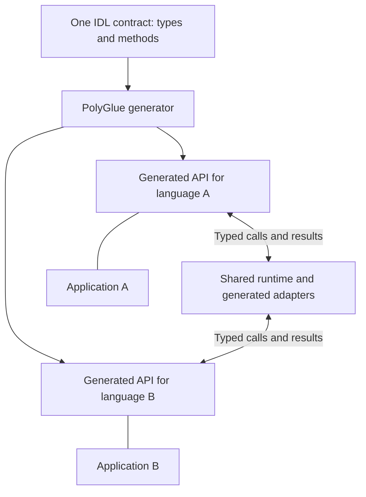

Terms used throughout this document:

| Term | Meaning |
| --- | --- |
| IDL | A language-neutral description of types and operations |
| Record | A named group of values, such as a user |
| Interface | A contract describing what methods an object offers |
| Consumer | Code that calls a method |
| Provider | Code that implements the method |
| Proxy | A generated object that forwards a call to another implementation |
| Adapter | Generated code that converts values and invokes the correct runtime |
| ABI | The binary rules both sides follow when calling each other |
| Service registry | An optional place to register and find implementations |
| SDK | A generated and packaged library that another application can use |

A record carries data, an enum names allowed choices, and an interface describes actions. A service is an interface implementation registered for discovery. PolyGlue generates the connection between languages, not the application's business logic.

For a first project, start with a record and one interface method. Generate bindings for two languages, implement the method in one language and call it from the other. Once that works, add a second module, optional values, asynchronous methods and callbacks. Use shared buffers when the application needs to avoid copying large data. Use the registry when the application needs to find or replace an implementation at runtime. Build and package the SDK after the calls work. Deployment is optional. The later chapters explain each step in depth.

### 1.1 Required outcomes

- One IDL can describe data models, repositories, services, callbacks, factories and asynchronous operations.
- A module can import data models and interfaces defined or generated in another module.
- A developer can implement a contract in Kotlin and consume it from Flutter, C++ or another available runtime. The same contract can also be implemented in Dart or Swift.
- Native calls can share memory without copying when supported, and make copying explicit when necessary.
- Every module can choose independent output directories, packages, namespaces, prefixes, naming conventions, annotations and build integration.
- The generator and native support libraries live in one repository and are released and tested together.
- An optional registry allows runtime service discovery and replacement. Ordinary interface references work without it.

### 1.2 Non-goals and decisions

| Topic | Decision |
| --- | --- |
| Existing IDL compatibility | None. Design an independent language |
| Protocol Buffers | Out of scope |
| Network RPC | Out of scope. No mandatory transport or serialization |
| Provider as built-in IDL type | Omit. Interfaces and callbacks implement factories |
| Future syntax | Use `async` in IDL. Futures are runtime/target representations |
| Result / Outcome | Use `Result<T, E>` for typed business errors |
| Global service locator | Optional, never required to invoke an interface |
| Python in production | Only when Python is a selected application runtime |
| External formatters | Optional. Generated source is readable by default |
| Universal cross-runtime sync dispatch | Do not promise where thread or isolate constraints make it unsafe |

Use original implementations. Preserve required third-party notices when dependencies are used. Do not copy existing generator or runtime source. Prefer fewer dependencies and a small, well-tested runtime. No unverified feature claims.

### 1.3 Engineering boundaries

The final implementation must be small, direct and maintainable. Use the simplest architecture that satisfies the explicit requirements. Do not add features, dependencies, extension frameworks, generators, wrappers or tests just to demonstrate activity. Every component must serve a real consumer, a documented contract or a credible failure mode.

Implement only the new final contract. Remove replaced implementations, obsolete configuration, compatibility aliases, version-detection branches, dead code and unused dependencies together with their callers. Do not preserve old PolyGlue APIs, IDL, configuration, manifest or ABI formats. Version and ABI checks remain necessary to reject incompatible current artifacts safely, not to route old versions to legacy code. Never hide failure with default values, silent retries, alternate implementation selection, ignored errors or compatibility workarounds. Explicit template inheritance, a deliberately selected provider override and safe resource finalization are defined behavior, not error-recovery fallbacks. Unsupported operations must fail with useful diagnostics.

Follow the owner rules in AGENTS.md. Review actual impact, fix substantiated problems and do not perform unrelated speculative refactors. Preserve user data, unrelated work, security and release authorization.

## 2. Supported languages and platforms

### 2.1 Language targets

Every language must be able to act as a consumer and as an implementation provider where its runtime permits the operation.

| Target | Boundary | Async surface |
| --- | --- | --- |
| C | Versioned C ABI | Completion function and opaque operation handle |
| C++ | C++20 interface / C ABI adapter | Awaitable / future |
| Java | JNI | CompletableFuture |
| Kotlin | JNI / JVM | suspend function |
| Objective-C | Objective-C++ | Completion block |
| Swift | Native Apple adapter | async throws |
| Python | CPython adapter | awaitable / async def |
| Dart | Dart FFI or web adapter | Future |
| Flutter | Dart bindings plus native plugin | Future |
| C# | .NET interop | Task |
| JavaScript | WebAssembly / JS adapter | Promise |
| TypeScript | JS implementation plus type declarations | Promise |

Flutter is an integration target, not a separate language. JavaScript and TypeScript may share implementation artifacts. Java and Kotlin can share JVM models to avoid duplicate classes. Swift and Objective-C can share imported types or use distinct namespaced wrappers. Never generate conflicting definitions.

### 2.2 Platform matrix

| Platform | Required primary targets | Evidence |
| --- | --- | --- |
| Linux | C, C++, Java, Kotlin, Python, Dart, Flutter, C# | Native execution |
| Windows | C, C++, Java, Kotlin, Python, Dart, Flutter, C# | Native execution |
| macOS | C, C++, Objective-C, Swift, Java, Kotlin, Python, Dart, Flutter, C# | Native execution |
| Android | C, C++, Java, Kotlin, Dart, Flutter | Emulator and device smoke where required |
| Android XR | C, C++, Java, Kotlin | SDK build and compatible emulator/device |
| iOS / iPadOS | C, C++, Objective-C, Swift, Dart, Flutter | Simulator and device smoke where required |
| tvOS | C, C++, Objective-C, Swift | SDK build and simulator |
| watchOS | C, C++, Objective-C, Swift | SDK build and simulator |
| visionOS | C, C++, Objective-C, Swift | SDK build and visionOS simulator/device |
| Mac Catalyst | C, C++, Objective-C, Swift | SDK build and execution |
| Web (browser) | C/C++ via WASM, JS, TS, Dart/Flutter Web | Browser execution |
| Node.js | C/C++ via WASM, JS, TS | Node execution |

The table is a required coverage plan, not verified support. SDK floors in examples are illustrative until the current toolchain matrix is validated. Each combination requires a capability entry and actual evidence. Native visionOS support is independent of Flutter. Native Flutter visionOS is conditional on upstream SDK/engine support. Flutter Web uses JS/WASM adapters rather than dart:ffi. Additional runtime combinations require explicit tests.

Build-only, emulator/simulator and physical-device evidence must be reported separately. An unavailable runner is a blocker, not a pass.

## 3. Developer workflow and distribution

### 3.1 Project usage

The CLI is named `polyglue`. The main config is `polyglue.yaml`. Modules use `module.yaml`. IDL files use `.idl`.

```bash
polyglue generate
polyglue generate --module domain
polyglue generate --module repository --target swift
polyglue generate --config modules/domain/module.yaml
polyglue validate
polyglue config show --module repository --target objc
polyglue list targets
polyglue --version
```

Without a target filter, generate all public targets explicitly selected by the requested modules. With a target filter, generate only that target and its required source dependency closure, including internal bridge artifacts. Resolve source and prebuilt dependencies automatically. A module.yaml used directly inherits built-in and module defaults only. To apply project defaults, select the module through its polyglue.yaml. Do not search parent directories for an implicit project. Validation must happen before writes. The config inspection command prints the effective merged settings, resolved paths and their origins.

### 3.2 Official and local generator

After release:

```bash
uvx polyglue generate
pip install polyglue
polyglue generate
```

From source:

```bash
git clone https://github.com/polyglue/polyglue.git
cd polyglue
uv sync --locked
uv run --locked polyglue generate --config examples/polyglue.yaml
uv tool install --editable .
```

A consumer may pin an official version or run a modified local checkout without changing the IDL. The package must work offline after installation. Wheel and sdist include the grammar, built-in templates and runtime source resources.

Python API:

```python
from polyglue.compiler import Compiler

compiler = Compiler.from_file("polyglue.yaml")
compiler.validate()
compiler.generate()
```

Use an installed CLI as the baseline. A bundled executable without a separately installed Python is optional only if a real deployment need justifies it after the wheel works. Do not publish packages before all required release gates and owner authorization.

### 3.3 Tooling

Latest stable CPython (verify actual release and dependency compatibility before locking), uv, pyproject.toml, uv.lock, Lark, Jinja2, safe YAML loading, typed dataclasses, argparse, pytest, Hypothesis and Ruff. Native support: C++20, C ABI, CMake and standard toolchains. Avoid duplicate configuration or CLI frameworks, mandatory formatters, generators requiring Scala/JVM and unnecessary build systems.

### 3.4 Build, test and packaging commands

One installed Python CLI is the entry point for generation and native build orchestration. A repository-local invocation uses the same code as the installed CLI. Do not maintain a second independent task runner.

| Command | Responsibility |
| --- | --- |
| polyglue doctor | Discover host, installed SDKs, compilers and tool versions. Show missing requirements for the selected target |
| polyglue generate | Generate source files and configured integration metadata. No native SDK required |
| polyglue build | Resolve the selected build plan, generate inputs if needed, configure and build the requested artifact |
| polyglue test | Run target-specific tests, conformance or installed-package tests against selected artifact bytes, optionally with sanitizer configuration |
| polyglue package | Build and assemble the distributable, inspect its structure and write an artifact manifest |
| polyglue deploy | Upload an explicitly selected, already packaged SDK to an S3-compatible bucket using its validated version and build number |
| polyglue run | Run the selected example where the current host or device allows execution |
| polyglue clean | Remove only PolyGlue-owned build outputs for the selected scope |
| polyglue config show | Inspect the effective configuration and its origin |
| polyglue templates list | Show template IDs, target, source and render-model version |
| polyglue templates export | Export selected built-in templates for local customization |
| polyglue templates check | Validate a template override set against its declared target and context contract |

Illustrative CLI (commands to implement and test, not available yet):

```bash
uv run --locked polyglue doctor --target kotlin --platform android
uv run --locked polyglue generate --module repository --target kotlin
uv run --locked polyglue build --product mobile --platform android --configuration release
uv run --locked polyglue package --product mobile --format aar
uv run --locked polyglue test --product mobile --format aar
uv run --locked polyglue package --product apple --format xcframework
uv run --locked polyglue package --product apple --format swiftpm
uv run --locked polyglue package --product desktop --platform linux --format cmake
uv run --locked polyglue test --target cpp --sanitizer address
uv run --locked polyglue test --target cpp --sanitizer thread
uv run --locked polyglue run --target flutter --platform android
```

Use explicit module/target selection for source generation and explicit product selection for multi-module binary artifacts. Deploy consumes a previously validated artifact manifest and never implicitly builds, bumps a version, publishes to a package registry or uploads as a side effect of generate/build/package/test. Resolve missing or ambiguous product/format/SDK combinations before modifying outputs. Build/test/package may require native SDKs. Generate/validate must remain offline Python-only. Support an explicit incremental mode with input fingerprint verification, an explicit clean build, a dry-run build plan, bounded parallelism, nonzero exit on failure/signal, and a machine-readable result option. Never report success just because an external command returned zero: verify expected artifacts and test results.

### 3.5 Development version and release authorization

The current project version is **0.0.1**, an unreleased development version. Use a single canonical package version in pyproject.toml once the Python package is bootstrapped. Derive the CLI version, runtime distribution version, generated metadata and artifact manifests from the same source. Keep the ABI version and user module versions independent. A 1.0.0 value in an application-module or SDK product example is illustrative, not the PolyGlue version. Do not claim 1.0.0 support. Product SDK versions and build numbers are independently configured by their owners under section 7.8. They must not change the tool version or ABI identity.

- Continue development and local/CI testing at 0.0.1 until the owner explicitly requests another version.
- Advance to 0.0.2, 0.0.3 and subsequent versions only when explicitly authorized. Never increment the version automatically for commits, builds or successful CI.
- An authorization to change the development version does not authorize a Git tag, GitHub Release, TestPyPI upload, PyPI upload or any other external publication.
- Local builds and GitHub Actions test artifacts may use the current development version without creating a public release. Identify individual builds by commit SHA and artifact checksum.
- Do not create tags, releases, registry uploads, SDK cloud deployments or publication automation capable of running automatically during normal development. An explicit consumer invocation of deploy authorizes only that selected SDK artifact and destination. For this repository, actual external deployment requires the owner's explicit authorization. No cloud upload or credential setup is authorized by implementing or documenting the feature.
- Production PyPI publication is prohibited until every mandatory acceptance gate passes on the exact candidate revision, the project is complete to the owner's satisfaction and the owner explicitly approves that specific version for PyPI. Never publish placeholder packages to reserve the name.

### 3.6 PyPI Trusted Publishing (future, disabled)

The intended pending publisher is:

| Setting | Value |
| --- | --- |
| PyPI project name | polyglue |
| GitHub owner | polyglue |
| GitHub repository | polyglue |
| Workflow filename | publish.yml |
| GitHub environment | pypi |

The owner may register this pending publisher at https://pypi.org/manage/account/publishing/. A pending publisher does not create a project or reserve the distribution name. Confirm the name remains available when the first authorized release is ready.

Future workflow: .github/workflows/publish.yml. Do not install an upload-capable workflow until the owner explicitly authorizes production publishing. Until then, ordinary CI only builds, checks and stores test artifacts. No automatic publishing on push, merge, tag, release, schedule or pull request. No TestPyPI upload without separate permission.

When enabled by a separate owner-approved task, use manual workflow_dispatch for a specific version and candidate revision, restrict it to an approved protected ref, and require the pypi environment and owner approval where GitHub settings support required reviewers. Keep an independent explicit owner authorization requirement even if an environment protection feature is unavailable. Validate the version and exact commit, required CI evidence and all artifact checks. Keep build/test jobs read-only, with checkout credentials disabled and no OIDC permission. Build wheel and sdist with uv, inspect package metadata and contents, run Twine check and install both in isolated consumer environments. Transfer the exact validated distributions within the workflow. The dedicated hosted Linux publish job alone receives id-token: write and uses the official PyPA publishing action pinned to a reviewed immutable SHA. Preserve default attestations, do not rebuild in the privileged job, and do not store PyPI API tokens or passwords. Never use skip-existing to conceal version conflicts. Check the resulting registry metadata and hashes after an authorized upload. Yanking, deletion and retry after a partial release require review and explicit authorization.

Official guidance: https://docs.pypi.org/trusted-publishers/creating-a-project-through-oidc/ and https://docs.pypi.org/trusted-publishers/using-a-publisher/.

### 3.7 Current stable tools and dependencies

Latest stable versions are a mandatory engineering policy. At implementation time and when maintaining build, CI or package configuration, verify every direct runtime, development, testing and build dependency, GitHub Action, reusable workflow, compiler, SDK and package manager against its official upstream stable release. Select the newest stable release, not an arbitrary older major or a prerelease. Verify compatible dependency sets for coupled toolchains. A necessary older direct version requires an explicit documented incompatibility and owner approval. Do not silently downgrade. Transitive versions respect upstream constraints and must be reviewed for security and compatibility.

Use the newest stable CPython and uv for development and CI. Verify the actual available releases and all dependency compatibility before declaring the supported Python runtime range. Keep pyproject.toml, src layout, uv.lock, dependency groups, modern supported Python syntax/typing and standard-library APIs. Use uv for project setup, virtual environments, dependency management, execution, testing and packaging. Do not maintain parallel requirements.txt or other Python environment-management workflows. Consumers may install an authorized distribution with pip. That does not replace uv for development.

```bash
uv sync --locked
uv run --locked ruff check .
uv run --locked ruff format --check .
uv run --locked pytest
uv build --no-sources
```

Use uv add for declared dependencies and uv lock --upgrade during deliberate reviewed upgrades. Commit the updated lockfile. The latest stable dependency policy and reproducible builds are complementary: select current stable releases, lock their actual versions and test them. Ordinary CI installs the committed resolution and must not silently upgrade it or rewrite files. Pin Actions to the immutable commit of the latest verified stable release and annotate the release tag. Pin CMake/native dependencies by reviewed source revision or archive checksum. Record exact resolved toolchains and dependencies in build evidence. No unreviewed floating dependency or automatic release, version increment, dependency-update PR or scheduled repository mutation.

## 4. IDL language

### 4.1 Domain and repository example

`modules/domain/idl/user.idl`:

```text
module domain;

enum UserStatus {
    Active = 1,
    Inactive = 2,
    Blocked = 3
}

/// Represents a registered user.
record User {
    id: int64;
    name: string;
    email: optional<string>;
    loggedIn: bool = false;
    status: UserStatus = UserStatus.Active;
}
```

`modules/repository/idl/user-repository.idl`:

```text
module repository;

import domain.User;
import domain.UserStatus;

interface UserRepository {
    async findById(id: int64): optional<User>;
    async findAll(): list<User>;
    async findByStatus(status: UserStatus): list<User>;
    async save(user: User): User;
    async saveAll(users: list<User>): list<User>;
    async count(): int64;
    async exists(id: int64): bool;
    async delete(id: int64): bool;
    async deleteAll(): void;
}
```

This is a core acceptance fixture. The user status belongs to the User record, so findByStatus filters the same data that save and findById return. loggedIn is a separate boolean, not a second account status. Each target must implement and consume these contracts across module and language boundaries. The repository sample uses the User definition from section 4.1. The separate date example in section 5.6 is an alternative fixture, not a second User declaration in the same module. No JSON conversion or manually written bridge in the example.

### 4.2 Language constructs

| Construct | Semantics |
| --- | --- |
| module | Logical namespace, shared by multiple IDL files |
| import | Compile-time symbol reference, independent of physical output |
| record | Value semantics. Immutable by default, configurable where safe |
| enum / flags | Stable integer representation, named values and bit masks |
| variant | Tagged union with explicit alternatives |
| interface | Object identity, methods and cross-language references |
| callback | Typed callable with a synchronous or asynchronous completion contract and explicit lifetime |
| async | Asynchronous method or callback, independent of return type |
| const | Typed constant |
| static / factory | Explicitly bound factory or static method, not implicit global lookup |
| public / private | Export visibility |
| generic parameters | Concrete instantiation and ABI specialization |
| documentation | Structured comments copied to target documentation |
| annotations | Typed semantic or backend-specific metadata |

Support interface inheritance with cycle detection. Reject recursive value layouts without an indirection. Validate constant ranges, defaults, method signatures, overload collisions and reserved IDL identifiers. A typed enum constant or default may reference a declared member such as UserStatus.Active. Resolve it during generation. Define grammar and diagnostic source spans before publishing the syntax.

### 4.3 Imports and aliases

```text
import domain.User;
import domain.{User, UserStatus};
import domain as model;
import domain.User as DomainUser;
import domain.*;
```

These are alternative forms, not intended to be combined redundantly. A wildcard import must resolve unambiguously. No dependence on C++ headers or Swift module names in IDL. Fully qualified logical identifiers can disambiguate types.

### 4.4 User-defined generics

```text
module common;

record Page<T> {
    items: list<T>;
    page: int32;
    pageSize: int32;
    total: int64;
    hasNext: bool;
}
```

```text
module repository;

import common.Page;
import domain.User;

interface PagedUserRepository {
    async findPage(page: int32, pageSize: int32): Page<User>;
}
```

Generic source types are instantiated consistently. C uses concrete generated types such as PageUser. Generic-capable targets may expose native generics when equivalent. Specialization identity comes from the fully qualified generic definition and canonical type arguments, not from the importing module or rendered name. In the example, repository owns its concrete Page<User> artifacts if they are not already supplied by a dependency. If independently generated modules need the same specialization in one product, they must import it from one shared owning module. Use an explicit named concrete specialization in that shared module, with its declaration syntax finalized alongside the generic grammar in phase 1. Do not silently emit several public classes for the same specialization or change ownership depending on the selected target. A prebuilt dependency can only supply specializations recorded in its manifest. Never modify it to add a new one. Reject conflicting owners and open generics at a concrete binary boundary.

### 4.5 Constants, inheritance and factory flow

Constants and defaults become generated values, not runtime lookup calls. Interface inheritance and concrete generic specialization are resolved before generation. Static operations and factories bind to an explicitly selected implementation rather than a hidden global service.

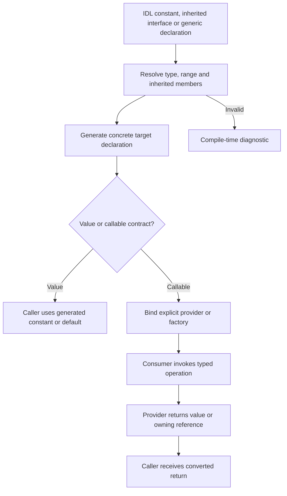

## 5. Type system

Start with ordinary values such as integers and strings. Records group values together. Collections hold several values. Optionals say whether a value exists. Interfaces and callbacks allow calls rather than just carrying data. Buffers and references add lifetime rules. Section 5.4 is the complete type reference, and section 5.9 shows how the values actually travel and return.

### 5.1 Types to implement and test

| Group | IDL types |
| --- | --- |
| Scalar | bool, int8, int16, int32, int64, uint8, uint16, uint32, uint64, float32, float64 |
| Text / binary | string, bytes |
| Collections | `list<T>`, `set<T>`, `map<K,V>`, `array<T>` |
| Optional / variant | `optional<T>`, variant |
| Named | record, enum, flags, interface |
| Special memory | DataView, MutableDataView, DataRef |
| Errors | `Result<T,E>` |
| Time and identity | date, timestamp, duration, uuid |
| Behavior | callback, async method or callback, `Stream<T>` |
| Lifetime / control | `WeakRef<T>`, CancellationToken |
| External | Explicitly declared type with per-target adapter |

`void` is a return-only type, including Result success with no payload. Reject `optional<void>`, `list<void>` and other value positions containing void, except `Result<void,E>` as a legal success case. Null is a literal, not an independent transport type. Service discovery, constants, factories, inheritance and generic declarations are language features rather than extra wire types. `array<T>` is a variable-length sequence with an optimized contiguous representation for fixed-width numeric primitives. `list<T>` is the general sequence representation. Arrays of other legal value types use element-wise conversion without a contiguous-memory promise. Bool arrays must use explicitly defined byte storage when exposed as contiguous memory, not C++ `vector<bool>` bit proxies. Neither list nor array implies zero-copy. Use the explicit buffer contracts in section 13 for shared memory.

### 5.2 Return mapping examples

These are semantic API mappings. An async declaration wraps the corresponding type in the target's async mechanism.

| IDL | C++ | Kotlin | Swift | Dart |
| --- | --- | --- | --- | --- |
| User | User | User | User | User |
| `optional<User>` | `std::optional<User>` | User? | User? | User? |
| `list<User>` | `std::vector<User>` | `List<User>` | [User] | `List<User>` |
| int64 | int64_t | Long | Int64 | int (native) |
| bool | bool | Boolean | Bool | bool |
| void | void | Unit | Void | void |

For JavaScript and TypeScript, use bigint when exact 64-bit integer representation is required. Dart Web needs an explicitly validated exact-integer representation, not unchecked JS Number conversion. Java unsigned types require a documented exact mapping. C and Objective-C require explicit boxing/tagged representations for optionals, variants and generic collections.

### 5.3 Value and error rules

- Unicode strings use a specified UTF-8 boundary. Define invalid Unicode handling and test non-ASCII, supplementary characters, embedded nulls and empty strings.
- Integer values must not silently truncate. Define floating-point NaN, infinity and signed zero semantics.
- Specify collection equality, hashing, supported map keys, duplicate entries, ordering and nesting limits.
- Distinguish null, absent, empty and zero. Enums use explicit unique signed 32-bit values. Flags use unsigned 32-bit masks with explicit named bits and optional named combinations. Reject unknown enum values and unknown flag bits at the boundary. Zero is a valid empty flags value. These are closed current contracts, not forward-compatibility mechanisms.
- Define date, timestamp and duration units and UUID byte order. Test exact round trips as specified in section 5.6.
- `Result<T,E>` represents business success or failure. `Result<void,E>` has a success tag without a value payload. E must be a legal non-void owning value type. Runtime/ABI failures use a separate status, including conversion failure, missing service and invalid handle. Cancellation is a separate terminal status. No cross-ABI exception unwinding. A failed invocation or conversion must never look like a successful optional absence or a business error.
- External types require declared import paths, ABI representation, marshaller, ownership and tests for each target. No unsupported target fallback.

Example:

```text
enum LoginError {
    InvalidCredentials = 1
}

interface Auth {
    async login(username: string, password: string): Result<User, LoginError>;
}
```

Use one C++20-compatible Result representation. Swift uses Result when E conforms to Swift Error and a generated tagged result otherwise. A generated business-error enum may conform to Error without turning Result into an implicit throw. Other targets use a native or generated tagged result. Business errors do not become unexpected exceptions.

### 5.4 Complete type mapping contract

These tables are the proposed default public APIs, not native struct layouts. C and WASM describe the boundary representation. Generated wrappers are small and typed. Their final names follow module naming rules. Flutter uses the Dart native or Dart Web column according to its platform. Java and Kotlin share one model only when explicitly configured. Swift may import Objective-C models. Shared model ownership does not change the canonical type.

All numeric conversions check range and type. All collection mappings obey the key and optional rules below. A wrapper is required when a native representation cannot preserve the full value or lifetime contract. No silent conversion or fallback. A pointer, offset or handle is valid only inside its owning runtime or WASM instance. `async` is a declaration modifier rather than a value type. Async callbacks use the same completion contract as async methods. `void` is return-only, including the success case of Result. The WASM column describes a conceptual canonical lowering, not a finalized ABI signature.

#### Type meaning and native boundary

| IDL | Meaning | C | WebAssembly |
| --- | --- | --- | --- |
| `bool` | True or false | uint8_t (0/1) | i32 (0/1) |
| `int8` | Signed 8-bit integer | int8_t | i32, checked |
| `int16` | Signed 16-bit integer | int16_t | i32, checked |
| `int32` | Signed 32-bit integer | int32_t | i32 |
| `int64` | Signed 64-bit integer | int64_t | i64 |
| `uint8` | Unsigned 8-bit integer | uint8_t | i32, checked |
| `uint16` | Unsigned 16-bit integer | uint16_t | i32, checked |
| `uint32` | Unsigned 32-bit integer | uint32_t | i32 bit pattern |
| `uint64` | Unsigned 64-bit integer | uint64_t | i64 bit pattern |
| `float32` | 32-bit floating-point value | float | f32 |
| `float64` | 64-bit floating-point value | double | f64 |
| `string` | Unicode text | UTF-8 descriptor | UTF-8 in linear memory |
| `bytes` | Independent binary value | Owned byte descriptor | Owned byte buffer |
| `void` | Successful return with no payload | Status, no payload | Status, no payload |
| `record` | Named group of values | Generated value/handle | Canonical fields |
| `enum` | One declared integer value | int32_t + constants | i32, checked |
| `flags` | Combined named bits | uint32_t + constants | i32 bit mask |
| `variant` | One of several tagged alternatives | Tagged value + destroy | Tag + active payload |
| `list<T>` | Ordered sequence | Typed descriptor/handle | Length + elements |
| `set<T>` | Unique values | Typed descriptor/handle | Canonical unique elements |
| `map<K,V>` | Keys mapped to values | Typed descriptor/handle | Canonical key/value pairs |
| `array<T>` | Sequence with contiguous primitive optimization | Typed array descriptor | Length + typed or element buffer |
| `optional<T>` | Absent or present value | Presence tag + payload | Presence tag + payload |
| `Result<T,E>` | Business success or business error | Tagged result + destroy | Tag + active payload |
| `interface` | Reference to an implementation | Typed opaque handle | Context-local typed handle |
| `callback` | Callable passed to another implementation | Function table + context | Typed callback handle |
| `async method / callback` | Operation with asynchronous completion | Completion + operation handle | Operation handle + completion |
| `Stream<T>` | Sequence of asynchronous events | Subscription handle | Subscription handle |
| `WeakRef<T>` | Reference that does not retain the object | Weak handle | Context-local weak handle |
| `CancellationToken` | Cooperative stop signal | Token handle | Token handle |
| `date` | Calendar date, without a time | int64_t epoch days | i64 epoch days |
| `timestamp` | UTC instant, exact microseconds | int64_t UTC microseconds | i64 UTC microseconds |
| `duration` | Signed elapsed nanoseconds | int64_t nanoseconds | i64 nanoseconds |
| `uuid` | 128-bit identifier | 16-byte value | 16 canonical bytes |
| `DataView` | Scoped read-only borrowed memory | Const pointer + length | Scoped offset + length |
| `MutableDataView` | Scoped exclusive writable memory | Writable pointer + length | Exclusive scoped offset + length |
| `DataRef` | Shared owning buffer reference | Owning handle | Context-local owner handle |
| `external` | User-defined host type with canonical mapping | Declared type / adapter | Declared canonical representation |

#### Native and JVM public APIs

| IDL | C++ | Java | Kotlin | Objective-C | Swift |
| --- | --- | --- | --- | --- | --- |
| `bool` | bool | boolean | Boolean | BOOL | Bool |
| `int8` | std::int8_t | byte | Byte | int8_t | Int8 |
| `int16` | std::int16_t | short | Short | int16_t | Int16 |
| `int32` | std::int32_t | int | Int | int32_t | Int32 |
| `int64` | std::int64_t | long | Long | int64_t | Int64 |
| `uint8` | std::uint8_t | short | UByte | uint8_t | UInt8 |
| `uint16` | std::uint16_t | int | UShort | uint16_t | UInt16 |
| `uint32` | std::uint32_t | long | UInt | uint32_t | UInt32 |
| `uint64` | std::uint64_t | BigInteger | ULong | uint64_t | UInt64 |
| `float32` | float | float | Float | float | Float |
| `float64` | double | double | Double | double | Double |
| `string` | std::string | String | String | NSString | String |
| `bytes` | `std::vector<uint8_t>` | byte[] | ByteArray | NSData | Data |
| `void` | void | void / Void | Unit | void | Void |
| `record` | struct | Immutable class | data class | NSObject model | struct or imported model |
| `enum` | enum class | Generated enum | enum class | NS_ENUM | enum |
| `flags` | Flags wrapper | Flags wrapper | Flags wrapper | NS_OPTIONS | OptionSet |
| `variant` | std::variant | Tagged class | Sealed class | Tagged object | Associated-value enum |
| `list<T>` | `std::vector<T>` | `List<T>` | `List<T>` | NSArray | [T] |
| `set<T>` | std::set / hash set | `Set<T>` | `Set<T>` | NSSet | `Set<T>` |
| `map<K,V>` | std::map / hash map | `Map<K,V>` | `Map<K,V>` | NSDictionary | `Dictionary<K,V>` |
| `array<T>` | std::vector / array wrapper | Primitive array / wrapper | Primitive array / wrapper | Typed buffer / wrapper | Typed buffer / wrapper |
| `optional<T>` | `std::optional<T>` | Nullable boxed T / wrapper | T? / wrapper | Nullable object / boxed optional | `Optional<T>` |
| `Result<T,E>` | PolyGlue Result | Generated Result | Sealed Result | Tagged result object | Result / tagged enum |
| `interface` | Owning interface reference | Interface + proxy | Interface + proxy | Protocol + proxy | Protocol + proxy |
| `callback` | Callable wrapper | Functional interface | Function / SAM | Block | Closure |
| `async method / callback` | Awaitable / future | CompletableFuture | suspend | Completion block | async throws |
| `Stream<T>` | Async stream | Publisher adapter | Flow | Subscription + block | AsyncSequence |
| `WeakRef<T>` | Weak interface reference | Weak handle wrapper | Weak handle wrapper | Weak handle wrapper | Weak handle wrapper |
| `CancellationToken` | Token wrapper | Token wrapper | Token wrapper | Token wrapper | Token wrapper |
| `date` | std::chrono::year_month_day | LocalDate | LocalDate | Calendar date wrapper | Calendar date wrapper |
| `timestamp` | `sys_time<microseconds>` | Instant | Instant | Exact wrapper + NSDate conversion | Exact wrapper + Date conversion |
| `duration` | std::chrono::nanoseconds | Duration | java.time.Duration | Exact duration wrapper | Duration or exact wrapper |
| `uuid` | UUID value wrapper | UUID | UUID | NSUUID | UUID |
| `DataView` | Scoped read-only span | Checked read view | Checked read view | Checked read view | Scoped read-only access |
| `MutableDataView` | Scoped writable span | Checked write view | Checked write view | Checked write view | Scoped writable access |
| `DataRef` | RAII owner | Retained buffer owner | Retained buffer owner | Retained buffer owner | Retained buffer owner |
| `external` | Declared type / adapter | Declared type / adapter | Declared type / adapter | Declared type / adapter | Declared type / adapter |

#### Managed and web public APIs

| IDL | Python | Dart native | Dart Web | C# | JavaScript | TypeScript |
| --- | --- | --- | --- | --- | --- | --- |
| `bool` | bool | bool | bool | bool | boolean | boolean |
| `int8` | int | int | int | sbyte | number | number |
| `int16` | int | int | int | short | number | number |
| `int32` | int | int | int | int | number | number |
| `int64` | int | int | BigInt | long | bigint | bigint |
| `uint8` | int | int | int | byte | number | number |
| `uint16` | int | int | int | ushort | number | number |
| `uint32` | int | int | int | uint | number | number |
| `uint64` | int | BigInt | BigInt | ulong | bigint | bigint |
| `float32` | float | double | double | float | number | number |
| `float64` | float | double | double | double | number | number |
| `string` | str | String | String | string | string | string |
| `bytes` | bytes | Uint8List | Uint8List | byte[] | Uint8Array | Uint8Array |
| `void` | None | void | void | void | undefined | void |
| `record` | Frozen dataclass | Immutable class | Immutable class | record / class | Immutable object | Readonly model + runtime object |
| `enum` | Enum | enum | enum | enum | Frozen constants | Checked numeric type |
| `flags` | IntFlag / checked wrapper | Flags wrapper | Flags wrapper | Flags enum / wrapper | Checked mask | Checked mask |
| `variant` | Tagged dataclass union | Sealed class | Sealed class | Tagged record hierarchy | Tagged object | Discriminated union |
| `list<T>` | list[T] | `List<T>` | `List<T>` | `IReadOnlyList<T>` | Array | `ReadonlyArray<T>` |
| `set<T>` | set[T] | `Set<T>` | `Set<T>` | `IReadOnlySet<T>` | Set | `Set<T>` |
| `map<K,V>` | dict[K,V] | `Map<K,V>` | `Map<K,V>` | `IReadOnlyDictionary<K,V>` | Map | `Map<K,V>` |
| `array<T>` | Typed buffer / list | TypedData / wrapper | TypedData / wrapper | T[] / `Memory<T>` | TypedArray / Array | TypedArray / `ReadonlyArray<T>` |
| `optional<T>` | T or None / wrapper | T? / wrapper | T? / wrapper | T? / wrapper | T or null / wrapper | T or null / wrapper |
| `Result<T,E>` | Tagged result | Sealed Result | Sealed Result | Generated Result | Tagged object | Discriminated union |
| `interface` | Protocol/ABC + proxy | Interface + proxy | Interface + proxy | Interface + proxy | Provider object / proxy | Interface + runtime proxy |
| `callback` | Callable | Typed function | Typed function | Delegate | Function | Typed function |
| `async method / callback` | Awaitable / async def | Future | Future | Task | Promise | Promise |
| `Stream<T>` | AsyncIterator | Stream | Stream | `IAsyncEnumerable<T>` | AsyncIterable | `AsyncIterable<T>` |
| `WeakRef<T>` | Weak handle wrapper | Weak handle wrapper | Weak handle wrapper | Weak handle wrapper | Weak handle wrapper | Weak handle wrapper |
| `CancellationToken` | Token wrapper | Token wrapper | Token wrapper | CancellationToken adapter | AbortSignal adapter | AbortSignal adapter |
| `date` | datetime.date | Calendar date wrapper | Calendar date wrapper | DateOnly | Calendar date wrapper | Calendar date wrapper |
| `timestamp` | Exact wrapper + aware datetime conversion | Exact wrapper + UTC DateTime conversion | Exact wrapper + UTC DateTime conversion | Exact wrapper + DateTimeOffset conversion | bigint + Date conversion | bigint + Date conversion |
| `duration` | Exact wrapper + timedelta conversion | Exact wrapper + Duration conversion | Exact wrapper + Duration conversion | Exact wrapper + TimeSpan conversion | bigint nanoseconds | bigint nanoseconds |
| `uuid` | uuid.UUID | UUID wrapper | UUID wrapper | Guid | Canonical UUID string | Canonical UUID string |
| `DataView` | Checked read view | Checked read view | Checked read view | Scoped read-only access | Checked linear-memory view | Checked linear-memory view |
| `MutableDataView` | Checked write view | Checked write view | Checked write view | Scoped writable access | Checked writable memory view | Checked writable memory view |
| `DataRef` | Retained buffer owner | FFI buffer owner | Web buffer owner | SafeHandle / owner | Linear-memory owner | Linear-memory owner |
| `external` | Declared type / adapter | Declared type / adapter | Declared type / adapter | Declared type / adapter | Declared type / adapter | Declared type / adapter |

Java unsigned values use checked wider types. Kotlin uses exact unsigned types with checked JNI bit conversions. Python integers and JavaScript Number inputs are checked, including rejection of Python bool as an integer. JavaScript and Dart Web must not convert exact 64-bit values through JavaScript Number. Use BigInt or an exact checked bit representation at the adapter boundary. A JS or WASM signed bit pattern is not the mathematical unsigned value until it has been decoded. Numeric arrays use exact contiguous representations only where available. Float32 rounding occurs at the boundary. Strings use validated UTF-8 with explicit lengths, including embedded NUL. Invalid UTF-8 or unpaired surrogates fail. C bool accepts only 0/1. Record and collection values do not share mutable object identity. Interface and DataRef references retain ownership explicitly.

Collection key types are limited to bool, integer, string, enum and UUID, plus external types proven to preserve one of those key representations. Reject duplicate canonical keys. There is no portable set/map iteration order. Key wrappers are needed when host equality differs from canonical equality, such as Swift canonical-equivalent Unicode strings. Objective-C dictionary keys must also support NSCopying. Generated key wrappers must be immutable, implement canonical equality and hashing, and copy without changing their value. Java/Kotlin and Objective-C shared models must preserve the same rules. JS UUID keys use canonical strings. Preserve float signed zero, infinity and NaN classification without promising NaN payload bits. UUID bytes use network order. No borrowed memory may escape a direct synchronous parameter. DataRef is read-only by default and retains its true owner. See sections 5.6, 5.8, 13 and 14 of PROJECT.md for detailed rules.

### 5.5 Per-type acceptance

Use the shared conformance inventory and risk-based coverage policy in section 18. Each built-in and external fixture type must cross every feasible ordered language pair. Test argument, result, record, collection and async conversion paths where legal and distinct. Reuse representative nested fixtures instead of multiplying equivalent cases. No backend may mark a type supported just because it generates a declaration.

### 5.6 Built-in date and time types

Date and time interoperability is a built-in feature, not a user-required extension. Keep built-ins limited to the common types in section 5.1. Domain-specific colors, vectors, money and geographic coordinates use ordinary IDL or external types unless explicitly requested otherwise. Distinguish an instant from a calendar date and a duration. Never interpret a date as a local midnight timestamp. Use the proleptic Gregorian calendar for date and UTC with POSIX-style epoch semantics for timestamp (no distinct leap-second encoding). A timestamp is never sent as a local time, locale-dependent text or floating-point seconds.

| IDL type | Canonical value | Meaning |
| --- | --- | --- |
| timestamp | int64 microseconds since 1970-01-01T00:00:00Z | Exact UTC instant |
| date | int64 epoch days since 1970-01-01 | Calendar date, without time or timezone |
| duration | int64 nanoseconds | Signed elapsed time |
| uuid | 16 bytes in canonical network order | UUID value |

The portable date range is years 0001 through 9999 inclusive, enforced at conversion. Timestamp and duration support the full canonical integer range via exact value wrappers where a host's native type cannot represent it. Native conversions must reject overflow or precision loss by default. UTC normalization preserves the same instant and is required. Never silently truncate or reinterpret local wall-clock time. Explicit rounding or truncation is a separate documented application choice. Do not use floating-point seconds as the canonical ABI representation.

Example IDL:

```text
module domain;

record User {
    id: int64;
    name: string;
    birthday: optional<date>;
    createdAt: timestamp;
    sessionDuration: duration;
    identifier: uuid;
}
```

#### 5.6.1 Native date and time integration

| Target | Calendar date | UTC instant | Duration |
| --- | --- | --- | --- |
| C | Checked epoch-day value | int64 microseconds | int64 nanoseconds |
| C++ | std::chrono::year_month_day | `sys_time<microseconds>` | std::chrono::nanoseconds |
| Java | java.time.LocalDate | java.time.Instant | java.time.Duration |
| Kotlin/JVM | java.time.LocalDate | java.time.Instant | java.time.Duration |
| Objective-C | Generated calendar-date value | Exact value plus NSDate conversion | Exact nanosecond value |
| Swift | Generated calendar-date value with checked DateComponents conversion | Exact value plus Foundation.Date conversion | Swift.Duration or exact value wrapper |
| Python | datetime.date | Exact value plus timezone-aware datetime conversion | Exact value plus timedelta conversion |
| Dart / Flutter | Generated calendar-date value | Exact value plus UTC DateTime conversion | Exact value plus Duration conversion |
| C# | DateOnly | Exact value plus DateTimeOffset conversion | Exact value plus TimeSpan conversion |
| JavaScript / TypeScript | Generated calendar-date value | bigint microseconds plus Date conversion | bigint nanoseconds |
| WASM | Canonical integer representation | Canonical i64 | Canonical i64 |

The table specifies required supported public conversions. Use idiomatic host-native objects directly when the conversion preserves the entire advertised contract. Otherwise expose a generated exact value wrapper with convenient native conversion methods. Host values outside the canonical range or with finer precision than the IDL type must fail checked conversion. Do not restrict a built-in's canonical range per target to make a native mapping appear complete. Do not silently reduce timestamps to milliseconds for JS Date or round nanoseconds to microseconds/ticks for Python, Dart or .NET. Every date-time instant crosses the bridge as UTC, encoded as signed epoch microseconds. A timezone-aware input is normalized to the same UTC instant before conversion. All native date-time values produced by the bridge use UTC when they carry a timezone or offset. Reject naive or ambiguous local date-times unless the application explicitly resolves them to an instant before crossing. Do not read the host's default timezone during conversion. A calendar date is transmitted as epoch days without time or timezone, so a birthday never moves to another day. Durations have no timezone. These rules apply to every nested record, optional, collection, callback, stream, async result and external adapter using timestamp. Timezone identifiers and local/zoned date-times with DST ambiguity are not synonyms for timestamp. If needed, model them explicitly as records or external types. No extra timezone library in core.

Use checked integer arithmetic for epoch conversion, including negative instants. For hosts exposing whole seconds and nonnegative fractional nanoseconds, split a negative timestamp with floor division and a nonnegative remainder. Do not divide through floating-point seconds. For example, -1 microsecond represents 1969-12-31T23:59:59.999999Z, not a positive fractional time at epoch zero. Java and Kotlin use java.time on Android only where the configured SDK floor supports the required APIs, or with explicitly declared and tested core library desugaring. An unsupported floor must fail validation rather than silently change the temporal contract. See [Android Java API desugaring](https://developer.android.com/studio/write/java8-support) and the [Instant API](https://docs.oracle.com/en/java/javase/24/docs/api/java.base/java/time/Instant.html).

Provide checked native conversion methods in the built-in implementation. Do not create a separate profile system for standard dates. If a project wants a narrower domain-specific host type as its public API, use the existing external type mechanism with explicit checked conversion. Keep the built-in representation exact.

#### 5.6.2 Date conformance

Test epoch zero, pre-epoch negative timestamps, positive and negative subsecond values, values beyond the JS safe-integer range, signed extremes, invalid ranges, leap years (including 1900 and 2000), month/day validation, year boundaries, calendar date stability across timezone changes, UTC offset normalization, naive input rejection, DST ambiguous/nonexistent local times in applicable native conversion tests, precision loss, invalid Date/NaN, UUID canonical byte order and signed duration arithmetic overflow. Test dates in records, optionals, lists, maps as values, results, callbacks, async and streams. Compare canonical values independently, not formatted local strings. Run a focused round-trip fixture with different host timezone settings, including a non-UTC offset, to prove the bridge does not depend on the machine timezone. Calendar-date keys and other non-listed key types remain unavailable unless portable equality and hashing are explicitly specified and proven.

### 5.7 Custom and external type extension system

Users must be able to add new reusable types without modifying, forking, rebuilding or publishing a new version of the Python generator. Ordinary records, enums, flags, variants, interfaces and generic declarations already define project-owned types in IDL. External types additionally expose existing host-language classes or value types through an explicit portable representation and native adapters. Both are first-class module symbols. Use a stable, documented declarative descriptor schema and a small adapter API. Do not require a Python plugin for an ordinary new type or copy the built-in backend templates just to integrate one.

#### 5.7.1 Portable representation

Use an existing valid PolyGlue type as the canonical boundary representation: a scalar, record, enum, variant, collection, DataRef or typed interface reference. An external type has a stable logical identity and a checked mapping to this representation in every selected target. Reuse the generated ABI, ownership and conversion machinery rather than adding arbitrary raw ABI layouts for each external type. An external value may map to a canonical record. An opaque resource must map to an owning typed interface or supported handle contract, never a foreign raw pointer encoded as int64. Borrowed representations are allowed only within the existing scoped synchronous borrow rules. Reject unsafe nested/async uses. Generic external types may reuse the existing concrete generic instantiation mechanism. Do not create a second generic system. Validate canonical representation dependencies and reject cycles in external-to-external mappings that would recurse without a legal indirection. No open generics at an ABI boundary.

The external type's value equality, hashing, ordering, precision, range and validation semantics come from its documented logical contract. Enable equality/hash/map-key operations only if the representation and adapters preserve those semantics on every selected target. External types with unverified semantics cannot be used as portable set elements/map keys. No automatic JSON fallback, reflection-based conversion, stringification or hidden copy.

#### 5.7.2 Complete module-local example

Illustrative extension: expose an existing application-specific geographic point class as GeoPoint in all selected languages. This is a normal user-owned extension, not a new PolyGlue built-in.

```text
modules/geo/
├── module.yaml
├── idl/
│   └── geo.idl
├── types/
│   └── geo-point.yaml
├── adapters/
│   ├── cpp/
│   │   ├── geo-point-adapter.hpp
│   │   └── geo-point-adapter.cpp
│   ├── kotlin/
│   │   └── GeoPointAdapter.kt
│   └── swift/
│       └── GeoPointAdapter.swift
└── tests/
```

Module configuration:

```yaml
module:
  name: geo
  version: "1.0.0"
sources: [idl/**/*.idl]
external_types:
  - types/geo-point.yaml
targets:
  cpp:
    output: ../../native/geo
    namespace: app::geo
    include_prefix: app/geo
  kotlin:
    output: ../../android/generated/geo
    package: com.app.geo
  swift:
    output: ../../apple/Geo
    module: AppGeo
```

IDL defines the portable representation and uses the external symbol declared by the descriptor:

```text
module geo;

record GeoPointValue {
    latitude: float64;
    longitude: float64;
}

interface LocationService {
    current(): GeoPoint;
    async history(): list<GeoPoint>;
    async update(point: GeoPoint): Result<GeoPoint, string>;
}
```

The descriptor (types/geo-point.yaml):

```yaml
schema_version: 1
name: GeoPoint
version: "1.0.0"
representation: geo.GeoPointValue
semantics: value
ownership: value
targets:
  cpp:
    type: "app::maps::GeoPoint"
    includes: ["app/maps/geo-point.hpp"]
    adapter:
      type: "app::maps::GeoPointAdapter"
      includes: ["geo-point-adapter.hpp"]
      to_representation: toRepresentation
      from_representation: fromRepresentation
    build:
      include_directories: [../adapters/cpp]
      sources: [../adapters/cpp/geo-point-adapter.cpp]
  kotlin:
    type: com.app.maps.GeoPoint
    imports: [com.app.maps.GeoPoint, com.app.maps.GeoPointAdapter]
    adapter:
      type: com.app.maps.GeoPointAdapter
      to_representation: toRepresentation
      from_representation: fromRepresentation
    build:
      sources: [../adapters/kotlin/GeoPointAdapter.kt]
  swift:
    type: AppMaps.GeoPoint
    imports: [AppMaps]
    adapter:
      type: GeoPointAdapter
      to_representation: toRepresentation
      from_representation: fromRepresentation
    build:
      sources: [../adapters/swift/GeoPointAdapter.swift]
```

The descriptor paths resolve relative to the descriptor itself. The adapter sources and external AppMaps/application classes are user-owned. Generated files never overwrite them. The fixture must supply real host types and dependency declarations. The example selects only C++, Kotlin and Swift, but the descriptor must cover every additional selected public target before generation. Required C ABI and JNI/Apple bridge representations derive from GeoPointValue rather than requiring another application class in C. If a product exposes GeoPoint publicly in C, Java, Objective-C or another language, it needs an explicit mapping or explicit opt-in to the canonical representation as that target's public type. No implicit fallback.

#### 5.7.3 Adapter contract

Each adapter converts the existing host type to the canonical generated value and back. Both directions are required. Identity adapters may be declared explicitly when types are identical. Generated callers invoke these functions using the target's normal type system, not string-based runtime reflection. Conversion failures become the standard contextual runtime conversion error, never default coordinates or an unrelated business Result error.

Illustrative Kotlin adapter (the application provides GeoPoint and generated module provides GeoPointValue):

```kotlin
package com.app.maps

import com.app.geo.GeoPointValue

object GeoPointAdapter {
    fun toRepresentation(value: GeoPoint): GeoPointValue {
        validate(value.latitude, value.longitude)

        return GeoPointValue(value.latitude, value.longitude)
    }

    fun fromRepresentation(value: GeoPointValue): GeoPoint {
        validate(value.latitude, value.longitude)

        return GeoPoint(value.latitude, value.longitude)
    }

    private fun validate(latitude: Double, longitude: Double) {
        require(latitude.isFinite() && latitude in -90.0..90.0)
        require(longitude.isFinite() && longitude in -180.0..180.0)
    }
}
```

The sample shares validation between both directions. Adapters must be callable on the declared executor. No implicit cross-thread access or blocking I/O. If conversion creates native resources, declare and enforce ownership, cleanup on partial failure, and required executor. DataRef conversions retain the owner without implicit copies. View conversions obey scoped lifetime. An adapter failure must not leak a partially converted collection or interface handle.

| Target | Adapter integration |
| --- | --- |
| C | Checked C function pair and explicit owned-value cleanup where needed |
| C++ | Typed class/static methods, includes and CMake targets |
| Java / Kotlin | Typed static/object functions, imports, Gradle dependencies and JNI canonical bridge |
| Objective-C | Typed class methods or C functions, headers, ARC and module imports |
| Swift | Static functions, module imports, SwiftPM/source dependencies |
| Python | Explicit imported module and typed conversion callables |
| Dart / Flutter | Explicit package imports and conversion functions, native/web capability selection |
| C# | Static methods, namespace/assembly and project/package references |
| JS / TS | Explicit ESM exports, imports, runtime validation and declarations |
| WASM | Canonical native representation plus JS adapter and checked memory conversion |

Adapters are handwritten in the host language, not arbitrary snippets evaluated by the generator. User-owned native dependency targets, includes and sources integrate with the CMake graph. Managed dependencies use the corresponding ecosystem tooling. Build paths and dependencies are explicit and validated. No new generator backend is needed for a new type that uses an existing canonical representation. Adding a fundamentally new ABI primitive or language backend is a separate compiler feature, not promised by this extension contract.

#### 5.7.4 Discovery, module sharing and diagnostics

- Load descriptor files through external_types in module.yaml, resolve logical symbols before output planning, and allow normal imports of geo.GeoPoint in dependent modules.
- Ship a versioned descriptor schema and validate names, type references, duplicate symbols, adapter signatures through compile tests, target coverage, supported representation, dependency cycles, build paths, ownership, annotations and generic instantiations.
- Record external logical identity, version, canonical representation fingerprint, ABI fingerprint, per-target public type/import/adapter metadata and source/dependency hashes in module manifests. Source/prebuilt consumers must use compatible descriptors and artifacts. Changing an adapter implementation invalidates relevant build caches. Changing the canonical ABI or logical semantics requires compatibility review.
- Resolve adapter imports and includes in the defining module, not from the importing module's naming defaults. Support external descriptors in separate repositories through the existing source/prebuilt dependency system.
- No arbitrary Python imports or execution during generation, unsafe YAML tags, implicit dependency installation or arbitrary shell commands. Type descriptors are data. Source adapters and build integration are explicitly trusted developer inputs.
- Report a missing mapping with module, logical type, target, referencing IDL location and descriptor path. Reject incompatible or invalid mappings before writing output. Actual adapter signature mismatch is a build failure, not silently accepted.

#### 5.7.5 Developer experience and documentation

Provide a schema reference and a complete working guide in docs/external-types.md, with examples/external-types/ demonstrating date mapping, GeoPoint, a resource-owning external type and a separately distributed type module. Include the smallest descriptor for a scalar-backed type, adapter templates or sample code per language, source/package integration, validation, test fixtures, failure cases and how to extend an existing descriptor for another target. Reuse the built-in catalog for standard types. Users do not need to create adapters for common date, timestamp, duration or UUID operations.

Proposed commands (implement with the existing CLI, not a separate tool):

```bash
polyglue validate --module geo
polyglue generate --module geo
polyglue config show --module geo --target cpp
polyglue test --module geo --target cpp
```

Publish the descriptor schema with the generator package, document exact adapter signatures, provide clear validation diagnostics and ensure generation works from an installed wheel using only user-owned descriptor/adapter files. No separate plugin manager or dynamic registration framework is needed for ordinary custom types.

### 5.8 Optional values, nulls and defaults

All values are required and non-null unless declared as `optional<T>`. Do not introduce an untyped null value or an implicit nullable mode. The IDL keyword null is a literal allowed only where an optional value is expected, including an optional default. Optional does not mean that a method parameter may be omitted. Every call supplies every declared argument. An optional parameter accepts an explicitly absent value, not an omitted argument. Generated record constructors may omit a field only when it has a declared default or is optional without a default. An absent optional field with no default becomes absent. A required field without a default must be supplied.

At the ABI, every optional has an explicit presence tag. An absent optional carries no active payload. A present optional carries a valid T. The outer and inner tags of `optional<optional<T>>` are independent. Do not read, retain or release inactive payloads. The generated record representation contains all declared fields after construction. A constructor may use a language-specific omission sentinel, but the sentinel is never a transported value. The decoder receives fully constructed fields and never reapplies defaults to explicit absence. Omission is a construction-time rule, not an extra wire state.

| Input or state | Meaning |
| --- | --- |
| Required field omitted | Error unless it has a declared default |
| Required field explicitly null | Error, even if it has a default |
| Optional field omitted | Use declared default, otherwise absent |
| Optional field explicitly null | Absent, not the default |
| Optional value present with empty string/list/bytes, zero or false | A real present value |
| Nested optional | Outer absent, outer present with inner absent, or both present |
| Successful optional return with no value | Success with absence, not an invocation failure |
| Failed Result, runtime error or cancellation | Distinct from optional absence |

Use the native nullable form for a single optional when it can represent both states. Use a small explicit tagged wrapper where native nullability collapses nested states. For Objective-C collections, use generated boxed optional values rather than inserting nil in NSArray or NSDictionary. Java/Kotlin collections must preserve optional elements without using collection constructors that reject legal null values. Swift Optionals retain both tags even when imported Objective-C APIs need wrappers. Python uses None for a single absent value and a tagged wrapper for nested optionals. JavaScript and TypeScript use explicit null for a single absent value. A declared field is not a TypeScript optional property merely because its value can be null. Enable strictNullChecks and exactOptionalPropertyTypes. Reject explicit undefined at value boundaries and sparse array holes rather than treating them as null. The exception is the no-payload void result. Detect missing record properties before default application. A missing map key is not a present key with an absent optional value.

```text
record Profile {
    name: string;
    nickname: optional<string>;
    biography: optional<string> = "New user";
    scores: list<optional<int32>>;
}

interface ProfileStore {
    save(profile: Profile): Profile;
    find(id: int64): optional<Profile>;
}
```

For example, a missing biography uses "New user", an explicit null biography stays absent, and an empty biography stays present. A call returning an absent profile succeeded. A failed conversion or missing provider did not.

Required conformance cases cover null rejection for required values, default versus explicit absence, nested optional tags, missing map keys versus present absent values, nullable elements, empty and zero values, successful absent async results, and cleanup of partially converted optional collections. Test representative distinct conversion paths in both directions using the common fixtures.

Official host API references: [Foundation collections](https://developer.apple.com/documentation/foundation/collections), [TypeScript strict null checks](https://www.typescriptlang.org/tsconfig/strictNullChecks.html) and [Python datetime](https://docs.python.org/3/library/datetime.html).

### 5.9 How each value crosses languages

Read these flows after the type tables. Every arrow represents a typed operation or conversion, not network serialization. The same contract applies when caller and provider exchange roles.

#### Scalar values, strings and bytes

A call validates values on both sides. The return follows the same conversion in the opposite direction.

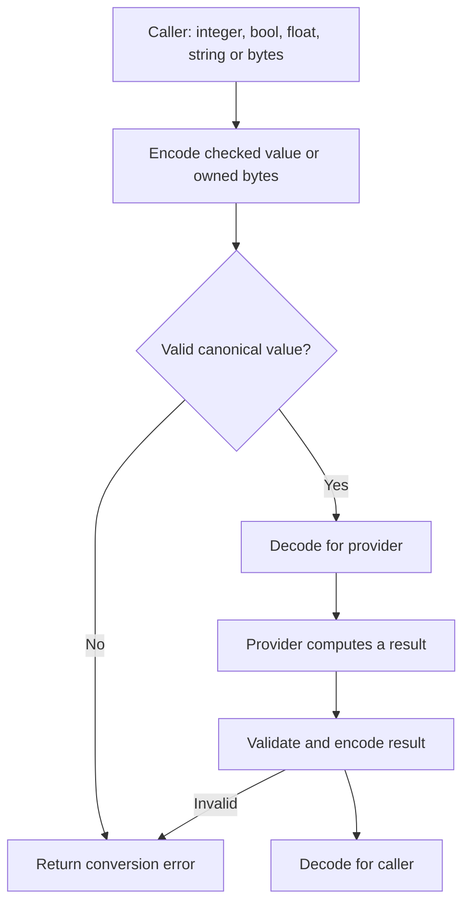

Text uses UTF-8. Ordinary bytes are independent values, not shared buffers.

#### Records and generic records

A record is a value, not a remote object. A concrete `Page<User>` uses the same field conversion rules as User.

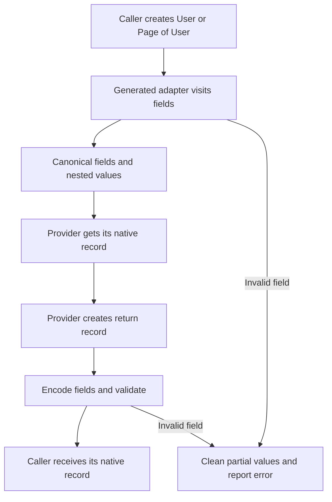

#### Enums

An enum represents exactly one declared value. For example, UserStatus.Active has the declared integer 1. Never transfer the ordinal position or a display name.

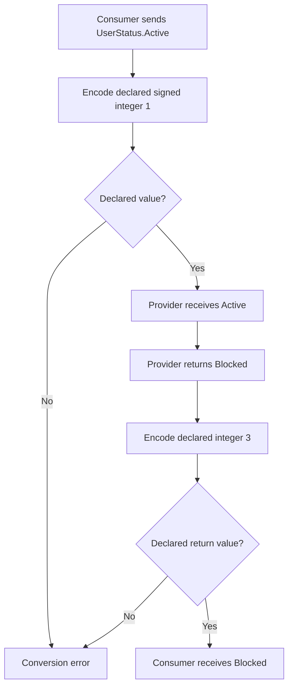

#### Flags

Flags describe independent bits that may be combined. For example, Read is 1, Write is 2, and Read plus Write is 3. Zero means no flags.

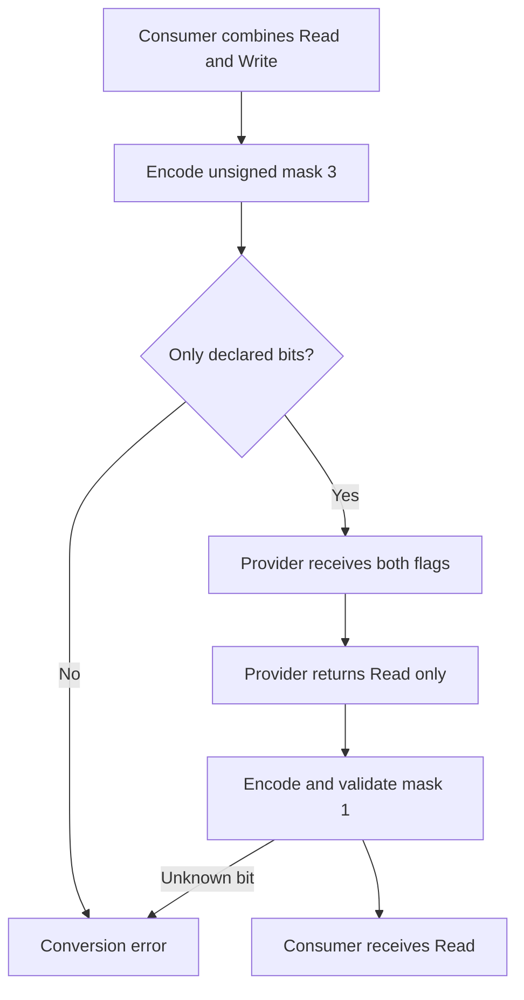

#### Variants

A variant holds one of several alternatives, not all their values at once. For example, a response could contain either a text message or an integer code.

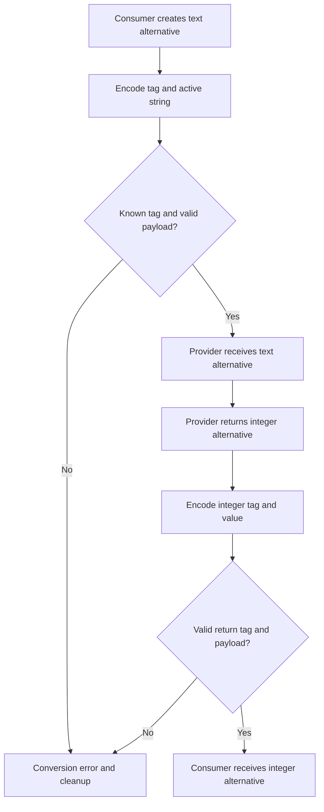

Only the active payload is read, retained or released. Never inspect inactive storage.

#### Lists and arrays

A list preserves element order. An array may use a compact contiguous representation for fixed-width primitive values. Both represent independent values unless a separate shared-memory type is used.

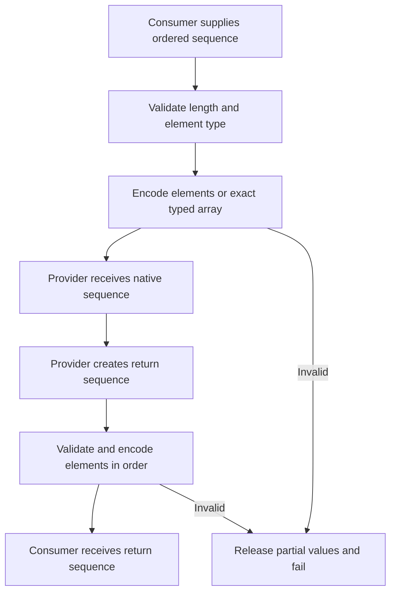

#### Sets and maps

A set holds unique values. A map holds a value for each unique key. Both use the canonical equality rules, even when the host's default equality differs.

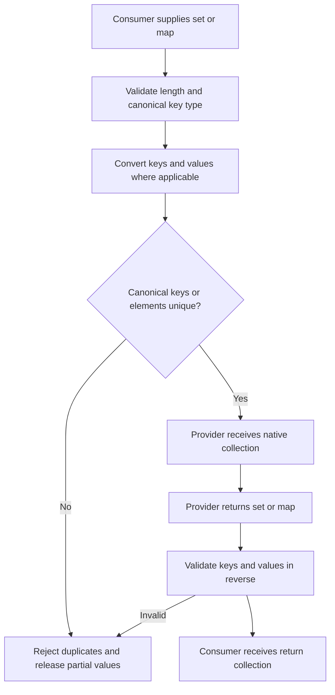

A missing key and a key with an optional absent value are different. A map or set has no portable iteration-order guarantee.

#### Optional values and defaults

Only construction applies defaults. The bridge carries the presence tag, not the original omission.

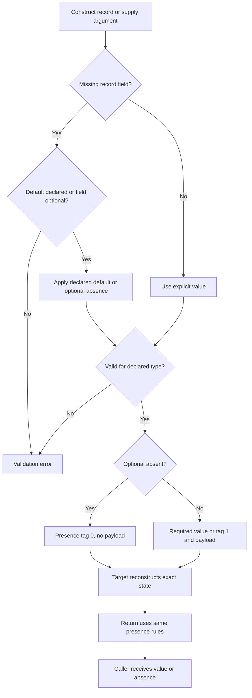

Nested optionals repeat the presence decision for each layer. A runtime error is never converted into absence.

#### Result and runtime errors

A business error is an expected return from an implementation. A runtime error means the invocation itself failed.

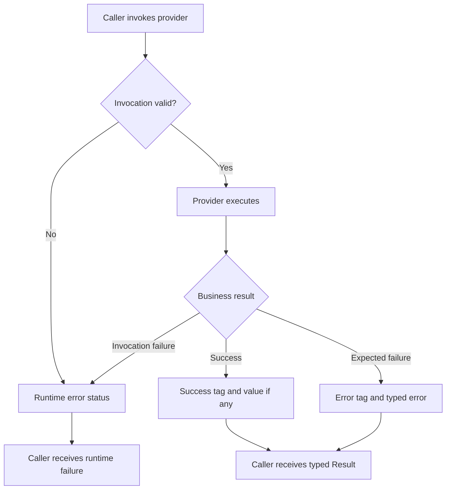

#### Dates, timestamps, durations and UUIDs

An instant is always normalized to UTC. A calendar date has no timezone.

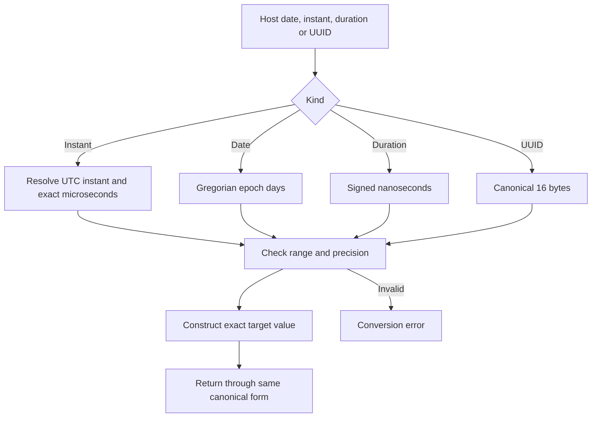

#### External types

An external type is converted by user-owned adapters. The generator itself remains unchanged.

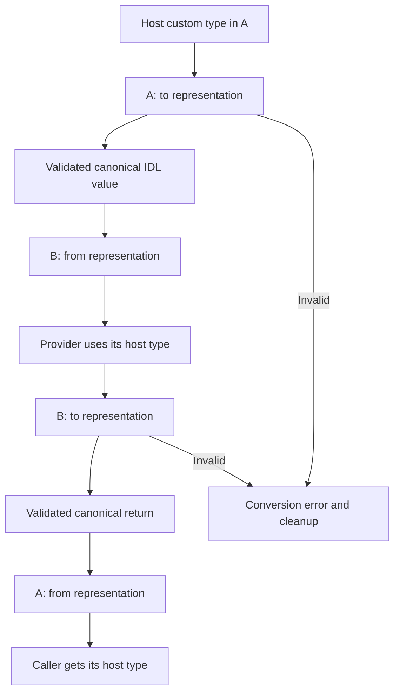

## 6. Modules and dependencies

### 6.1 Example application layout

```text
my-project/
├── polyglue.yaml
├── modules/
│   ├── domain/
│   │   ├── module.yaml
│   │   └── idl/
│   │       ├── user.idl
│   │       └── product.idl
│   ├── repository/
│   │   ├── module.yaml
│   │   └── idl/
│   │       ├── user-repository.idl
│   │       └── product-repository.idl
│   └── network/
│       ├── module.yaml
│       └── idl/
│           └── http-client.idl
├── native/
├── android/
├── apple/
├── python/
├── dotnet/
├── flutter/
└── web/
```

A module is the fundamental unit of compilation, dependency resolution, generation and distribution. A project is a convenient collection of modules and shared defaults, not a mandatory monolithic input.

### 6.2 Independent dependencies

```yaml
dependencies:
  domain:
    path: ../shared-domain/module.yaml
    mode: source
  networking:
    path: ../shared-networking/polyglue-manifest.json
    mode: prebuilt
```

| Mode | Behavior |
| --- | --- |
| source | Resolve IDL and generate required target dependencies |
| prebuilt | Reuse validated generated artifacts and contract metadata without regenerating |

A prebuilt manifest includes enough canonical contract information to resolve imported symbols (not just hashes), plus public include/import locations and ABI compatibility information. Validate actual artifacts, dependency closure and versions. Do not duplicate imported types.

Use the fully qualified logical module and symbol name as identity, independent of physical directory, output names and version. Require a unique logical module name across the dependency closure, with qualified module names available for independently distributed libraries. Distinguish semantic identity, contract fingerprint and target ABI fingerprint. Check the current manifest schema and contract/ABI fingerprints directly. No old-schema reader or compatibility translation.

### 6.3 Manifest

```json
{
  "schema_version": 1,
  "generator_version": "0.0.1",
  "runtime_abi_version": 1,
  "module": {
    "id": "domain",
    "version": "1.0.0"
  },
  "symbols": {
    "domain.User": {
      "kind": "record",
      "targets": {
        "cpp": {
          "name": "app::domain::User",
          "file": "include/app/domain/user.hpp",
          "import": "app/domain/user.hpp"
        },
        "dart": {
          "name": "User",
          "package": "app_domain",
          "file": "lib/src/user.dart",
          "import": "package:app_domain/app_domain.dart"
        }
      }
    }
  }
}
```

Illustrative excerpt. The full schema must include canonical type definitions, real fingerprints, dependency versions, architecture-specific ABI information, effective naming/layout metadata, generated-file ownership and content hashes. Validate the manifest schema and reject missing required information. Never emit fake fingerprints.

### 6.4 Acceptance tests

- Generate domain and repository together and separately, using source and prebuilt dependencies.
- Import a type by alias, grouped import and wildcard. Detect ambiguity.
- Change a domain output path, prefix or package and regenerate repository imports correctly.
- Reject incompatible duplicates, missing targets, invalid cycles, incompatible manifests and unavailable generated artifacts.
- Confirm that identical logical symbols have stable identity regardless of casing or path.

### 6.5 Module imports and dependency flow

#### A module uses a type from another module

Logical imports resolve before file generation, even if the modules use different namespaces or output paths.

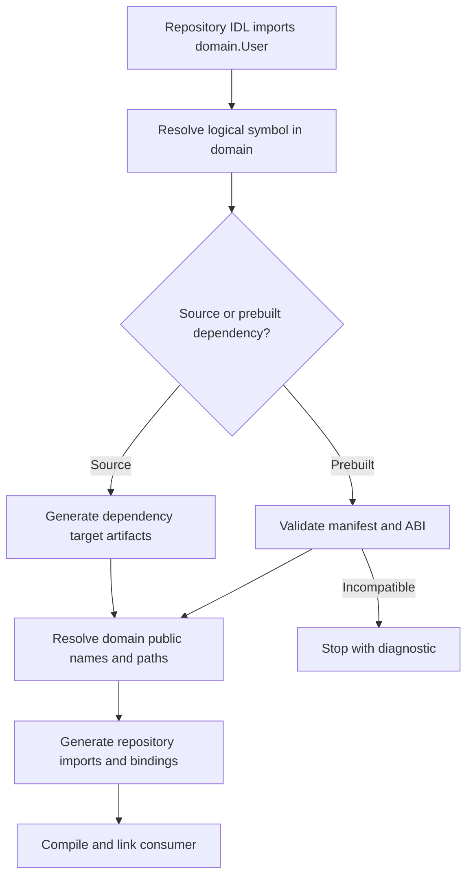

## 7. Module-first configuration

### 7.1 Precedence and semantics

From lowest to highest priority:

1. Built-in generator defaults.
2. Project-wide defaults.
3. Module-wide defaults.
4. Target settings inside that module.
5. Declaration annotations for supported properties.

Project defaults and module defaults use the same defaults key. Apply shared settings before target-specific settings at each level. Normalize naming shorthand before merging, for example methods: camelCase means methods: {case: camelCase}. Merge mappings recursively. Scalar and list values replace inherited values unless explicitly documented otherwise. Missing values inherit. Null is only valid for nullable options. Unknown keys, conflicting options and invalid types fail validation. Relative paths resolve from the file that originally declares them, even after inheritance. Source roots and authorized output roots are distinct. External output paths are allowed when explicitly configured, but traversal outside the configured output root and unintended symlink writes are forbidden.

### 7.2 Global configuration

`polyglue.yaml`:

```yaml
project:
  name: application
  version: "1.0.0"

modules:
  - modules/domain/module.yaml
  - modules/repository/module.yaml
  - modules/network/module.yaml

defaults:
  generation:
    encoding: utf-8
    line_endings: lf
    generated_warning: true
  targets:
    cpp:
      standard: 20
      naming:
        types: PascalCase
        methods: camelCase
        fields: camelCase
        files: kebab-case
    objc:
      swift_names:
        enabled: true
    dart:
      naming:
        types: PascalCase
        methods: camelCase
        files: snake_case
```

Global defaults must not enable undeclared targets automatically. Each module explicitly selects its outputs. Determinism, ABI validation, ownership safety, ARC where required, nullability correctness and strict concurrency checks are mandatory invariants, not options to disable.

### 7.3 Domain module configuration

`modules/domain/module.yaml`:

```yaml
module:
  name: domain
  version: "1.0.0"

sources:
  - idl/**/*.idl

targets:
  c:
    output: ../../native/domain/c
    prefix: app_domain_
    include_prefix: app/domain
  cpp:
    output: ../../native/domain/cpp
    namespace: app::domain
    include_prefix: app/domain
    header_extension: hpp
    source_extension: cpp
  java:
    output: ../../android/generated/domain/java
    package: com.app.domain
  kotlin:
    output: ../../android/generated/domain/kotlin
    package: com.app.domain
    model_source: java
    naming:
      interfaces:
        prefix: Kotlin
  objc:
    output: ../../apple/Domain/ObjC
    prefix: DOM
    module: AppDomainObjC
  swift:
    output: ../../apple/Domain/Swift
    module: AppDomain
    model_source: objc
  dart:
    output: ../../flutter/packages/domain
    package: app_domain
    mode: package
  python:
    output: ../../python/domain
    package: app_domain
  csharp:
    output: ../../dotnet/Domain
    namespace: App.Domain
    assembly: App.Domain
  javascript:
    output: ../../web/domain
    module: "@app/domain"
  typescript:
    output: ../../web/domain
    module: "@app/domain"
    implementation_source: javascript
  wasm:
    output: ../../native/domain/wasm
```

The model_source and implementation_source settings express intentional artifact ownership. The owner target alone emits the shared files. Selecting a dependent target automatically includes the owner artifacts in its dependency closure. An internal C, JNI or Apple adapter does not automatically make that adapter's language a public target. Only explicitly requested public targets and declared shared public artifact owners are exposed. Internal adapters use the canonical representation for external types, without demanding an unrelated public host mapping. For shared Java/Kotlin models, Java owns JVM class identity and public field types. Kotlin adapters convert at the API boundary where needed. Java and Kotlin interfaces with different async signatures cannot occupy the same JVM name. In the shared-package example, Java owns UserRepository and the explicit Kotlin interface prefix produces KotlinUserRepository with its suspend API. Names do not change based on which targets happen to be selected for a particular command. Both use the same logical IDL descriptor and ABI. For Swift model_source: objc, emit a public Swift typealias to the imported Objective-C type in AppDomain or the configured Swift module so dependent Swift modules can import that type. A plain Swift import does not itself re-export types. Shared JS/TS output has one JS runtime and package.json owner, with TypeScript adding declarations and type metadata to the joint file plan. Validate artifact ownership and emit only required files. If independent Java and Kotlin classes are required, configure distinct packages. If independent Swift models are needed, use non-conflicting modules/names. JavaScript and TypeScript outputs may share a package only when their planned filenames and export contracts do not conflict.

### 7.4 Repository module configuration

`modules/repository/module.yaml`:

```yaml
module:
  name: repository
  version: "1.0.0"

sources:
  - idl/**/*.idl

dependencies:
  domain:
    path: ../domain/module.yaml
    mode: source

targets:
  c:
    output: ../../native/repository/c
    prefix: app_repo_
    include_prefix: app/repository
  cpp:
    output: ../../native/repository/cpp
    namespace: app::repository
    include_prefix: app/repository
  java:
    output: ../../android/generated/repository/java
    package: com.app.repository
  kotlin:
    output: ../../android/generated/repository/kotlin
    package: com.app.repository
    model_source: java
    naming:
      interfaces:
        prefix: Kotlin
  objc:
    output: ../../apple/Repository/ObjC
    prefix: REP
    module: AppRepositoryObjC
  swift:
    output: ../../apple/Repository/Swift
    module: AppRepository
  dart:
    output: ../../flutter/packages/repository
    package: app_repository
    mode: package
  flutter:
    output: ../../flutter/plugins/repository
    package: app_repository_plugin
  python:
    output: ../../python/repository
    package: app_repository
  csharp:
    output: ../../dotnet/Repository
    namespace: App.Repository
    assembly: App.Repository
  javascript:
    output: ../../web/repository
    module: "@app/repository"
  typescript:
    output: ../../web/repository
    module: "@app/repository"
    implementation_source: javascript
  wasm:
    output: ../../native/repository/wasm
```

### 7.5 Network module configuration

`modules/network/module.yaml`:

```yaml
module:
  name: network
  version: "1.0.0"

sources:
  - idl/**/*.idl

targets:
  c:
    output: ../../native/network/c
    prefix: app_net_
    include_prefix: app/network
  cpp:
    output: ../../native/network/cpp
    namespace: app::network
    include_prefix: app/network
  java:
    output: ../../android/generated/network/java
    package: com.app.network
  kotlin:
    output: ../../android/generated/network/kotlin
    package: com.app.network
    model_source: java
    naming:
      interfaces:
        prefix: Kotlin
  objc:
    output: ../../apple/Network/ObjC
    prefix: NET
    module: AppNetworkObjC
  swift:
    output: ../../apple/Network/Swift
    module: AppNetwork
  dart:
    output: ../../flutter/packages/network
    package: app_network
    mode: package
  flutter:
    output: ../../flutter/plugins/network
    package: app_network_plugin
  python:
    output: ../../python/network
    package: app_network
  csharp:
    output: ../../dotnet/Network
    namespace: App.Network
    assembly: App.Network
  javascript:
    output: ../../web/network
    module: "@app/network"
  typescript:
    output: ../../web/network
    module: "@app/network"
    implementation_source: javascript
  wasm:
    output: ../../native/network/wasm
```

None of these choices is imposed on domain or repository.

### 7.6 Configuration schema coverage

| Category | Required options |
| --- | --- |
| Sources | IDL roots/globs, dependencies, external manifests |
| Paths | Output root, headers, sources, public/private paths, runtime location |
| Naming | Per-category case, prefix, suffix, acronym policy |
| Namespace | C++, C# |
| Package | Java, Kotlin, Python, Dart, Flutter |
| Module | Swift, Objective-C, JS/TS |
| Assembly | C# |
| Imports | Public import path, include prefix, strategy, module maps, exports |
| Templates | Override directory and explicit inheritance policy |
| Formatting | Indentation, line endings, final newline, brace style where supported |
| Annotations | Defaults, automatic attributes, target-specific overrides |
| Visibility | Exported/public/private/internal symbols |
| Availability | Platforms, SDK minimums and capability checks |
| Build | Sources or package mode. Platform build settings |
| Runtime | Shared runtime integration and supported version |
| ABI | Version and binary contract checks |
| Documentation | Comments and generated API docs |
| Headers | License, copyright, generated warning, version and source metadata |

Define a machine-readable schema with examples and reject unknown options. Do not invent settings without implementing their semantics. Test inherited defaults, module-only generation, target-specific overrides and invalid combinations.

### 7.7 Build and product configuration

A module remains the unit of code generation. A product is an explicit aggregation of already-defined modules for linking, packaging and distribution. A product is not another IDL namespace and never overrides a module's public names or type identity. This is necessary when domain, repository and network belong to one AAR or XCFramework, or when a reusable module is shipped independently.

Module-level build settings configure integration, not global compiler installation:

```yaml
targets:
  cpp:
    output: ../../native/repository/cpp
    namespace: app::repository
    include_prefix: app/repository
    mode: package
    build:
      library_name: app_repository
      linkage: static
      public_headers: include
      private_sources: src
      implementation_sources:
        - ../../native/implementations/repository.cpp
      dependencies:
        - app_domain
  kotlin:
    output: ../../android/generated/repository/kotlin
    package: com.app.repository
    model_source: java
    naming:
      interfaces:
        prefix: Kotlin
    build:
      android_namespace: com.app.repository
      consumer_rules: ../../android/consumer-rules.pro
```

Illustrative project-level products in polyglue.yaml (in addition to modules and defaults from section 7.2):

```yaml
build:
  root: build/polyglue
  artifacts: dist
  configuration: release

products:
  mobile:
    modules: [domain, repository, network]
    targets: [c, cpp, java, kotlin]
    artifact:
      formats: [aar]
      name: app_bridge
      version: "1.0.0"
      build_number: 1
    platforms:
      android:
        min_sdk: 26
        abis: [arm64-v8a, armeabi-v7a, x86_64]

  apple:
    modules: [domain, repository, network]
    targets: [c, cpp, objc, swift]
    artifact:
      formats: [xcframework, swiftpm]
      name: AppBridge
      version: "1.0.0"
      build_number: 1
    platforms:
      ios:
        minimum_version: "17.0"
        device_architectures: [arm64]
        simulator_architectures: [arm64, x86_64]
      macos:
        minimum_version: "14.0"
        architectures: [arm64, x86_64]
      visionos:
        minimum_version: "1.0"
        device_architectures: [arm64]
        simulator_architectures: [arm64]

  desktop:
    modules: [domain, repository, network]
    targets: [c, cpp]
    artifact:
      formats: [cmake]
      name: AppBridge
      version: "1.0.0"
      build_number: 1
    platforms:
      linux:
        architectures: [x86_64, arm64]
      windows:
        architectures: [x86_64, arm64]
      macos:
        architectures: [arm64, x86_64]
```

SDK floors and architectures above are illustrative choices, not a verified toolchain matrix. The tool checks whether the installed SDK can build each requested slice. It must not silently remove an unavailable slice. Product manifests declare the exact module closure, native implementation sources, runtime linkage, SDK version, build number, requested output format and target/architecture matrix. artifact.formats declares the permitted outputs. The CLI --format selects one of them and is required when several are configured. SwiftPM packaging depends on the matching XCFramework artifacts. A command builds only explicitly requested slices and never silently drops an unavailable one. For a desktop product spanning multiple host OSes, require explicit --platform selection unless the build plan can produce all requested platforms. CI assembles evidence across hosts rather than expecting one host to build every SDK. Product packaging can select source or prebuilt modules, with strict compatibility validation. A prebuilt module may carry its own module version but must not silently replace the product SDK version. Product metadata is generated at the packaging boundary. Separate product output roots prevent cross-product contamination. A source-only project never has to declare products.

Dependency names in native build configuration refer to explicitly declared CMake targets, not arbitrary flags. IDL dependencies and native build dependencies are distinct. Module output paths, native implementation source paths, SDK settings, extra includes and link libraries are schema-validated. Accept additional CMake integration via an explicit, trusted consumer CMake target or source list. No arbitrary shell execution from IDL.

### 7.8 SDK version and build number

Keep the following identities independent. Never infer one from another.

| Identity | Source | Purpose |
| --- | --- | --- |
| PolyGlue version | Tool pyproject.toml | Generator and support library release |
| ABI version and contract fingerprints | Runtime and canonical IDL | Reject incompatible binary contracts |
| Module version | module.yaml | Logical module dependency metadata |
| SDK version | products.<id>.artifact.version | Distributed library release version |
| SDK build number | products.<id>.artifact.build_number | Identifies a particular build of that SDK version |

The SDK version and build number are required for a binary product. They are not required for source-only IDL generation. Use an explicit numeric MAJOR.MINOR.PATCH string without leading zeroes and a positive integer build_number. The version is not derived from the Git tag, module version, tool version, CI run number or current time. The build number is supplied by the product owner, not incremented automatically. Keep SDK build numbers monotonic within a version for operational clarity. The tool need not contact a remote service to allocate a number. The same build identity is used by every requested architecture and format of a product for one build. Different platform and format outputs are distinct artifact sets under that identity. If changed bytes must replace an already deployed artifact set, assign a new build number explicitly. Local development may regenerate an unpublished artifact set at the same build number.

Example:

```yaml
products:
  apple:
    modules: [domain, repository, network]
    targets: [c, cpp, objc, swift]
    artifact:
      name: AppBridge
      formats: [xcframework, swiftpm]
      version: "1.2.3"
      build_number: 42
    platforms:
      ios:
        minimum_version: "17.0"
        device_architectures: [arm64]
        simulator_architectures: [arm64, x86_64]
```

Resolve these two values once in the Python build plan and pass the same immutable values to every downstream tool. Do not maintain duplicated editable versions in Gradle, CMake, Xcode, manifests or templates. Expose sdk_version and sdk_build_number in the existing versioned template context when generating for a product. A standalone module generation must not invent SDK metadata. Keep product-specific generated version files in the selected product staging directory so multiple products cannot overwrite shared module source. A module's logical ID and ABI fingerprint do not change merely because the product build number changed. The build and artifact fingerprints do change.

Validate version constraints for the selected ecosystems before building. Do not truncate, clamp, round, append an invented suffix or silently substitute a different value to fit a platform field. The SDK version remains the ecosystem package version. Build number is separate build metadata, not a new Maven/PyPI/npm/NuGet package version. Two builds of one ecosystem version are not two independently publishable releases in an immutable registry. Local and bucket paths distinguish them. Use a new SDK version if a registry requires a unique release coordinate.

#### 7.8.1 Propagation to toolchains

| Target | SDK version | Build number |
| --- | --- | --- |
| C / C++ / CMake | Product project VERSION, generated product version header and package config version, target VERSION where applicable | Product version header and manifest |
| Windows native | File/Product version resource where emitted, checked platform representation | Checked fourth file version component when representable |
| Android AAR | Gradle project/publication version and local Maven coordinates | Packaged SDK metadata resource and native version metadata |
| JVM JAR | Gradle/Maven version and JAR Implementation-Version | JAR metadata and native version metadata |
| Apple framework | MARKETING_VERSION / CFBundleShortVersionString | CURRENT_PROJECT_VERSION / CFBundleVersion |
| SwiftPM | Distribution package metadata, archive and URL path. SwiftPM dependency versions are selected by actual Git tags or package configuration | Packaged metadata and referenced artifact build path |
| Python generated bindings | Wheel/sdist project version | Packaged metadata resource and native product version metadata |
| Dart / Flutter | pubspec.yaml package version | Packaged metadata and native product version metadata |
| C# | PackageVersion, Version and checked assembly/file version mapping | Informational metadata and checked file version where applicable |
| JS / TS | package.json version | Packaged SDK metadata |
| WASM | Product metadata emitted with the JS loader or packaged WASM assets | Same metadata and native product version where applicable |

AAR libraries do not have an application versionCode requirement. Only an application artifact with a supported versionCode field may map the SDK build number to it. Do not pretend JARs, archives, static libraries or WASM modules have a standard OS-level build number field. Where native metadata has no matching field, include the canonical values in a small packaged metadata resource. Use the resolved build plan as the source for embedded metadata and the final artifact manifest. Only add a small version header/resource where a runtime or ecosystem needs it. Never embed the final artifact manifest inside a file whose own hash that manifest records. Verify metadata in installed consumers. Do not add a new version service or ABI call solely for build numbers.

For CMake, pass explicit cache inputs from Python:

```bash
cmake -S . -B build/example -DPOLYGLUE_SDK_VERSION=1.2.3 -DPOLYGLUE_SDK_BUILD_NUMBER=42
```

The product integration uses these values for its project VERSION, configure_file version metadata and native target version properties as appropriate. Do not overwrite the parent project's version or set unrelated global version properties when using add_subdirectory. Shared library SOVERSION follows the runtime's actual ABI major, not the SDK's build number. Do not apply versioned shared-library properties to static archives. Keep compiler, SDK deployment floor and library version separate. Resolve the product version before the product CMake project() call. The PolyGlue runtime's own CMake project retains the tool/runtime version when built as a dependency. A generated product header must not redefine runtime version macros or collide with another product's header.

For Apple products, verify the framework Info.plist values after building each device/simulator slice and before assembling the XCFramework. Use the same product build identity across all constituent frameworks. For Windows/.NET numeric file version fields, check the range of each component before assigning it. For Android and JVM, verify the publication metadata and the packaged resource independently. For all formats, inspect final manifests and packaged version metadata and reject any mismatch with the resolved plan.

#### 7.8.2 Acceptance

- A single product configuration produces matching version and build metadata in the native outputs, ecosystem packages, archive metadata and artifact manifest.
- Changing only the build number invalidates relevant generated metadata and builds without changing logical type IDs or ABI fingerprints.
- Two builds with the same SDK version but different build numbers have separate output directories and can coexist.
- Distinct product versions or concurrent product builds do not overwrite common module source files.
- Invalid or unrepresentable version/build values fail before compilation. No silently modified version.
- Build and deploy reject a manifest whose version, build number, files or selected product identity differ from the requested configuration.

### 7.9 How configuration reaches generated files

#### Configuration, naming and annotations

The selected module and target have their own effective settings.

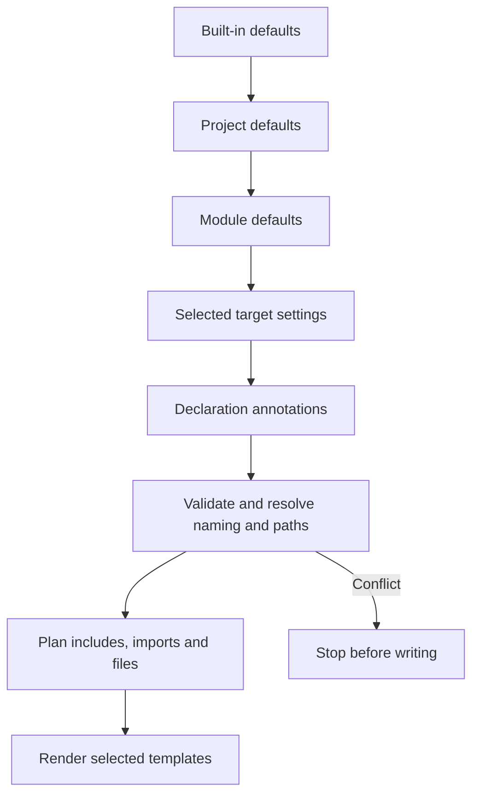

## 8. Naming and file formatting

### 8.1 Naming categories and defaults

| Target | Types | Methods | Fields | Files |
| --- | --- | --- | --- | --- |
| C | snake_case | snake_case | snake_case | kebab-case |
| C++ | PascalCase | snake_case | snake_case | kebab-case |
| Java / Kotlin | PascalCase | camelCase | camelCase | PascalCase |
| Swift | PascalCase | camelCase | camelCase | PascalCase |
| Objective-C | prefixed PascalCase | camelCase | camelCase | PascalCase |
| Python | PascalCase | snake_case | snake_case | snake_case |
| Dart / Flutter | PascalCase | camelCase | camelCase | snake_case |
| C# | PascalCase | PascalCase | PascalCase | PascalCase |
| JS / TS | PascalCase | camelCase | camelCase | kebab-case |

These are defaults, not mandatory language standards. Support PascalCase, camelCase, snake_case, SCREAMING_SNAKE_CASE, kebab-case, lowercase, UPPERCASE and dot-separated paths where legal. Configure types, records, interfaces, methods, async methods, fields, parameters, constants, enum values, files, namespaces, packages, private fields and proxy names independently.

### 8.1.1 Mandatory dash-based filenames

Use hyphens for multiword repository-owned filenames and directories wherever possible, including IDL, native C/C++ headers and sources, Jinja2 templates, CMake helper scripts, documentation, standalone Python scripts, CI workflows, assets and tests. Do not use underscores unless a language or tool requires them or the adopted language profile mandates the exact convention. Python importable modules/packages and __init__.py, enforced Dart file_names conventions, symbol-named Java/Kotlin/Swift files and required tool entrypoints are narrow exceptions. Keep these exceptions explicit. This is a filename policy, not a rule to rename valid identifiers, ABI symbols, JSON/YAML keys, package names or environment variables. Consumer naming overrides are still available, but the built-in defaults follow this policy. Validate path conventions and compile generated imports/includes after changing filenames.

Within each naming category, an explicit case, prefix or suffix overrides only that property. Inherit unspecified properties from the appropriate general category or target defaults. An async-method suffix does not discard method casing. Apply prefixes exactly once.

### 8.2 Prefixes and suffixes per module and category

Within domain:

```yaml
targets:
  objc:
    prefix: DOM
    naming:
      records:
        prefix: DOM
        case: PascalCase
      interfaces:
        prefix: DOM
        suffix: Protocol
        case: PascalCase
      enums:
        prefix: DOM
        case: PascalCase
      proxies:
        prefix: DOM
        suffix: Proxy
      files:
        case: PascalCase
    swift_names:
      enabled: true
      remove_prefix: true
      remove_suffix: true
```

Repository can independently use REP and an interface suffix such as Protocol. With that optional override applied in repository as well:

| IDL | Objective-C | Swift public name |
| --- | --- | --- |
| domain.User | DOMUser | User |
| domain.UserStatus | DOMUserStatus | UserStatus |
| repository.UserRepository | REPUserRepositoryProtocol | UserRepository |

A category-specific prefix replaces the target-wide prefix. It is not concatenated twice. Apply the configured filename convention to the final emitted symbol, subject to required type filenames. C/C++ filenames default to kebab-case while identifiers retain their configured case. An imported type always uses the defining module's resolved name, never the consuming module's prefix.

C# configuration example:

```yaml
targets:
  csharp:
    naming:
      types: PascalCase
      interfaces:
        case: PascalCase
        prefix: I
      methods: PascalCase
      parameters: camelCase
      async_methods:
        suffix: Async
```

### 8.3 Acronyms, reserved words and collisions

```yaml
naming:
  acronyms:
    - HTTP
    - URL
    - UUID
    - ID
    - GPU
    - XML
    - JSON
    - API
    - RGBA
    - IPv6
```

Define normalization and preservation policies per target. Test HTTPClient, XMLParser, getUserID, GPUTexture2D, URLRequest and IPv6Address. Expected normalized examples: httpClient / http_client, getUserId / get_user_id, gpuTexture2D / gpu_texture_2d.

Handle reserved words through legal escaping where appropriate (Swift/Kotlin backticks, C# @identifier) or configured suffixes. Detect collisions after all conversions, including user_id vs userId, generated proxies vs user types, Unicode/case-folded filenames, Java/Kotlin duplicate JVM types and reserved Windows filenames. Fail with both source locations. Never silently rename public symbols to resolve an ambiguity.

### 8.4 Formatting and headers

```yaml
targets:
  cpp:
    formatting:
      indent: 4
      indent_style: spaces
      line_length: 0
      brace_style: allman
      line_endings: lf
      final_newline: true
    file_header:
      copyright: "Copyright (c) 2026 Example"
      license: MIT
      generated_warning: true
      include_generator_version: true
      include_source_path: true
```

Generate deterministic UTF-8 text, ordered and deduplicated imports and appropriate documentation comments. Do not include wall-clock generation timestamps or machine-specific absolute source paths. If source metadata is selected, use a normalized logical module-relative path. Build provenance may record execution times separately from generated source and its fingerprints. Default formatting must be readable without external tools and follow the owner conventions in AGENTS.md, including single-line calls, signatures and string literals. Optional formatters: clang-format, google-java-format, ktlint, swift-format, Ruff, dart format, dotnet format, Prettier. Only advertise options a backend actually honors. Test custom formatting, output byte reproducibility and unchanged-file preservation.

## 9. Annotations and platform attributes

### 9.1 Universal annotations

```text
@deprecated("Use UserProfile instead")
record User {
    @readonly
    id: int64;
    name: string;
}

interface Camera {
    @thread("main")
    async start(): void;
}
```

Universal annotations carry defined semantic meaning. An executor/thread annotation must affect dispatch, not just comments. Readonly semantics must be enforced by generated APIs and runtime where required. Availability and ownership constraints cannot be overridden by an unsafe target-specific annotation.

### 9.2 Language-specific annotations

```text
@objc.name("DOMUser")
@swift.name("User")
@csharp.name("UserModel")
record User {
    @swift.name("userID")
    @kotlin.name("userId")
    id: int64;
}
```

```text
@platform.apple(ios: "17.0", macos: "14.0", visionos: "1.0")
interface SpatialRenderer {
    @swift.main_actor
    @objc.selector("initializeWithCompletion:")
    async initialize(): void;
}
```

Annotations are allowed on modules, records, interfaces, enums, enum members, fields, methods, parameters, callbacks and constants where their registered schema permits. Validate argument count/type, duplicates, placement, conflicts and target availability. An unknown annotation is an error even if its namespace is not selected. Known annotations for non-selected targets may be validated and ignored for rendering.

### 9.3 Apple interop details

| Mechanism | Purpose |
| --- | --- |
| @objc / @objcMembers / @nonobjc | Objective-C exposure from Swift |
| NS_SWIFT_NAME / CF_SWIFT_NAME | Explicit names imported into Swift |
| NS_REFINED_FOR_SWIFT | Wrapper refinement |
| NS_SWIFT_UNAVAILABLE | Prevent import where appropriate |
| NS_SWIFT_ASYNC / NS_SWIFT_ASYNC_NAME | Async import customization |
| NS_SWIFT_SENDABLE / @MainActor | Concurrency metadata only when valid |
| @available | OS and SDK availability, including visionOS |
| NS_ASSUME_NONNULL_BEGIN / _Nullable / _Nonnull | Nullability |
| NS_ENUM / NS_OPTIONS | Swift-friendly enum and flags |
| NS_DESIGNATED_INITIALIZER / NS_UNAVAILABLE | Initialization contract |
| @discardableResult | Intentional result-discard support |

Automatically infer safe attributes from IDL when possible. Annotations override naming or supported metadata, not safety rules.

Illustrative Objective-C output for a reduced User record (id, name and optional email):

```objc
#import <Foundation/Foundation.h>

NS_ASSUME_NONNULL_BEGIN

NS_SWIFT_NAME(User)
@interface DOMUser : NSObject
@property(nonatomic, readonly) int64_t userId;
@property(nonatomic, copy, readonly) NSString *name;
@property(nonatomic, copy, readonly, nullable) NSString *email;

- (instancetype)initWithUserId:(int64_t)userId
                          name:(NSString *)name
                         email:(nullable NSString *)email
    NS_DESIGNATED_INITIALIZER
    NS_SWIFT_NAME(init(id:name:email:));
- (instancetype)init NS_UNAVAILABLE;
@end

NS_ASSUME_NONNULL_END
```

Swift consumption:

```swift
let user = User(id: 10, name: "John", email: nil)
```

For a repository async method, generate a compatible Objective-C completion API and NS_SWIFT_ASYNC_NAME when supported by the selected SDK. Otherwise generate an explicit Swift async wrapper. Test both nullability and the difference between a valid absent optional result and a runtime failure. Compile actual Swift imports, not just macro strings. Test selector conflicts and exposure restrictions (not every Swift type is representable in Objective-C).

### 9.4 Other backend attributes

| Target | Examples |
| --- | --- |
| Kotlin | JvmName, JvmStatic, JvmOverloads where valid |
| Java | Nullable, NonNull, Deprecated |
| C/C++ | symbol visibility, calling convention, nodiscard, deprecated, noexcept when guaranteed |
| C# | StructLayout, LibraryImport, MarshalAs |
| Python | typing, property, staticmethod |
| Dart | Native / pragma where appropriate, immutable |
| TypeScript | readonly, JSDoc deprecated |
| WASM | Export and visibility controls |

Backend catalog defines exact supported annotations and transformations. Do not allow arbitrary raw code injection as the default annotation mechanism.

### 9.5 Annotation processing flow

#### From IDL annotation to native API

Semantic annotations must affect real behavior, and language-specific annotations must be validated by the target compiler.

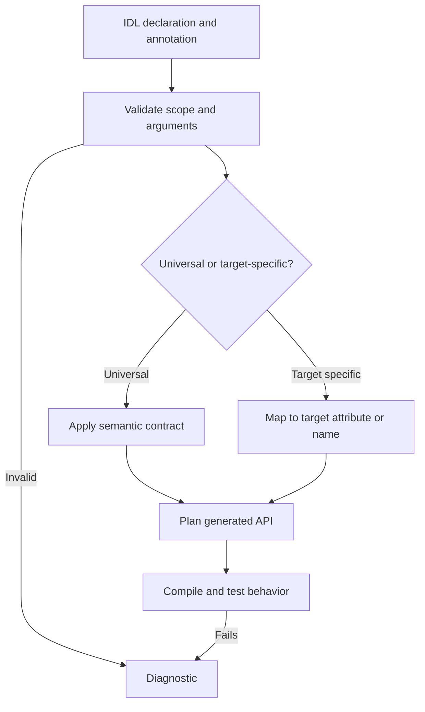

## 10. Output layout and import resolution

### 10.1 Logical versus physical identity

| Concept | Example |
| --- | --- |
| IDL symbol | domain.User |
| C++ symbol | app::domain::User |
| C++ public include | app/domain/user.hpp |
| Java/Kotlin type | com.app.domain.User |
| Objective-C type | DOMUser |
| Swift module/type | AppDomain.User |
| Dart public import | package:app_domain/app_domain.dart |
| Python import | app_domain.User |
| C# namespace/type | App.Domain.User |

Plan all generated symbols before rendering any file. The repository refers to the defining domain module's planned artifacts, including prebuilt manifests, not a guessed relative path.

### 10.2 Expected cross-module output

For the repository contract in section 4, using the naming overrides in section 7.2 where relevant. These are deliberately reduced excerpts, not complete generated files. The Java and Kotlin snippets show independent API naming. The shared JVM layout uses KotlinUserRepository as defined in section 7.4.

**C**

```c
#include <app/domain/user.h>
#include <polyglue/runtime.h>

/* Illustrative names; final signatures follow the versioned C ABI. */
typedef struct app_repo_user_repository app_repo_user_repository;
```

**C++**

```cpp
#include <app/domain/user.hpp>
#include <polyglue/future.hpp>
#include <cstdint>
#include <optional>
#include <vector>

namespace app::repository {
class UserRepository {
public:
    virtual ~UserRepository() = default;
    virtual polyglue::Future<std::vector<app::domain::User>> findAll() = 0;
    virtual polyglue::Future<std::optional<app::domain::User>> findById(std::int64_t id) = 0;
};
}
```

**Kotlin**

```kotlin
package com.app.repository

import com.app.domain.User

interface UserRepository {
    suspend fun findAll(): List<User>
    suspend fun findById(id: Long): User?
}
```

**Java**

```java
package com.app.repository;

import com.app.domain.User;
import java.util.List;
import java.util.concurrent.CompletableFuture;

public interface UserRepository {
    CompletableFuture<List<User>> findAll();
}
```

Java/Kotlin examples illustrate alternative standalone API surfaces. If both are selected for one JVM, choose a shared contract and non-conflicting wrapper names. Do not compile these two same-name interface examples together.

**Objective-C**

```objc
@import Foundation;
@import AppDomainObjC;

NS_SWIFT_NAME(UserRepository)
@protocol REPUserRepository
- (void)findAllWithCompletion:
    (void (^)(NSArray<DOMUser *> * _Nullable,
              NSError * _Nullable))completion;
@end
```

**Swift**

```swift
import AppDomain

public protocol UserRepository {
    func findAll() async throws -> [User]
    func findById(id: Int64) async throws -> User?
}
```

**Dart**

```dart
import 'package:app_domain/app_domain.dart';

abstract interface class UserRepository {
  Future<List<User>> findAll();
  Future<User?> findById(int id);
}
```

**Python**

```python
from abc import ABC, abstractmethod
from app_domain.user import User


class UserRepository(ABC):
    @abstractmethod
    async def find_all(self) -> list[User]: ...
```

**C#**

```csharp
using App.Domain;
using System.Collections.Generic;
using System.Threading.Tasks;

namespace App.Repository;

public interface IUserRepository
{
    Task<List<User>> FindAllAsync();
}
```

**TypeScript**

```typescript
import type { User } from "@app/domain";

export interface UserRepository {
    findAll(): Promise<User[]>;
    findById(id: bigint): Promise<User | null>;
}
```

These excerpts show public contract shape. Generated proxies, C ABI declarations, converters, initialization and all remaining methods are required separately.

### 10.3 Generated directory examples

```text
native/domain/cpp/
├── include/app/domain/user.hpp
└── src/user.cpp

native/repository/cpp/
├── include/app/repository/user-repository.hpp
└── src/user-repository.cpp

android/generated/domain/java/
└── com/app/domain/User.java

android/generated/repository/kotlin/
└── com/app/repository/KotlinUserRepository.kt

apple/Domain/
├── ObjC/
│   ├── include/DOMUser.h
│   └── module.modulemap
└── Swift/
    └── Sources/AppDomain/

apple/Repository/Swift/
└── Sources/AppRepository/UserRepository.swift

flutter/packages/domain/
├── pubspec.yaml
└── lib/
    ├── app_domain.dart
    └── src/user.dart

flutter/packages/repository/
├── pubspec.yaml
└── lib/
    ├── app_repository.dart
    └── src/user_repository.dart

python/domain/
└── app_domain/
    ├── __init__.py
    └── user.py

dotnet/Domain/
├── App.Domain.csproj
└── User.cs

web/domain/
├── package.json
└── src/user.js
```

These trees illustrate public artifacts, not exhaustive bridge sources. The domain package exposes User through its explicit public module (app_domain.user in Python). Python __init__.py files remain empty. The repository package declares the dependency in its package/build manifest in package mode.

### 10.4 Target artifact rules

| Backend | Layout / imports / package files |
| --- | --- |
| C | Public .h, sources, include guards, C names and calling convention |
| C++ | include/ and src/, namespace, includes/forward declarations, CMake |
| Java/Kotlin/JNI | Package directory tree, JVM type ownership, JNI names, Gradle |
| Swift | Sources/<target>, module imports only between distinct modules, Package.swift |
| Objective-C | Prefixed public headers, umbrella header/module.modulemap, .mm sources |
| Python | Package tree, empty __init__.py, explicit public modules, pyproject.toml |
| Dart | lib/src, public library exports, pubspec.yaml |
| Flutter | Plugin metadata, Dart package and platform adapters |
| C# | Namespace, project/assembly references, .csproj |
| JS/TS | ES module exports/imports, package.json, .d.ts and tsconfig as appropriate |
| WASM | Emscripten build configuration, exports and JS loader |

Provide sources mode (integrate into existing build) and package mode (standalone buildable package). Paths, filenames, extensions and public import strings are separately configurable. Do not overwrite consumer-owned build files. Test both modes, separate source roots and external dependencies, same-module Swift imports, Python circular imports, C++ forward declarations and package export validity.

## 11. Compiler and templates

### 11.1 Pipeline

The compiler resolves and validates the complete selected module graph before any generated output is committed. Template overrides affect rendering, not semantic validation.

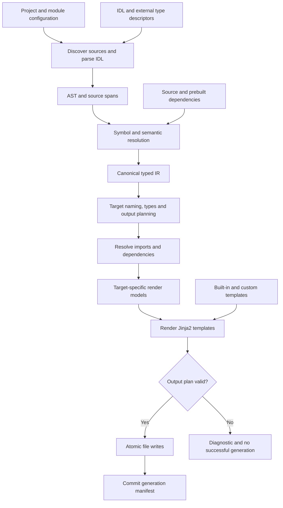

Any validation or rendering failure stops generation. An interrupted write must not leave a successful manifest. See section 11.4.

### 11.2 Responsibilities

| System | Responsibility |
| --- | --- |
| Project / Module | Inputs and independent generation units |
| Configuration | Schema, inheritance and effective settings |
| Type / Symbol | Canonical identities and validated type graph |
| Dependency | Source and prebuilt graph resolution |
| Naming | Case, prefixes, suffixes, acronyms, escaping |
| Layout | Physical paths and public artifact names |
| Imports | Includes/imports/forward declarations/export maps |
| Annotation | Semantic and target-specific attributes |
| Backend | Type mapping, capabilities, render models, marshalling |
| Template | Presentation only |
| Diagnostic | Actionable errors and source spans |
| Manifest | Contract metadata and generated-file ownership |
| ABI / Runtime | Native interoperability and lifetime |
| Service | Optional lookup and replacement |
| Testing | Conformance and regression evidence |

### 11.3 Backend shape

```python
from typing import Protocol


class LanguageBackend(Protocol):
    def plan_outputs(self, module, context): ...
    def resolve_symbol(self, symbol, context): ...
    def resolve_type(self, type_ref, context): ...
    def resolve_import(self, source, dependency, context): ...
    def build_render_models(self, module, context): ...
```

The protocol is illustrative. Freeze actual interfaces with tests. Keep the implementation small and share only genuinely common logic. Each backend owns naming, types, imports, layout, annotations, marshalling and templates. Do not implement a general plugin framework. Built-in backends, template overrides and declarative external types cover the requested extension use cases.

Template example:

```jinja2
package {{ package }}


import {{ dependency }}


interface {{ interface.name }} {

    {{ method.declaration }}

}
```

Template override:

```yaml
targets:
  cpp:
    templates:
      directory: ./custom/templates/cpp
      inherit_builtin: true
```

Use StrictUndefined. All imports/types/names are resolved in Python before rendering. Custom template selection and resource paths must be validated. Templates are explicitly trusted developer inputs. Never load them implicitly from untrusted IDL.

### 11.4 Generation guarantees

Validate the whole output plan before writing. Reject overlapping files, collisions on case-insensitive systems, invalid path components and symlink escapes. Render and validate all planned files before writing. Write changed files atomically per file. A multi-file update is not an atomic filesystem transaction. Invalidate the previous success state before modifying outputs and commit the new manifest last. On interruption or write failure, keep enough owned-file information to repair the incomplete generation and refuse to build or consume it as successful. Never overwrite an existing unowned file even if its path matches a planned output. Prevent two invocations from writing overlapping output roots concurrently using the simplest appropriate filesystem locking mechanism. No global lock for independent roots. Do not rewrite identical files or delete user-authored files. Only remove obsolete manifest-owned generated files when explicitly requested. Test failure recovery, deterministic generation and standalone installation.

### 11.5 Template override system (mandatory)

Template override support is a first-class public feature, not a fork-only customization. All files generated from templates must have stable, documented template IDs: public models, enums, variants, interfaces, callbacks, proxies, provider adapters, ABI glue, marshallers, module exports, package metadata, CMake integration, Gradle files, SwiftPM files, Dart/Flutter integration, .NET project files and JS/TS exports. Runtime source files are separately versioned handwritten code, not implicitly replaced by a template.

A default built-in template catalog is packaged with the Python wheel. Each entry declares target, ID, output kind, render-model schema version, required variables and related partials. IDs are independent of target filenames, module prefixes and physical output directories. Names below define a proposed initial catalog convention:

```text
templates/
├── common/
│   └── file-header.j2
├── cpp/
│   ├── record.hpp.j2
│   ├── interface.hpp.j2
│   ├── proxy.cpp.j2
│   ├── provider.cpp.j2
│   └── CMakeLists.txt.j2
├── kotlin/
│   ├── record.kt.j2
│   ├── interface.kt.j2
│   └── build.gradle.kts.j2
├── objc/
│   ├── record.h.j2
│   └── module.modulemap.j2
└── swift/
    ├── interface.swift.j2
    └── Package.swift.j2
```

Actual catalog covers all targets. Do not create redundant placeholder templates. Reusable macros and partials are allowed when they simplify rendering.

#### 11.5.1 Directory override and individual override

```yaml
defaults:
  targets:
    cpp:
      templates:
        directory: ./templates/cpp
        inherit_builtin: true
```

```yaml
# modules/repository/module.yaml
targets:
  cpp:
    templates:
      directory: ./templates/cpp
      overrides:
        interface.hpp.j2: ./templates/special/repository-interface.j2
        CMakeLists.txt.j2: ./templates/special/repository-cmake.j2
      inherit_builtin: true
```

Only matching template IDs are overridden. All other files use the next permitted layer. A module-specific directory need not duplicate the complete built-in tree. Resolve lookup per ID from highest to lowest precedence: explicit module target, module target defaults, module-wide defaults, project target defaults, project-wide defaults, then built-in catalog. Each layer has its own explicitly mapped files and directory. Do not merge the directories into one path or skip module target defaults. Resolve the same layer order for an included partial, unless the selected template explicitly references a documented built-in namespace. Explicit mapping takes precedence over directory lookup at the same layer. Preserve path origin at each layer rather than flattening inherited directories into one. A configured inherit_builtin: false disallows use of the built-in catalog for that target's effective set. Missing required templates fail before any outputs are written. A missing explicitly mapped file always fails. An existing selected template that fails to parse or render is an error. Never try another template after a failure. Validate unknown IDs and conflicting overrides.

#### 11.5.2 Custom template workflow

```bash
polyglue templates list --target cpp
polyglue templates export --target cpp --output ./templates/cpp
polyglue templates check --module repository --target cpp
polyglue config show --module repository --target cpp
polyglue generate --module repository --target cpp
```

Export does not overwrite existing custom files without explicit authorization. The check command renders against real validated IR fixtures or the selected project. Show syntax errors, missing variables, incompatible schema versions, unknown IDs and the originating config/template path. Report effective template source and content hash in the generation manifest, including transitive include/import/extends dependencies. Changes invalidate incremental build and generation fingerprints.

#### 11.5.3 Render context and safety

Publish a versioned render-model contract with examples for every public template. Backend code supplies names, includes/imports, type declarations, annotations, ownership and ABI-specific render metadata. Jinja2 is presentation, not a second semantic compiler. StrictUndefined, deterministic rendering, documented filters/macros and no implicit environment or timestamp dependence. Use a restricted filesystem loader with explicit roots, normalized relative IDs and no traversal/symlink escape. Templates may reference catalog partials through a documented namespace or allowed relative ID. Prevent accidental recursive inclusion and report its chain.

Custom templates are trusted local developer input, not a security sandbox. A template cannot declare a new output path, change the validated file plan or bypass capability/ABI validation. Custom templates cannot replace the runtime implementation. Runtime changes follow the normal source development and validation process. A custom template that changes ABI-visible code must be validated by downstream compilation and ABI checks. Do not certify arbitrary overrides based on rendering alone.

#### 11.5.4 Acceptance tests

- Single-file override retains all other built-ins. Partial override and multiple modules with different overrides.
- Project/module precedence, correct relative paths, strict missing template behavior, duplicate/unknown ID and inheritance disabled.
- Override of nested partials and generated build files. Stable manifest fingerprints and invalidation when content changes.
- Syntax error, undefined variables, context schema mismatch, traversal, recursive inclusion and deterministic rerender.
- Generated outputs compile and run in each target, including an actual package consumer using customized source/build templates.
- Wheel installation includes the same template catalog, export/check commands and behavior as a source checkout.

### 11.6 Template selection flow

#### Override a template without changing the generator

Choose the first applicable declared source. An invalid selected template must fail, not trigger another lookup.


## 12. Native runtime and ABI

The support runtime implements only shared interoperability mechanics, while generated adapters provide contract-specific behavior.

Required ABI rules:

- Versioned C ABI with fixed-width primitives, explicit alignment, size/version headers and documented calling conventions.
- Stable logical type IDs distinct from contract fingerprints and target-specific ABI fingerprints.
- Validate architecture, ABI version, handle origin, kind and generation before invocation.
- Explicit ownership for every argument and return, allocator/deallocator pairing and checked length/offset arithmetic.
- No C++ STL layout, foreign object memory layout or exception crossing the ABI directly.
- One compatible shared runtime per context. Detect unintended duplicate instances.
- Explicit close/dispose and safe finalization for abandoned resources. Never rely on finalizers alone.
- Define identity, strong and weak references, refcount overflow, cycles and thread-affine destruction.

Buffer-specific rules are in section 13. Asynchronous lifecycle rules are in section 14.

### 12.1 Typed function tables

A generated interface adapter holds a typed table of functions, an opaque context and lifetime operations. Foreign objects are never interpreted directly by another language. As an illustrative C ABI shape:

```c
typedef struct {
    uint32_t abi_version;
    uint32_t struct_size;
    void *context;
    void (*retain)(void *context);
    void (*release)(void *context);
    pg_status (*request)(void *context, const pg_http_request *input, pg_http_completion completion, pg_completion_token completion_token, pg_operation_handle *operation);
} pg_http_client_vtable;
```

The final ABI must define calling convention, status propagation, context validity, ownership of input/output, cancellation and completion lifetime before implementation. A table contains immutable function pointers and a separately owned context reference. A retained completion token remains valid for the provider's documented lifetime, including late completion after cancellation. Duplicate completions while the token is valid are rejected and any transferred payload is released exactly once according to ownership. Do not dereference a freed callback context to detect a duplicate. A call after the provider has relinquished its last valid token is an invalid use, not a supported callback pattern. This is a conceptual table, not a finalized header. The status, completion token and operation handle names stand for runtime-owned ABI types. The return status reports whether the start was accepted. An accepted operation publishes its final outcome through completion, including inline completion, and exposes a valid operation handle until the caller releases it. A rejected start leaves no operation or completion outstanding. The input descriptor is borrowed for the start call only. Retain or convert any values needed later before returning from start. Never store the descriptor pointer.

A JNI adapter's context owns a global Java object reference. A Swift adapter owns an ARC-managed object. A Dart adapter owns an isolate-bound registration. The generated native adapter invokes the correct runtime's method. Direct references and registry lookups reuse the same mechanism.

### 12.2 Runtime lifecycle

One runtime instance per explicitly shared context. Multiple libraries must link to the same intended context. Use opaque generation-checked handles. Validate kind, generation, origin and ABI against runtime-owned metadata before obtaining a live reference. Do not dereference an arbitrary caller-supplied pointer for validation. Acquire a strong reference atomically with validation to prevent concurrent disposal. This is an in-process interoperability contract, not a sandbox against arbitrary native memory access. Pair allocators and deleters. No managed object pointer, C++ STL layout or exception crosses the C ABI directly.

Do not hold internal locks during foreign calls, callbacks, scheduling or destruction. Pin runtime-owned reference state under the lock, then release the lock before calling foreign retain/release or executing the provider. Do not obtain safety by calling user code inside the registry mutex. Define shutdown ordering, pending-operation drain/cancellation, registration invalidation and thread-affine release. Test reentrancy, nested cross-language calls, duplicate runtime instances, stale handles, allocator mismatch, refcount overflow, weak references and shutdown races.

### 12.3 Call and return across the ABI

#### Runtime initialization

A consumer and provider must deliberately share a live runtime context before exchanging references. The application decides which component owns startup and shutdown.

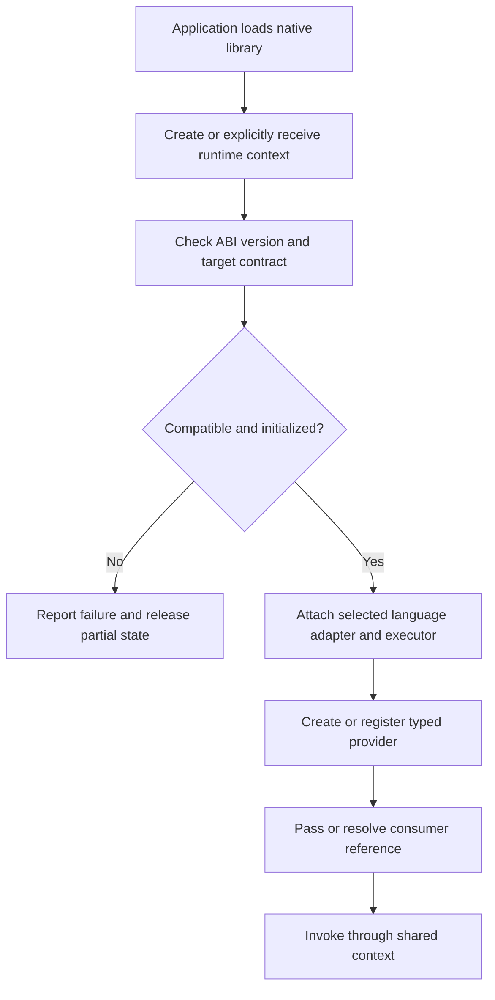

Loading two independent runtime instances is not the same as sharing a context. Do not pass handles between them. Keep registration and lookup unavailable until initialization completes successfully. The final shutdown sequence is in section 15.5.


#### A synchronous interface call

The caller and provider can be written in different languages. The generated proxy and adapter handle the conversion, not the business logic.

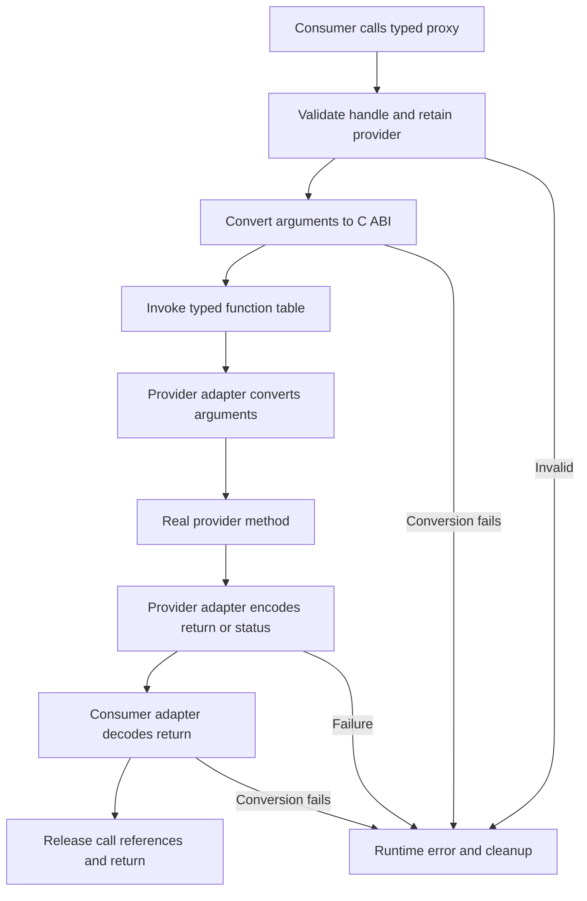

The return path must release temporary values on both success and failure. A foreign method or deleter is never invoked under the runtime lock.

#### The same interface in both directions

For an async UserLookup contract, the Kotlin implementation can answer a Dart call. A separate Dart implementation can answer a Kotlin call. The return is not the reverse invocation. Each role can initiate a new request independently.

```mermaid
sequenceDiagram
    participant D as Dart consumer or provider
    participant F as Dart adapter
    participant R as Shared C ABI
    participant J as JNI adapter
    participant K as Kotlin consumer or provider
    D->>F: findById(10)
    F->>R: Start typed async call
    R->>J: Invoke Kotlin provider
    J->>K: Execute lookup
    K-->>J: User or absence
    J-->>R: Complete with owning result
    R-->>F: Deliver completion
    F-->>D: Resolve Future
    Note over D,K: Independent call in the opposite direction
    K->>J: findById(20)
    J->>R: Start typed async call
    R->>F: Dispatch to Dart provider
    F->>D: Execute on owning isolate
    D-->>F: User or absence
    F-->>R: Complete with owning result
    R-->>J: Deliver completion
    J-->>K: Resume suspend call
```

Both directions use the same declared types. A runtime error or cancellation completes through its own status instead of returning an absent User.

## 13. Memory and buffers

### 13.1 Contracts

| Type | Ownership | Copy policy | Allowed lifetime |
| --- | --- | --- | --- |
| bytes | Independent value | Explicit copy | Independent |
| DataView | Borrowed read-only | No implicit copy | Scoped synchronous access |
| MutableDataView | Exclusive borrowed write | No implicit copy | Scoped synchronous access |
| DataRef | Shared owned buffer | No implicit copy | Until last owning reference is released |

```text
interface ImageProcessor {
    process(data: DataView): DataRef;
    processInPlace(data: MutableDataView): void;
    async processAsync(data: DataRef): DataRef;
}
```

Borrowed views may not escape the validated synchronous scope. DataView and MutableDataView are permitted only as direct synchronous parameters, including synchronous callback parameters under the same scope rules. Reject borrowed returns, stored fields, collection elements, async parameters and escaping captures. Use DataRef for independent or asynchronous lifetimes. A DataRef does not grant exclusive write access merely because its reference count is one. Managed wrappers must provide checked scoped access. Unrestricted raw pointers are not part of the default safe API. Couple validation to actual access so concurrent close cannot invalidate memory between the check and its use. Mutable views require exclusive access.

DataRef retains the true owner, including for subranges. Creating a reference to borrowed storage requires a retainable underlying owner and a legal independent lifetime. A borrowed view alone cannot be promoted to an owning buffer. An explicitly requested independent copy may create a new owner. A mutable view cannot become a shared reference to the same storage while its exclusive borrow is active. Last release executes the correct deleter once on an appropriate executor. Default shared access is read-only. Explicit conversion to bytes copies. Unsupported shared memory conversions must fail or request an explicit copy rather than silently copying.

### 13.2 Target representation examples

| Target | Borrowed / shared representation |
| --- | --- |
| C | Pointer + length scoped view. Opaque owning handle |
| C++ | span-like view. RAII reference |
| Java/Kotlin | Scoped direct ByteBuffer wrapper. Retained owner |
| Swift | Checked scoped access. Raw pointer only through explicit unsafe API. Owner object |
| Obj-C | Checked scoped read/write wrapper. Retained owner |
| Python | Checked scoped wrapper. Owning buffer exporter for retained memory |
| Dart | Checked native view and owned FFI reference |
| C# | Span-like scoped access. SafeHandle/owner for shared data |
| JS/TS/WASM | Checked view of linear memory. Lease or reacquire after memory growth |

A typed array in a JS heap is not automatically shared with WASM. Direct JVM buffers, GC pinning, Python buffer exporters, Dart finalizers and camera/GPU surfaces require specific lifetimes. Do not claim zero-copy when memory placement or runtime capabilities prevent it.

### 13.3 Test evidence

Test empty and large buffers, invalid lengths, overflow, slices, misalignment where typed access applies, concurrent release, source destruction while DataRef remains alive, use after view scope, double release, aliasing, mutable borrow conflicts, allocator matching and thread-affine deleters. Verify identity and exact contents across compatible boundaries. Instrument bytes copied, allocations/deallocations, handles and outstanding operations. Instrumentation must not claim visibility into all third-party runtime allocations.

### 13.4 Buffer and ownership flows

#### DataView and MutableDataView

A borrowed view is valid only during its synchronous call. Read-only access permits compatible read borrows. Mutable access is exclusive. Both return paths end the borrow before the owner can dispose of its storage.

```mermaid
flowchart TD
    A["Owner holds buffer"] --> B["Acquire read or exclusive write borrow"]
    B --> C{"Memory, scope and alias rules valid?"}
    C -->|No| X["Release acquired lease and report error"]
    C -->|Yes| D{"Read or exclusive write?"}
    D -->|Read| R["Provider reads same memory"]
    D -->|Write| W["Provider modifies same memory"]
    R --> E["Return value or error"]
    W --> E
    E --> F["End borrow and invalidate scoped view"]
    F --> G["Owner regains access under borrow rules"]
```

#### DataRef and explicit copies

An owning reference can outlive the call, and a copy is a separate operation.

```mermaid
flowchart TD
    A["Caller owns DataRef"] --> B["Retain real owner"]
    B --> C["Provider receives owning reference"]
    C --> D["Provider may keep or return it across async"]
    D --> E["Caller and provider release their references"]
    E --> F{"Last owner released?"}
    F -->|No| G["Memory remains valid"]
    F -->|Yes| H["Run correct deleter once"]
    C -->|Explicit conversion to bytes| I["Create independent copy"]
```

#### Strong and weak interface references

Weak references never resurrect an object that has already been disposed.

```mermaid
flowchart TD
    A["Strong interface reference"] --> B["Create weak handle"]
    B --> C["Try to acquire strong reference"]
    C --> D{"Owner still alive?"}
    D -->|Yes| E["Atomically retain and return reference"]
    D -->|No| F["Return absent optional reference"]
    E --> G["Use provider and release reference"]
```

## 14. Asynchronous operations callbacks and streams

### 14.1 Async and futures

```text
interface HttpClient {
    async request(input: HttpRequest): HttpResponse;
}
```

Async declares a potentially pending operation. Future/Task/Promise represent its result in a target runtime. Await waits without inherently creating a thread. No mandatory Future syntax in IDL.

```cpp
auto response = co_await client->request(request);
```

```kotlin
val response = client.request(request)
```

```swift
let response = try await client.request(request)
```

```dart
final response = await client.request(request);
```

```csharp
var response = await client.RequestAsync(request);
```

```python
response = await client.request(request)
```

### 14.2 Callback contract

```text
async callback Progress(received: int64, total: int64): void;

interface Downloader {
    async download(
        url: string,
        progress: Progress,
        cancellation: CancellationToken
    ): DataRef;
}
```

Callbacks are typed functions supplied by the application. They can be called from another language. A plain callback is synchronous, even when its return type is void. It completes before the invocation returns and may use borrowed parameters only during that call. An async callback uses an explicit async modifier, as in Progress above, and completes through the same typed completion and error contract as an async method. It may return void or an owning value. Do not turn a synchronous void callback into queued asynchronous work merely because it has no payload.

Specify scoped, retained or one-shot lifetime and the allowed executor. A synchronous callback is allowed only when the target can execute it on the calling context without blocking an event loop or violating thread affinity. An async callback may dispatch to another executor, retaining all needed arguments and references until actual execution ends. Borrowed views cannot be queued. In the download example, the provider may await progress completion to preserve order and avoid unbounded queued notifications. A callback failure is a typed runtime failure and is not ignored. Dart NativeCallable.listener is an asynchronous notification with a void native return. Use it only to deliver an explicit async completion or owning dispatch envelope, not as a synchronous callback implementation. See [Dart NativeCallable.listener](https://api.dart.dev/dart-ffi/NativeCallable/NativeCallable.listener.html).

### 14.3 Streams

```text
interface Camera {
    async start(): void;
    async stop(): void;
    frames(): Stream<CameraFrame>;
}
```

Map to idiomatic async streams (Dart Stream, Kotlin Flow, Swift AsyncSequence, .NET IAsyncEnumerable, Python async iterator, JS AsyncIterable, C/C++ subscription). Define subscription ownership, bounded queue, backpressure, drop policy, ordered events, cancellation, terminal event and buffer retention. Use one bounded subscription contract, not a new streaming framework. Default to demand/backpressure for lossless streams. Camera previews may explicitly select latest-frame behavior with a bounded queue and immediate release of dropped frames. No unbounded camera frame queue. A stream may terminate before producing any value. Lossless demand controls production and delivery, including when the queue is empty. Normal end-of-stream drains accepted values in order before the terminal notification. Error or cancellation stops delivery of pending values and releases them under the documented terminal policy. A consumer cancellation releases the subscription only after the actual producer and any in-flight delivery are safe to detach. A queue-full condition must pause a cooperative lossless producer or fail an invalid producer, not silently discard events. An explicit latest-frame preview policy may replace a queued frame and release the displaced owner.

### 14.4 Operation state and threading

Each operation has one caller-visible terminal transition: success, failure or cancellation. Synchronous runtime failures are reported through each target's documented error mechanism and do not unwind across the C ABI. An operation that cannot start fails immediately and must not also deliver a completion. Once the provider accepts the operation, its terminal outcome is delivered through the completion contract even if it happens inline before the start function returns. Initialize caller completion state and retain the start-call resources before invoking the provider. A completion that runs inline must not free state still needed by the start call. Separately track actual provider execution lifetime. Cancellation cannot release resources still used by running code. Safely consume late or duplicate completions and release their owning payloads without calling the consumer again. Handle inline completion before the initiating call returns, completion races, cancellation after completion, late/duplicate responses, errors and teardown. Retain arguments and provider until no execution can use them. Cancellation is cooperative and does not imply a running foreign operation has stopped.

Use existing target executors/event loops. No per-call thread. JNI attaches correctly, Swift respects actors, Python respects interpreter/GIL and event loop, .NET roots delegates, Dart dispatches to the correct isolate, JS/WASM respects event-loop and memory constraints. Reject unsafe synchronous crossings. Verify callbacks after detach, reentrant calls, no deadlocks, no stranded futures, no leaked references and stable stream termination. Shutdown stops new operations and registrations, requests cancellation and drains actual execution. Then remove registrations, invalidate handles and release runtime-owned references. Drain the releases these actions schedule while the owning runtimes and executors are still available. Detach only after cleanup finishes. Host-owned references that still require the runtime must be closed or keep it alive until safe release. Cleanup must remain available while new business calls are blocked. Never unload a runtime with active callbacks or required releases pending. Report a shutdown failure and retain required resources until safe cleanup is possible.

### 14.5 Async, callbacks, cancellation and streams in motion

#### Async request and result

The consumer receives a future. The implementation may complete immediately or later.

```mermaid
flowchart TD
    A["Consumer starts async call"] --> B["Retain arguments, provider and completion token"]
    B --> C{"Start accepted?"}
    C -->|No| X["Release start references, return failure without completion"]
    C -->|Yes| D["Schedule or execute provider"]
    D --> E["Provider completes with value or error"]
    E --> F{"Win terminal transition?"}
    F -->|Yes| G["Dispatch completion on caller executor"]
    F -->|No| H["Release late payload without callback"]
    G --> I["Caller await finishes"]
    D --> J["Actual execution finishes"]
    J --> K["Release execution resources when no longer owned"]
```

#### Callbacks in the opposite direction

A synchronous callback returns before the provider continues. An async callback completes later and follows the same rules as an async method.

```mermaid
flowchart TD
    A["Consumer passes typed callback"] --> B["Provider retains callback as declared"]
    B --> C["Provider invokes callback"]
    C --> D{"Synchronous or async contract?"}
    D -->|Synchronous| E{"Calling context safe?"}
    E -->|No| X["Report unsupported crossing"]
    E -->|Yes| F["Run callback in current allowed context"]
    D -->|Async| G["Retain arguments and dispatch to owner"]
    G --> H["Callback owner runs and completes"]
    F --> I["Return value or status"]
    H --> I
    I --> J["Provider receives completion or error"]
    J --> K["Release callback when no longer needed"]
```

In the Downloader example, the progress callback may be implemented by Dart while the download runs in Kotlin. The typed completion lets the provider continue without blocking the Dart isolate.

#### Explicit cancellation token

A CancellationToken lets the application request that work stop. It is different from the operation's own terminal status. A token may be shared by several operations if the application chooses. Cancelling one operation does not automatically cancel every other operation using the same token.

```mermaid
flowchart TD
    A["Caller owns a cancellation source and token"] --> B["Pass token to an async method"]
    B --> C["Retain token and observe cancellation"]
    C --> D{"Already cancelled?"}
    D -->|Yes| E["Complete operation as cancelled without starting work"]
    D -->|No| F["Provider starts work"]
    A -->|Request stop| G["Signal token once"]
    G --> H["Notify active observers on allowed context"]
    H --> I["Request cancellation of observing operations"]
    F --> J["Provider finishes or cooperates with cancellation"]
    I --> J
    J --> K["Remove observer and release token and execution owners"]
```

A cancellation source is a runtime helper, not an additional IDL type. Subscribe and check cancellation as one atomic operation so a request between registration and start is not lost. If work was accepted before cancellation, retain execution resources until work actually ends. Removing an observer must not race with destroying its context. Reuse the existing async cancellation machinery. Do not add a second cancellation scheduler.

#### Cancellation and actual execution lifetime

Cancellation completes the caller once but cannot free resources still used by the provider.

```mermaid
flowchart TD
    A["Consumer cancels operation"] --> B{"Terminal transition won?"}
    B -->|No| C["Already terminal"]
    B -->|Yes| D["Notify caller and signal cancellation"]
    D --> E["Provider cooperates or finishes normally"]
    E --> F["Consume late completion if any"]
    F --> G["Drain actual execution and release owners"]
```

#### Streams and backpressure

A stream carries zero or more values followed by at most one terminal outcome. Demand is the consumer's request for more items.

```mermaid
flowchart TD
    A["Consumer subscribes"] --> B["Retain subscription and provider"]
    B --> C{"Active subscription?"}
    C -->|No| Z["Drain producer and release subscription"]
    C -->|Yes| D{"Demand or preview policy allows work?"}
    D -->|No| E["Wait for demand or terminal event"]
    D -->|Yes| F["Provider produces next event"]
    E -->|New demand| C
    E -->|Terminal| T["End, failure or cancellation"]
    F --> G{"Event kind"}
    G -->|Value| H{"Bounded capacity available?"}
    H -->|Yes| I["Deliver or queue in order"]
    H -->|No| J["Pause lossless producer or replace preview frame explicitly"]
    I --> C
    J --> C
    G -->|Terminal| T
    T --> K["Drain accepted values on normal end, otherwise release pending values"]
    K --> L["Notify once if consumer still subscribed"]
    L --> Z
```

A normal empty stream can end while waiting for demand. Cancellation is also valid before the first item. Release each queued DataRef when it is delivered, explicitly dropped or abandoned. The producer cannot continue using a freed subscription.

## 15. Interfaces and service discovery

### 15.1 Ordinary object references come first

Any interface may be created, passed as an argument, returned or injected independently of service registration.

```text
interface HttpClient {
    async request(input: HttpRequest): HttpResponse;
}

interface Application {
    async configure(client: HttpClient): void;
}

callback HttpClientFactory(): HttpClient;
```

No special Provider type is needed. A factory can also be declared as an interface or async callback when appropriate. Generated references preserve the implementation's identity and lifetime according to the ABI.

### 15.2 Optional registry API

Proposed Kotlin registration:

```kotlin
val registry = ServiceRegistry.global
val registration = registry.register(KotlinHttpClient.TYPE, AndroidHttpClient())
```

Dart resolution:

```dart
final registry = ServiceRegistry.global;
final client = registry.get(HttpClientType);
final response = await client.request(request);
```

Swift:

```swift
let client = try ServiceRegistry.global.get(HttpClient.self)
let response = try await client.request(request)
```

C++:

```cpp
auto client = ServiceRegistry::global().get<HttpClient>();
auto response = co_await client->request(request);
```

C#:

```csharp
var client = ServiceRegistry.Global.Get<IHttpClient>();
var response = await client.RequestAsync(request);
```

Python:

```python
client = ServiceRegistry.global_instance().get(HttpClient)
response = await client.request(request)
```

C, Java, Objective-C and JS/TS expose equivalent typed descriptors or generated typed accessors. A descriptor is an actual runtime value, not a language type annotation. Use generated top-level descriptor values for Dart and JS/TS interface contracts, and typed tokens or class-based accessors where the host supports them. The API is illustrative and must be proven with C/C++ and managed runtimes before freezing.

### 15.3 How lookup actually works

1. The generator assigns a deterministic logical type identifier to network.HttpClient and emits the same descriptor in every selected target.
2. The registering language creates a generated adapter containing its object reference and typed function table.
3. The shared runtime validates interface identity, ABI fingerprint and runtime context, retains the adapter, and stores a registration token.
4. A consumer calls get using its generated descriptor. The shared runtime finds the compatible registration and takes a strong snapshot.
5. The consumer's generated adapter constructs a typed proxy around the snapshot. Invocations use its function table rather than method-name strings.
6. The provider's adapter schedules or executes the actual method on its runtime. Completion returns through the consumer's generated adapter.

No reflection or network is required. Multiple registrations can coexist. Use explicit scoped registries and an optional global convenience. No implicit search through parent registries or substitute provider after a failure. A context must be shared intentionally. An unrelated runtime cannot see its providers.

### 15.4 Replacement semantics

| Operation | Behavior |
| --- | --- |
| get(type) | Fixed snapshot, holds current provider |
| proxy(type) | Dynamic proxy, resolves provider for each new invocation |
| register(type, implementation) | Explicit duplicate/replacement policy |
| scoped override | Optional stack. Removing override restores previous provider |
| unregister(token) | Removes only that registration |
| missing provider | Typed runtime failure |

Default duplicate registration is an error unless explicit replace/override policy is specified. A registry retains its active registration and any deliberately stacked previous registration. Unregistering a hidden stacked entry removes it, so it cannot be restored later. Stale tokens cannot remove newer registrations. Replacing without a scoped override releases the old registry ownership. A scoped override restores a previous registration only when that override is deliberately removed, not when a call fails. Do not silently retry a failed call against another provider. Existing operations and stream subscriptions retain their selected provider. New dynamic calls use the current provider. Removing a registration does not invalidate an otherwise valid fixed reference. Runtime shutdown cancels/drains operations before releasing adapters.

Tests: both get/proxy modes. Replacement and explicit scoped restoration. Multiple instances. Nested contexts. ABI mismatch. Concurrent registration, lookup, removal and invocation. Stale registration tokens. Runtime reload. Callback reentrancy. Final release outside locks.

### 15.5 Direct references and service registry flows

#### Direct injection and factories

The registry is not required. A factory returns a normal owning interface reference.

```mermaid
flowchart TD
    A["Provider creates implementation"] --> B["Generated adapter exposes typed handle"]
    B --> C["Pass reference or return from factory"]
    C --> D["Consumer holds typed proxy"]
    D --> E["Call provider method through ABI"]
    E --> F["Return typed value or error"]
    F --> D
    D -->|Dispose| G["Release owning reference"]
```

#### Register, resolve and call a service

A registry maps the logical interface descriptor to a provider, not method-name strings.

```mermaid
flowchart TD
    A["Provider creates adapter"] --> B["Register typed descriptor"]
    B --> C["Validate ABI and retain registration"]
    C --> D["Shared registry in one runtime context"]
    E["Consumer requests same descriptor"] --> D
    D --> F{"Matching registration?"}
    F -->|No| X["Missing service error"]
    F -->|Yes| G["Retain snapshot and create proxy"]
    G --> H["Invoke provider through typed table"]
    H --> I["Result returns to consumer"]
    C --> J["Registration token"]
    J -->|Unregister| K["Remove only matching registration"]
```

#### Replacing a registered service

A fixed reference keeps its chosen provider. A dynamic proxy resolves again at the start of a new call.

```mermaid
flowchart TD
    A["Provider A registered"] --> B["Fixed reference to A"]
    A --> C["Dynamic proxy"]
    D["Explicitly register provider B as replacement"] --> E["Registry now points to B"]
    B --> F["Existing references and in-flight calls use A"]
    C --> G["Next invocation resolves B"]
    E --> G
    G --> H["Invoke B and return result"]
    F --> I["Release A when last owner finishes"]
    E -->|Explicitly remove scoped override| J["Restore previous retained provider if still registered"]
    J --> C
```

#### Runtime shutdown

Stop accepting work before detaching any runtime or destroying its callbacks.

```mermaid
flowchart TD
    A["Shutdown requested"] --> B["Reject new calls and registrations"]
    B --> C["Request cancellation"]
    C --> D["Drain actual execution"]
    D --> E{"Execution and ownership safe?"}
    E -->|No| X["Report shutdown failure and keep resources alive"]
    E -->|Yes| F["Remove registrations, invalidate handles, release adapters"]
    F --> H["Drain releases on live owning executors"]
    H --> I{"All required cleanup finished?"}
    I -->|No| X
    I -->|Yes| G["Detach runtime"]
```

## 16. Language-specific integration

### 16.1 Flutter calling Kotlin or Swift

The Dart application imports generated typed bindings. A Flutter plugin initializes the shared native runtime and platform adapters. Kotlin or Swift registers an implementation or passes an interface reference to Dart. The C/C++ support runtime routes the typed function table. It does not implement the business logic.

```text
Flutter/Dart -> FFI -> C ABI -> JNI -> Kotlin provider
Flutter/Dart -> FFI -> C ABI -> Apple adapter -> Swift provider
Kotlin/Swift/C++ -> native adapter -> Dart isolate -> Dart provider
Flutter Web -> JS interop -> WASM/JS provider
```

No MethodChannel dependency for the primary native ABI calls. Flutter platform/plugin lifecycle mechanisms may still be used for loading, registration or platform-specific facilities where justified. A Dart implementation is a real provider, not just a client. Async return paths must respect isolate affinity.

Example Dart registration:

```dart
class DartHttpClient implements HttpClient {
  @override
  Future<HttpResponse> request(HttpRequest input) async {
    return executeDartRequest(input);
  }
}

final registration = ServiceRegistry.global.register(HttpClientType, DartHttpClient());
```

The implementation function above is illustrative. Examples must supply a real implementation.

### 16.2 Concrete provider-to-consumer example

A handwritten Kotlin repository implements the generated interface from the shared JVM configuration in section 7.4. The executable sample uses a small deterministic in-memory store, not a real database dependency. This example shows all repository methods from section 4.1. UserStore is a handwritten in-memory implementation supplied by the sample:

```kotlin
class AndroidUserRepository(private val store: UserStore) : KotlinUserRepository {
    override suspend fun findById(id: Long): User? = store.findById(id)

    override suspend fun findAll(): List<User> = store.findAll()

    override suspend fun findByStatus(status: UserStatus): List<User> = store.findByStatus(status)

    override suspend fun save(user: User): User = store.save(user)

    override suspend fun saveAll(users: List<User>): List<User> = store.saveAll(users)

    override suspend fun count(): Long = store.count()

    override suspend fun exists(id: Long): Boolean = store.exists(id)

    override suspend fun delete(id: Long): Boolean = store.delete(id)

    override suspend fun deleteAll() = store.deleteAll()
}
```

Register the implementation in the shared Android runtime during plugin initialization:

```kotlin
val registration = ServiceRegistry.global.register(KotlinUserRepository.TYPE, AndroidUserRepository(store))
```

Dart consumes the same contract and the imported domain model:

```dart
final repository = ServiceRegistry.global.get(UserRepositoryType);
final users = await repository.findAll();
final user = await repository.findById(10);
final count = await repository.count();
final exists = await repository.exists(10);

for (final item in users) {
  print(item.name);
}
```

The same Dart code can consume a Swift provider on Apple platforms. Alternatively, inject the repository reference directly instead of registering it. In reverse, Kotlin or Swift may consume a Dart provider, using an asynchronous invocation when crossing isolate/thread boundaries. All examples must run with generated adapters. Snippets alone do not satisfy acceptance.

### 16.3 Per-target integration review

| Target | Mandatory concerns |
| --- | --- |
| C/C++ | C ABI visibility, fixed layout, RAII, compiler portability |
| Java/Kotlin | JNI reference lifetime, exceptions, attach/detach, coroutine/Future bridge |
| Objective-C/Swift | ARC, selectors, module maps, nullability, actors, async import |
| Python | CPython references, buffer protocol, interpreter and event loop |
| Dart/Flutter | FFI, callback lifetime, isolates, restart, plugin registration, web separation |
| C# | P/Invoke or LibraryImport, safe handles, GC/delegate lifetime, Task cancellation |
| JS/TS/WASM | BigInt, typed arrays, memory growth, JS roots, ESM exports, Promise |
| Apple platforms | SDK availability, build and simulator/device execution including visionOS |
| Android / XR | NDK/JNI packaging, ABI variants, emulator and lifecycle |

Compile and execute actual generated APIs in each claimed target. Platform-dependent limitations must be documented and enforced by the generator.

### 16.4 Common backend acceptance contract

Every backend below must deliver the following together, not as disconnected generators:

- Public idiomatic model, enum, flags, variant, interface, callback, result and async APIs. Generated consumer proxy and provider adapter. Exact type mappings from sections 5 and 13.
- Module-specific output configuration, public import path, package/module/namespace, filenames, prefixes, naming categories, annotations, sources mode and package mode. Resolve dependency artifacts from the defining module.
- Versioned ABI integration, initialization and shutdown, strong/weak handles, explicit cleanup, error translation, async completion, cancellation, callbacks, streams and optional service registry. No generated API may bypass its documented ownership/thread contract.
- Golden source tests, native compiler/type-checker tests, real provider and consumer execution, separate module/prebuilt dependency tests, both-direction type conformance, lifetime/copy tests and actual sample application tests.
- The corresponding CI job and language guide must show commands that work from a clean checkout. The toolchain invocations below are implementation requirements, not commands already available in the repository.

For each target, generate a capability manifest listing types, sync/async directions, platform, runtime, scheduler restrictions, zero-copy eligibility, build mode and verified test IDs. Reject unsupported combinations rather than silently emitting broken code.

### 16.5 C backend

**Artifacts and configuration:** public .h files, generated C or C-compatible bridge source, separate private headers, typed handles and vtables, include guards, export/calling convention macros, optional CMake target. Module-specific prefix (app_domain_, app_repo_, etc.), include prefix, header/source paths, extensions, snake_case symbols and kebab-case filenames. Public headers compile as C11 and when included from C++. No C++ types leak through.

**Types and memory:** fixed-width integers and explicit UTF-8 pointer/length descriptors. Generated tagged optionals, results and variants. Typed collection descriptors. Opaque interface/weak/operation/subscription handles. Explicit init/destroy for owning values and recursive cleanup on partial conversion failure. Borrowed buffers are scoped. DataRef is retained/released through the ABI. Caller never frees memory allocated by another allocator.

**Provider and consumer:** generated typed function table and context, functions to create/retain/release interface handles, invoke methods and register/resolve services. Async methods return a status/operation handle and accept typed completion callbacks with user context. Define callback argument ownership and completion exactly once. Expose cancellation and subscription disposal. No exceptions cross C entry points.

```c
/* Illustrative generated API shape. */
pg_status app_repo_user_repository_count_async(
    app_repo_user_repository *repository,
    pg_int64_completion completion,
    void *context,
    pg_operation **operation);
```

**CI:** c.yml runs C11 compilation with GCC/Clang and supported MSVC C mode on Linux/Windows/macOS. Build C and C++ header consumers. Run C-to-C++ and reverse, C provider called by managed targets, all type fixtures, allocator-failure injection, invalid handles, ABI layout tests, ASan/UBSan/LSan where available, separate TSan stress. Test Windows DLL export/import and calling conventions. Example CLI executes HTTP through a foreign provider, grayscale fixture and fake login.

### 16.6 C++ backend

**Artifacts and configuration:** .hpp/.cpp files, namespace, header/include prefix, public/private layout, configurable case and suffixes, forward declarations, CMake targets and optional installed package config. Use C++20 baseline. Do not require std::expected or C++23 for public headers. Support nodiscard/deprecated and safe noexcept annotations.

**Types and memory:** records with value semantics, enums/flags, optional, variant, vector/collections, generated Result, typed references and RAII wrappers. Move ownership when contract permits. Reference counting must not copy buffers. DataView span-like scoped access. MutableDataView exclusive borrow. DataRef retainable owner. Weak references must not resurrect disposed objects.

**Provider and consumer:** generated abstract interface, proxy and native provider adapter. C++ implementations use ordinary virtual methods and can be passed directly without registry. Async return uses a PolyGlue awaitable/future with co_await, callback completion and cancellation, without imposing a thread per call. Document executor behavior and destructor safety. Registry get<T> snapshots a provider. Dynamic proxy resolves on invocation.

```cpp
auto repo = registry.get<UserRepository>();
auto users = co_await repo->findAll();
```

**CI:** cpp.yml builds CMake/CTest on GCC, Clang and MSVC. Shared/static consumer builds, installed headers, multiple translation units, visibility and ABI checks, debug/release, RAII, exception translation, coroutine completion/cancel races, weak reference and destruction tests. Run native sanitizers independently and verify reentrant calls. Example CLI with actual foreign provider and native image processor.

### 16.7 Java backend

**Artifacts and configuration:** public classes/interfaces, proxy and provider adapter classes, JNI bridge source/header, package and Java file naming, optional Gradle Java library. Every public top-level class uses its required filename. Support nullability/deprecation attributes with explicit dependency policy. Never add an annotation library implicitly. Share JVM models with Kotlin only through an explicit artifact-ownership strategy.

**Types and memory:** primitive and boxed representations follow section 5. Unsigned values widen or use checked BigInteger. JNI strings convert UTF-16 to canonical UTF-8 and back, not modified UTF-8 shortcuts that lose NUL/supplementary characters. JNI global references retain providers, local frames bound references, weak globals only for explicit weak semantics. Use direct buffers only when valid native memory and owner lifetime are established. Do not expose an unrestricted direct ByteBuffer as a safe borrowed view.

**Provider and consumer:** generated Java interface uses CompletableFuture for async, functional interfaces for callbacks, typed stream subscription and a publisher adapter where useful. JNI retains callbacks/provider objects, attaches foreign threads, checks and clears/translates Java exceptions, and releases references on a valid JVM thread. Never cache JNIEnv across threads. No JVM initialization or destruction while active adapters remain. Cancellation of the returned CompletableFuture must propagate to the native operation under the common cancellation contract. Provider completion still controls resource lifetime.

```java
UserRepository repo = registry.get(UserRepository.TYPE);
CompletableFuture<List<User>> users = repo.findAll();
```

**CI:** java.yml builds Java/JNI on Linux, macOS and Windows with pinned JDK/Gradle, runs -Xcheck:jni, Java↔C++, Java↔Kotlin shared artifact cases, forced GC, exception conversion, global/local reference balance, direct buffer lifetime, callback from native thread, duplicate completion, JVM teardown and exact unsigned/Unicode round trips. Sample desktop CLI or simple UI.

### 16.8 Kotlin backend

**Artifacts and configuration:** Kotlin classes/interfaces and adapters, .kt files, package, JVM module and optional Gradle/Kotlin library. For Android emit appropriate Android library/JNI packaging integration, not a mandatory application rewrite. When Java is also selected, either generate one shared model set with distinct API wrapper names or use separate packages. Validate JNI signatures after Kotlin name mangling. Support JvmName/JvmStatic/JvmOverloads only where legal and needed.

**Types and memory:** Kotlin signed and unsigned types, nullable types and explicit tagged nesting, immutable data models, Kotlin collections, sealed Result/variant. Primitive arrays with exact conversion. Shared Java models may require safe value conversions. Do not duplicate class identities. Use JNI lifetime rules from Java. DataRef keeps the owner and any direct memory valid across suspension.

**Provider and consumer:** suspend methods, cancellation-aware continuations and Flow for streams. Bridge Java CompletableFuture when sharing API artifacts. Cancellation and exceptions map to native terminal states without resuming a continuation twice. Use structured concurrency or supplied CoroutineScope/dispatcher. No GlobalScope or blocking event loops. Android UI/system APIs dispatch to the main looper only when required. Kotlin providers can be registered or injected and invoked by Dart or C++.

```kotlin
val registration = registry.register(KotlinUserRepository.TYPE, repositoryImpl)
val users = registry.get(KotlinUserRepository.TYPE).findAll()
```

**CI:** kotlin-desktop.yml exercises JVM on desktop and Kotlin↔Java/C++. Kotlin-android.yml builds Android Gradle project, packages ABI-specific .so, runs instrumented tests/emulator and Flutter↔Kotlin integration in both directions. Test coroutine cancellation, thread dispatch, activity recreation, provider detach, JNI references, camera buffer release and exact unsigned mapping. Test Android XR separately when device/emulator is available.

### 16.9 Objective-C backend

**Artifacts and configuration:** prefixed public headers, Objective-C++ .mm implementation, umbrella header/module.modulemap and optional framework/SwiftPM-compatible Clang target. Use module-specific DOM/REP prefixes, selectors, naming and NS_SWIFT_NAME metadata. Resolve dependency module imports or header imports. No duplicate type names when Swift wrappers coexist.

**Types and memory:** NSObject model objects, protocols for interfaces, NS_ENUM/NS_OPTIONS, Foundation collections/strings and explicit boxing for scalar optional/nested variants. Nullability distinguishes absent value from runtime error. ARC retains object providers and blocks. Use explicit bridge ownership operations for opaque contexts, avoid retain cycles and balance autorelease pools on foreign threads. DataRef is a retained owner wrapper. NSData use alone does not prove zero-copy. Borrowed view wrappers must enforce scope.

**Provider and consumer:** typed generated protocols and proxy classes, copied completion blocks, typed callbacks and subscription cancellation. Use NSError or explicit status for runtime failures, Result for business failures. No NSException crosses the ABI. Annotate importable completion APIs for Swift where valid. Generate explicit Swift wrappers for ambiguous optional/error cases. Test callback block lifetime, reentrancy and dispatch queues.

```objc
@import AppDomainObjC;

id<REPUserRepository> repo = [registry userRepository];
[repo findAllWithCompletion:^(NSArray<DOMUser *> *users, NSError *error) {
    /* Handle completion. */
}];
```

**CI:** objc.yml compiles Objective-C and Objective-C++ on macOS with ARC, tests Obj-C↔C++, Obj-C↔Swift, import macros, nullability, enum/flags, selector conflicts, autorelease/weak lifetime, callback block disposal, actual Swift compiler import. Platform SDK builds and execution covered by apple-platforms.yml. Sample native app or CLI. Verify foreign HTTP, login and media processor.

### 16.10 Swift backend

**Artifacts and configuration:** .swift contracts, models or re-exports, proxies and adapters, Package.swift or source integration, module/target, visibility, prefix/case, imports and availability. Swift module names are not directory names. When using imported Objective-C models, provide one canonical model type. When generating native Swift models, use explicit conversion or separate modules and avoid ambiguous unqualified imports.

**Types and memory:** Swift value types where appropriate, protocols and generated proxies, optional, enum/OptionSet, tagged variants and Result when Error constraints are satisfied. Exact numeric/time mappings. Controlled UnsafeRawBufferPointer access for DataView, owned DataRef reference and explicit Data copying. ARC and Unmanaged bridge ownership must be balanced. Never label arbitrary object types Sendable or use unchecked Sendable without a documented proof and tests.

**Provider and consumer:** async throws, checked continuation adapter with exactly-once resume and cancellation propagation, typed closures, AsyncSequence stream, explicit executor/actor policy. MainActor is enforced for UI APIs. Swift implementations register or pass protocol references and may be called from Kotlin/C++/Dart where valid. Do not block an actor waiting for a callback scheduled on that actor.

```swift
let repo = try registry.get(UserRepository.self)
let users = try await repo.findAll()
```

**CI:** swift.yml runs SwiftPM or Xcode tests on macOS with strict concurrency diagnostics, Swift↔C++, Swift↔Objective-C and Swift↔Dart integration on applicable platforms. Test ARC/weak refs, continuations, cancellation/actor dispatch, selector/import name consistency, module dependencies and availability annotations. apple-platforms.yml builds each Apple SDK and runs platform-appropriate tests. Record visionOS/tvOS/watchOS/Catalyst evidence individually. Sample native UI where applicable.

### 16.11 Python backend

**Artifacts and configuration:** Python package with explicit public module imports, empty __init__.py files, .py/.pyi as appropriate, generated proxy/provider wrapper and CPython bridge or stable supported adapter, optional pyproject.toml/build integration. Package name, output tree, source vs wheel package mode, snake_case, annotations and imports. Python generator dependencies are not automatically runtime dependencies of generated Python bindings.

**Types and memory:** frozen dataclasses by default, Enum/IntFlag, typed collections and Result/variant, strict numeric range checks, Unicode and bytes. Handle cycles and interpreter shutdown. Own every new/borrowed PyObject reference correctly. For DataRef, keep Py_buffer/exporter alive until final release, release on correct interpreter/thread. A Python memoryview that escapes a borrowed scope cannot be treated as safely invalidated. Use a checked scoped wrapper or explicit owned conversion.

**Provider and consumer:** async def/awaitable, asyncio event loop capture, thread-safe scheduling from native threads, callback roots, async iterator and cancellation. Acquire correct interpreter thread state before invoking Python. Respect GIL or supported free-threaded build policy. Never call Python after finalization. Record supported CPython versions and whether subinterpreters/free-threaded builds are supported. Reject unsupported modes.

```python
repo = registry.get(UserRepository)
users = await repo.find_all()
```

**CI:** python.yml tests installed generated bindings on Linux/macOS/Windows, native↔Python and Python↔other coexisting runtimes, CPython debug/refcount checks, forced GC, buffer export lifetime, async cancellation, native worker callback scheduling and interpreter shutdown in subprocesses. Wheel/sdist package tests verify import from outside source tree. Example CLI or simple app with real cross-language HTTP/login/grayscale.

### 16.12 Dart backend

**Artifacts and configuration:** Dart package, public barrel export, lib/src models/interfaces/proxies, FFI binding declarations and native assets loading configuration. Separate web implementation and conditional imports. Package/output, naming, annotations and optional pubspec. A pure Dart target must not require Flutter SDK. No dart:ffi imports in web build.

**Types and memory:** native int for signed 64-bit, BigInt for uint64 and exact Web 64-bit. Typed data arrays when exact. Immutable models, sealed variants and Result. Native memory uses checked handles and explicit dispose plus NativeFinalizer where safe. Never keep raw borrowed TypedData views beyond synchronous lifetime. DataRef retains native storage through async. NativeFinalizer cannot serve as the only deterministic lifecycle mechanism.

**Provider and consumer:** Future/Completer, typed functions, Stream and cancellation. NativeCallable.listener or supported message dispatch delivers async operation and async callback envelopes from arbitrary threads. A synchronous callback, including void, needs a supported same-context invocation. A queued listener cannot satisfy that contract. Isolate-local calls require the correct thread/isolate. No synchronous foreign-thread Dart return. Root registered providers in their owning isolate. On detach/hot restart invalidate registrations, drain/cancel operations and ensure no callback into a closed NativeCallable. Completion arguments remain valid until isolate consumes them.

```dart
final repo = registry.get(UserRepositoryType);
final users = await repo.findAll();
```

**CI:** dart.yml runs dart analyze, format checks where configured, dart test on Linux/macOS/Windows, native library load/architecture tests, Dart↔C++, callback from worker thread, multiple isolates, isolate shutdown and forced restart, DataRef finalizer/explicit disposal and copy tracking. Dart Web runs actual JS/WASM integration in browser. Sample CLI, not a Flutter-only demo.

### 16.13 Flutter integration target

**Artifacts and configuration:** reuse generated Dart contracts, emit plugin with pubspec, lib, Android Gradle/JNI, iOS/macOS Apple integration, Windows/Linux CMake and web adapter as appropriate. Support existing native projects in sources mode and buildable plugin in package mode. Plugin owns runtime initialization/attachment tokens, not all application service instances. Expose a single public Dart API with target-appropriate adapters.

```text
app_repository_plugin/
├── pubspec.yaml
├── lib/
│   └── app_repository_plugin.dart
├── android/
├── ios/
├── macos/
├── windows/
├── linux/
├── web/
├── test/
└── integration_test/
```

**Providers and lifecycle:** Kotlin/Java and Swift/Obj-C implementations are real providers, not MethodChannel stubs. Calls go through generated FFI/native adapters and shared service context. Native implementations can call Dart providers asynchronously. Handle plugin detach, multiple Flutter engines, isolates, activity recreation, background/foreground, hot restart and disposal independently. Web uses the JS/WASM implementation. Reuse DataRef for camera frames, with explicit mapping/copy for non-shareable memory.

**CI:** flutter.yml has distinct jobs for Android emulator, iOS simulator, macOS, Windows, Linux and Web. Run flutter analyze/test plus integration_test and actual native plugin build/run. Verify Android Kotlin provider and Apple Swift provider using the same Dart consumer, reverse native→Dart callback/provider, module import/layout, lifecycle and restart. Desktop runners test C++ provider. Web tests JS/WASM provider. Required UI contains HTTPBin, login form and camera/grayscale preview. Deterministic fixtures do not replace actual device camera validation. Native visionOS Flutter is not claimed without upstream support and evidence.

### 16.14 C# backend

**Artifacts and configuration:** .cs models, interfaces, proxies, native adapter declarations, namespace and assembly, project references, optional .csproj. PascalCase types/methods, I interface prefix and Async suffix configurable. Use generated P/Invoke/LibraryImport declarations appropriate to supported .NET version and platform. Validate calling convention, StructLayout and field sizes. Do not assume C# bool/string layout is the C ABI layout.

**Types and memory:** exact signed/unsigned primitives, immutable record models, nullable or tagged optionals, generated Result/variant and read-only collections. Use SafeHandle or equivalent for owning references and explicit IDisposable. Retain delegates/GCHandle for provider callbacks and release only after native operations drain. Span/ReadOnlySpan scoped borrowed access. DataRef owner enables async use. GC pinning or copies are explicit. No pointer to movable managed memory after pin scope.

**Provider and consumer:** `Task<T>`/Task for async, typed delegates, IAsyncEnumerable and CancellationToken adapter. Use completion sources with asynchronous continuation scheduling where needed. Exactly-once completion. Map cancellation without prematurely releasing active native resources. Use stable unmanaged entrypoints or rooted delegates. Exceptions never cross native ABI. Managed provider registration works from C++/Dart where the .NET host is available. Do not assume arbitrary embedding. Specify supported .NET hosting and NativeAOT modes separately.

```csharp
using var registration = registry.Register<IUserRepository>(implementation);
var repo = registry.Get<IUserRepository>();
var users = await repo.FindAllAsync();
```

**CI:** csharp.yml runs dotnet build/test on Windows/Linux/macOS with pinned SDK, C#↔C/C++, GC stress and forced collection, delegate lifetime, SafeHandle explicit/finalizer cleanup, struct size/offset assertions, cancellation and native thread callbacks. Test package/project reference and platform native-library resolution. Sample console or simple UI with all three scenarios.

### 16.15 JavaScript backend

**Artifacts and configuration:** ESM runtime .js modules, loader, package.json exports, public entry point and generated proxies/providers. Configurable module/package, relative/public import policy, names, layout and file extension. Browser and Node runtime integration are separate capabilities. No reliance on TypeScript compiler at application runtime when JS is selected.

**Types and memory:** checked Number for small integers, BigInt for exact 64-bit, string UTF-16 validation, Uint8Array for copied bytes, Map/Set, tagged result and variants, runtime value validation because JS is dynamic. WeakRef/FinalizationRegistry cannot guarantee timely cleanup. Use explicit dispose. DataRef and views refer to compatible native/WASM memory only. Arbitrary JS heap cannot be assumed shareable.

**Provider and consumer:** Promise, typed callable shape at runtime, AsyncIterable, AbortSignal adapter and generated provider registration. Maintain rooted JS references while native handles are alive. Prevent calls after module teardown. Handle synchronous reentrancy and asynchronous microtask completion. Use worker/message dispatch only with explicit transfer/sharing contract. No cross-worker raw pointers.

```javascript
const repo = registry.get(UserRepositoryType);
const users = await repo.findAll();
```

**CI:** javascript.yml runs Node tests and browser integration, generated ESM import/exports, JS↔WASM and reverse provider, Promise resolution/rejection, BigInt boundary, Unicode, callback roots, GC/explicit disposal, memory growth, worker constraints and package installation. Browser example includes HTTP, login form and camera via getUserMedia where permission exists. Node CLI uses deterministic image fixture.

### 16.16 TypeScript backend

**Artifacts and configuration:** generated .ts or .d.ts declarations plus matching JS runtime, package.json exports/types, tsconfig, per-module public type imports and type-only imports. When sharing JavaScript output, generate declaration artifacts once and verify no duplicate runtime classes or export collisions. Strict mode, no implicit any in public contracts, target/module resolution explicit.

**Types and memory:** exact mappings match JavaScript runtime. Interfaces/read-only models, tagged unions, bigint, typed arrays and explicit nullable/optional states. TypeScript declarations do not substitute runtime validation. Model the owner/borrow API without claiming the TS type checker can enforce lifetime of escaped views.

**Provider and consumer:** strongly typed interfaces, `Promise<T>`, `AsyncIterable<T>`, callback signatures, AbortSignal and typed registry descriptors. Generated declarations match actual runtime exports and implementation signatures. Emit a real value export such as UserRepositoryType for each generated interface descriptor, in addition to the TypeScript interface declaration. Do not access static members on an erased interface or use a type-only import as a runtime value. Verify both valid and invalid type-check fixtures.

```typescript
const repo: UserRepository = registry.get(UserRepositoryType);
const users: User[] = await repo.findAll();
```

**CI:** typescript.yml runs strict tsc type-check, negative compile fixtures, package consumer tests and actual emitted/runtime JS tests in Node/browser. Run all common types and provider directions, not just compilation. Verify JS and TS shared artifact mode, separate module import resolution, bigint and Result/variant discriminants. Provide typed browser sample and Node harness.

### 16.17 WebAssembly backend

WebAssembly is a transport/execution target, not another IDL language.

**Artifacts and configuration:** generated C/C++ WASM adapter, exported functions, Emscripten build integration, JS module loader and TypeScript declarations. Configure output, include prefix, module/package name, environment (browser/Node), memory growth/thread mode and public exports. Avoid unnecessary Embind or other dependencies when typed C ABI plus generated JS suffices.

**Types and memory:** fixed WASM ABI, validate pointer/length and linear memory bounds. Use exact i64/BigInt conversion. Views of WebAssembly.Memory may become detached/stale after growth. Pin or prohibit growth while a borrow is active, or reacquire using checked owner/offset. Never expose stale cached views as valid. Shared DataRef may keep a linear-memory allocation alive. It cannot prevent arbitrary JS buffer detach unless policy enforces it. Separate shared memory/threads support and cross-origin isolation requirements from baseline single-thread mode.

**Provider and consumer:** JS/TS can implement interfaces consumed from WASM and vice versa, with Promise-based async bridge and rooted JS callbacks. No blocking browser main thread to emulate synchronous async completion. Threaded mode only when browser/runtime configuration allows it. Cancellation and teardown release both native and JS references.

**CI:** wasm.yml builds with pinned Emscripten, runs Node and headless browser tests, memory growth, out-of-bounds checks, JS/WASM bidirectional types, BigInt, DataView/DataRef/copy counts, Promise completion/cancel, module destruction/reinitialization, workers when supported. Verify no native ABI pointer is reused as a cross-instance handle. Flutter Web tests run against actual WASM/JS adapter.

### 16.18 Platform integration specifics

| Platform | Build / execution requirement | Lifecycle and sample-specific requirement |
| --- | --- | --- |
| Linux | GCC/Clang, shared libraries, native runtimes | Loader path, headless fixture, optional camera device |
| Windows | MSVC and supported Clang, DLL imports/exports | CRT allocator pairing, architecture, native library discovery |
| macOS | Clang, Xcode, SwiftPM, supported desktop runtimes | ARC, signing where required, camera permission, native UI |
| Android | NDK/Gradle, ARM64 and emulator ABI, instrumented test | JNI, app lifecycle, permissions, CameraX or compatible capture |
| Android XR | Android XR SDK-compatible build and emulator/device | XR lifecycle, available sensors/camera permission. No false hardware claim |
| iOS/iPadOS | Xcode simulator/device target, framework or library integration | ARC, main actor, app lifecycle, permission and actual camera on device |
| tvOS | SDK build and simulator execution | Remote/input and available media/camera capability. Use image fixture when no camera |
| watchOS | SDK build and simulator execution | Watch app lifecycle, constrained resources, no unsupported camera claim |
| visionOS | visionOS SDK build and simulator execution. Device where hardware required | Native Swift/Obj-C/C++ bridge, actor/lifecycle, camera entitlement/access constraints. Use fixtures where access unavailable |
| Mac Catalyst | Catalyst SDK build and native execution | Distinguish from macOS target. Availability and lifecycle |
| Web | Browser and Node where supported | Browser permissions, CORS, event loop, WASM memory constraints. Node fixture |

Physical device tests are not replaceable by a simulator for device-only features. Record hardware access as blocked when unavailable. Do not require a physical camera for platforms without appropriate APIs. The grayscale computation and buffer transfer remain mandatory with fixtures. All supported platform targets must build and execute at least their applicable conformance cases.

### 16.19 Concrete runtime paths in both directions

The following diagram summarizes the adapters required for all language targets. Connections are possible only when both runtimes can be loaded and safely called in the same execution context. The platform matrix in section 2 defines where to prove these paths.

```mermaid
flowchart TD
    Core["Shared native C ABI and runtime"] <-->|Native API| C["C and C++"]
    Core <-->|JNI| JVM["Java and Kotlin"]
    Core <-->|Apple adapter| Apple["Objective-C and Swift"]
    Core <-->|CPython adapter| Py["Python"]
    Core <-->|FFI| Dart["Dart and Flutter native"]
    Core <-->|P/Invoke or hosting adapter| NET["C#"]
    Wasm["C ABI compiled into WASM instance"] <-->|WASM adapter| Web["JavaScript and TypeScript"]
    Web <-->|JS interop| DartWeb["Dart and Flutter Web"]
```

The browser WASM instance has its own memory and runtime context. A native process handle cannot cross into an unrelated WASM instance. Each adapter is responsible for the execution context, error and lifetime rules in its language profile.

#### Flutter on Android, Apple and Web

The same Dart-facing contract selects the generated integration for its platform. Reverse calls follow the same bridge and the runtime's scheduling rules.

```mermaid
flowchart TD
    A["Flutter native Dart consumer or provider"] <-->|Calls and results| B["Dart FFI adapter and shared C ABI"]
    B <-->|JNI| C["Kotlin or Java on Android"]
    B <-->|Apple adapter| D["Swift or Objective-C on Apple"]
    B <-->|Native adapter| E["C or C++ on desktop"]
    F["Flutter Web Dart consumer or provider"] <-->|JS interop| G["JS or TS adapter"]
    G <-->|WASM ABI| H["C or C++ WASM implementation"]
```

## 17. Example applications

### 17.1 Shared modules

```text
examples/
├── polyglue.yaml
├── modules/
│   ├── domain/
│   ├── repository/
│   ├── auth/
│   ├── network/
│   └── media/
├── c/
├── cpp/
├── java/
├── kotlin/
├── objc/
├── swift/
├── python/
├── dart/
├── flutter/
├── csharp/
├── javascript/
└── typescript/
```

Every target must have runnable provider and consumer examples. Use simple UI on relevant platforms and CLI equivalents on headless targets. All bridges must come from the generator. Handwritten business logic is expected.

### 17.2 HTTPBin

```text
record HttpHeader {
    name: string;
    value: string;
}

record HttpRequest {
    url: string;
    method: string;
    headers: list<HttpHeader>;
    body: optional<DataRef>;
}

record HttpResponse {
    status: int32;
    headers: list<HttpHeader>;
    body: DataRef;
}

interface HttpClient {
    async request(input: HttpRequest): HttpResponse;
}
```

Send a real HTTPS request to https://httpbin.org/get or /post using a provider in a different runtime. Display status, headers and body. Headers are a list rather than a map so repeated fields such as Set-Cookie are not overwritten. HTTP header name matching is case-insensitive in the HTTP implementation, not a change to IDL string equality. Check repeated response headers with the existing local fixture on providers whose HTTP API exposes them. Browser Fetch may hide or combine headers, and never exposes Set-Cookie to frontend code. The browser provider returns only the headers actually available from Fetch and must obey CORS and other browser restrictions. Do not invent hidden headers, split combined values heuristically, or require the browser to return headers forbidden by the platform. Test permitted response headers and the native repeated-header contract separately. Serve the routine browser fixture from the same origin or with deliberate CORS configuration. The direct HTTPBin browser smoke is conditional on that service permitting the requested browser call. See [Fetch forbidden response headers](https://developer.mozilla.org/en-US/docs/Web/API/Headers/getSetCookie). A non-success HTTP status is a response, not an ABI failure. A transport failure or unavailable browser response is an invocation error. Test error, timeout, cancellation and async completion. Deterministic CI uses a local HTTP fixture with the same contract. A separate live smoke checks the actual public service. Do not make deterministic tests rely on public network availability.

### 17.3 Camera and grayscale

```text
enum PixelFormat {
    RGBA8 = 1,
    BGRA8 = 2,
    RGB8 = 3
}

record CameraFrame {
    width: int32;
    height: int32;
    stride: int32;
    capturedAt: timestamp;
    format: PixelFormat;
    data: DataRef;
}

interface Camera {
    async start(): void;
    async stop(): void;
    frames(): Stream<CameraFrame>;
}

interface ImageProcessor {
    process(data: DataView): DataRef;
    processInPlace(data: MutableDataView): void;
    async grayscale(frame: CameraFrame): CameraFrame;
}
```

Capture a real camera image on supported devices, pass a retained CPU-accessible frame to a provider implemented in another language, convert to grayscale and display the result. Accept RGB8, RGBA8 and BGRA8 with byte stride. Normalize orientation before crossing the boundary in this sample. Use a deterministic integer calculation: gray = (77 * red + 150 * green + 29 * blue + 128) >> 8. Set RGB channels to gray, preserve alpha and leave row padding unchanged. Validate positive dimensions, bytes per pixel, stride and checked buffer bounds. Any camera-specific YUV/GPU conversion is explicit in the capture adapter. Reject unsupported pixel formats or explicitly convert.

CI uses deterministic known-pixel fixtures, padded strides, odd sizes and invalid inputs, and verifies exact grayscale output plus copy instrumentation. Hardware camera tests and fixture tests are separate evidence. Do not claim real camera coverage solely from a fixture.

### 17.4 Fake login and repository

A minimal login form or CLI submits fictional username/password values, calls the Auth implementation defined by the Result example in section 5.3 in another runtime, and receives a populated User with id, name, email, loggedIn and status. Use one fixed fictional account and an invalid-credentials case. No server, account database or authentication framework is required. Invalid credentials return a typed LoginError. Never log passwords. Include the domain/repository async list, optional, integer, bool and void methods from section 4.

### 17.5 Cross-language application acceptance

Every language has a documented cross-language caller and implementation case, with repeatable commands. Include Flutter Android to Kotlin, Apple to Swift, native to Dart callback/provider, JVM to C++, Python to C++, C# to C++, JS to WASM and their supported reverse directions. Test switching providers without modifying the consumer, including unregistering a hidden override before restoration. Exercise callbacks, cancellation, shared memory and shutdown. The conformance suite, not just UI demos, covers the full type and pair matrix.

### 17.6 Example application flows

#### HTTP and fake login

Both examples prove an application call really reaches a foreign implementation.

```mermaid
flowchart TD
    A["App invokes generated API"] --> B{"Selected interface"}
    B -->|HttpClient| C["Foreign provider performs HTTP request"]
    B -->|Auth| D["Foreign provider validates fictional credentials"]
    C --> E["Typed response or error"]
    D --> F["User or typed business error"]
    E --> G["Bridge converts return"]
    F --> G
    G --> H["App displays result"]
```

#### Camera and grayscale

Real camera access is platform-specific. The processing contract is shared.

```mermaid
flowchart TD
    A["Capture camera frame or CI fixture"] --> B["Validate format, stride and dimensions"]
    B --> C["Retain CPU-accessible DataRef"]
    C --> D["Foreign image processor converts to grayscale"]
    D --> E["Return owned output buffer"]
    E --> F["Caller displays or checks exact pixels"]
    F --> G["Release frame and result owners"]
```

## 18. Test specification

### 18.0 Coverage and test design policy

Test actual contracts and credible failure modes. Every test must identify a public behavior, invariant, boundary, platform integration risk or previously observed defect. A test must fail when that behavior breaks, not merely duplicate implementation logic or assert editorial wording. Use real generated adapters and actual language runtimes. Do not invent unlikely cases that have no reachable code path, test trivial getters, duplicate assertions in multiple suites, add arbitrary sleeps, or grow a test matrix solely to increase counts or coverage percentages.

Use the smallest set of meaningful fixtures that proves all supported types, directions and distinct behaviors. Share IDL, canonical expected values and parameterized tests across languages. Cover each type in each feasible ordered pair, then exercise nested values, callback, async, stream and ownership paths according to the distinct conversion and lifetime risks. Reuse a fixture or result where it proves multiple requirements. Do not multiply every scalar by every annotation, collection, OS, compiler, build mode and scheduler when those dimensions exercise the same code path. Do test each platform-specific adapter, ABI, loader and runtime lifecycle where it differs. Never omit a required type, direction or distinct failure mode to save time.

Write a regression test for a real bug at the lowest useful boundary, and integration coverage when the bug crosses layers. Prefer deterministic barriers, injected failures, local fixtures and bounded property tests. Keep expensive stress/fuzz/sanitizer runs purposeful and time-bounded. Benchmark actual hot paths (native invocation, copying, buffer lifetime and async scheduling), not trivial operations. Add a performance threshold only after a meaningful baseline exists. Measure test and build duration before optimizing. Remove redundant work, not evidence. No arbitrary target for line coverage is a substitute for conformance.

The required finite case inventory and actual execution evidence must reach 100% of supported contracts before approval. No finite suite proves every conceivable input, schedule or future defect. Record unsupported combinations with a concrete technical reason and record unavailable execution as blocked, not passed.

### 18.1 Shared conformance suite

All backends consume the same IDL fixtures and named test cases. Generate fresh bindings, compile them, execute real implementations and compare actual results. Maintain a machine-readable matrix indexed by type, direction, platform, runtime, operation and case ID. Every claimed combination has evidence or an explicit unsupported reason.

| Category | Required cases |
| --- | --- |
| Scalars | All widths, signed/unsigned limits, bool, float edge cases |
| Strings | Empty, Unicode, embedded null, invalid encoding |
| Collections | Empty/large/nested, duplicates, map keys, arrays |
| Named types | Records, enums, flags, variants, constants, defaults, generic instantiations |
| Optional / Result | Missing, present, success, error, void success, nested values |
| Date/time and UUID | Calendar dates, UTC instants, precision, duration, timezone and canonical UUID bytes |
| External types | Descriptor resolution, both conversion directions, invalid input, lifetime, custom source/prebuilt module |
| Interfaces | Identity, multiple objects, inheritance, factory, both directions |
| Async | Every valid return category, inline and delayed completion, error, cancel |
| Callbacks | Scoped, retained, one-shot, thread affinity, return values where supported |
| Streams | Ordering, backpressure, cancellation, terminal state, slow consumer |
| Modules | Source/prebuilt, import aliases, independent paths, dependency graph |
| Naming / annotations | Golden source plus actual compiler checks |
| Buffers | DataView, MutableDataView, DataRef, bytes, alias/copy/lifetime rules |
| Registry | Lookup, fixed/dynamic references, override, explicit scoped restoration, concurrent teardown |

Exercise legal nested compositions (e.g. `optional<list<User>>`, `list<optional<User>>`, `Result<Page<User>, Error>`) and reject forbidden combinations. Select cases for distinct conversion, nullability and ownership behavior. See section 18.5 for the pair matrix.

### 18.2 Memory safety and concurrency

| Risk | Evidence |
| --- | --- |
| Use-after-free/return/scope, double-free, overflow | ASan and negative lifecycle tests |
| Leaks | LSan or platform equivalent, allocation balance, GC/ARC tests |
| Undefined behavior | UBSan |
| Uninitialized memory | MSan where toolchain is instrumented |
| Race conditions | TSan in separate compatible builds. Deterministic race tests |
| Deadlocks | Lock-order tests, reentrant callbacks, barriers, watchdog timeouts |
| JNI misuse | CheckJNI, reference tracking, attach/detach tests |
| Managed lifetimes | Python debug build, Swift strict concurrency/ARC, .NET GC stress, Dart isolate tests |
| ABI | Layout, calling convention, version mismatch, stale/foreign handles |
| Copies | Pointer identity where valid, copy counters, explicit copy conversions |
| Async teardown | Completion/cancel/shutdown races, duplicate completion, late callbacks |
| Robustness | Fuzz parser, semantic resolver and ABI/converters. Bounded malicious inputs |
| Performance | Latency, throughput, allocation and copy baselines |

Use instrumented builds, repeated initialization, concurrent retains/releases, forced collections, randomized seeds, explicit failure injection and subprocess isolation for deliberate faults. Confirm sanitizer harnesses detect faults. Tests must not depend on sleeps to orchestrate races. Use barriers and bounded timeouts. Instrumented counters must return to expected baselines after teardown.

### 18.3 Compiler and generation tests

Unit parser/AST/IR/config tests, semantic errors and source spans, snapshots/golden files, annotation validation, custom templates, import/path/naming collisions, deterministic output, no-op regeneration, safe cleanup, module dependency tests, source/package compilation and wheel/sdist installation. Test invalid YAML and IDL, escaping, path traversal, unsupported targets and partial write failures.

### 18.4 Completion evidence

No finite test suite proves that all possible defects are absent. The acceptance standard is complete explicit conformance coverage, reproducible test evidence and zero known blocking defects. Never hide a failing or skipped required test. Every substantiated defect affecting behavior receives a targeted regression test before it is closed, unless an existing test already proves the same failure and fix. Documentation-only findings require appropriate document validation, not unrelated runtime tests.

### 18.5 Exhaustive declared type and language-pair coverage

Maintain a checked-in, machine-readable inventory of every built-in type, external fixture type and valid usage category. Derive expected case IDs from a small shared fixture inventory and a reviewed runtime coexistence matrix independent of backend self-reported capabilities. A backend cannot reduce mandatory scope by declaring an unimplemented type unsupported. A genuine technical restriction needs documented evidence and owner approval if it removes a required deliverable. Missing tools or unfinished implementation are blockers. Use ordinary data files and the existing test tools rather than a separate testing framework. The test harness must compare expected cases with observed executions and fail on missing, skipped or duplicated required results. Coverage is exhaustive over the declared finite fixture matrix and supported capabilities. Arbitrary unbounded generic nesting or all possible values cannot be exhaustively enumerated. Use property tests, bounded nesting and fuzzing for the remaining input space.

For each feasible ordered pair A -> B (A consumes, B implements), test all supported types with independently computed expected values. Reverse B -> A is a separate required direction. Native C/C++ loopback is a useful baseline but is not a substitute for actual cross-language pairs. A JNI -> Dart or Swift -> Python path is tested when both runtime hosts actually coexist, including their native bridge. Unsupported platform/runtimes require an explicit reason and may not be marked passing.

| Usage | Required verification |
| --- | --- |
| Input and output | A constructs input. B checks exact values and returns independently constructed output. A checks it |
| Round trip | A -> B -> A, with canonical comparison and independent expected values |
| Record/collection | Every valid field/element type, nested optional/list/map/result/variant and generic substitution |
| Async | Every permitted return type, inline and delayed completion, failure and cancellation |
| Callback / stream | Reverse calls, repeated values, ordering, cancellation and ownership |
| Borrowed data | Sync-only scoped view, mutation exclusivity and rejected escape |
| Owned data | DataRef across async, retained slice, copy count, owner release and teardown |
| Invalid values | Range, encoding, tags, null, overflow, conversion failure and invalid lifetime |
| Custom type | Descriptor-only addition, host adapters, separate module import, canonical conversion and cleanup |
| Packaged artifact | Repeat applicable cases from clean installed consumers using final binary/package |

Test actual values from each language, not just a universal C fixture reflected unchanged back to itself. Include distinct sentinel values and provider-side assertions to detect reversed fields, signedness, wrong time unit, accidental defaulting and unexpected copies. Use reproducible seeds, exact numeric comparisons except explicitly defined float tolerance, canonical date/UUID representations and test failure injection for partial collection conversion. For each external type fixture, test no changes to generator source, module-specific naming/template overrides, descriptor schema errors, missing target, incompatible ABI, adapter compile error, both conversions, async/callback lifetimes and source/prebuilt package consumption.

Report coverage by ordered pair, platform, type, usage, case ID and source revision. Required case coverage must be 100% of the declared feasible matrix before release. This is not a claim that all conceivable defects are impossible. Ordinary type/adapter tests run in each relevant language CI, and an aggregate interop check fails if any required pair or type lacks evidence.

### 18.6 How conformance evidence is produced

#### Test both language directions

The expected cases are independent of what the backend reports as implemented.

```mermaid
flowchart TD
    A["Shared type fixtures and required pair inventory"] --> B["Generate and compile real adapters"]
    B --> C["A calls B with known input"]
    B --> D["B calls A with known input"]
    C --> E["Check provider input and independent return"]
    D --> E
    E --> F["Check lifetime, error and copy rules"]
    F --> G{"All required case IDs executed?"}
    G -->|Yes| H["Record evidence for exact commit"]
    G -->|No| X["Fail or report blocker"]
```

## 19. GitHub Actions

### 19.1 Workflows and independent checks

| Workflow / job | Required execution |
| --- | --- |
| generator | Ruff, Python unit/property tests, grammar, config, generation |
| c | Generated C consumer/provider. GCC/Clang/MSVC where applicable |
| cpp | Generated C++ consumer/provider. CMake/CTest and compiler matrix |
| java | JVM/JNI bidirectional conformance, CheckJNI |
| kotlin-desktop | JVM desktop and coroutine interop |
| kotlin-android | Android emulator, JNI integration, sample app |
| objc | Objective-C++ and Swift import tests |
| swift | Native macOS Swift tests, actors, ARC |
| apple-platforms | iOS, iPadOS, tvOS, watchOS, visionOS, Catalyst SDK builds and available execution |
| python | Generated CPython bindings, async, refcount/buffer tests |
| dart | Native FFI and isolate tests |
| flutter | Android, iOS, macOS, Windows, Linux, Web integration matrix |
| csharp | .NET native interop and GC stress |
| javascript | Node/browser and JS provider tests |
| typescript | Type checking plus actual generated runtime execution |
| wasm | Emscripten compilation, browser and Node conformance |
| android-xr | SDK and compatible emulator/device evidence |
| interop | Supported language-pair matrix, both directions |
| sanitizers | ASan/LSan/UBSan, TSan separately, MSan where valid |
| fuzz-stress | Fuzz, stress, lifetime and concurrency regression |
| docs | Links, snippets and example validation |
| packaging | Wheel/sdist install, resource availability, CLI from clean environment. Independent native and ecosystem package consumer matrix |
| httpbin-live | External HTTP smoke with separate network failure reporting |

Use workflow names/filenames consistently (e.g. .github/workflows/c.yml). Only add README badges for real workflows. Generate inputs from the current revision or reuse identical verified generation artifacts from the same run. Each job fails if its required tests did not execute. Do not replace real test jobs with echo commands, empty matrices or allow-failure.

### 19.2 CI rules

PR and main runs execute the required deterministic compiler, target, conformance and package checks for the implemented scope. Documentation-only changes may run documentation checks without rebuilding binaries if CI configuration, fixtures and executable sources are unchanged. Never report non-executed jobs as passed or use this shortcut for final acceptance. Run independent jobs concurrently and reuse build outputs safely. Bounded sanitizer regression checks remain mandatory for native changes. Run longer stress/fuzz and extended device matrices only on deliberate manual validation or before an authorized release. Do not create unnecessary scheduled jobs. Release gates require all mandatory evidence on the exact candidate SHA. Use the latest stable verified toolchains and actions under section 3.7, pinned to reviewed revisions. Use least permissions, safe caches, timeouts and reproducible build environments. No secrets in untrusted PR jobs.

Collect JUnit/CTest reports, sanitizer output, coverage, copy counts, platform/test matrix, build logs and benchmark data as artifacts. Confirm jobs actually ran, inspect failures, fix root causes, rerun and record the SHA. Platform/runner unavailability remains an explicit blocker. Do not claim a passing run from a queued workflow or successful compilation alone.

### 19.3 Target coverage and evidence gates

Each target-specific workflow owns its toolchain setup, generation command, build, actual test execution, and artifact publication. Shared reusable workflows may reduce duplication but must preserve distinct named checks for each language. A test report lists expected case IDs and observed results. Fail when an expected case was not executed. A missing SDK, simulator or runtime is blocked, not silently skipped.

| Target | Primary test tools | Required output |
| --- | --- | --- |
| C | CMake/CTest, C11 compiler | C provider/consumer executable and C ABI checks |
| C++ | CMake/CTest, compiler matrix | Native executable, RAII and coroutine results |
| Java | Gradle/JUnit, JNI checker | JVM provider/consumer and reference checks |
| Kotlin desktop | Gradle/JUnit, coroutine tests | JVM bridge and cancellation results |
| Kotlin Android | Gradle connected/instrumented tests | Emulator APK execution and JNI results |
| Objective-C | Xcode/CTest/XCTest as appropriate | ARC/block and Swift import tests |
| Swift | SwiftPM/XCTest | Swift provider/consumer and concurrency results |
| Python | pytest, debug interpreter where available | Native bridge, GC/refcount and event loop results |
| Dart | dart analyze/test | FFI/isolate and buffer lifecycle tests |
| Flutter | flutter analyze/test/integration_test | Separate Android/iOS/desktop/web execution reports |
| C# | dotnet build/test | Managed/native interop and GC/delegate tests |
| JavaScript | Node test runner and browser harness | JS and WASM provider execution |
| TypeScript | tsc and runtime test runner | Type fixtures plus actual runtime tests |
| WASM | Emscripten, Node and browser harness | WASM module execution and memory tests |

Document exact commands and pinned toolchains once implemented. Do not claim that illustrative commands already work. CI release evidence must include compiler/SDK versions, target architecture, runner OS, git SHA, generated module manifest fingerprints, case IDs, sanitizer status, sample execution and known unsupported capabilities. Track first-class platform checks independently for visionOS, tvOS, watchOS, Catalyst, Android XR and others. For camera use hardware evidence separately from deterministic fixture tests.

### 19.4 Review checklist per backend

Apply the common acceptance contract in section 16.4 and the detailed language, conformance and delivery checklist in section 22. Record evidence once per case and reference it from all relevant requirements rather than maintaining duplicate checklists.

### 19.5 Package-level CI gates

Every language workflow must call the same Python orchestration commands used locally. Add independent artifact checks for CMake installation, AAR/JAR, XCFramework/SwiftPM, wheel, Dart/Flutter, NuGet and npm/WASM. Build requested release slices, inspect format and architecture, install into a separate consumer with no source-tree fallback and run representative conformance, async, ownership and sample scenarios. Run full conformance through the final packaged artifact where practical, avoiding a second identical run against source. Where source and binary integration exercise distinct behavior, add focused checks for each. Verify every advertised packaging path independently. Test both clean and incremental builds, corrupted/missing artifacts, unavailable SDKs, incorrect architecture, stale manifests, failed commands and sanitizer contamination. Verify debug-symbol matching and release optimization/stripping where applicable. Upload actual distributable and reports tied to commit SHA. Do not publish externally from ordinary CI. On main, preserve complete runs. PR cancellation may cancel superseded revisions but never mark them passing.

### 19.6 Fast CI and cache policy

Use supported GitHub Actions and ecosystem caches rather than inventing a cache service. Verify the latest stable action versions when implementing the workflows and pin their reviewed release commits as required by section 3.7.

| Cache | Scope and invalidation |
| --- | --- |
| uv | uv dependency/download cache keyed by host, Python, uv and uv.lock |
| CMake / native | Pinned dependency sources and compiler cache (ccache or sccache only if measured useful), isolated by OS, architecture, compiler, SDK, flags and sanitizer |
| Gradle / JVM / Android | Gradle-supported dependency/build caches, lockfiles, wrapper, JDK, AGP, Kotlin and NDK versions |
| Apple / SwiftPM | Dependency checkout/download cache keyed by Package.resolved, Xcode/SDK and architecture. Cache DerivedData only if safe, useful and validated |
| Dart / Flutter | pub download cache keyed by SDK and lockfile |
| .NET | NuGet package cache keyed by SDK, platform and lockfile |
| Node / Emscripten | npm download cache and supported Emscripten cache keyed by lockfile, SDK, OS and architecture |

Do not cache secrets, signing materials, test verdicts or unverified final binaries. Never use a cached test result as evidence of execution on a new revision. Restore dependency downloads and compiler outputs only when their real input identity matches. Do not share release/debug/sanitizer artifacts or host/target binaries. Use immutable same-run artifacts for generated code, native libraries and test packages needed by several jobs, with SHA and manifest checks. Ordinary tests run after restoring caches. A cache miss must still work from a clean checkout. Use broad restore keys only for dependency downloads whose checksums and lockfile resolution are revalidated, never for ABI-sensitive binaries.

Keep workflows readable, use reusable setup only for actual repeated work, use parallel independent language jobs and avoid reinstalling SDKs/dependencies or rebuilding identical native slices multiple times. Avoid uncontrolled matrix multiplication and oversubscription. Set bounded timeouts, cancel superseded PR runs when appropriate, retain meaningful logs and artifact reports, and measure cold/warm CI duration and cache hits. Fix a measured bottleneck rather than adding speculative tooling. Do not skip tests based on a cache hit or use path filters that omit affected transitive consumers.

### 19.7 CI cache and evidence flow

A cache may save build work, but it must never stand in for a real test execution.

```mermaid
flowchart TD
    A["Checkout exact commit"] --> B["Resolve locked tools and dependencies"]
    B --> C{"Matching cache available?"}
    C -->|Yes| D["Restore validated cached inputs"]
    C -->|No| E["Fetch or build required inputs"]
    D --> F["Generate and compile current revision"]
    E --> F
    F --> G["Run required target and interop tests"]
    G --> H{"Required cases passed?"}
    H -->|Yes| I["Publish evidence and validated artifacts"]
    H -->|No| X["Fail CI or report missing capability"]
```

## 20. Repository documentation and branding

### 20.1 Repository layout

```text
polyglue/
├── PROJECT.md
├── README.md
├── AGENTS.md
├── pyproject.toml
├── uv.lock
├── Makefile
├── CMakeLists.txt
├── CMakePresets.json
├── LICENSE
├── src/polyglue/
│   ├── cli/
│   ├── config/
│   ├── parser/
│   ├── semantic/
│   ├── ir/
│   ├── diagnostics/
│   ├── backends/
│   ├── templates/
│   └── build/
├── support/
│   ├── core/
│   ├── c/
│   ├── cpp/
│   ├── jni/
│   ├── java/
│   ├── kotlin/
│   ├── objc/
│   ├── swift/
│   ├── python/
│   ├── dart/
│   ├── flutter/
│   ├── dotnet/
│   └── wasm/
├── tests/
│   ├── compiler/
│   ├── conformance/
│   ├── interoperability/
│   ├── memory/
│   ├── concurrency/
│   └── fuzz/
├── examples/
├── benchmarks/
├── docs/
├── scripts/
├── cmake/
├── extras/images/logo.svg
└── .github/workflows/
```

Keep directories meaningful. Do not create empty scaffolding just to match the tree. Choose the license with owner authorization.

### 20.2 README and logo

The README is a concise public introduction in English, following the owner's existing project style. Use the centered logo, project name, one-line tagline and current project status. Use a progressive introduction: Project (the problem), How it works (one small IDL example and the call/return), Features (brief descriptions), Supported languages and platforms, Workflow and Documentation. Explain a term on first use, avoid unexplained acronyms and write plain English even for technical contracts. Each feature is a brief, objective bullet with a meaningful label and short description. Keep technical architecture, detailed configuration, ABI contracts, complete examples and implementation checklists in PROJECT.md or the applicable docs/ guide rather than duplicating them in the README.

List every intended language and platform accurately, distinguish languages from integration targets, and clearly mark planned targets until actual build and execution evidence exists. Keep the public matrix consistent with section 2. Add concise installation/usage instructions only when they are runnable. Add centered CI and release badges only for real workflows or published artifacts. Add a License section only after the owner selects the license and the file exists. Never create fake badges, broken links, unsupported feature claims or fabricated examples to fill a section.

The original SVG logo lives at extras/images/logo.svg. Use it directly in the README and keep it as a small, self-contained vector asset with a viewBox and accessible label. It should remain recognizable at small sizes on light and dark backgrounds. No external images, fonts, scripts or unnecessary variants. The mark combines two code brackets with a connecting element to represent native language interoperability.

Use GitHub-renderable Mermaid diagrams throughout PROJECT.md for every major feature, including both directions of calls and values, errors, cancellation, ownership and service discovery. Use flowcharts for control and value flow and sequence diagrams when they make the call and return order clearer. Keep AGENTS.md diagram-free. Its purpose is engineering rules and the complete synchronized type and platform reference. Group related features rather than drawing redundant diagrams for each scalar. Place diagrams next to the contract they explain. Include compiler and SDK build/distribution pipelines. Keep diagrams readable, consistent with the actual contracts and adjacent explanations, and update them when the architecture changes. Do not add an image-generation or diagram-build dependency merely to display them. Validate the actual Markdown renderer where available and use plain prose for the key information so the document remains understandable without diagram rendering.

### 20.3 AGENTS.md and documentation

AGENTS.md directs contributors to PROJECT.md, requires original source, English code/docs, small dependencies, test-driven development, deep reviews and honest reporting of capability status. No bypassing the generated adapters or disabling tests to pass CI. Provide repeatable development commands and update documentation with behavior changes.

Documentation files cover getting started, IDL grammar and type system, modules/configuration, naming, annotations, layout/imports, external types, runtime/ABI, memory/ownership, async/callbacks/streams, optional registry, all language/platform integrations, application examples, test matrix, contribution, troubleshooting and releases. Validate snippets and links against actual implementation.

### 20.4 Native build system and CMake organization

CMake is the authoritative native build system for C, C++, JNI, Objective-C/Objective-C++, native FFI support, and WASM. SwiftPM, Gradle, Xcode, Flutter, .NET and Python packaging remain the native ecosystem entry points where appropriate. Python orchestrates them and CMake builds their native components. Do not force pure managed-language or frontend sources through CMake.

Use target-based modern CMake. Choose the minimum version during implementation from the current stable CMake and supported SDK/toolchain requirements. C++20 and C11 are the language baselines. Use CMakePresets.json for reproducible common development configurations and CMakeUserPresets.json (ignored) for local customizations. Cross-compilers, sysroots, target architecture and SDK selection are explicit and validated at configure time.

Required layout (create files only when their functionality is implemented):

```text
polyglue/
├── CMakeLists.txt
├── CMakePresets.json
├── cmake/
│   ├── options.cmake
│   ├── dependencies.cmake
│   ├── compiler-warnings.cmake
│   ├── sanitizers.cmake
│   ├── install.cmake
│   ├── PolyGlueConfig.cmake.in
│   ├── dependencies/
│   │   └── testing.cmake
│   └── toolchains/
│       └── README.md
├── support/
│   ├── core/
│   │   ├── CMakeLists.txt
│   │   ├── include/polyglue/
│   │   └── src/
│   ├── c/
│   │   ├── CMakeLists.txt
│   │   ├── include/polyglue/
│   │   └── src/
│   ├── cpp/
│   │   ├── CMakeLists.txt
│   │   └── include/polyglue/
│   ├── jni/
│   │   ├── CMakeLists.txt
│   │   ├── include/polyglue/
│   │   └── src/
│   ├── objc/
│   │   ├── CMakeLists.txt
│   │   ├── include/
│   │   └── src/
│   └── wasm/
│       ├── CMakeLists.txt
│       └── src/
├── tests/
│   ├── CMakeLists.txt
│   ├── conformance/
│   ├── native/
│   └── consumers/
├── examples/
│   ├── modules/
│   ├── c/
│   │   └── CMakeLists.txt
│   └── cpp/
│       └── CMakeLists.txt
├── build/                # ignored
└── dist/                 # ignored
```

Additional language support directories remain in the repository layout from section 20.1. Add a local CMakeLists.txt only where native compilation is needed. Prefer a single source list per component, explicit files rather than implicit recursive globbing, and small focused modules. Use official SDK toolchain files for Android NDK and Emscripten. Use explicit Apple SDK/sysroot, architecture and deployment target settings. Do not duplicate vendor toolchain implementations or ship a custom Apple toolchain unless a demonstrated requirement justifies it.

#### 20.4.1 Targets and options

Stable exported CMake target names:

| Target | Responsibility |
| --- | --- |
| PolyGlue::runtime | Common C ABI and native support runtime |
| PolyGlue::cpp | Public C++ wrappers/headers. Links runtime |
| PolyGlue::jni | Optional JNI support, linked only where needed |
| PolyGlue::objc | Optional Apple adapter, linked only where needed |
| PolyGlue::<module> | Generated module integration target where appropriate |

Use ordinary build targets with namespace aliases and exported install names. Generated module targets must have deterministic conflict-free names across products. Export exactly the public symbols required by the ABI and adapters. Keep private symbols hidden. One shared runtime context per product even when several modules are linked. Static libraries are permitted, but composing static archives into multiple shared libraries must not create independent unintended runtime instances. Tests must detect this scenario. Use PIC for static objects linked into a shared library. Do not leak build paths, warning flags or internal dependencies to consumers.

```cmake
# Proposed public options; exact defaults are part of the implementation contract.
option(POLYGLUE_BUILD_TESTS "Build native tests" OFF)
option(POLYGLUE_BUILD_EXAMPLES "Build examples" OFF)
option(POLYGLUE_BUILD_JNI "Build JNI adapter" OFF)
option(POLYGLUE_BUILD_OBJC "Build Apple adapter" OFF)
option(POLYGLUE_ENABLE_INSTALL "Enable install and export rules" ON)

set(POLYGLUE_LINKAGE "static" CACHE STRING "static or shared")
set_property(CACHE POLYGLUE_LINKAGE PROPERTY STRINGS static shared)

set(POLYGLUE_SANITIZER "none" CACHE STRING "Native instrumentation")
set_property(CACHE POLYGLUE_SANITIZER PROPERTY STRINGS
    none address thread undefined memory)
```

Validate every option and incompatible combination at configure time. Use target-scoped compile features, includes, definitions, link options and warnings. Only set default build type/output directories for the top-level project. Do not overwrite parent project settings when used with add_subdirectory or FetchContent. Account for single-configuration and multi-configuration generators. Enable C, CXX, OBJC, OBJCXX or Swift only when required. Do not apply C/C++ flags to Swift or managed-language builds. Propagate ABI-affecting definitions through the public target, and keep private warnings private. MSVC, Clang and GCC receive compatible flags.

Sanitizer modes build and link every relevant native component with compatible instrumentation. TSan and ASan run separately. LSan is enabled with a supported ASan configuration or standalone where appropriate. MSan requires instrumented dependencies and a compatible toolchain. Never silently ignore a requested sanitizer. Validate actual instrumented binaries and execute a fault-detection probe in an isolated test harness. Avoid mixing sanitizer and production artifacts.

#### 20.4.2 Native dependency management

Keep core runtime dependency-free apart from the standard library and mandatory platform SDKs wherever practical. No JSON serializer, HTTP client, camera library or UI framework in core. A single canonical dependency declaration and CMake target graph controls dependency versions, options and link visibility.

- Default strategy: use standard CMake find_package for explicitly supplied packages and pinned FetchContent for necessary source dependencies (initially tests only if core remains dependency-free).
- Support preinstalled dependency targets, local source overrides and an offline cache. Fail explicitly if a required dependency is unavailable in offline mode.
- Select the latest stable verified releases under section 3.7, then pin exact revisions or archive hashes. Record dependency versions, licenses, source hashes and build options in artifact metadata.
- Separate test-only dependencies, such as a native test framework if justified, from public installed targets. Do not install or link them into production libraries.
- Do not add a second dependency manager merely to match another project. Do not implement CPM or Conan integration unless the owner requests a concrete need. Do not require both.
- Resolve SDK-specific dependencies through the ecosystem tool: Gradle/Maven, SwiftPM, uv/pip, NuGet, pub, npm, and official SDKs. Use lockfiles or equivalent pinned versions appropriate to each ecosystem. No hidden downloads at generation time.
- Cross-compiling dependencies must use the same target sysroot, ABI, compiler/runtime, sanitizer and deployment floor as the product. Never link host binaries into target outputs. Separate caches by toolchain and target.
- User-owned native implementation dependencies remain the user's responsibility. Expose explicit target-based integration instead of rewriting their build files.

Supply documented dependency configuration, provenance and troubleshooting. Verify clean online setup and offline rebuild from populated cache. Prefer standard tooling over a custom package manager.

#### 20.4.3 Consumer integration and installation

Support all three native consumption modes:

```cmake
# Source integration
add_subdirectory(path/to/polyglue-runtime)
target_link_libraries(app PRIVATE PolyGlue::runtime)
```

```cmake
# Installed package
find_package(PolyGlue CONFIG REQUIRED)
target_link_libraries(app PRIVATE PolyGlue::runtime PolyGlue::cpp)
```

```cmake
# Pinned source dependency
include(FetchContent)
FetchContent_Declare(polyglue
    GIT_REPOSITORY https://github.com/polyglue/polyglue.git
    GIT_TAG <reviewed-release-or-commit>)
FetchContent_MakeAvailable(polyglue)
target_link_libraries(app PRIVATE PolyGlue::runtime)
```

The final implementation must provide relocatable config/version/target files, proper BUILD_INTERFACE and INSTALL_INTERFACE paths, runtime headers, correct transitive dependencies and generated module package exports when package mode is selected. Test an independent consumer from a relocated installation, not just a target inside the repository. Test both static/shared linkage, multiple generated modules, custom implementation sources and a consumer with its own build flags. Never overwrite an existing consumer CMakeLists.txt unless explicitly generating a new package into an owned directory.

### 20.5 Python build orchestration and artifact pipeline

The Python CLI coordinates tools. It does not reimplement the compiler, linker, Gradle, Xcode or package manager. Use standard subprocess APIs with argument lists, explicit cwd and environment, checked exit codes and bounded timeouts. No shell-string concatenation or task-specific global mutable state. Log tool commands and versions with secrets redacted. SDK discovery runs only for commands that need the SDK.

Proposed package organization:

```text
src/polyglue/
├── cli/
├── config/
├── parser/
├── semantic/
├── ir/
├── backends/
├── templates/
└── build/
    ├── plan.py
    ├── runner.py
    ├── toolchains.py
    ├── cmake.py
    ├── artifacts.py
    ├── verify.py
    ├── deploy.py
    └── packagers/
        ├── android.py
        ├── apple.py
        ├── desktop.py
        ├── python.py
        ├── dart.py
        ├── dotnet.py
        └── web.py
```

This structure is conceptual. Consolidate small functions rather than creating excessive files. Build plans are immutable data describing commands, input fingerprints, dependencies and expected outputs. The plan is inspectable before execution, supports host/target distinction, and validates requested SDKs/platforms/architectures up front.

The build and distribution pipeline consumes the configured SDK version and build number throughout. The final cloud deployment is optional and explicitly invoked.

```mermaid
flowchart TD
    product["Product configuration and SDK version/build"] --> resolve["Resolve modules and native dependencies"]
    resolve --> doctor["Validate host tools and target capabilities"]
    doctor --> generate["Generate selected module sources"]
    generate --> slices["Plan platform and architecture slices"]
    slices --> native["CMake configure, compile and stage"]
    native --> ecosystem["Build ecosystem packages where required"]
    ecosystem --> assemble["Assemble final package and debug symbols"]
    assemble --> inspect["Inspect ABI, metadata, architectures and hashes"]
    inspect --> artifact["Package command: local artifact and manifest"]
    artifact --> consumer["Test command: install exact package and execute checks"]
    consumer --> ready{"Required checks passed?"}
    ready -->|No| failed["Keep local artifact, block deployment and release"]
    ready -->|Yes| evidence["Record test evidence for exact artifact hashes"]
    evidence --> choice{"Explicit deploy requested?"}
    choice -->|No| done["Keep local SDK"]
    choice -->|Yes| upload["Deploy command: upload exact packaged bytes to S3-compatible storage"]
    upload --> verify["Verify remote hashes"]
    verify --> complete["Write deployment completion manifest"]
```

Each command must stop on its own failure. Packaging writes a structurally valid artifact without implicitly running the separate test or deploy command. A failed test does not turn an existing artifact into an approved release. Packaging does not implicitly deploy. The deploy command consumes the existing validated package rather than recompiling or re-archiving it. A failed consumer or deployment check must never be reported as successful.

The same CLI and code path is used locally, by Makefile and in GitHub Actions. The Makefile exposes thin aliases such as setup, lint, test, build, package, docs and clean. It must not duplicate build logic or assume all SDKs are available. No hidden IDE-only steps. If generating sources for an existing project, users can still build them using their own tools without the PolyGlue CLI.

#### 20.5.1 Build directories and incremental behavior

```text
build/polyglue/
└── <product>/<version>/build-<build-number>/
    └── <platform>/<sdk-variant>/<architecture>/<configuration>/<sanitizer>/
        ├── generated/
        ├── cmake/
        ├── stage/
        ├── logs/
        └── build-manifest.json
dist/
└── <product>/
    └── <version>/build-<build-number>/
        └── <format>/
            └── <platform-or-platform-set>/<architecture-or-slice-set>/<configuration>/<sanitizer>/
                ├── <validated-artifact>
                ├── artifact-manifest.json
                └── checksums.sha256
```

Use stable names for actual platform and slice sets, not guessed SDK identifiers. Separate local artifact paths for different configurations, architectures and sanitizer modes, even when the product version is unchanged. Package archives and manifests must agree on that identity. Generated source outputs configured by the module may reside outside build/. The build plan references them or stages a snapshot without rewriting user files. Build cache keys include generator/runtime version, SDK version and build number, canonical IDL, effective config, all used templates, implementation source fingerprints, dependencies, compiler/SDK, architecture, flags and configuration. Compiler caches may reuse unchanged objects across build identities when their actual input hashes match. Do not reuse a previous artifact for a changed build plan. The tool must detect stale or missing outputs, unexpected files, architecture mismatches and interrupted builds. Clean only explicitly owned directories (never recursive deletion based on an unvalidated path). Temporary staging and atomic publication prevent partial packages appearing successful. Incremental output is equivalent to a clean build.

### 20.6 Binary and package outputs by target

All formats below are intended deliverables. A binary artifact is not considered supported until a separate consumer project installs/links and executes it.

| Target | Required final artifact / integration | Producer |
| --- | --- | --- |
| C | Static archive, shared library, public headers, relocatable CMake package | CMake |
| C++ | Static/shared library, C++ headers, generated module targets, CMake package | CMake |
| Java desktop | JAR with Java API and declared platform native library packaging. Maven metadata | Gradle + CMake JNI |
| Kotlin desktop | JAR with Kotlin/JVM API and native loader/distribution. Maven metadata | Gradle + CMake JNI |
| Java/Kotlin Android | AAR with classes.jar, manifest, consumer rules, ABI-specific JNI .so, POM/dependency metadata as required | Gradle + Android NDK/CMake |
| Objective-C | Native library/framework, public headers and module map, XCFramework for supported Apple slices | CMake + Apple SDK/Xcode |
| Swift | Swift module/framework, XCFramework and source or binary SwiftPM integration | SwiftPM/Xcode + CMake |
| Python generator | Pure Python wheel and sdist with templates, grammar and runtime sources | Python build backend / uv |
| Python bindings | Target-specific wheel with Python API and compiled native adapter. Source distribution | Python packaging + CMake |
| Dart | Dart package with generated API and native assets/loading integration, plus separate web adapter | pub tooling + CMake |
| Flutter | Flutter plugin package and native dependencies for selected platforms. Example app builds | Flutter + Gradle/Xcode/CMake |
| C# | NuGet package with managed assemblies and native RID-specific assets | dotnet pack + CMake |
| JavaScript | npm package with actual JS loader/runtime, ESM exports, WASM assets where needed | npm + Emscripten/CMake |
| TypeScript | npm package with valid declarations and matching JS runtime/exports | tsc + npm |
| WebAssembly | .wasm binary, generated JS loader, declarations and any required worker assets | Emscripten + CMake |

Examples are real applications but are not substitutes for reusable library artifacts. Platform application artifacts (APK, desktop executable, simulator .app, web bundle) are built and exercised separately. Signing, notarization, mobile distribution and registry publication require appropriate credentials and explicit authorization. Local unsigned/test artifacts remain supported when the SDK permits.

#### 20.6.1 Android AAR and desktop JVM JAR

AAR packaging must support Java-only, Kotlin-only and intentional shared Java/Kotlin output.

```text
app_bridge.aar
├── AndroidManifest.xml
├── classes.jar
├── proguard.txt                 # consumer rules when needed
└── jni/
    ├── arm64-v8a/libapp_bridge.so
    ├── armeabi-v7a/libapp_bridge.so
    └── x86_64/libapp_bridge.so
```

Illustrative ABI list. The artifact must match the explicitly configured requested ABIs. Build one CMake slice per ABI with the official NDK, selected API floor and consistent C++ runtime/linkage. Stage only current native outputs. Gradle assembles the AAR using generated Java/Kotlin classes and native libraries, correct namespace/minSdk, dependency metadata and consumer R8 rules for any JNI-resolved methods/classes. Preserve required native library loading names and register JNI methods reliably. Handle shared C++ runtime dependencies without duplicate inconsistent copies.

Inspect AAR ZIP contents, class signatures, ABI directories, ELF machine type, dynamic dependencies, exported JNI entry points and applicable Android page-size/alignment requirements using SDK/NDK tools. Verify release shrinker behavior with R8 and real release consumer invocation. Strip production symbols as configured. Retain matching external debug symbols and build IDs. Install the AAR in a separate Android sample via local Maven or direct AAR with explicitly declared transitive dependencies. Run instrumented tests on configured emulator/device. Verify the package rather than compiling the source module directly.

For desktop JAR, use a documented native-loader strategy and platform/architecture-specific native resources or explicit native companion artifacts. Validate library paths, classpath and Maven dependencies. Test loading in a clean process on each advertised host and architecture. Do not assume an Android AAR can serve desktop JVM consumers.

#### 20.6.2 Apple XCFramework and SwiftPM

Build Apple platforms through explicit SDK and architecture slices. Keep device, simulator and Mac Catalyst distinct even when all use arm64. Merge architectures only inside the same SDK/platform variant and compatible deployment/build configuration. Do not merge device and simulator binaries into a single Mach-O.

| Platform | Slice policy |
| --- | --- |
| iOS/iPadOS | Device and simulator variants |
| macOS | Requested supported arm64/x86_64 architectures |
| tvOS | Device and simulator variants |
| watchOS | Device and simulator variants supported by selected SDK |
| visionOS | Device and simulator variants |
| Mac Catalyst | Separate macabi variant, not ordinary macOS |

Use Xcode/Apple SDK tools to build frameworks or static libraries with headers. For Swift public binary distribution, use library evolution/module stability where applicable, verify .swiftinterface and module metadata, and avoid forcing it for source-only builds. Objective-C headers, module maps and umbrella header names must agree with configured module prefixes and Swift imports. Preserve framework symlinks, resources and bundle metadata when staging/archiving. Use xcodebuild -create-xcframework for final assembly, not a hand-written fake bundle.

```text
AppBridge.xcframework/
├── Info.plist
├── <ios-device-slice>/
│   └── AppBridge.framework/
├── <ios-simulator-slice>/
│   └── AppBridge.framework/
├── <macos-slice>/
│   └── AppBridge.framework/
├── <visionos-device-slice>/
│   └── AppBridge.framework/
└── <visionos-simulator-slice>/
    └── AppBridge.framework/
```

The actual slice identifiers are produced by Apple tools, not guessed by PolyGlue. Preserve the public identities of generated Swift and Objective-C modules. An XCFramework contains variants of one library product, not unrelated modules as architecture slices. If separate frameworks are needed, produce one XCFramework per framework and a SwiftPM product referencing the required binary targets. A single aggregated framework requires an explicit public module layout and compilation proof. Include requested tvOS/watchOS/Catalyst variants as configured. Verify Info.plist library descriptors, Mach-O architecture, LC_BUILD_VERSION platform and minimum OS, actual optimization settings, public symbols, module interfaces, dependency install names/rpaths, and any required code signatures. Generate debug symbols where applicable and verify dSYM UUIDs match the exact slice binaries. Static libraries need a documented symbolication strategy rather than invented dSYM guarantees. Preserve original Swift compiler interface metadata. Remove machine-specific paths only by supported reproducible build configuration, never by modifying binary signatures or invalidating module interfaces. Signing policy is explicit. No credentials required for unsigned simulator builds.

SwiftPM binary packaging produces a locally usable Package.swift and the required XCFrameworks. Reference the local artifact with binaryTarget(name:path:). For an explicitly configured remote distribution, produce a ZIP with the XCFramework at its root and compute its checksum using swift package compute-checksum. Emit binaryTarget(name:url:checksum:) only when a real remote URL is supplied. A local binary target does not require a remote URL or checksum in Package.swift. No fabricated download URL. A local archive/package must be usable before remote publication. Publishing is separate. Verify fresh SwiftPM/Xcode consumers import generated APIs and run on requested simulator/device. Include Objective-C and Swift consumers. Test visionOS independently. Verify package contains exactly the requested valid slices and no stale sanitizer/debug slice.

#### 20.6.3 Desktop libraries and native packages

Stage CMake install output: include/, lib/, bin/ where applicable, CMake package config/targets, runtime dependency metadata and license notices. Build .a/.so, .a/.dylib or .lib/.dll with correct platform naming. Windows import libraries travel with DLLs. Inspect exports, architecture, runtime dependencies, SONAME/install name/rpath, CRT configuration and public ABI. Package relocatable install archives without build-machine absolute paths. Verify find_package after moving the install tree and run a separate consumer with custom generated modules. Distribute per-platform/architecture artifacts rather than implying binary portability across OSes.

#### 20.6.4 Python, Dart, Flutter, C# and web packages

- Python: generator wheel remains pure Python and includes resource files. Compiled bindings wheel has correct platform/interpreter tags, native dependencies and loader paths. Test import in clean venv outside source tree, installed package resource access and native calls. Do not publish a platform binary as a universal wheel.
- Dart: produce source package and native library asset configuration for supported native targets. Verify loading from an independent pub consumer. Web package uses conditional imports and JS/WASM adapter. No FFI on web.
- Flutter: generate platform plugin integration and stage AAR/JNI or XCFramework/native source integration where appropriate. Keep one runtime instance per intended shared context. Desktop plugins use CMake/SDK builds. Web bundles use JS/WASM. Validate actual plugin installation into clean app, build and run for every supported platform. No symlink pointing back into a developer's build tree in a distributable.
- C#: dotnet pack emits .nupkg with managed assemblies and native assets under runtimes/<rid>/native plus appropriate dependency metadata. Validate RID and ABI resolution, package dependencies, managed assembly/native version pairing, and install from a local NuGet feed into a new project. Test native callback and ownership across the packaged ABI.
- JS/TS/WASM: package exports and types resolve from a clean consumer. Include .wasm and required JS/worker assets, correct loader URL handling and relative asset paths. Verify npm pack contents, browser and Node execution, memory growth, BigInt mapping and TypeScript declaration compatibility. Do not claim a .d.ts-only package is an implementation.

### 20.7 Artifact provenance and release validation

A successful package command emits an artifact manifest only after structural inspection, including architecture, ABI, expected files and metadata. Structural validity is not test approval. The test command runs applicable installed-consumer checks against the exact artifact, recording the artifact manifest hash and the actual payload hashes in its separate test report. Do not mutate the artifact manifest after testing. A successful report for other bytes, even with the same SDK version and build number, cannot approve this artifact. A compile-only result must not be reported as a runtime test. Deploy checks applicable required product test evidence before uploading, without rerunning tests or rebuilding. Missing required evidence blocks deployment. This is the consumer product's declared verification scope, not the full release checklist for PolyGlue itself. Local packaging remains usable before tests are complete. Define a non-recursive integrity layout: artifact-manifest.json lists final distributable payloads, their relative paths, byte sizes and SHA-256 hashes, but not itself or the checksum file. checksums.sha256 covers those payloads and the completed artifact-manifest.json, never itself. The deployment manifest separately records the verified hashes of the payloads, artifact manifest and checksum file. It does not hash itself. A checksum file must agree with the artifact manifest, not authorize additional payloads. Record product ID, SDK version, SDK build number, generator/runtime version, requested and actual platforms/architectures, format, module/type/ABI fingerprints, toolchain versions, source revision, dependency hashes, templates, build flags, configuration, sanitizer, file hashes, exported symbol summary, debug symbol identifiers and verification results. Use portable paths relative to the artifact root. Record test evidence separately from build provenance. Test reports identify the immutable package by manifest hash and payload hashes. The artifact manifest contains structural inspection results, not future test verdicts. A package manifest must not claim that cloud deployment or external registry publication occurred. Deployment evidence is a separate manifest written only after verified upload. Artifact generation is allowed before full support is verified. Release approval requires independent package consumer tests and every required acceptance gate.

Record input identity and output checksums separately. A clean build may produce different bytes because of toolchain or signing nondeterminism. Never claim that equal inputs guarantee identical archive bytes. Deploy selects existing bytes rather than rebuilding them. Verify reproducibility where toolchains permit it. Deterministic generation is mandatory. Do not promise bit-for-bit equality of signed archives or compiler-specific outputs without evidence. Use checksums to identify final bytes and store release/debug variants separately. Never reuse stale binaries or overwrite an existing published release. Publishing to PyPI, Maven, SwiftPM release hosting, pub, NuGet or npm is explicitly separate from local packaging. S3-compatible SDK deployment is also an explicit separate command under section 20.10. Packaging never uploads.

### 20.8 Build and packaging documentation

Add docs/build.md, docs/dependencies.md, docs/packaging.md, docs/deployment.md, docs/templates.md and per-format guides for CMake, Android AAR/JAR, Apple XCFramework/SwiftPM, Python wheels, Dart/Flutter, NuGet and npm/WASM. Explain prerequisites, CLI commands, configuration, output directory, standalone consumer integration, debugging, supported architectures and offline dependency setup. Include complete copyable examples and verify them in CI. AGENTS.md requires keeping the toolchain/build layout consistent, using the CLI for CI, testing artifacts independently and not introducing unnecessary dependencies or duplicate build systems.

### 20.9 Owner engineering standards and AGENTS.md

The owner requires the engineering practices from https://github.com/paulocoutinhox/skills. AGENTS.md is the repository-level operating contract and records the applied rules, current repository map and actual commands. PROJECT.md describes the planned product and acceptance gates. Keep those roles separate. Review the applicable skill entrypoints and language references before changing code. Record the inspected revision when applying a significant policy change. The initial reviewed skills revision is fcca67d378ee025d646aa70c2b6f514c151fa5c4.

Apply code-developer, code-review, git, editor-config, git-ignore, security-audit and pypi-library, with npm-library and platform testing profiles where applicable. For languages without a dedicated profile, establish a compatible language-specific convention using official toolchain documentation. Do not invent a rule or force invalid syntax. Owner-specific preferences are not universal language requirements.

Mandatory conventions: English code, comments, docs and commit messages. Meaningful names, clear intermediate values, blank lines between responsibilities, early returns, one class/enum/component per file where syntax allows, mandatory dash-based multiword filenames and directories except documented language/tool requirements, no speculative abstractions or legacy compatibility. Single-line function calls, signatures and string literals with structural block exceptions. Python src layout, uv, Ruff, completely empty __init__.py, explicit public module imports and no TYPE_CHECKING. Formatter settings: Ruff line-length 320 and skip-magic-trailing-comma true, clang-format ColumnLimit 0 and narrow formatter-off regions around lambdas, Swift formatter and SwiftLint width 320, Kotlin ktlint max_line_length 320, Prettier printWidth 320. Use appropriate settings for additional languages. Keep generated code readable by default and allow explicit consumer naming/format overrides without changing the repository's own style. Check formatter idempotence and previously wrapped calls.

AGENTS.md must cover architecture, code ownership, repository organization, Git delivery, privacy, security, dependency policy, generated artifacts, version and publication authorization, actual test commands and CI evidence. No task diary or claims of implemented features that are still planned. No unconditional force push, history rewrite, deletion, tag or release without specific authorization. Follow the Git skill's task-aware naming and reviewed change procedure. The single-root snapshot policy expressly authorized for the skills repository does not automatically authorize rewriting PolyGlue history. Keep main as the current development branch for explicitly requested repository edits. Do not create extra branches or pull requests without an actual need or instruction. Use real human author identity for local Git commits. Connector-created commits may use the integration identity and must be reported accurately.

### 20.10 SDK deployment to S3-compatible object storage

Support one S3-compatible deployment implementation for AWS S3, Cloudflare R2 and other services implementing the required S3 protocol operations. Do not build separate AWS and Cloudflare SDKs, a cloud provider plugin system, a registry, a release server, a CDN manager or a custom signing implementation. Other protocols or private deployment processes belong to the consumer's project. They can consume the local package and artifact manifest using their own script or CI without modifying PolyGlue.

Use the latest stable verified boto3/botocore versions through a Python optional dependency extra named deploy. Keep the compiler, native runtime, generation and ordinary packaging independent of the deployment dependency. An installed tool without the extra produces a clear instruction to install it when deploy is explicitly requested. No AWS CLI or cloud credentials required for local generation/build/package.

#### 20.10.1 Destination configuration

Use named destinations at project level. Each destination has the same S3 protocol configuration. A product chooses the destination explicitly with the command, allowing the same validated local artifact to be deployed to another bucket without rebuilding.

```yaml
deploy:
  destinations:
    aws:
      bucket: company-sdks
      prefix: sdk
      region: us-east-1

    r2:
      bucket: company-sdks
      prefix: sdk
      endpoint_url: https://ACCOUNT_ID.r2.cloudflarestorage.com
      region: auto
      addressing_style: path

    compatible:
      bucket: company-sdks
      prefix: internal/sdk
      endpoint_url: https://storage.example.com
      region: us-east-1
      addressing_style: path
```

The names and account values are illustrative. Do not add actual bucket/account/credential values to the PolyGlue repository. An omitted endpoint uses the official AWS SDK endpoint resolution. Custom endpoints are explicit HTTPS S3 API endpoints, not public CDN URLs. Allow an explicit local HTTP endpoint only in an isolated test fixture without real credentials. Keep TLS certificate verification enabled. Validate bucket, prefix, region, endpoint and addressing style. Reject embedded endpoint credentials and ambiguous path segments. Credentials come from the standard AWS credential provider chain, such as environment variables AWS_ACCESS_KEY_ID, AWS_SECRET_ACCESS_KEY, AWS_SESSION_TOKEN, an explicitly selected local profile or temporary AWS role credentials. R2 uses its S3 API access key pair with scoped permissions. A custom S3 endpoint must be explicitly trusted by the user and use credentials intended for that service. Do not silently use AWS role or instance credentials against a custom endpoint. For a custom endpoint, require an explicitly selected service profile or explicitly supplied environment credentials. Keep actual credentials out of the project configuration. Validate the effective endpoint, including SDK environment overrides, against the destination selected by the user before creating a client. Do not store keys in YAML, manifests, command arguments, logs or generated SDKs. Do not discover or provision buckets, change IAM, public access, ACLs, lifecycle or CDN settings.

#### 20.10.2 CLI and versioned object keys

```bash
uv sync --locked --extra deploy
uv run --locked polyglue package --product apple --format xcframework
uv run --locked polyglue test --product apple --format xcframework
uv run --locked --extra deploy polyglue deploy --product apple --format xcframework --destination r2 --dry-run
uv run --locked --extra deploy polyglue deploy --product apple --format xcframework --destination r2
```

These are planned commands, not working commands yet. The deploy command uses exactly one selected artifact manifest. Product, format, platform or slice set, architecture or slice set, configuration and sanitizer must resolve unambiguously. Accept the exact manifest path as an explicit selection alternative for an already built artifact, with identity and checksum validation against the selected project. Missing or ambiguous packages are errors, not a reason to rebuild or select the newest directory. Dry-run prints destination and the exact object keys, sizes, version/build and checksums without opening a cloud connection or requiring credentials.

Use the local distribution-relative path as the remote key beneath the configured prefix. Use forward slashes, not host filesystem separators. Example for an Apple product with SDK version 1.2.3 and build number 42:

```text
s3://company-sdks/sdk/
└── apple/
    └── 1.2.3/
        └── build-42/
            └── xcframework/
                └── ios/
                    └── <actual-slice-set>/
                        └── release/
                            └── none/
                                ├── AppBridge.xcframework.zip
                                ├── artifact-manifest.json
                                ├── checksums.sha256
                                └── deployment-manifest.json
```

A product with multiple frameworks may emit multiple archives within the same selected artifact set. Use actual validated platform and slice identity, not the placeholder above. Preserve archive filenames required by package ecosystems. Archive directory-based distributions during package, not deploy. Include those exact downloadable archives in the artifact manifest and checksums. Never archive a directory again at deploy time because the bytes and SwiftPM checksum could change. Debug-symbol archives may be included only if explicitly listed for distribution. Do not upload source trees, .env, unlisted build logs, caches, credentials or arbitrary files under dist. No mutable latest key, automatic promotion, public ACL, object deletion, bucket sync or overwrite command.

For remote SwiftPM, use an explicitly supplied download base URL and the exact immutable object key of the XCFramework ZIP when generating the remote Package.swift. The SwiftPM packager may reference the already packaged XCFramework artifact set in the xcframework format path. Do not assume it lives under the swiftpm format path. Package the exact ZIP once, include its hash and referenced artifact identity in the SwiftPM manifest, and require the referenced XCFramework deployment to be complete and verified before publishing a remote SwiftPM artifact set. A deploy invocation must not silently upload another product or format. The S3 API endpoint is not automatically a public download origin. A private bucket does not become public merely because deployment succeeds. Consumers provide their own authorized delivery mechanism. Do not invent URLs, set public ACLs or generate expiring links for permanent SwiftPM manifests. Local SwiftPM packages remain usable without a cloud destination. Test that the remote checksum refers to the exact deployed ZIP bytes.

#### 20.10.3 Upload, integrity and interruption

- Validate the manifest schema, selected identity, listed relative paths, byte lengths and SHA-256 values of all files before any network write. Reject symlink escapes and undeclared files. Use the immutable packaged bytes for upload. Prevent concurrent mutation of the selected local package during upload.
- First conditionally create artifact-manifest.json at the destination, before uploading any payload. This existing manifest serves as the immutable identity of the intended artifact set, not a completion signal. When it already exists, compare its exact bytes or verified SHA-256 with the local manifest and reject a different artifact set before writing any other object. This prevents concurrent deployments of different builds at the same identity from mixing their payloads. The later deployment-manifest.json is still the only completion signal.
- Upload only the manifest allowlist and accompanying checksum/manifest files. Record the SDK version, build number and checksum in object metadata where appropriate. Set content types correctly. Do not treat an S3 ETag as SHA-256 or as a universal MD5.
- Use conditional creation with If-None-Match: * on PutObject or CompleteMultipartUpload. Check required operations against the current provider API. A preliminary HEAD followed by unconditional PUT is not an atomic overwrite guard. Do not remove the condition if a compatible provider rejects it. Report an unsupported deployment endpoint explicitly.
- Use single PUT for appropriate file sizes and multipart for files that require it. Reuse the official SDK's protocol functionality. If its high-level transfer helper cannot pass the required condition, use the necessary low-level SDK operations rather than inventing a client. Stream bounded chunks and abort only multipart sessions created by this invocation on a known failure. Never delete committed objects automatically. A conditional-write conflict or an ambiguous completion response must be reconciled by reading the exact destination object and verifying its bytes. An existing identical object may be reused. A different object is an error. If no committed object exists and an S3 multipart completion cannot be retried with its original upload ID, fail cleanly and let an explicit rerun start a new multipart upload. Never retry as an unconditional write.
- Verify remote bytes through a supported full-object SHA-256 checksum or a streaming read and hash. A checksum advertised only in user metadata is not proof of transferred bytes. Use the storage API, not a potentially stale CDN cache, for verification. Set bounded network timeouts and SDK transport retries for safe transient failures. Never retry by dropping a conditional write or changing the destination.
- Publish deployment-manifest.json last using the same conditional write. It records the artifact manifest hash, SDK version/build, selected artifact identity and the verified object keys and hashes. Its presence marks the artifact set as complete. Do not claim a multi-object atomic transaction. A partial upload is not a successful deployment and consumers must use the completion manifest rather than directory listing. A pre-existing valid identical completion manifest plus verified matching bytes is an idempotent success.
- If interrupted, leave committed immutable objects intact. An explicit re-run with the exact same artifact can verify and reuse already committed identical bytes, then upload missing objects and finish the deployment manifest. If an existing object or completion manifest differs, fail and require a new explicitly selected build number or destination. No silent overwrite or automatic rollback/deletion. Concurrent identical uploads converge to one complete artifact set. Concurrent differing bytes cannot replace a committed object or completion manifest. The artifact manifest is claimed first, so a conflicting deployment cannot add unrelated payloads to the same artifact set. This guarantee assumes other writers respect the immutable destination policy. PolyGlue does not control external writers, bucket lifecycle or deletion policies.
- Report actual completed keys, errors and the final deployment manifest path. Return nonzero when upload or verification fails, even if some objects were committed. Do not mark unverified content complete.

The initial protocol surface is deliberately small: object creation, read/head verification and multipart creation, part upload, conditional completion and abort when required. Document least-privilege permissions scoped to the chosen bucket/prefix, including read permission for verification and multipart cleanup permission when required. AWS and R2 both document conditional writes. Other S3-compatible implementations must prove the required behavior before being listed as verified.

Official implementation references:

- https://docs.aws.amazon.com/AmazonS3/latest/userguide/conditional-writes.html
- https://developers.cloudflare.com/r2/api/s3/conditional-operations/
- https://developers.cloudflare.com/r2/api/s3/api/
- https://docs.aws.amazon.com/boto3/latest/reference/services/s3.html

#### 20.10.4 Deployment tests and documentation

Keep ordinary deployment tests network-free and cloud-credential-free. Ordinary CI may still fetch its declared toolchain and dependency downloads under the existing cache policy. Test version/build propagation through the existing build fixtures, deterministic key calculation, dry-run, manifest selection and file checksum verification, optional dependency handling, invalid configuration and secret redaction. Test actual SDK requests and response handling with the official SDK's supported test facilities. Cover conditional conflicts, two different artifact manifests targeting the same prefix, identical re-run, partial failure, multipart abort and ambiguous completion, changed bytes, remote checksum mismatch and completion manifest ordering. Use a single focused fixture for the manifest-first conflict. Reuse the existing SDK request tests. Verify a custom endpoint does not acquire unrelated AWS role credentials. Use one focused S3-compatible integration fixture if it exercises protocol behavior that the existing SDK tests do not prove. Do not start a cloud emulator in every language job. A mocked or local fixture does not prove actual AWS/R2 interoperability. Execute a separately authorized live smoke against each claimed service using isolated test prefixes and scoped credentials. If credentials or authorization are unavailable, report the live verification as blocked. No normal push, PR, scheduled CI or package command deploys to the cloud.

Provide docs/deployment.md with AWS S3, R2 and generic S3-compatible configuration, optional extra installation, credential setup without exposing secrets, versioned bucket layout, dry-run, actual explicit command, partial-failure handling, integrity checks, remote SwiftPM URL/checksum integration and using the manifest in a consumer-owned custom deployment script. No new publishing framework for other services.

### 20.11 Package and deploy detail

#### Immutable SDK deployment

The selected artifact is uploaded without rebuilding it or changing its version.

```mermaid
flowchart TD
    A["Select product version, build and manifest"] --> B["Verify local paths and SHA-256"]
    B --> C{"Dry run?"}
    C -->|Yes| D["Print exact destination and files"]
    C -->|No| E["Resolve scoped credentials and S3 endpoint"]
    E --> Q["Conditionally claim exact artifact manifest"]
    Q -->|Different manifest| X["Fail without overwriting"]
    Q -->|Same or newly created| F["Conditionally create payload objects"]
    F --> G{"Remote bytes match?"}
    G -->|No| X["Fail without overwriting"]
    G -->|Yes| H["Write completion manifest last"]
    H --> I["Report completed SDK deployment"]
    F -->|Conflict| J["Verify existing exact bytes"]
    J --> G
```

## 21. Implementation phases and reviews

Use the detailed checklist in section 22 as the implementation backlog. Check an item only when its implementation, meaningful tests and documentation are complete. Record evidence in the normal test reports and commit history rather than a task diary or another tracking framework. Before starting a phase, read the relevant specification and direct/transitive consumers. Implement a coherent vertical slice and verify it before extending the next target. Do not create empty scaffolding or placeholder success jobs.

| Phase | Deliverables | Gate |
| --- | --- | --- |
| 0 — specification | PROJECT.md, detailed examples, scope review | No missing discussed feature. Unresolved choices explicitly recorded |
| 1 — compiler | Package, CLI, parser, IR, module config, naming/layout/import/annotation systems, template overrides, diagnostics and build-plan foundation | Compiler tests, template override tests and clean wheel installation |
| 2 — native base | Versioned C ABI, C/C++ generated bindings, memory, async, callbacks, CMake target/install graph, SDK version/build metadata and Python native build orchestration | C/C++ conformance, sanitizer pass, version propagation and independent installed package consumer |
| 3 — JVM and Apple | Java/Kotlin/JNI, Obj-C/Swift, cross-runtime adapters, AAR/JAR and XCFramework/SwiftPM packagers | JVM/Android and Apple conformance plus actual packaged consumer tests |
| 4 — additional targets | Python, C#, Dart/Flutter, WASM/JS/TS and their packagers | All target-specific integration and installed artifact tests |
| 5 — full conformance | Finish remaining advanced type, stream, registry and package integration cases across implemented backends | All applicable type/pair combinations pass |
| 6 — applications, distribution and docs | HTTP, camera, login per target, optional S3-compatible deployment, SVG, README, AGENTS.md and complete docs | Executable examples, deployment tests and accurate documentation |
| 7 — stabilization | Full CI, sanitizer, fuzz, stress, performance and deep reviews | All release acceptance gates green on candidate SHA |

Every phase includes implementation, purposeful automated tests, review and fixes. Define the complete canonical type and ownership contract before extending managed backends. Prove representative advanced types, external adapters, streams and registry operations in C/C++ before porting them. Each new backend implements the established contracts and product version/build propagation instead of deferring all advanced features to the final phase. Do not mark a backend complete until its full checklist and actual execution evidence are satisfied. Tests are developed alongside the feature, not deferred to phase 7. Review runtime contracts and compiler configuration before freezing public APIs. At completion, inspect the actual repository tree and final diff, remove unused code, obsolete tests, duplicate paths and temporary artifacts within the authorized scope. Reconcile README.md, AGENTS.md, PROJECT.md and all existing docs with implementation and CI. Verify links and examples using their actual tools. Do not delete user files or release artifacts outside the task scope.

Explicit remaining design decisions to settle with proof-of-concept and tests: exact grammar, concrete ABI declarations, safe handle representation, detailed type mapping (especially unsigned/64-bit web values), executor policies, shared JVM/Apple artifact strategies, stream backpressure configuration and registry duplicate/override API. These are engineering design gates, not permission to drop requirements.

## 22. Implementation and acceptance checklist

This is the detailed delivery checklist, grouped by responsibility rather than a second architecture specification. All boxes are initially unchecked. Each item requires actual implementation, the applicable tests from section 18 and current documentation. Mark only completed work with evidence. Do not create one test per checkbox when an existing test proves several requirements. No publication is authorized by checking these boxes.

### 22.1 Repository, tooling and engineering rules

- [ ] Create the real Python src package, pyproject.toml, uv.lock, CLI entry point and required package resources using the latest stable verified CPython, uv and dependencies. Keep runtime dependencies minimal and development groups separate.
- [ ] Add the actual Makefile targets, EditorConfig, Ruff and target-specific formatter settings. Verify single-line calls, signatures and string literals, clear blank-line separation, English code and rare useful comments.
- [ ] Enforce dash-based multiword filenames and directory names, except documented language/tool requirements. Keep Python initializers empty and avoid TYPE_CHECKING and legacy imports.
- [ ] Add a focused gitignore covering build/dist, caches, virtual environments, local IDE state, credentials and temporary outputs. Keep lockfiles, required wrappers, fixtures and source assets tracked.
- [ ] Confirm current stable dependency/action/SDK versions from official sources, pin resolved releases and document any approved incompatibility. Do not add unnecessary tools or automatic update workflows.
- [ ] Keep a single current contract. Remove old implementations, compatibility branches, aliases, unused configuration, redundant abstractions and orphaned callers whenever a contract changes.

### 22.2 Compiler, IDL and diagnostics

- [ ] Implement source discovery, UTF-8 grammar, comments/docs, source spans, AST, symbol table, semantic validation and canonical typed IR with deterministic ordering.
- [ ] Support modules, imports, aliases, grouped and wildcard imports with ambiguity checks, public/private visibility, constants and validated defaults.
- [ ] Implement records, enums, flags, variants, interfaces, inheritance, callbacks, factories/static operations and concrete generics. Reject invalid recursive values, cycles, duplicate symbols, unsupported types and unresolved references.
- [ ] Implement async declarations, typed errors/Result, streams, cancellation and weak references with explicit legal usage rules. Reject borrowed types in escaping/async positions.
- [ ] Provide clear diagnostics with file, line, relevant symbol, module and target. Validate the entire selected plan before writing. Fail on invalid config, type mapping, name, path or missing dependency.
- [ ] Expose CLI generate, validate, config show, list targets, version and local Python API. Support project, individual module and selected target invocation, including source dependency closure, explicit standalone versus project defaults and installed/offline generation.

### 22.3 Module system, configuration and output planning

- [ ] Implement project defaults, module defaults, target overrides and declaration annotations with defined precedence, validated schema, type checking, normalized naming shorthand and config-relative paths. Do not expose settings that disable safety or deterministic generation. Reject wall-clock timestamps in generated source and preserve the complete template lookup precedence.
- [ ] Support independent Domain, Repository and Network module configurations and IDL sources, with correct import resolution regardless of physical paths, prefixes and package names.
- [ ] Implement source and prebuilt dependencies, transitive resolution, compatible canonical symbol metadata and artifact validation. Reject duplicate or incompatible artifacts without trying old formats.
- [ ] Implement per-target paths, header/source directories, package, namespace, module, assembly, naming, prefix/suffix by symbol category, acronym rules, visibility, availability and build settings.
- [ ] Resolve names/includes/imports before rendering, including Java/Kotlin shared JVM artifact ownership, Swift/Obj-C shared or distinct models and JS/TS shared runtime declarations.
- [ ] Detect case-folded filename collisions, reserved names, overlapping outputs, path traversal, invalid symlinks and incompatible dependency identities. Preserve user-owned files.
- [ ] Write files deterministically and atomically per file, reject unowned collisions, invalidate incomplete generation, preserve unchanged files, record owned outputs and remove obsolete generated files safely when requested. Emit real module manifests and fingerprints.

### 22.4 Templates and annotations

- [ ] Package Jinja2 templates for every target, including models, interfaces, proxies, providers, marshalling and build/package metadata. Keep business rules and type/import resolution in Python, not templates.
- [ ] Implement module/target directory and individual template overrides, explicit inheritance of unmodified templates, documented IDs, StrictUndefined, partials, export/list/check and content fingerprinting.
- [ ] Reject unknown IDs, missing explicit files, render failures, traversal and incompatible contexts. Never recover from an invalid custom template by silently selecting another.
- [ ] Implement universal deprecated, readonly, thread, ownership and availability metadata and validate placement/arguments. Enforce actual semantics where applicable, not comments alone.
- [ ] Implement language-specific annotations with real compiler validation: Obj-C prefixes/selectors/nullability/Swift names/async import, Swift actor/availability, JVM naming/nullability, C/C++ visibility, C# layout, Dart and JS/TS attributes.
- [ ] Verify customized templates, imports, naming and generated build files compile in each applicable target. Test one representative real override path per distinct backend behavior.

### 22.5 Built-in types and extension mechanism

- [ ] Implement bool, all signed/unsigned integer widths and float32/64 with exact range/precision rules, Unicode strings and copied bytes. Verify boundaries, invalid encodings, null and empty distinctions.
- [ ] Implement records, enum/flags, variant, optional, Result, list, set, map and contiguous array types. Test valid nested combinations, required null rejection, construction defaults versus explicit null, distinct nested optional states, optional collection elements, missing map keys versus present absent values, exact enum/flag/tag checks, canonical equality/hash constraints and duplicate keys.
- [ ] Implement date, timestamp, duration and UUID as built-ins common to all targets. All instants cross as UTC epoch microseconds. Preserve calendar dates without timezone shifts, signed exact units, canonical UUID order and checked native conversions, including different host timezone settings.
- [ ] Implement DataView, MutableDataView and DataRef with explicit copy, scope and ownership contracts. Do not silently copy when a zero-copy contract is requested.
- [ ] Implement typed interface references, callback, async, stream, cancellation and weak-reference representations in every supported target.
- [ ] Implement module-local external type descriptors and explicit host-language adapters using existing canonical ABI types. Support imports, dependencies, ownership, adapter build integration and validation without changing generator source.
- [ ] Provide runnable scalar-backed, GeoPoint, custom-date, owned-resource and separately shared type examples, with selected-target adapters and source/prebuilt consumers. Test conversion in both directions and failures, not duplicate hand-coded bridge implementations.

### 22.6 Native ABI, ownership and runtime

- [ ] Define and implement the versioned C ABI, fixed-width layout, typed function tables, opaque handles, logical IDs and contract fingerprints. Reject incompatible artifacts, with no compatibility translation.
- [ ] Implement C/C++ consumers and providers, direct typed calls, generated proxies/adapters and explicit context initialization/shutdown. Never expose STL or managed pointers as ABI values.
- [ ] Define argument/return ownership, allocator pairing, retained slices, explicit release and safe finalization. Test invalid/stale handles, overflow, partial conversion failures and thread-affine cleanup.
- [ ] Implement scoped immutable/mutable borrows and owned DataRef with exact lifetime and copy semantics. Test aliasing, exclusivity, owner destruction, async retention, zero-copy identity where supported and release exactly once.
- [ ] Implement async terminal state, inline and deferred completion, error/cancel propagation and callback rooting. Distinguish synchronous callbacks (including void) from explicit async callbacks. Verify safe scheduling, inline start ownership and rejection of borrowed async arguments. Test an explicit cancellation token already cancelled before invocation and cancellation racing with observer registration. Keep active provider/argument references until execution cannot access them, even after caller cancellation. Verify shutdown drains releases both from actual execution and from removing registrations and invalidating handles before runtime detach.
- [ ] Implement bounded streams, ordering, backpressure, cancellation and terminal cleanup with appropriate host schedulers. Test empty stream termination, cancellation before the first item, ordered normal drain, and explicit preview drop ownership. Never block event loops or dispatch unsafe synchronous cross-thread calls.
- [ ] Implement direct interface injection, factories and optional typed registry with fixed snapshots, dynamic lookup, explicit replacement/scoped restoration, tokens and missing-service errors. No implicit alternate-provider retry.
- [ ] Prove native memory safety and concurrency with actual reachable use-after-free, double-free, leak, overflow, race, deadlock, reentrancy, shutdown and cancellation scenarios and supported sanitizers.

### 22.7 Language-specific backends and platform support

- [ ] C: C11 headers, typed ABI calls/handles, cleanup, C/C++ inclusion, static/shared builds and independent C consumer/provider tests.
- [ ] C++: C++20 value types, RAII, interfaces/proxies, awaitables, exceptions translated at ABI, namespace/includes and installed CMake consumers.
- [ ] Java: JNI type conversions, global/local reference handling, native threads, exact unsigned/Unicode values, CompletableFuture, callback lifetime and desktop JAR consumption.
- [ ] Kotlin: JVM and Android bindings, suspend/Flow, cancellation, unsigned types, shared artifact ownership, JNI lifecycle and installed AAR/JAR consumers.
- [ ] Objective-C: ARC, protocols/blocks, prefixes, selectors, nullability, Foundation mappings, Swift import annotations and framework consumers.
- [ ] Swift: idiomatic protocols, async throws, actor isolation, ARC, continuation safety, native date/buffer conversions and SwiftPM/XCFramework consumers.
- [ ] Python: explicit modules, CPython thread state/refcounts/buffer exporters, asyncio, clean installed wheel and native-to-Python provider tests.
- [ ] Dart: native FFI, explicit web adapter, exact integers, callbacks on correct isolate, DataRef lifetime, hot-restart/shutdown and independent package consumers.
- [ ] Flutter: plugin lifecycle, Android Kotlin provider, Apple Swift provider, native-to-Dart calls, desktop C++ and web integration. Build and run real examples.
- [ ] C#: precise interop layout, SafeHandle, rooted delegates, Task/cancellation, GC behavior, native provider and installed NuGet consumer.
- [ ] JavaScript: actual ESM runtime, JS provider, Promise/BigInt, managed references, browser and Node execution, npm package consumption.
- [ ] TypeScript: strict declarations matching runtime exports, typed providers/proxies, negative type fixtures and actual JS runtime execution.
- [ ] WASM: generated C/C++ exports and loader, linear memory bounds/growth, BigInt, ownership, JS callbacks and browser/Node artifact tests.
- [ ] Verify the advertised desktop matrix for Linux, Windows and macOS with actual toolchains, native loaders and packaged execution.
- [ ] Verify Android and Android XR SDK/ABI/device or emulator evidence. Verify iOS/iPadOS, tvOS, watchOS, visionOS and Mac Catalyst independently, separating device, simulator and build-only results.
- [ ] Maintain a concise capability matrix with every feasible ordered language pair, type and distinct usage case, actual platform evidence and explicit unsupported/blocker reasons. Do not infer support from a declaration.

### 22.8 CMake, Python build tool and binary artifacts

- [ ] Create organized target-based CMake infrastructure with options, dependencies, warnings, sanitizer modes, installation/export rules and appropriate toolchain files. Keep parent projects unaffected.
- [ ] Implement native dependency resolution using standard CMake and pinned FetchContent/find_package, with local and offline inputs where needed. No unnecessary dependency managers or native libraries in core.
- [ ] Implement Python doctor/build/test/package/run/clean and inspectable build plans. Use real SDK commands, explicit arguments, expected artifacts, bounded parallelism and contextual failures.
- [ ] Isolate builds by product, platform, SDK variant, architecture, configuration and sanitizer. Verify incremental invalidation, clean build equivalence, missing output rejection and safe owned cleanup.
- [ ] Build and inspect C/C++ desktop static/shared libraries, headers and relocatable CMake exports. Install and run an independent consumer after relocating the package.
- [ ] Build Java/Kotlin desktop JAR and Android AAR with native architecture slices, required dependencies and release/R8 rules. Inspect classes, native binaries, alignment and real clean consumers.
- [ ] Build Objective-C/Swift XCFramework for requested Apple SDK slices, keeping device/simulator/Catalyst distinct and preserving public module identities when packaging multiple frameworks. Validate Info.plist, Mach-O platform/architecture, headers/modules and matching debug symbols as applicable.
- [ ] Generate valid local and remote SwiftPM integration with archive/checksum and no fabricated URL. Test a separate Swift and Objective-C consumer.
- [ ] Build the pure Python generator wheel/sdist and target-specific native bindings wheels. Inspect archive metadata/resources and install outside the source tree.
- [ ] Build and validate Dart/Flutter packages and plugins, .NET NuGet packages, JS/TS npm packages and WASM binaries/loader assets. Run real installed consumers.
- [ ] Record package manifests, hashes, exact toolchains, dependencies and evidence. No stale artifacts or cross-architecture/sanitizer contamination.
- [ ] Implement one product SDK version/build number source, validate selected ecosystem ranges, pass both values to CMake and all ecosystem tools and inspect final native/package metadata. Keep tool, module, ABI and SDK identities independent.
- [ ] Isolate build and dist paths by SDK version and build number as well as platform, architecture, format, configuration and sanitizer. Prove separate builds coexist and changed metadata invalidates the relevant build inputs.
- [ ] Implement optional boto3-based deploy for S3/R2/compatible endpoints using exact packaged manifests, explicit destinations, version/build keys and dry-run without credentials or network. No extra provider framework or implicit uploads.
- [ ] Implement conditional immutable uploads, manifest-first identity, bounded multipart handling, SHA-256 verification, completion manifest, identical re-run and conflict/partial-failure handling. Test through SDK fixtures and separately authorized AWS/R2 live smokes. Never mark an unverified provider as supported.

### 22.9 Real applications and conformance

- [ ] Create shared example modules for domain, repository, auth, network and media, generating all bridges from IDL and using small real handwritten providers.
- [ ] Build real HTTPBin requests with typed status/headers/body, cancellation and error behavior across a language boundary. Use deterministic local HTTP fixtures for routine CI and a separate deliberate live smoke.
- [ ] Implement camera capture where supported and grayscale processing in another language, with checked pixel format/stride/dimensions and buffer ownership. Test deterministic image fixtures and distinguish hardware evidence.
- [ ] Implement a fake login form or CLI invoking a foreign provider, returning populated User and typed invalid-credential errors. Never log credentials.
- [ ] Implement repository methods returning records, lists, optionals, integers, bool and void asynchronously across modules and runtimes.
- [ ] Run every supported type across every feasible ordered caller/provider language pair with independent expected values, both directions and distinct async/callback/stream/ownership cases.
- [ ] Test relevant invalid inputs and actual failure modes, with bounded deterministic tests and property/fuzz coverage only where useful. Reuse shared fixtures. Reject missing expected case IDs.
- [ ] Run appropriate sanitizer and runtime diagnostics, verify actual instrumentation, test memory and concurrency regression paths and document any blocked hardware/toolchain checks.

### 22.10 CI performance, documentation and final delivery

- [ ] Create real independent GitHub Actions checks for all required languages and platforms, generator, interop, packaging, docs and native sanitizers. Use latest stable verified actions and least privilege.
- [ ] Implement safe ecosystem dependency caches and compiler caching where useful. Reuse same-run verified generation/build artifacts, parallelize independent jobs and measure cold/warm duration. Never cache test verdicts.
- [ ] Keep routine CI bounded and fast without reducing required coverage. Run long stress/fuzz/device validation deliberately when relevant and before authorized release. Inspect real logs, fix root causes and rerun affected checks.
- [ ] Maintain the original SVG logo at extras/images/logo.svg and the concise owner-style README with a centered header, brief feature list, complete planned/verified language and platform scope, honest status and real badges when available. Keep the PROJECT.md feature flowcharts consistent with all call/return, memory, type, service, compiler and distribution contracts, including explicit cancellation tokens and runtime initialization. Keep the complete type and platform tables identical in PROJECT.md and AGENTS.md. Maintain AGENTS.md with current architecture and verified commands, and user documentation for each implemented feature and target.
- [ ] Document IDL, types/date/time, custom types, config/modules/naming/annotations/templates, runtime/ABI/ownership, async/registry, build/dependencies, packaging, SDK version/build configuration, S3-compatible deployment, all language guides and example execution.
- [ ] Reconcile README.md, PROJECT.md, AGENTS.md and existing docs against actual source, command behavior, capabilities and CI. Validate links, anchors, code examples and installation steps. Remove outdated descriptions and broken references.
- [ ] Perform a final deep review of actual affected code, generated APIs, ABI, memory, concurrency, security, build and documentation. Fix substantiated defects, rerun relevant checks and remove redundant tests/unused code.
- [ ] Clean temporary files, stale build outputs, abandoned scripts, obsolete generated files, unused dependencies and unrelated scaffolding within the authorized scope. Preserve user-owned files, source assets and required evidence. Review final diff and repository tree.
- [ ] Verify every applicable checklist item has real test/documentation evidence and every required CI check passes on the candidate SHA. Report any blocker honestly instead of marking complete.
- [ ] Keep development version 0.0.1 until the owner authorizes a change. Obtain owner approval for the license and separate approval for any tag, release, registry upload or actual cloud deployment from this repository. Never publish automatically.

Completion means 100% of the defined, feasible acceptance cases are implemented, tested and documented. It does not mean an infinite input space has been exhaustively tested.
