

     
    <strong>PolyGlue</strong> 
    Generate native type-safe bindings from a single definition to connect programming languages across platforms. 
    Version 0.0.1

## Project

PolyGlue is a code generator that allows different programming languages to call each other's methods and exchange data within the same application.

Define your data types and interfaces once in a common definition language (IDL). PolyGlue generates the native bindings for each selected language, removing the need to write and maintain the connecting code by hand.

For example, share the same C++ code between an iOS app written in Swift and an Android app written in Kotlin. Calls work in both directions within each app, without a server or mandatory JSON serialization.

    

## Features

- 🔗 **Native bindings:** type-safe calls and implementations in both directions.
- 🧩 **Modular IDL:** reusable records, enums, interfaces, variants and generic types.
- 📚 **Type system:** collections, nullable values, UTC timestamps and typed results.
- 🧬 **Custom types:** extend the type system with your own adapters.
- ⚡ **Async:** asynchronous methods, callbacks, streams and cancellation.
- 💾 **Memory:** borrowed views, owning references and zero-copy buffers where supported.
- 🔄 **Services:** optional registration, discovery and replacement of implementations.
- 🎨 **Customization:** module-specific naming, prefixes, annotations and template overrides.
- 🛠️ **Build tools:** generate, compile and test with one Python command-line tool.
- 📦 **SDK packaging:** versioned native libraries, AARs, XCFrameworks and language packages.
- ☁️ **Deploy:** upload validated SDKs to Amazon S3, Cloudflare R2 and compatible storage.

## Languages

    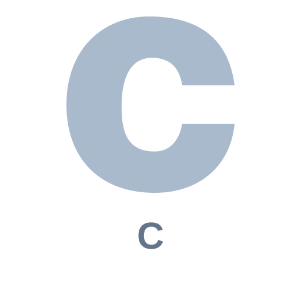
    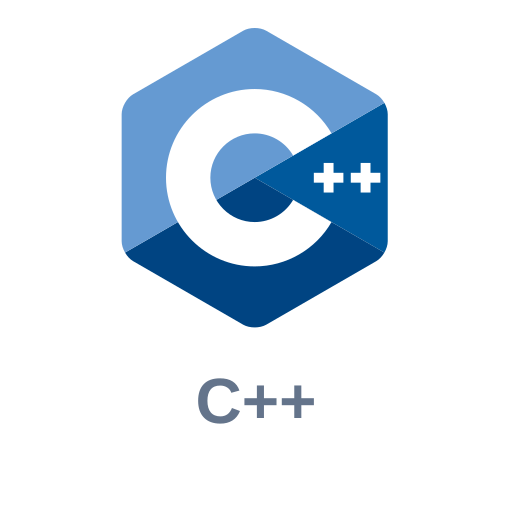
    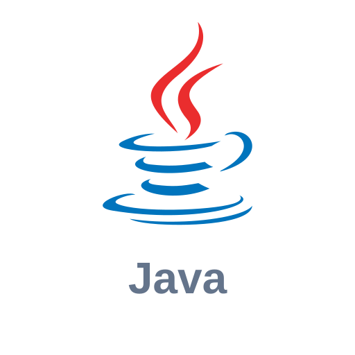
    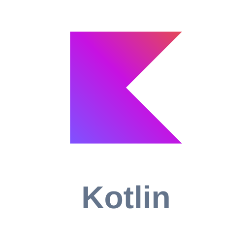
    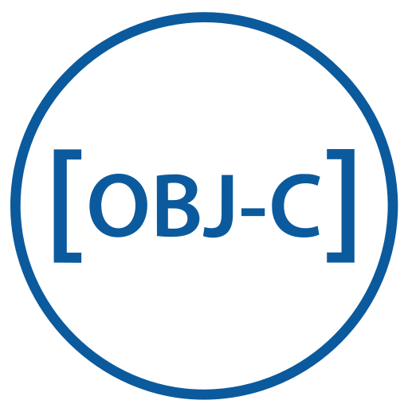
    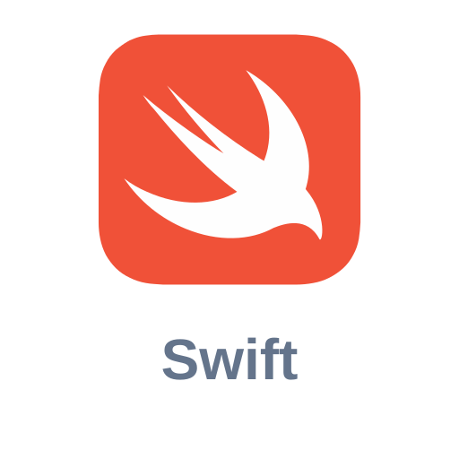
    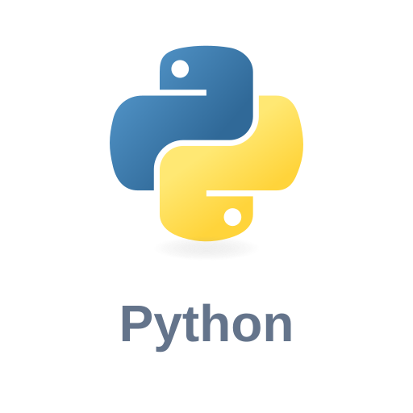
    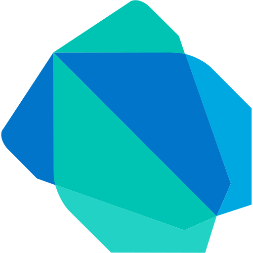
    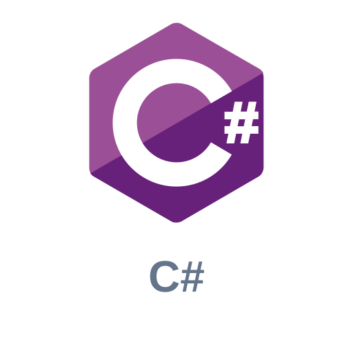
    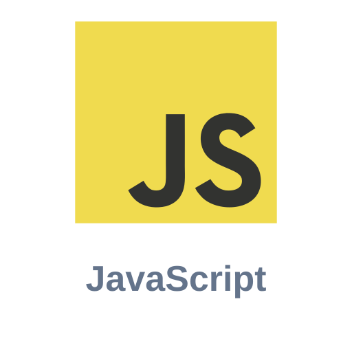
    

## Platforms

    
    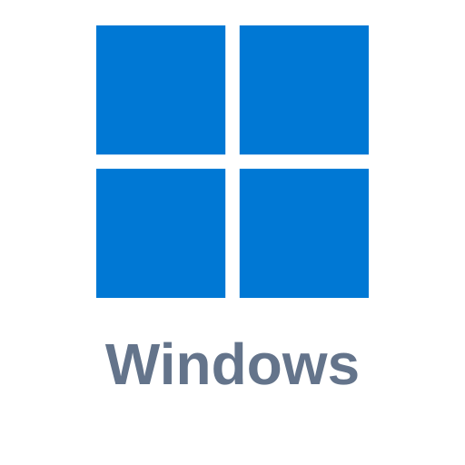
    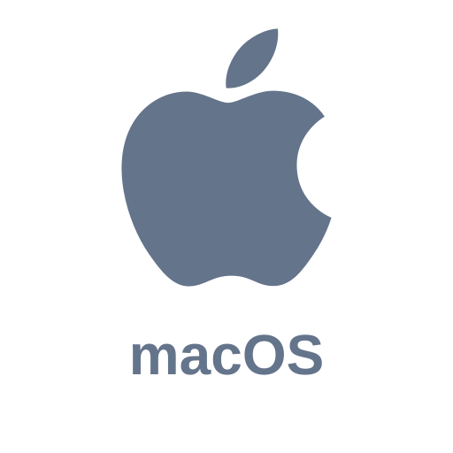
    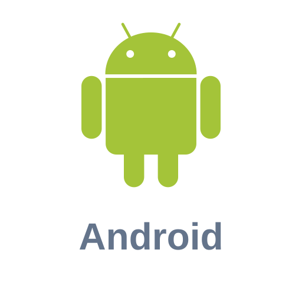
    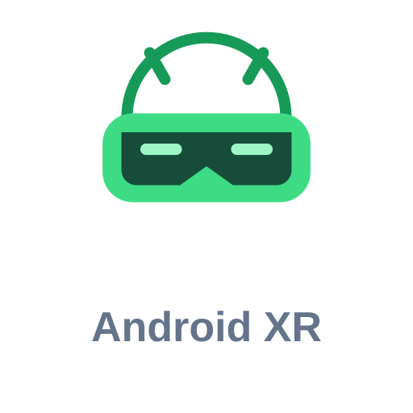
    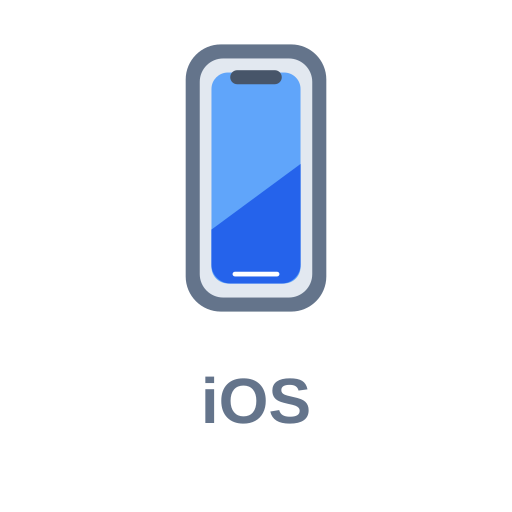
    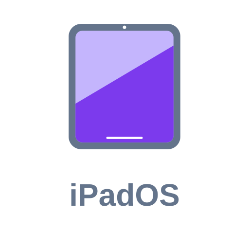
    
    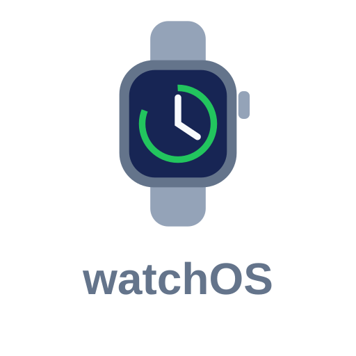
    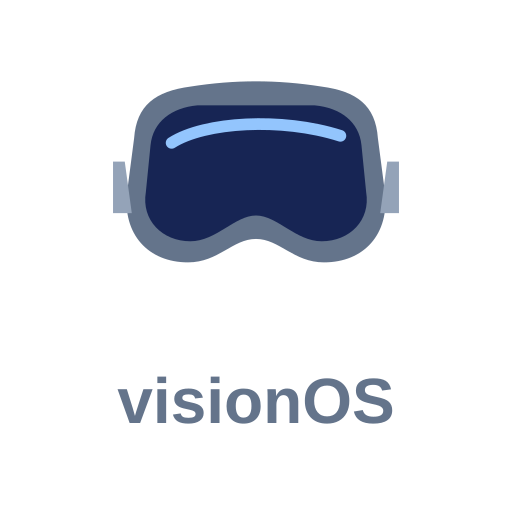
    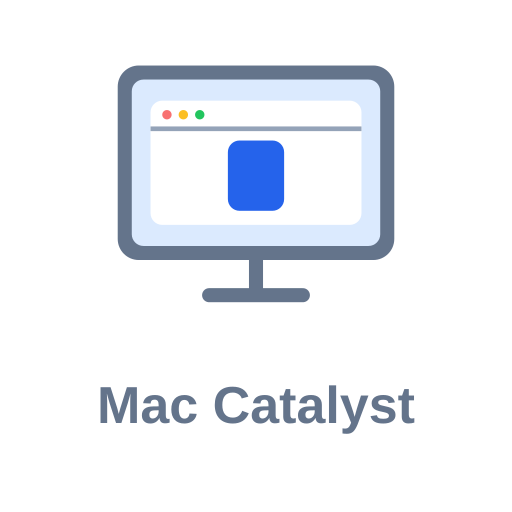
    
    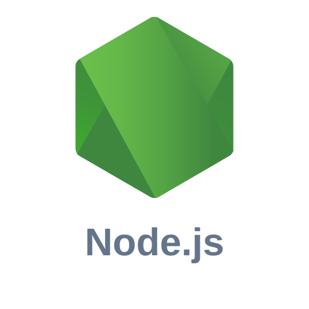
    
    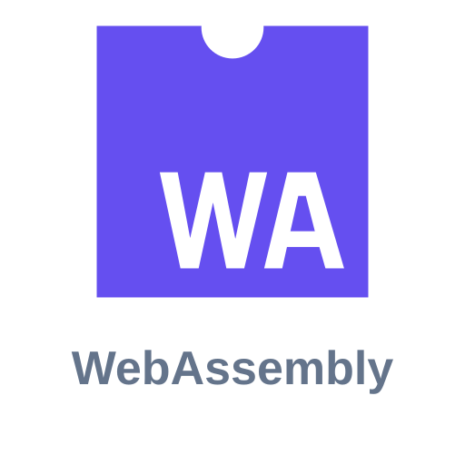

Choose the languages and targets for your project and compile the generated code with the appropriate toolchains. See the [target matrix](PROJECT.md#2-supported-languages-and-platforms) for runtime and build coverage.

## Documentation

- [Project specification](PROJECT.md) — architecture, types, diagrams, examples and roadmap.
- [Engineering guidelines](AGENTS.md) — development and contribution rules.

## Contributing

Report bugs or suggest improvements through [GitHub Issues](https://github.com/polyglue/polyglue/issues). Read [AGENTS.md](AGENTS.md) before contributing.

## Support

Support the ongoing development of this project through [GitHub Sponsors](https://github.com/sponsors/paulocoutinhox) or [Ko-fi](https://ko-fi.com/paulocoutinho).

## License

This project is licensed under the [MIT License](LICENSE).

Made with ❤️ by [Paulo Coutinho](https://github.com/paulocoutinhox).
