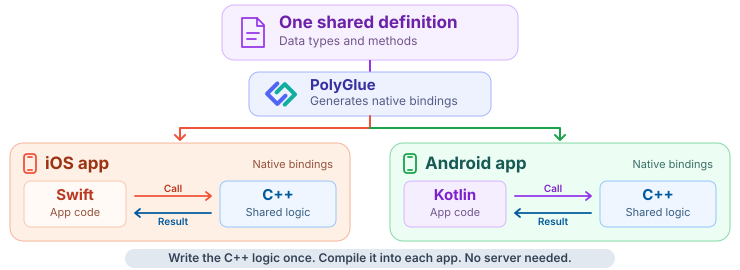

     
    <strong>PolyGlue</strong> 
    Connect programming languages with native, type-safe code generation. 
    Version 0.0.1 · In development

### Project

PolyGlue is a code generator that allows different programming languages to call each other's methods and exchange data within the same application.

Define your data types and interfaces once in a common definition language (IDL). PolyGlue generates the native bindings for each selected language, removing the need to write and maintain the connecting code by hand.

Implement a feature in one language and call it from another, without a server or mandatory JSON serialization.

    

> PolyGlue is in early development. The features and targets below are planned, not verified support.

### Features

- 🔗 **Native bindings:** type-safe calls and implementations in both directions.
- 🧩 **Modular IDL:** reusable records, enums, interfaces, variants and generic types.
- 📚 **Type system:** collections, nullable values, UTC timestamps and typed results.
- 🧬 **Custom types:** extend the type system with your own adapters.
- ⚡ **Async:** asynchronous methods, callbacks, streams and cancellation.
- 💾 **Memory:** borrowed views, owning references and zero-copy buffers where supported.
- 🔄 **Services:** optional registration, discovery and replacement of implementations.
- 🎨 **Customization:** module-specific naming, prefixes, annotations and template overrides.
- 🛠️ **Build tools:** generate, compile and test with one Python command-line tool.
- 📦 **SDK packaging:** versioned native libraries, AARs, XCFrameworks and language packages.
- ☁️ **Deploy:** upload validated SDKs to Amazon S3, Cloudflare R2 and compatible storage.

### Supported languages and platforms

**Languages**

⚙️ C · ⚙️ C++ · ☕ Java · 🟣 Kotlin · 🍎 Objective-C · 🐦 Swift

🐍 Python · 🎯 Dart · 🟪 C# · 🟨 JavaScript · 🟦 TypeScript

**Integration targets**

🦋 Flutter · 🌐 WebAssembly

**Platforms**

🐧 Linux · 🪟 Windows · 🍎 macOS · 📱 iOS/iPadOS · 💻 Mac Catalyst

🤖 Android · 🥽 Android XR · 📺 tvOS · ⌚ watchOS · 🥽 visionOS

🌐 Web · 🟢 Node.js

See the [target matrix](PROJECT.md#2-supported-languages-and-platforms) for valid language and platform combinations.

### Documentation

- [Project specification](PROJECT.md) — architecture, types, diagrams, examples and roadmap.
- [Engineering guidelines](AGENTS.md) — development and contribution rules.

### Contributing

Report bugs or suggest improvements through [GitHub Issues](https://github.com/polyglue/polyglue/issues). Read [AGENTS.md](AGENTS.md) before contributing.

### Support

Support the ongoing development of this project through [GitHub Sponsors](https://github.com/sponsors/paulocoutinhox) or [Ko-fi](https://ko-fi.com/paulocoutinho).

### License

The license has not been finalized yet.

Made with ❤️ by [Paulo Coutinho](https://github.com/paulocoutinhox).
