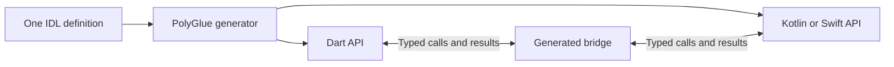

<p align="center">
    <a href="https://github.com/polyglue/polyglue" target="_blank" rel="noopener noreferrer"></a>
</p>

<h1 align="center">PolyGlue</h1>

<p align="center">
    One definition. Multiple languages. Native interoperability.
</p>

<p align="center">
    <strong>Version 0.0.1 — In development</strong>
</p>

## Project

Imagine a mobile app written in Flutter that needs to use an Android feature written in Kotlin and an iOS feature written in Swift. Normally, developers need to write connecting code for each language and keep their data models, method signatures and error handling in sync.

PolyGlue is designed to solve that problem. Define your data and methods once, then generate the code that connects the selected programming languages. Write the actual implementation in one language and use it from another.

The goal is to make native cross-language calls feel like ordinary method calls, without requiring a server or converting every call into JSON (a text-based data format).

> PolyGlue is in early development. The features, examples and targets below describe the planned design, not verified support.

## How it works

An IDL (Interface Definition Language) describes data and methods without choosing a programming language. A record groups related values, an enum names the possible choices, and an interface describes the methods an object must provide. The generator turns this definition into code for each selected language.

For example, suppose an app needs to find a user by ID. This is the proposed IDL for a small lookup API:

```text
module domain;

record User {
    id: int64;
    name: string;
    email: optional<string>;
    loggedIn: bool = false;
}

interface UserLookup {
    async findById(id: int64): optional<User>;
}
```

Here, User describes the data, optional means a value may be absent, and async means the operation may finish later. The generator creates the equivalent types and connecting code for the chosen languages. Your application provides the actual lookup implementation.



In this example, a Dart app calls `findById`, a Kotlin implementation looks up the ID, and the generated bridge returns a `User` to Dart. If there is no matching user, it returns an absent value. That is a successful lookup, not a failed call. The roles can also be reversed: a Kotlin app can call an implementation written in Dart when the runtimes support that direction. PolyGlue generates the connection, not the application's business logic.

## Features

- 🔗 **Native interoperability:** call and implement interfaces across languages.
- 🧩 **Modular IDL:** share data models and contracts between independent modules.
- 📚 **Rich types:** records, enums, collections, nullable values, timestamps in UTC and custom types.
- ⚡ **Asynchronous operations:** use native async APIs, callbacks, streams and cancellation.
- 💾 **Shared memory:** pass borrowed or owned buffers with clear lifetime rules.
- 🔄 **Service registry:** optionally register, find and replace implementations instead of passing them directly.
- 🎨 **Customization:** control naming, prefixes, annotations and templates per module.
- 🛠️ **Build tools:** generate, compile, test and package with one Python command-line tool.
- 📦 **SDK distribution:** produce versioned software development kits (SDKs), including Android AARs, Apple XCFrameworks and other language packages.
- ☁️ **Cloud deployment:** optionally upload validated SDKs to Amazon S3, Cloudflare R2 or compatible object storage.
- ✅ **Quality:** verify real cross-language calls, memory safety and packaged consumers.

## Supported languages and platforms

The following targets are planned. A combination is confirmed only after its required build and runtime tests pass.

### Languages

C, C++, Java, Kotlin, Objective-C, Swift, Python, Dart, C#, JavaScript and TypeScript.

Flutter and WebAssembly are integration targets. Flutter uses Dart, and WebAssembly provides a native execution boundary for web bindings.

### Platforms

| Platform | Primary targets |
| --- | --- |
| 🐧 Linux | C, C++, Java, Kotlin, Python, Dart, Flutter, C# |
| 🪟 Windows | C, C++, Java, Kotlin, Python, Dart, Flutter, C# |
| 🍎 macOS | C, C++, Objective-C, Swift, Java, Kotlin, Python, Dart, Flutter, C# |
| 🤖 Android | C, C++, Java, Kotlin, Dart, Flutter |
| 🥽 Android XR | C, C++, Java, Kotlin |
| 📱 iOS and iPadOS | C, C++, Objective-C, Swift, Dart, Flutter |
| 📺 tvOS | C, C++, Objective-C, Swift |
| ⌚ watchOS | C, C++, Objective-C, Swift |
| 🥽 visionOS | C, C++, Objective-C, Swift |
| 💻 Mac Catalyst | C, C++, Objective-C, Swift |
| 🌐 Web (browser) | C/C++ through WebAssembly, JavaScript, TypeScript, Dart, Flutter Web |
| Node.js | C/C++ through WebAssembly, JavaScript, TypeScript |

## Workflow

Define → Generate → Build → Test → Package → Deploy (optional).

Start with an IDL contract, choose your languages, generate the bindings, implement your methods and test the resulting SDK. Packaging and cloud deployment are separate steps.

## Documentation

- [Project specification](PROJECT.md) — start here to understand the full design, type mappings, examples and feature flowcharts.
- [Engineering and contribution rules](AGENTS.md) — code standards, architecture, type mappings and validation rules.

Installation instructions and runnable examples will be added as implementation is verified. No package has been released yet.
